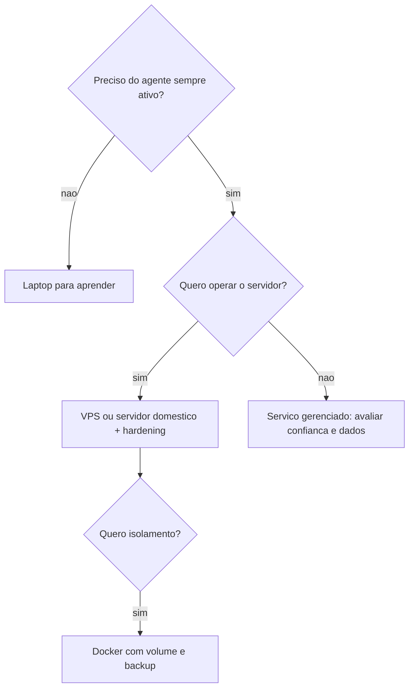

# Autohospedado versus serviço gerenciado

## Objetivo

Comparar rodar o Gateway por conta própria (laptop, servidor doméstico, VPS, contêiner) com depender de um serviço gerenciado, destacando responsabilidades que mudam de mãos.

## Explicação

> [!warning] Cobertura
> Esta nota trata de **opções de hospedagem documentadas** (laptop, VPS, Docker, plataformas de nuvem listadas no guia de instalação). A existência e o preço de um serviço gerenciado oficial **não foram confirmados** na documentação lida; um artigo de terceiros cita um plano de nuvem pago, sem verificação. Trate "serviço gerenciado" aqui como categoria geral.

### Opções de hospedagem

| Opção | Controle | Disponibilidade | Esforço | Observações |
|---|---|---|---|---|
| Laptop ou desktop | Total | Só quando ligado | Baixo | Bom para aprender; dorme e perde mensagens |
| Servidor doméstico (Mac mini, Raspberry Pi) | Total | Alta se estável | Médio | Rede doméstica entra na fronteira de confiança |
| VPS | Total no SO | Alta | Médio a alto | Segurança do host é sua; fonte da verdade |
| Contêiner (Docker/Podman) | Alto | Alta | Médio | Volume de estado e `DOCKER-USER` exigem atenção |
| Plataformas da lista oficial (Fly.io, Railway, Render etc.) | Médio | Alta | Médio | Cada uma tem guia próprio |
| Serviço gerenciado (categoria) | Menor | Do provedor | Baixo | Você delega operação, mas também confia credenciais e dados |

### O que muda de mãos

- **Atualizações e patches:** autohospedado = você (veja [[Atualizar o OpenClaw e escolher o canal de release]]).
- **Backups:** você (veja [[Backup e restauração do estado]]).
- **Segurança do host e da rede:** você.
- **Confidencialidade:** no autohospedado, os dados ficam sob seu controle, mas **mensagens vão ao provedor de modelo** de qualquer forma, a menos que use modelo local.
- **Custo:** hospedagem (zero a algumas dezenas de dólares por mês, conforme o caso) + custo de modelo, que costuma dominar.



## Exemplo prático

Checklist para decidir (marque honestamente):

```text
[ ] Tenho tempo mensal para atualizar, auditar e testar restauracao?
[ ] Sei configurar firewall, SSH por chave e Tailscale/tunel?
[ ] Os dados tratados podem sair para um terceiro? (se nao: autohospedado + modelo local)
[ ] Preciso de SLA? (se sim: avalie opcoes gerenciadas com contrato)
Se marcou 3 ou mais "nao" nas duas primeiras: considere comecar no laptop ou em servico gerenciado.
```

## Armadilhas comuns

- Subestimar a carga de manutenção do VPS.
- Achar que autohospedado garante privacidade total (o provedor de modelo vê os prompts).
- Usar o mesmo host para o agente e para serviços pessoais.
- Escolher gerenciado sem ler onde ficam as credenciais.

## Resumo

- Autohospedado = controle + responsabilidade.
- Gerenciado = conveniência + confiança em terceiro (verifique).
- Privacidade depende também do provedor de modelo.

## Relacionados

- [[Hospedar em um VPS com segurança]]
- [[Docker - instalar o Gateway em contêiner]]
- [[Modelo de segurança do OpenClaw - um operador, uma fronteira]]
- [[Rotina de manutenção e checklist de operação]]
- [[Modelos locais versus APIs de nuvem]]

## Exercícios

1. Que responsabilidades passam a ser suas ao autohospedar?
2. Por que autohospedar não garante privacidade total?
3. Que critério levaria você a escolher VPS em vez do laptop?
4. Que informações faltam para avaliar um serviço gerenciado?
