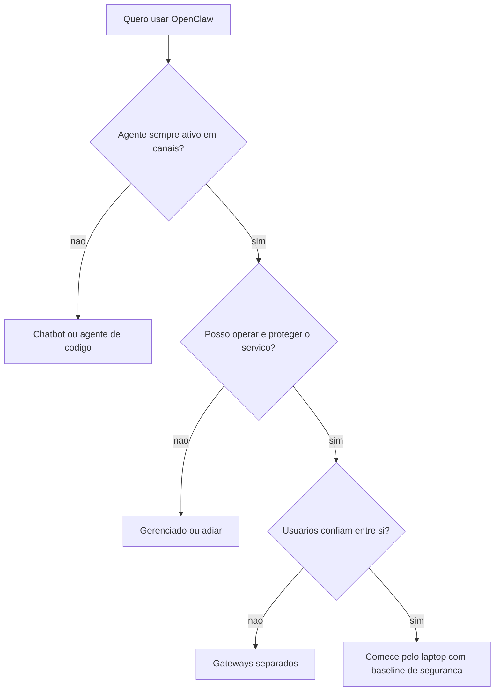

# Matriz de decisão - quando usar e quando não usar o OpenClaw

## Objetivo

Oferecer uma matriz objetiva para decidir se o OpenClaw é a ferramenta certa, quando é melhor outra e quando é melhor não usar agentes autônomos.

## Explicação

Critérios derivados da documentação (modelo de confiança, canais, automações, requisitos de operação) e do que a série cobriu.

### Bons candidatos

| Sinal | Por quê |
|---|---|
| Quer um agente **sempre ativo** em apps de mensagens | Gateway, canais e automações são o núcleo |
| Aceita operar um serviço (atualizar, auditar, fazer backup) | Autohospedado exige rotina |
| Valoriza controle e inspeção (arquivos Markdown, licença MIT) | Memória e skills são texto legível |
| Trabalha sozinho ou numa equipe que confia entre si | Uma fronteira de confiança por Gateway |
| Quer escolher e trocar provedores e modelos | Referências `provedor/modelo`, fallbacks |

### Candidatos fracos

| Sinal | Alternativa |
|---|---|
| Só precisa conversar e pesquisar | Chatbot hospedado |
| Trabalha só em repositórios de código | Agente de código em terminal/IDE |
| Usuários mutuamente hostis compartilhando o agente | Gateways separados ou outra arquitetura |
| Não tem tempo para manutenção e segurança | Serviço gerenciado ou nenhum agente |
| Exige garantia contratual (SLA, conformidade) | Soluções com contrato; avaliar riscos |
| Ações irreversíveis de alto valor sem humano no ciclo | Não automatize |



## Exemplo prático

Pontue de 0 a 2 cada pergunta e some:

```text
1. Preciso do agente sempre ativo em canais?            (0 nao, 1 as vezes, 2 sim)
2. Tenho 1h/mes para manutencao e seguranca?            (0 nao, 1 talvez, 2 sim)
3. Os usuarios do agente confiam uns nos outros?        (0 nao, 1 parcial, 2 sim)
4. Consigo manter humano no ciclo para acoes criticas?  (0 nao, 1 as vezes, 2 sim)
5. Aceito que o provedor de modelo veja meus prompts (ou uso modelo local)? (0 nao, 2 sim)

8-10: bom candidato | 5-7: comece pequeno, so leitura | 0-4: reavalie
```

> [!tip] Comece pequeno
> Mesmo com pontuação alta, comece pelo caso de menor risco (veja [[Mapa de casos de uso - o que a comunidade constrói]]) e abra permissões gradualmente.

## Armadilhas comuns

- Decidir por entusiasmo e popularidade da ferramenta.
- Ignorar o custo operacional recorrente.
- Subestimar o risco de dar a um agente acesso a dinheiro e contas.
- Não definir o que seria "sucesso" antes de começar.

## Resumo

- OpenClaw brilha em agente sempre ativo, com controle e rotina de operação.
- Outras ferramentas servem melhor conversa pura ou trabalho em repositório.
- Pontue, comece pequeno e mantenha humano no ciclo.

## Relacionados

- [[Para quem é o OpenClaw e o que ele exige]]
- [[Modelo de segurança do OpenClaw - um operador, uma fronteira]]
- [[Mapa de casos de uso - o que a comunidade constrói]]
- [[OpenClaw, chatbots hospedados e Claude Code - quem faz o quê]]
- [[Autohospedado versus serviço gerenciado]]

## Exercícios

1. Cite três sinais de que o OpenClaw é boa escolha.
2. Em que situações você evitaria um agente autônomo?
3. Aplique a pontuação ao seu caso e interprete.
4. Que métricas definiriam "sucesso" do seu primeiro mês?
