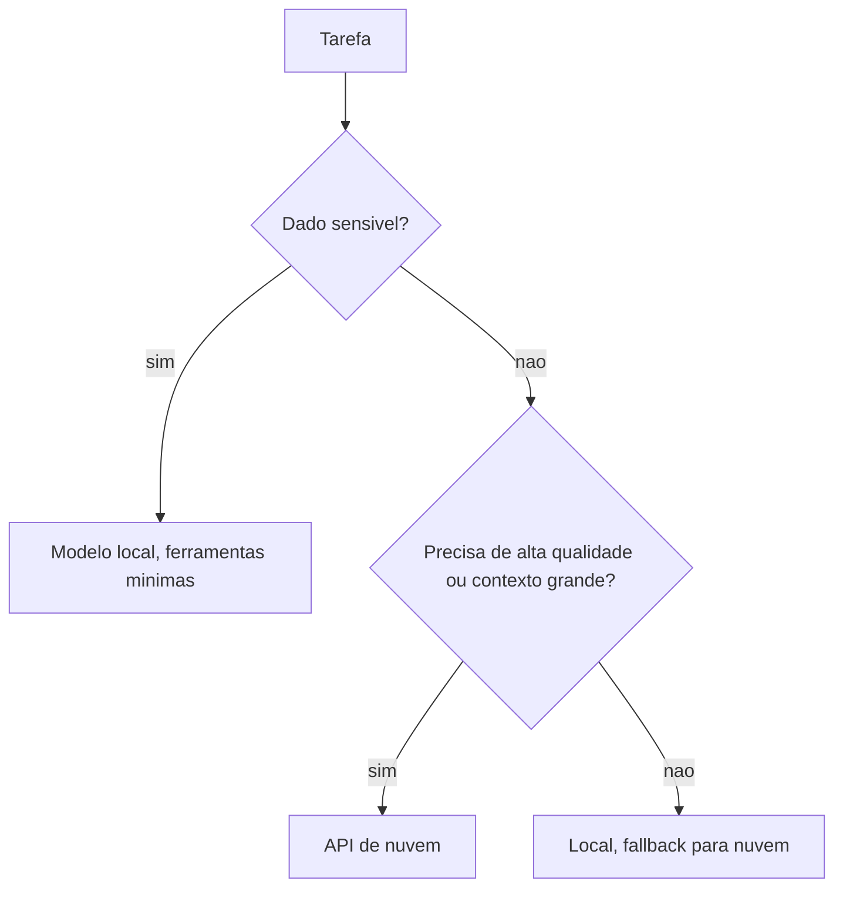

# Modelos locais versus APIs de nuvem

## Objetivo

Decidir entre rodar modelos na sua máquina ou usar APIs de nuvem, pesando privacidade, qualidade, custo, latência e segurança do agente.

## Explicação

| Critério | Modelo local (Ollama, llama.cpp) | API de nuvem |
|---|---|---|
| Privacidade | Dados ficam no seu host | Prompts vão ao provedor |
| Custo variável | Zero por token; custo de hardware e energia | Por token; escala com o uso |
| Qualidade em tarefas complexas | Em geral menor com modelos que cabem em hardware doméstico | Modelos de fronteira, em geral superiores |
| Contexto e velocidade | Limitados por memória e GPU | Janelas grandes, latência estável |
| Disponibilidade | Depende do seu host | Depende do provedor e da sua conta |
| Resistência à injeção de prompt | **Mais baixa em modelos menores**, segundo a doc de ameaças | Melhor em modelos de fronteira, mas não é garantia |
| Operação | Você baixa, atualiza e monitora | Gerenciada |

> [!info] O que a documentação confirma
> O OpenClaw usa referências `provedor/modelo`, suporta Ollama (com `baseUrl` nativa, sem `/v1`) e llama.cpp gerenciado, e permite `fallbacks`. A doc de ameaças afirma que modelos menores são mais fáceis de conduzir por injeção. As afirmações de qualidade e custo acima são **generalizações do autor**; meça no seu caso.

### Estratégias híbridas

1. **Local primeiro, nuvem como fallback** para tarefas simples e continuidade (veja [[Projeto - Modelo local com Ollama e fallback]]).
2. **Nuvem para o que exige qualidade ou segurança**, local para rotinas de baixo risco.
3. **Agentes separados**: um local para dados sensíveis sem ferramentas perigosas; outro na nuvem para tarefas complexas.



## Exemplo prático

Medição simples (faça antes de decidir):

```text
1. Escolha 10 tarefas reais suas (resumo, extracao, classificacao, resposta em canal).
2. Rode cada uma no modelo local e no de nuvem.
3. Anote: acertou? tempo? custo estimado (/usage cost)? precisou de retrabalho?
4. Decida por categoria de tarefa, nao globalmente.
```

```bash
openclaw models set ollama/<modelo-local>
openclaw agent --message "classifique este texto: ..."
openclaw models set <provedor>/<modelo-de-nuvem>
openclaw agent --message "classifique este texto: ..."
/usage cost
```

(O último comando é um comando de chat, não de shell.)

## Armadilhas comuns

- Escolher local "por privacidade" e liberar ferramentas poderosas a um modelo fraco.
- Fallback de nuvem recebendo dados que deveriam ficar locais.
- Ignorar o custo real de hardware e energia.
- Contexto pequeno do modelo local truncando a conversa sem você notar (veja [[Orçamento de bootstrap e tamanho do contexto]]).

## Resumo

- Local = privacidade e custo marginal zero; nuvem = qualidade e simplicidade.
- Modelos menores resistem menos a injeção.
- Híbrido por categoria de tarefa, com medição.

## Relacionados

- [[Modelos locais - Ollama e llama.cpp]]
- [[Custo e escolha de modelo]]
- [[Failover de modelos e fallbacks]]
- [[Provedores, referências de modelo e a CLI models]]
- [[Projeto - Modelo local com Ollama e fallback]]

## Exercícios

1. Que riscos de segurança são maiores com modelos locais pequenos?
2. Como o fallback de nuvem pode quebrar a promessa de privacidade?
3. Planeje um teste comparativo com cinco tarefas.
4. Em que situação você usaria agentes separados local e nuvem?
