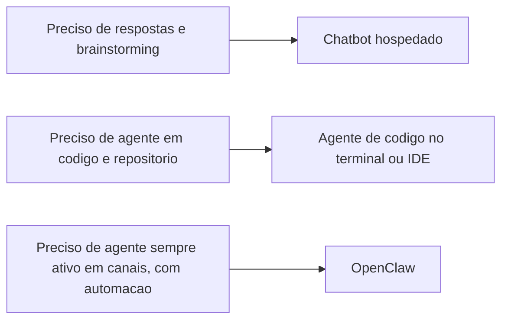

# OpenClaw, chatbots hospedados e Claude Code - quem faz o quê

## Objetivo

Posicionar o OpenClaw frente a chatbots hospedados e a agentes de código como o Claude Code, separando **fatos documentados** de **opinião**, sem tratar a comparação como ranking.

## Explicação

> [!warning] Fonte e viés
> A tabela usa um artigo de terceiros (Fast.io, comparação OpenClaw vs Claude Code), cuja própria origem é comercial (a empresa vende armazenamento para agentes). Eu separei o que o artigo apresenta como dado do que é julgamento. **Versões de modelos, preços e contagens citadas podem estar desatualizadas.** Verifique nos sites oficiais antes de decidir.

| Dimensão | OpenClaw | Claude Code (segundo o artigo) |
|---|---|---|
| Propósito | Assistente geral, que também pode programar | Agente de programação |
| Interface | Aplicativos de mensagens (muitos canais) | Terminal, IDEs, apps desktop e web |
| Hospedagem | Autohospedado, na sua máquina | Infraestrutura da Anthropic com CLI local |
| Modelos | Vários provedores e modelos locais | Modelos da Anthropic |
| Segurança | Autogerida: você atualiza e audita skills | Permissões por ação e restrições no nível do SO |
| Custo | Software MIT gratuito + custo de modelo | Assinatura ou API |

### O que é fato verificável e o que é julgamento

- **Fato (da doc do OpenClaw):** autohospedado, licença MIT, Gateway único, múltiplos canais e provedores (veja [[Principais capacidades do OpenClaw]] e [[Licença MIT e OpenClaw Foundation]]).
- **Julgamento do artigo:** "a postura de segurança do Claude Code é mais forte", "OpenClaw tem pouca compreensão de base de código", tempos de instalação e faixas de custo. São avaliações sem benchmark citado.
- **Relatos externos não verificados aqui:** o artigo cita uma vulnerabilidade com CVSS 8.8 e mais de 135 mil instâncias expostas, e um plano de nuvem pago do OpenClaw; **não confirmei** esses itens na documentação oficial.

### Chatbot hospedado versus agente autohospedado

Um chatbot responde dentro de uma janela; o OpenClaw é um **processo sempre ativo** com canais, memória em arquivos, ferramentas e automações (veja [[O OpenClaw versus um chatbot]]). A troca: mais capacidade e controle, mais responsabilidade operacional e de segurança.



## Exemplo prático

Decisão por tarefa (avaliação do autor):

```text
"Refatorar este modulo e rodar os testes"         -> agente de codigo
"Resumir minhas conversas e me lembrar amanha 9h"  -> OpenClaw (canal + automacao + memoria)
"Explicar um conceito de forma didatica"          -> chatbot
"Monitorar falha de CI e avisar a equipe no chat" -> OpenClaw (webhook + canal)
```

Também é comum **combinar**: usar o OpenClaw como camada de canais e automações e um agente de código para tarefas de repositório.

## Armadilhas comuns

- Tratar um artigo comparativo (com viés comercial) como fonte técnica.
- Comparar custo sem contar sua hora de operação e o custo de tokens.
- Assumir que "autohospedado" é sinônimo de "mais seguro".
- Esperar que um chatbot ou um agente de código faça o papel de serviço sempre ativo.

## Resumo

- Propósitos diferentes: conversa, código, agente sempre ativo.
- Separe fatos documentados de julgamentos.
- Combinar ferramentas é válido.

## Relacionados

- [[O OpenClaw versus um chatbot]]
- [[Principais capacidades do OpenClaw]]
- [[Para quem é o OpenClaw e o que ele exige]]
- [[Licença MIT e OpenClaw Foundation]]
- [[Matriz de decisão - quando usar e quando não usar o OpenClaw]]

## Exercícios

1. Que dimensões diferenciam um chatbot de um agente autohospedado?
2. Por que desconfiar de comparativos publicados por empresas do ramo?
3. Dê um exemplo de tarefa adequada a cada uma das três categorias.
4. Que itens da tabela exigem verificação nas fontes oficiais?
