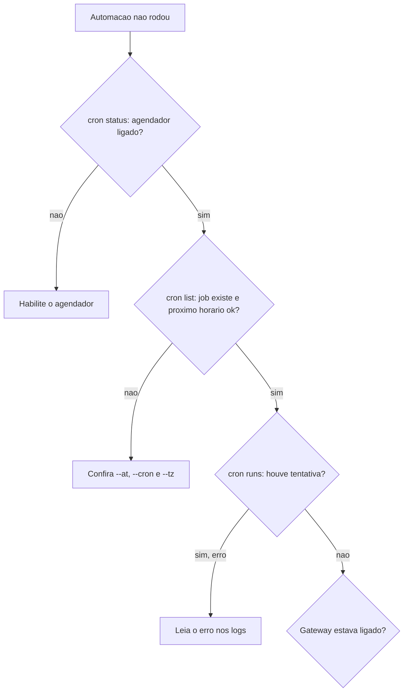

# Automações e heartbeat que não disparam

## Objetivo

Descobrir por que uma automação agendada ou o heartbeat não rodou, usando os comandos e as razões de "skipped" documentadas.

## Explicação

Comandos da doc de troubleshooting: `openclaw status`, `openclaw gateway status`, `openclaw cron status`, `openclaw cron list`, `openclaw cron runs --id <jobId> --limit 20` e `openclaw logs --follow` (`openclaw cron` é alias de `openclaw automations`). Esperado: o agendador habilitado com próximo despertar, entradas recentes `ok` e heartbeat habilitado dentro do horário ativo.

| Assinatura | Significado |
|---|---|
| `cron: scheduler disabled; jobs will not run automatically` | O agendador está desligado |
| `heartbeat skipped` + `quiet-hours` | Fora do horário ativo |
| `heartbeat skipped` + `empty-heartbeat-file` | `HEARTBEAT.md` só tem conteúdo vazio ou comentários |
| `heartbeat skipped` + `no-tasks-due` | Nenhum intervalo de tarefa venceu ainda |
| `heartbeat skipped` + `alerts-disabled` | `showOk`, `showAlerts` e `useIndicator` estão todos desligados |
| `requests-in-flight` | A pista principal está ocupada; o heartbeat foi adiado |
| `unknown accountId` | A conta de entrega do heartbeat não existe |

### Checagens adicionais (da doc de agendamento)

- Timestamps sem offset são **UTC**: um `--at` "no passado" pode ser só erro de fuso.
- Cron sem `--tz` usa o fuso do host do Gateway.
- Expressões no topo da hora têm escalonamento de até 5 minutos (`--exact` desativa).
- O Gateway precisa estar **ligado** na hora marcada (veja [[O Gateway como serviço em segundo plano]]).
- Jobs que dependem de `exec` sem humano para aprovar ficam parados ou são negados (veja [[Aprovações de exec e allowlists]]).



## Exemplo prático

```bash
openclaw cron status
openclaw cron list
openclaw cron runs --id <jobId> --limit 20
openclaw logs --follow
```

Teste rápido de que o mecanismo funciona, com um lembrete único para daqui a pouco:

```bash
openclaw automations create "5m" --name "Teste" --session main \
  --system-event "Teste de automacao: responda OK" --wake now --delete-after-run
```

## Armadilhas comuns

- Esperar execução às 7h locais com `--at` sem offset (é UTC).
- `HEARTBEAT.md` apenas com comentários: sempre `empty-heartbeat-file`.
- Gateway em máquina que dorme.
- Esquecer que `quiet-hours` suprime o heartbeat de propósito.

## Resumo

- `cron status` → `list` → `runs` → logs.
- Fuso, horário ativo e Gateway ligado explicam a maioria dos casos.
- Cada razão de `heartbeat skipped` tem significado próprio.

## Relacionados

- [[Automações e cron - agendar tarefas do agente]]
- [[Hooks internos e webhooks HTTP de entrada]]
- [[Logs e diagnóstico]]
- [[Standing orders - autoridade permanente do agente]]
- [[O Gateway como serviço em segundo plano]]

## Exercícios

1. O que significa `empty-heartbeat-file`?
2. Por que um `--at` sem offset pode "não rodar"?
3. Que comando mostra o histórico de execuções de um job?
4. Por que jobs com `exec` e sem humano falham?
