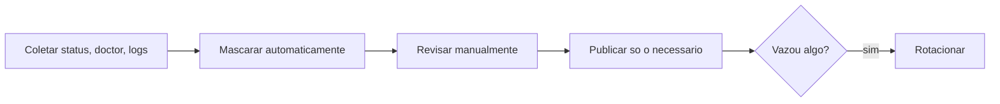

# Como pedir ajuda sem vazar segredos

## Objetivo

Reunir informações suficientes para que alguém ajude, sem expor chaves, tokens, mensagens privadas ou dados de terceiros.

## Explicação

A doc oferece relatórios feitos para compartilhar: `openclaw status --all` ("relatório completo que você pode compartilhar"), `openclaw doctor --json` (relatório somente leitura) e logs via `openclaw logs`. Ainda assim, **revise antes de colar**: a redação de segredos cobre padrões conhecidos (`logging.redactSensitive`, `redactPatterns`), mas texto livre de conversas, nomes, IDs de chat e caminhos pessoais podem passar.

### Pacote de informações recomendado

| Item | Como obter |
|---|---|
| Versão e sistema | `openclaw --version`, `uname -a` ou equivalente |
| Tipo de instalação | script, npm, Docker, app |
| Estado geral | `openclaw status --all` |
| Diagnóstico | `openclaw doctor --json` |
| Trecho de log do erro | `openclaw logs --limit 100 --plain` |
| O que mudou antes do erro | atualização, configuração, nova skill |
| Passos para reproduzir | numerados e mínimos |

### O que remover ou mascarar

- Tokens, chaves de API, senhas e URLs com credenciais.
- Tokens de bot, números de telefone, IDs de usuário e de chat.
- Conteúdo de conversas e nomes de pessoas.
- Caminhos que revelem nome de usuário ou da empresa.
- Valores de `docker.env` e saídas de `docker inspect`.

> [!danger] Se vazou, rotacione
> Se você colou um segredo em um fórum, issue ou chat, **considere-o comprometido**: troque-o agora (veja [[Checklist de hardening e resposta a incidentes]]).

## Exemplo prático

Gerar um pacote com mascaramento básico (revise o resultado manualmente):

```bash
{
  echo "== versao =="; openclaw --version
  echo "== status =="; openclaw status --all
  echo "== logs =="; openclaw logs --limit 100 --plain
} 2>&1 | sed -E \
  -e 's/(token|apikey|api_key|secret|password)[=: ]+[^ ]+/\1=<REMOVIDO>/Ig' \
  -e 's/[0-9]{8,}:[A-Za-z0-9_-]{20,}/<TOKEN-TELEGRAM>/g' \
  -e 's#/home/[^/ ]+#/home/<USUARIO>#g' > pacote-suporte.txt
less pacote-suporte.txt
```



## Armadilhas comuns

- Confiar só na redação automática.
- Colar o `openclaw.json` inteiro.
- Publicar capturas de tela com tokens visíveis.
- Pedir ajuda em canal público com dados de clientes nos logs.

## Resumo

- Use os relatórios feitos para compartilhar, mas revise.
- Pacote mínimo: versão, status, doctor, log, mudança recente, passos.
- Vazou? Rotacione.

## Relacionados

- [[Logs e diagnóstico]]
- [[Vazamento de credenciais e de dados - onde e como acontece]]
- [[Escada de diagnóstico do Gateway - status, logs e doctor]]
- [[Doctor e reparos do estado]]
- [[Checklist de hardening e resposta a incidentes]]

## Exercícios

1. Que comandos geram relatórios feitos para compartilhar?
2. O que você remove de um log antes de publicá-lo?
3. O que fazer se um token foi colado em público?
4. Monte o pacote de suporte para um problema fictício.
