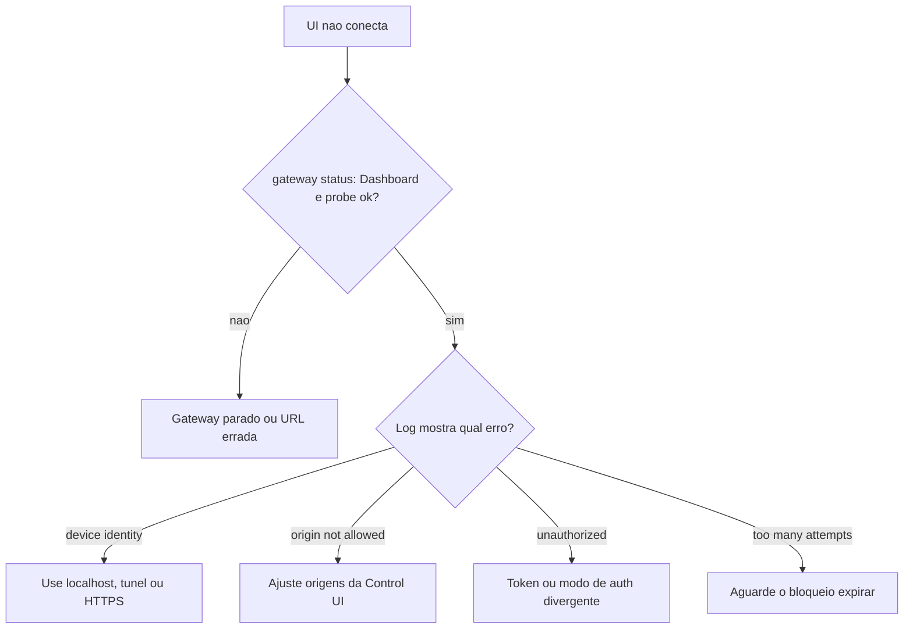

# Dashboard não conecta - origem, token e dispositivo

## Objetivo

Resolver falhas de conexão da Control UI interpretando as assinaturas de erro de autenticação e origem.

## Explicação

Comandos recomendados pela doc: `openclaw status`, `openclaw gateway status`, `openclaw logs --follow`, `openclaw doctor` e `openclaw channels status --probe`. O esperado é uma linha `Dashboard: http://...` em `gateway status`, `Connectivity probe: ok` e nenhum laço de autenticação nos logs.

| Assinatura | Causa provável | O que fazer |
|---|---|---|
| `device identity required` | Contexto HTTP não seguro não consegue concluir a autenticação do dispositivo | Use `localhost`, túnel SSH ou HTTPS |
| `origin not allowed` | O Origin do navegador não está permitido para a Control UI | Ajuste as origens permitidas da Control UI (chaves `gateway.controlUi.*`) |
| `AUTH_TOKEN_MISMATCH` com `canRetryWithDeviceToken=true` | Pode haver uma nova tentativa automática com token de dispositivo confiável | Aguarde; se persistir, veja a linha abaixo |
| `unauthorized` repetido | Token/senha errados, modo de autenticação divergente ou token de dispositivo pareado obsoleto | Confira `gateway.auth.mode` e o segredo; reemita o pareamento do dispositivo |
| `too many failed authentication attempts (retry later)` | Esse Origin foi bloqueado temporariamente | Espere e corrija a credencial |
| `gateway connect failed:` | URL ou porta errada, ou Gateway inalcançável | Confira bind, porta e túnel |



## Exemplo prático

Acesso remoto por túnel (o caminho recomendado para servidores):

```bash
ssh -N -L 18789:127.0.0.1:18789 usuario@servidor
# no navegador local: http://127.0.0.1:18789/
openclaw gateway status
openclaw dashboard
openclaw logs --follow
```

Se o token estiver em SecretRef, confirme que a variável existe no ambiente **do serviço** (não só do seu shell) e rode `openclaw secrets reload` depois de rotacionar.

## Armadilhas comuns

- Abrir a UI por `http://IP-DO-SERVIDOR:18789` em rede aberta: bloqueio por contexto não seguro e risco real.
- Tentar a senha várias vezes e disparar o bloqueio por Origin.
- Mudar `gateway.auth.mode` sem atualizar clientes e dispositivos já pareados.
- Copiar token com espaço ou quebra de linha.

## Resumo

- Cada assinatura de log aponta uma causa específica.
- Túnel SSH ou HTTPS resolvem o contexto não seguro.
- Alinhe modo de autenticação, segredo e dispositivos.

## Relacionados

- [[Control UI e dashboard]]
- [[Acesso remoto - SSH, Tailscale e modos de bind]]
- [[Configuração do Gateway em openclaw.json]]
- [[Gestão de segredos com SecretRef]]
- [[Superfície de rede - bind, autenticação e exposição]]

## Exercícios

1. O que indica `device identity required`?
2. Como contornar contexto HTTP não seguro sem abrir a porta?
3. O que fazer depois de `too many failed authentication attempts`?
4. Que variável de ambiente deve existir para o serviço usar um SecretRef?
