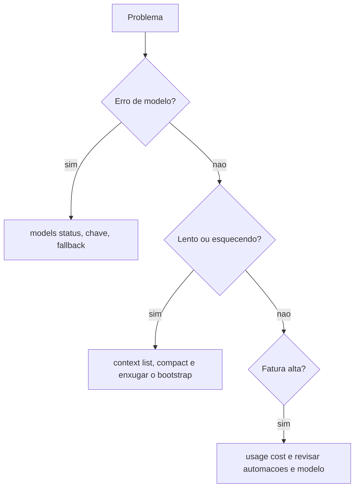

# Erros de modelo, contexto cheio e custo alto

## Objetivo

Diagnosticar três problemas relacionados: falhas de modelo/autenticação, respostas ruins ou lentas por contexto cheio, e custo de tokens acima do esperado.

## Explicação

### 1. Falhas de modelo e autenticação

```bash
openclaw models status
openclaw models list
openclaw doctor
openclaw logs --follow
```

`models status` mostra principal, fallbacks e estado de autenticação. Causas típicas: chave ausente ou expirada, modelo inexistente em `models list`, limite de taxa ou de tokens por minuto (a doc de failover descreve estágios e fallback), ou provedor local fora do ar (para Ollama, lembre da URL nativa sem `/v1`; veja [[Modelos locais - Ollama e llama.cpp]]). Com fallbacks configurados, o OpenClaw tenta o próximo modelo (veja [[Failover de modelos e fallbacks]]).

### 2. Contexto cheio

Sintomas: o agente "esquece" o início, responde mais devagar, repete-se. Ferramentas de chat confirmadas nas partes anteriores:

| Comando | Uso |
|---|---|
| `/context list` e `/context detail` | O que ocupa o contexto (skills, ferramentas, arquivos de bootstrap) |
| `/compact` | Resume turnos antigos |
| `/new` ou `/reset` | Começa uma sessão limpa |
| `/status` | Estado da sessão |

Reduza o contexto fixo: arquivos de workspace enormes, muitas skills elegíveis, esquemas de ferramentas desnecessários (veja [[Orçamento de bootstrap e tamanho do contexto]]).

### 3. Custo alto

Fatores citados na doc de uso de tokens: tamanho do contexto reenviado a cada turno, número de skills e ferramentas, resultados longos de ferramentas, modelo escolhido, frequência de automações. Medição: `/usage tokens`, `/usage full`, `/usage cost`, `/usage reset`.



## Exemplo prático

Rotina de uma passada, no chat e no shell:

```text
/status
/context list
/usage cost
```

```bash
openclaw models status
openclaw skills list --eligible
openclaw automations list
```

Cortes que costumam render mais: desativar skills que você não usa, reduzir a frequência de automações, mover tarefas simples para um modelo mais barato (veja [[Custo e escolha de modelo]]).

## Armadilhas comuns

- Aumentar a janela de contexto como única solução.
- Deixar automações a cada minuto com modelo caro.
- Não configurar fallback e ficar sem agente quando o provedor limita.
- Confiar em estimativas sem medir.

## Resumo

- `models status` para falhas; `/context` e `/compact` para contexto; `/usage` para custo.
- Menos contexto fixo, menos skills, automações com frequência sensata.
- Meça antes de otimizar.

## Relacionados

- [[Failover de modelos e fallbacks]]
- [[Poda de sessão e compactação]]
- [[Orçamento de bootstrap e tamanho do contexto]]
- [[Custo e escolha de modelo]]
- [[Modelos locais - Ollama e llama.cpp]]

## Exercícios

1. Que comando mostra o que está ocupando o contexto?
2. Que fatores aumentam o custo por turno?
3. Como um fallback ajuda quando o provedor limita a taxa?
4. Liste três cortes de custo que você aplicaria hoje.
