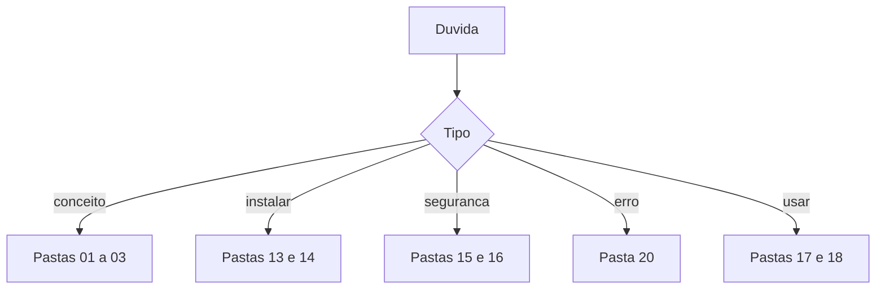

# FAQ - perguntas frequentes sobre o OpenClaw

## Objetivo

Responder em poucas linhas às dúvidas mais comuns, apontando a nota que aprofunda cada resposta. Respostas se baseiam nas fontes das partes anteriores; onde há incerteza, está dito.

## Explicação

**O que é o OpenClaw?** Um agente de IA autohospedado, de código aberto (licença MIT), criado por Peter Steinberger, antes chamado Clawdbot e Moltbot. Veja [[O que é o OpenClaw]] e [[Linha do tempo Clawdbot, Moltbot e OpenClaw]].

**Preciso saber programar?** Instalar e usar o básico não exige; operar com segurança (config, logs, backup, atualização) exige paciência e leitura. Veja [[Para quem é o OpenClaw e o que ele exige]].

**Onde roda?** Em macOS, Linux, Windows (nativo e WSL2), VPS e contêiner. Veja [[Requisitos e escolha do método de instalação]].

**Qual a porta padrão?** O Gateway escuta em `127.0.0.1:18789` por padrão. Veja [[O processo Gateway e a porta 18789]].

**Onde ficam meus dados?** Estado e configuração em `~/.openclaw` (perfis em `~/.openclaw-<perfil>`); workspace em `~/.openclaw/workspace`. Veja [[Onde o OpenClaw guarda estado em disco]].

**Quais modelos posso usar?** Vários provedores e modelos locais, no formato `provedor/modelo`. Veja [[Provedores, referências de modelo e a CLI models]].

**Meus dados vão para a nuvem?** As mensagens que o agente envia ao modelo vão ao provedor escolhido (a menos que use modelo local). Os arquivos do Gateway ficam na sua máquina. Veja [[Modelos locais versus APIs de nuvem]].

**É seguro?** Depende da configuração. Há padrões seguros (loopback, pareamento), mas o agente com ferramentas é uma superfície de risco. Veja [[Modelo de segurança do OpenClaw - um operador, uma fronteira]] e [[Linha de base endurecida em 60 segundos]].

**Posso compartilhar com outras pessoas?** Dentro de uma fronteira de confiança sim; entre usuários hostis, use Gateways separados.

**Como instalo skills com segurança?** Verifique, leia, fixe a versão, teste em perfil isolado. Veja [[A CLI openclaw skills]] e [[Skills e plugins maliciosos - o caso ClawHavoc]].

**Quanto custa?** O software é gratuito; você paga o modelo (e a hospedagem, se houver). Veja [[Custo e escolha de modelo]].

**Como atualizo e faço backup?** `openclaw update` e `openclaw backup create --verify`. Veja [[Atualizar o OpenClaw e escolher o canal de release]] e [[Backup e restauração do estado]].

**Não responde, e agora?** Siga a escada de comandos em [[Sem resposta no chat - pareamento, menção e allowlist]].

## Exemplo prático

Teste de conhecimento em um minuto: sem olhar, responda a porta padrão, o comando que valida a configuração e o que fazer ao ver `pairing request` nos logs. Depois confira nas notas (`openclaw config validate`; `openclaw pairing approve <canal> <CODIGO>`).

## Armadilhas comuns

- Procurar respostas em domínios parecidos com o oficial (veja [[Nomes antigos, domínios falsos e como verificar a fonte]]).
- Tratar blogs como documentação oficial.
- Confiar em tutoriais antigos: os comandos mudam entre versões (calendário v2026.10.x).
- Pular a leitura de segurança porque "é só um bot".

## Resumo

- Respostas curtas com ponteiros para as notas.
- Fonte principal: docs.openclaw.ai; confira a versão.
- Dúvida persistente: abra a pasta 20 e a escada de diagnóstico.

## Relacionados

- [[O que é o OpenClaw]]
- [[Para quem é o OpenClaw e o que ele exige]]
- [[Requisitos e escolha do método de instalação]]
- [[Modelo de segurança do OpenClaw - um operador, uma fronteira]]
- [[Como pedir ajuda sem vazar segredos]]

## Exercícios

1. Qual a porta padrão do Gateway e em que endereço?
2. Onde ficam os dados do OpenClaw no disco?
3. Quem vê o conteúdo das suas conversas quando se usa um provedor de nuvem?
4. Que passos seguir antes de instalar uma skill de terceiros?
