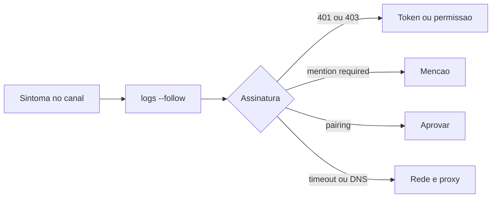

# Falhas por canal - Telegram, WhatsApp, Discord e Slack

## Objetivo

Reconhecer as assinaturas de falha específicas de cada canal e aplicar a correção documentada.

## Explicação

Escada da doc de canais: `openclaw status`, `openclaw gateway status`, `openclaw logs --follow`, `openclaw doctor`, `openclaw channels status --probe`. Saudável: `Runtime: running`, teste de conectividade bem-sucedido e transporte conectado (`works` ou `audit ok`).

**Após uma atualização**, se um canal "sumiu", rode `openclaw status --all`. A mensagem `plugin load failed: dependency tree corrupted; run openclaw doctor --fix` indica canal configurado que falhou ao carregar.

### WhatsApp

| Sintoma | Ação |
|---|---|
| Conectado, sem respostas em DM | `openclaw pairing list whatsapp`; aprove ou ajuste política/allowlist |
| Grupos ignorados | Verifique `requireMention` e padrões de menção |
| Login por QR expira (408) | Confira `HTTPS_PROXY`/`HTTP_PROXY` do Gateway; `NO_PROXY` só para exceções |
| Laços de desconexão/relogin | Observe logs, reinicie; se persistir, corrija a rede, faça backup da autenticação e revincule |
| Respostas atrasadas | `openclaw doctor --fix` (para clientes TUI locais obsoletos que atrasam o Gateway) |

### Telegram

| Sintoma | Ação |
|---|---|
| `/start` sem fluxo de resposta | `openclaw pairing list telegram` |
| Grupo mudo | Menção exigida e modo de privacidade do bot |
| Falhas de envio | DNS, IPv6 ou proxy para `api.telegram.org` |
| `getMe returned 401` | Regenere o token no BotFather e atualize `botToken`, `tokenFile` ou `TELEGRAM_BOT_TOKEN` |
| `BOT_COMMANDS_TOO_MUCH` | Reduza comandos personalizados ou desative menus nativos |
| Allowlist bloqueia após upgrade | `openclaw security audit`, depois `openclaw doctor --fix`, ou troque `@usuario` por IDs numéricos |

### Discord

| Sintoma | Ação |
|---|---|
| Bot online, sem respostas na guilda | `channels status --probe`; libere guilda/canal; confira a intent de conteúdo de mensagem |
| Silêncio em canais que funcionavam | Um mapa `channels` novo vira allowlist; adicione `"*"` |
| Não vê mensagens de outros bots | `requireMention` e `allowBots`; `"mentions"` é o mais seguro |
| Observa a sala mas não publica | `tools.alsoAllow: ["message"]` (perfis `minimal` e `coding` omitem) |

### Slack

Modo socket conectado sem respostas: `channels status --probe`, verifique os **dois** tokens e escopos (atenção a `configured_unavailable` com SecretRef). DMs bloqueadas: `pairing list slack`. Mensagens de canal ignoradas: `groupPolicy` e allowlist do canal.

## Exemplo prático

```bash
openclaw status --all
openclaw doctor --fix
openclaw gateway restart
openclaw channels status --probe
openclaw pairing list telegram
```



## Armadilhas comuns

- Regenerar o token e esquecer de atualizar a variável do **serviço**.
- Usar `@usuario` em allowlists em vez de ID numérico.
- Rodar vários clientes/TUIs antigos contra o mesmo Gateway.
- Aceitar `allowBots: true` sem necessidade.

## Resumo

- Cada canal tem assinaturas próprias e correções curtas.
- Após atualizar, `status --all` e `doctor --fix` resolvem falhas de carga.
- Allowlists por ID numérico; tokens atualizados no ambiente do serviço.

## Relacionados

- [[Telegram - configurar o bot passo a passo]]
- [[WhatsApp - vínculo por QR e cuidados]]
- [[Discord, Slack, Signal e iMessage - o que a doc oferece]]
- [[Sem resposta no chat - pareamento, menção e allowlist]]
- [[Doctor e reparos do estado]]

## Exercícios

1. O que significa `getMe returned 401` e como corrigir?
2. Por que um mapa `channels` novo no Discord pode silenciar canais antigos?
3. Que comando ajuda quando o WhatsApp responde com atraso?
4. Por que usar IDs numéricos em allowlists do Telegram?
