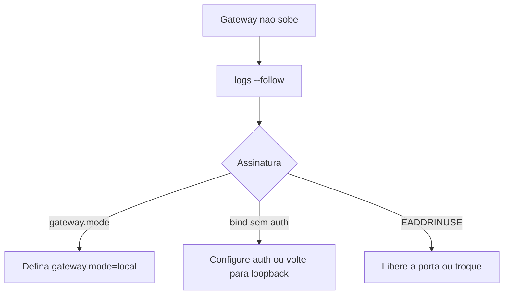

# Gateway não inicia - modo, bind e porta ocupada

## Objetivo

Descobrir por que o Gateway não sobe (ou o serviço está instalado, mas parado) e corrigir as três causas documentadas mais comuns.

## Explicação

Comandos: `openclaw status`, `openclaw gateway status`, `openclaw logs --follow`, `openclaw doctor`, `openclaw channels status --probe`. Esperado: `Service: ... (loaded)`, `Runtime: running`, `Connectivity probe: ok` e uma linha `Capability:`.

| Assinatura | Causa | Correção |
|---|---|---|
| `Gateway start blocked: set gateway.mode=local` ou `existing config is missing gateway.mode` | Modo remoto definido, ou falta o modo local | Defina `gateway.mode` como `local` (veja a baseline: `gateway: { mode: "local", ... }`) |
| `refusing to bind gateway ... without auth` | Bind além do loopback sem autenticação válida | Configure `gateway.auth.token` ou `password`, ou volte a `loopback` |
| `another gateway instance is already listening` ou `EADDRINUSE` | Porta já em uso | Pare a instância anterior ou use outra porta |

> [!info] Gateway no ar, canal parado
> Após reinícios sujos repetidos, um *disjuntor de crash loop* pode bloquear o auto-start de canais. A doc indica `openclaw gateway call channels.start --params '{"channel":"<id>"}'` para forçar; caso contrário, ele rechecka após a janela. Use só depois de entender por que houve reinícios sujos.



## Exemplo prático

```bash
openclaw gateway status
openclaw config get gateway
ss -ltnp | grep 18789          # quem esta usando a porta?
openclaw gateway stop
openclaw gateway start
openclaw doctor
openclaw logs --follow
```

Se a configuração parece corrompida, valide antes de qualquer reparo:

```bash
openclaw config validate
openclaw backup create --output ~/Backups/antes-do-reparo --verify
openclaw doctor --fix
```

## Armadilhas comuns

- Mudar `bind` para `lan` sem token: o Gateway **se recusa** a subir, por segurança.
- Duas instalações (npm e script) disputando a mesma porta.
- Rodar `--fix` sem backup.
- Procurar o erro só no console e não nos logs do serviço.

## Resumo

- Três assinaturas cobrem a maioria das falhas de partida.
- `gateway.mode`, autenticação no bind e porta livre.
- Backup antes de reparos.

## Relacionados

- [[O processo Gateway e a porta 18789]]
- [[O Gateway como serviço em segundo plano]]
- [[Instalação no Linux com systemd]]
- [[Resolver erros comuns do Gateway - tabela de sintomas]]
- [[Doctor e reparos do estado]]

## Exercícios

1. Que erro aparece ao fazer bind fora do loopback sem autenticação?
2. Como descobrir quem ocupa a porta 18789?
3. Por que fazer backup antes de `doctor --fix`?
4. Quando usar `channels.start` e que cautela ter?
