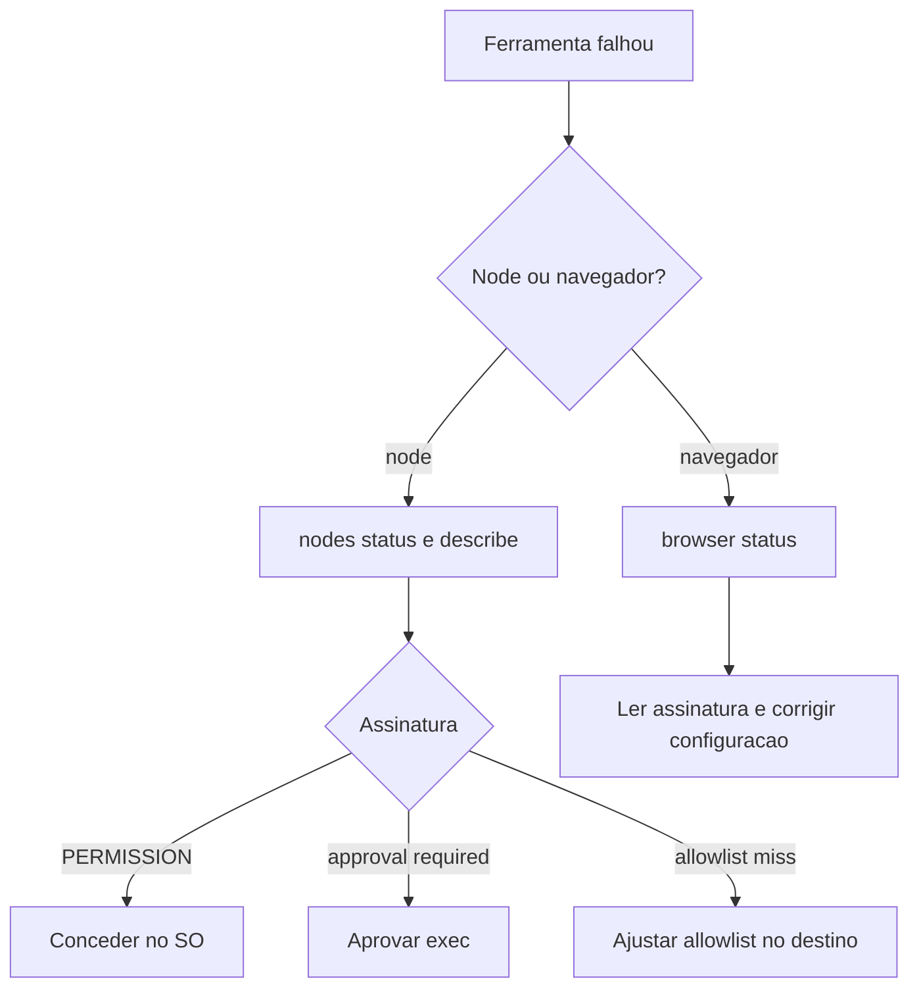

# Nodes e navegador falhando - sintomas e correções

## Objetivo

Corrigir falhas de nodes pareados (câmera, canvas, tela, exec) e da ferramenta de navegador com base nas assinaturas documentadas.

## Explicação

### Nodes pareados com ferramentas falhando

Comandos: `openclaw nodes status`, `openclaw nodes describe --node <id|nome|ip>`, mais `status`, `gateway status` e `logs --follow`. Esperado: node conectado e pareado com o papel `node`, capacidade disponível e permissão concedida.

| Assinatura | Causa e correção |
|---|---|
| `NODE_BACKGROUND_UNAVAILABLE` | Traga o app do node para o primeiro plano |
| `*_PERMISSION_REQUIRED` | Permissão do SO negada ou ausente: conceda no sistema |
| `SYSTEM_RUN_DENIED: approval required` | Há uma aprovação de exec pendente: aprove (se legítima) |
| `SYSTEM_RUN_DENIED: allowlist miss` | O comando não está na allowlist do host de destino |

Lembre que a aprovação de capacidades de um node é separada do pareamento do dispositivo: um node pareado pode não anunciar capacidades até a superfície pendente ser aprovada (`openclaw nodes pending`, `openclaw nodes approve <requestId>`).

### Ferramenta de navegador

Comandos: `openclaw browser status`, `status`, `gateway status`, `logs --follow`, `doctor`. Esperado: `running: true` com navegador e perfil selecionados; o perfil `openclaw` inicia ou o perfil `user` enxerga as abas locais do Chrome.

| Assinatura | Causa e correção |
|---|---|
| `unknown command "browser"` | `plugins.allow` exclui o plugin de navegador |
| `Failed to start Chrome CDP on port` | O navegador local falhou ao iniciar |
| `browser.executablePath not found` | Caminho do executável incorreto |
| `browser.cdpUrl must be http(s) or ws(s)` | Esquema de URL CDP não suportado |
| `browser.cdpUrl has invalid port` | Porta inválida ou fora do intervalo |
| `No Chrome tabs found for profile="user"` | Nenhuma aba local para anexar |
| `Remote CDP for profile "<nome>" is not reachable` | O host não alcança o endpoint CDP remoto |
| Substituições antigas (viewport, modo escuro, locale, offline) | `openclaw browser stop --browser-profile <nome>` limpa sem reiniciar o Gateway |



## Exemplo prático

```bash
openclaw nodes status
openclaw nodes describe --node meu-mac
openclaw nodes pending
openclaw browser status
openclaw browser stop --browser-profile openclaw
openclaw logs --follow
```

## Armadilhas comuns

- "Corrigir" `allowlist miss` liberando comandos amplos (veja [[Abuso de ferramentas e bypass de aprovações de exec]]).
- Aprovar pendências do node sem ler o que pedem.
- Usar o perfil `user` do navegador por conveniência e esquecer o risco de sessão real.
- Apontar `cdpUrl` para um endereço remoto sem TLS/autenticação.

## Resumo

- Nodes: primeiro plano, permissões do SO, aprovações e allowlist.
- Navegador: plugin habilitado, executável e CDP corretos.
- Corrija sem ampliar o risco.

## Relacionados

- [[Gateway, clientes e nodes]]
- [[Navegador gerenciado pelo agente]]
- [[Aprovações de exec e allowlists]]
- [[Superfícies de alto risco - elevated, navegador, nodes e hooks]]
- [[Abuso de ferramentas e bypass de aprovações de exec]]

## Exercícios

1. O que significa `SYSTEM_RUN_DENIED: allowlist miss`?
2. Que erro indica plugin de navegador excluído?
3. Como limpar substituições antigas de viewport sem reiniciar o Gateway?
4. Por que aprovar comandos de node exige cuidado?
