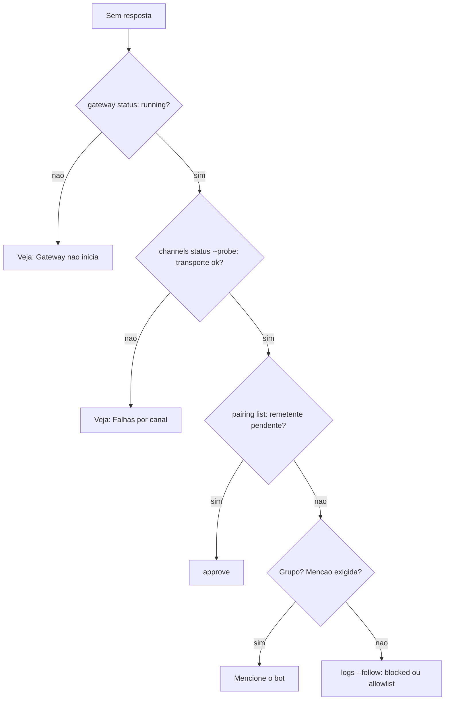

# Sem resposta no chat - pareamento, menção e allowlist

## Objetivo

Diagnosticar o problema mais comum: você manda uma mensagem e o agente não responde. Resultado: identificar se a causa é Gateway, transporte do canal, pareamento, menção ou allowlist.

## Explicação

A doc de troubleshooting define uma **escada de comandos para os primeiros 60 segundos**:

| # | Comando | Saudável quando |
|---|---|---|
| 1 | `openclaw status` | Canais configurados sem erros de autenticação |
| 2 | `openclaw status --all` | Relatório completo, compartilhável (revise antes) |
| 3 | `openclaw gateway probe` | `Reachable: yes` |
| 4 | `openclaw gateway status` | `Runtime: running` e `Connectivity probe: ok` (`--require-rpc` exige prova de RPC com escopo de leitura) |
| 5 | `openclaw doctor` | Sem erros bloqueantes de configuração ou serviço |
| 6 | `openclaw channels status --probe` | Transporte vivo por conta (`works` / `audit ok`) |
| 7 | `openclaw logs --follow` | Atividade estável, sem erros fatais repetidos |

Para "sem respostas" a doc indica: `openclaw pairing list --channel <canal> [--account <id>]` e os logs. O esperado é transporte conectado e remetente aprovado (ou política de DM aberta/allowlist).

### Assinaturas de log

| Trecho do log | Significado | Correção |
|---|---|---|
| `drop guild message (mention required` | Discord exige menção | Mencione o bot ou ajuste `requireMention` |
| `pairing request` | Remetente ainda não aprovado | `openclaw pairing approve <canal> <CODIGO>` |
| `blocked` ou `allowlist` | Remetente, sala ou grupo filtrado | Ajuste `allowFrom`, `groupAllowFrom` ou `groupPolicy` |



## Exemplo prático

```bash
openclaw status
openclaw gateway status
openclaw channels status --probe
openclaw pairing list --channel telegram
openclaw logs --follow
```

Envie uma mensagem de outra conta de teste enquanto os logs correm e procure as assinaturas da tabela. Se aparecer `pairing request`, é só aprovar; se aparecer `blocked`, o filtro está funcionando e você precisa decidir se o remetente deve mesmo ser liberado.

## Armadilhas comuns

- Liberar `dmPolicy: "open"` só para "resolver": troca um problema por um risco (veja [[Controle de acesso a DMs e grupos]]).
- Testar em grupo sem mencionar o bot.
- Esquecer que perfis `minimal` e `coding` omitem a ferramenta `message`: o agente lê a sala mas não publica (`tools.alsoAllow: ["message"]`, segundo a doc de canais).
- Rodar `openclaw doctor --fix` sem ler o que ele propõe.

## Resumo

- Escada de sete comandos; logs mostram a causa exata.
- Pareamento, menção e allowlist explicam a maioria dos silêncios.
- Corrija a causa; não abra a política por conveniência.

## Relacionados

- [[Pareamento e política de DM]]
- [[Grupos - menção obrigatória e groupPolicy]]
- [[Escada de diagnóstico do Gateway - status, logs e doctor]]
- [[Allowlists e política de ferramentas por chat]]
- [[Falhas por canal - Telegram, WhatsApp, Discord e Slack]]

## Exercícios

1. Que comando mostra se o remetente está pendente de aprovação?
2. O que significa `drop guild message (mention required`?
3. Por que `dmPolicy: "open"` não é uma boa correção?
4. Qual o primeiro degrau da escada e o que ele mostra?
