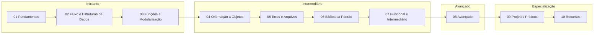

# Trilha de aprendizado - Python

Ordem sugerida de estudo do material de Python, com projetos para praticar e os níveis de domínio. Os módulos estão no [[Índice - Python]].

## 🗺️ Roadmap visual

> [!tip] Projetos desde cedo
> Você não precisa terminar todos os módulos para começar a fazer projetos. Sugestão: faça o Projeto 1 depois do módulo 03 e o Projeto 2 depois do módulo 05. Veja a tabela de [[#🎯 Trilha sugerida com projetos|trilha sugerida]].

## 🎯 Trilha sugerida com projetos

| Etapa | Estude | Pratique com |
|-------|--------|--------------|
| 1 | Módulos 01 e 02 | Exercícios dos módulos |
| 2 | Módulo 03 | [[09 - Projetos Práticos/Projeto 01 - Calculadora CLI\|Projeto 01]] |
| 3 | Módulos 04 e 05 | [[09 - Projetos Práticos/Projeto 02 - To-Do com Arquivos\|Projeto 02]] e [[09 - Projetos Práticos/Projeto 03 - Análise de Dados com CSV\|Projeto 03]] |
| 4 | Módulos 06 e 07 | [[09 - Projetos Práticos/Projeto 04 - Web Scraper\|Projeto 04]] e [[09 - Projetos Práticos/Projeto 05 - API REST\|Projeto 05]] |
| 5 | Módulo 08 (parcial) | [[09 - Projetos Práticos/Projeto 06 - Bot\|Projeto 06]] e [[09 - Projetos Práticos/Projeto 07 - Login com SQLite\|Projeto 07]] |
| 6 | Módulo 08 (completo) | [[09 - Projetos Práticos/Projeto 08 - Projeto Final\|Projeto 08]] |

## 🧭 Níveis de domínio

| Nível | Você consegue... | Módulos |
|-------|------------------|---------|
| 🟢 **Iniciante** | Escrever scripts simples, usar listas/dicts, criar funções | 01–03 |
| 🟡 **Intermediário** | Modelar com classes, tratar erros, manipular arquivos, usar a stdlib, escrever decorators e geradores | 04–07 |
| 🔴 **Avançado** | Escrever código assíncrono, otimizar, testar, empacotar e entender o CPython | 08 |
| 🚀 **Especialização** | Construir aplicações completas e escolher um caminho (web, dados, automação, IA) | 09–10 |

> [!note] Caminhos de especialização (depois deste vault)
> - **Web:** Django, FastAPI, Flask
> - **Dados:** pandas, NumPy, matplotlib, Jupyter
> - **Automação / DevOps:** scripts, Selenium, Ansible
> - **IA / Machine Learning:** scikit-learn, PyTorch
> - **Qualidade:** mypy, ruff, pre-commit, CI/CD

## Veja também

- [[Home - Python]]
- [[Índice - Python]]
- [[Glossário#Python]]
