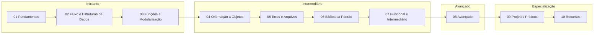

# 🐍 Python do Zero ao Avançado

Bem-vindo(a) ao seu vault de estudos de Python! Este material leva você do **absoluto zero** até tópicos **avançados**, de forma progressiva, modular e com muita prática.

> [!note] Como este material funciona
> Cada pasta é um **módulo**. Dentro de cada módulo você encontra teoria, exemplos, exercícios (`> [!question]`) e soluções (`> [!success]`). Siga a ordem numérica na primeira vez; depois use o índice para consultar o que precisar.

> [!tip] Pré-requisito
> Nenhum! Só é preciso um computador e vontade de praticar. Veja [[01 - Fundamentos/01 - Instalação e Ambiente|Instalação e Ambiente]] para começar.

---

## 🗺️ Roadmap visual



> [!tip] Projetos desde cedo
> Você não precisa terminar todos os módulos para começar a fazer projetos. Sugestão: faça o Projeto 1 depois do módulo 03 e o Projeto 2 depois do módulo 05. Veja a tabela de [[#🎯 Trilha sugerida com projetos|trilha sugerida]].

---

## 📚 Módulos

### 🟢 Nível Iniciante

#### 01 — Fundamentos
- [[01 - Fundamentos/01 - Instalação e Ambiente|Instalação e Ambiente]] (VS Code, PyCharm, Jupyter)
- [[01 - Fundamentos/02 - Sintaxe Básica e Variáveis|Sintaxe Básica e Variáveis]]
- [[01 - Fundamentos/03 - Tipos de Dados Primitivos|Tipos de Dados Primitivos]]
- [[01 - Fundamentos/04 - Operadores|Operadores]]
- [[01 - Fundamentos/05 - Entrada e Saída|Entrada e Saída]]
- [[01 - Fundamentos/06 - Comentários e Boas Práticas|Comentários e Boas Práticas]]
- [[01 - Fundamentos/07 - Exercícios de Fundamentos|Exercícios de Fundamentos]]

#### 02 — Controle de Fluxo e Estruturas de Dados
- [[02 - Controle de Fluxo e Estruturas de Dados/01 - if elif else e match case|if/elif/else e match/case]]
- [[02 - Controle de Fluxo e Estruturas de Dados/02 - Loops for e while|Loops: for e while]]
- [[02 - Controle de Fluxo e Estruturas de Dados/03 - Listas|Listas]]
- [[02 - Controle de Fluxo e Estruturas de Dados/04 - Tuplas|Tuplas]]
- [[02 - Controle de Fluxo e Estruturas de Dados/05 - Sets|Sets]]
- [[02 - Controle de Fluxo e Estruturas de Dados/06 - Dicionários|Dicionários]]
- [[02 - Controle de Fluxo e Estruturas de Dados/07 - Comprehensions|Comprehensions]]
- [[02 - Controle de Fluxo e Estruturas de Dados/08 - Exercícios de Fluxo e Estruturas|Exercícios progressivos]]

#### 03 — Funções e Modularização
- [[03 - Funções e Modularização/01 - Definindo Funções|Definindo Funções]]
- [[03 - Funções e Modularização/02 - args kwargs e Argumentos Padrão|*args, **kwargs e argumentos padrão]]
- [[03 - Funções e Modularização/03 - Escopo e Closures|Escopo e Closures]]
- [[03 - Funções e Modularização/04 - Módulos e Packages|Módulos e Packages]]
- [[03 - Funções e Modularização/05 - Virtual Environments e pip|Virtual Environments e pip]]
- [[03 - Funções e Modularização/06 - Docstrings|Documentação com Docstrings]]
- [[03 - Funções e Modularização/07 - Exercícios de Funções e Modularização|Exercícios de Funções e Modularização]]

### 🟡 Nível Intermediário

#### 04 — Programação Orientada a Objetos
- [[04 - Programação Orientada a Objetos/01 - Classes e Objetos|Classes e Objetos]]
- [[04 - Programação Orientada a Objetos/02 - Atributos e Métodos|Atributos e Métodos]]
- [[04 - Programação Orientada a Objetos/03 - Herança Polimorfismo e Encapsulamento|Herança, Polimorfismo e Encapsulamento]]
- [[04 - Programação Orientada a Objetos/04 - Propriedades e Métodos Mágicos|Propriedades e Métodos Mágicos (dunder)]]
- [[04 - Programação Orientada a Objetos/05 - Dataclasses e Slots|Dataclasses e Slots]]
- [[04 - Programação Orientada a Objetos/06 - Design Patterns Básicos|Design Patterns Básicos]]
- [[04 - Programação Orientada a Objetos/07 - Exercícios de POO|Exercícios de POO]]

#### 05 — Tratamento de Erros e Arquivos
- [[05 - Tratamento de Erros e Arquivos/01 - try except else finally|try / except / else / finally]]
- [[05 - Tratamento de Erros e Arquivos/02 - Exceções Personalizadas|Exceções Personalizadas]]
- [[05 - Tratamento de Erros e Arquivos/03 - Arquivos Texto CSV e JSON|Arquivos: texto, CSV e JSON]]
- [[05 - Tratamento de Erros e Arquivos/04 - Context Managers com with|Context Managers (`with`)]]
- [[05 - Tratamento de Erros e Arquivos/05 - Exercícios de Erros e Arquivos|Exercícios de Erros e Arquivos]]

#### 06 — Biblioteca Padrão Essencial
- [[06 - Módulos da Biblioteca Padrão Essenciais/01 - os pathlib e sys|os, pathlib, sys]]
- [[06 - Módulos da Biblioteca Padrão Essenciais/02 - datetime e time|datetime e time]]
- [[06 - Módulos da Biblioteca Padrão Essenciais/03 - collections itertools e functools|collections, itertools, functools]]
- [[06 - Módulos da Biblioteca Padrão Essenciais/04 - re Expressões Regulares|re (expressões regulares)]]
- [[06 - Módulos da Biblioteca Padrão Essenciais/05 - json csv e pickle|json, csv, pickle]]
- [[06 - Módulos da Biblioteca Padrão Essenciais/06 - concurrent futures e threading|concurrent.futures e threading]]
- [[06 - Módulos da Biblioteca Padrão Essenciais/07 - logging|logging]]
- [[06 - Módulos da Biblioteca Padrão Essenciais/08 - Exercícios da Biblioteca Padrão|Exercícios da Biblioteca Padrão]]

#### 07 — Programação Funcional e Intermediário
- [[07 - Programação Funcional e Intermediário/01 - Funções de Ordem Superior|Funções de Ordem Superior]]
- [[07 - Programação Funcional e Intermediário/02 - Lambda map filter reduce|Lambda, map, filter, reduce]]
- [[07 - Programação Funcional e Intermediário/03 - Decorators|Decorators (com parâmetros e de classe)]]
- [[07 - Programação Funcional e Intermediário/04 - Generators e Iterators|Generators e Iterators]]
- [[07 - Programação Funcional e Intermediário/05 - Context Managers Avançados|Context Managers Avançados]]
- [[07 - Programação Funcional e Intermediário/06 - Type Hints e typing|Type Hints e `typing`]]
- [[07 - Programação Funcional e Intermediário/07 - Exercícios de Programação Funcional e Intermediário|Exercícios de Programação Funcional e Intermediário]]

### 🔴 Nível Avançado

#### 08 — Avançado
- [[08 - Avançado/01 - Metaprogramação|Metaprogramação (metaclasses, descriptors)]]
- [[08 - Avançado/02 - Asyncio|Asyncio e programação assíncrona]]
- [[08 - Avançado/03 - Multiprocessing|Multiprocessing]]
- [[08 - Avançado/04 - CPython Internals|CPython internals (GIL, memória)]]
- [[08 - Avançado/05 - Performance e Profiling|Performance (cProfile, timeit)]]
- [[08 - Avançado/06 - Testes com unittest e pytest|Testes (unittest, pytest)]]
- [[08 - Avançado/07 - Packaging e Distribuição|Packaging (setuptools, poetry, pyproject.toml)]]
- [[08 - Avançado/08 - Design Patterns Avançados e Clean Code|Design patterns avançados e Clean Code]]
- [[08 - Avançado/09 - Exercícios de Python Avançado|Exercícios de Python Avançado]]

### 🚀 Especialização

#### 09 — Projetos Práticos
| # | Projeto | Nota do enunciado | Solução |
|---|---------|-------------------|---------|
| 1 | Calculadora de linha de comando | [[09 - Projetos Práticos/Projeto 01 - Calculadora CLI\|Projeto 01]] | [[09 - Projetos Práticos/Projeto 01 - Solução\|Solução]] |
| 2 | Gerenciador de tarefas (To-Do) com arquivos | [[09 - Projetos Práticos/Projeto 02 - To-Do com Arquivos\|Projeto 02]] | [[09 - Projetos Práticos/Projeto 02 - Solução\|Solução]] |
| 3 | Análise de dados simples com CSV | [[09 - Projetos Práticos/Projeto 03 - Análise de Dados com CSV\|Projeto 03]] | [[09 - Projetos Práticos/Projeto 03 - Solução\|Solução]] |
| 4 | Web scraper básico | [[09 - Projetos Práticos/Projeto 04 - Web Scraper\|Projeto 04]] | [[09 - Projetos Práticos/Projeto 04 - Solução\|Solução]] |
| 5 | API REST simples (Flask ou FastAPI) | [[09 - Projetos Práticos/Projeto 05 - API REST\|Projeto 05]] | [[09 - Projetos Práticos/Projeto 05 - Solução\|Solução]] |
| 6 | Bot de Telegram ou Discord | [[09 - Projetos Práticos/Projeto 06 - Bot\|Projeto 06]] | [[09 - Projetos Práticos/Projeto 06 - Solução\|Solução]] |
| 7 | Sistema de login + SQLite | [[09 - Projetos Práticos/Projeto 07 - Login com SQLite\|Projeto 07]] | [[09 - Projetos Práticos/Projeto 07 - Solução\|Solução]] |
| 8 | Projeto final (Dashboard ou full-stack simples) | [[09 - Projetos Práticos/Projeto 08 - Projeto Final\|Projeto 08]] | [[09 - Projetos Práticos/Projeto 08 - Solução\|Solução]] |

#### 10 — Recursos e Referências
- [[10 - Recursos e Referências/01 - Livros Recomendados|Livros recomendados]]
- [[10 - Recursos e Referências/02 - Sites e Documentação Oficial|Sites e documentação oficial]]
- [[10 - Recursos e Referências/03 - Canais e Cursos|Canais e cursos]]
- [[10 - Recursos e Referências/04 - Cheat Sheets|Cheat sheets]]
- [[Glossário#Python|Glossário de termos]]

---

## 🎯 Trilha sugerida com projetos

| Etapa | Estude | Pratique com |
|-------|--------|--------------|
| 1 | Módulos 01 e 02 | Exercícios dos módulos |
| 2 | Módulo 03 | [[09 - Projetos Práticos/Projeto 01 - Calculadora CLI\|Projeto 01]] |
| 3 | Módulos 04 e 05 | [[09 - Projetos Práticos/Projeto 02 - To-Do com Arquivos\|Projeto 02]] e [[09 - Projetos Práticos/Projeto 03 - Análise de Dados com CSV\|Projeto 03]] |
| 4 | Módulos 06 e 07 | [[09 - Projetos Práticos/Projeto 04 - Web Scraper\|Projeto 04]] e [[09 - Projetos Práticos/Projeto 05 - API REST\|Projeto 05]] |
| 5 | Módulo 08 (parcial) | [[09 - Projetos Práticos/Projeto 06 - Bot\|Projeto 06]] e [[09 - Projetos Práticos/Projeto 07 - Login com SQLite\|Projeto 07]] |
| 6 | Módulo 08 (completo) | [[09 - Projetos Práticos/Projeto 08 - Projeto Final\|Projeto 08]] |

---

## 🧭 Níveis de domínio

| Nível | Você consegue... | Módulos |
|-------|------------------|---------|
| 🟢 **Iniciante** | Escrever scripts simples, usar listas/dicts, criar funções | 01–03 |
| 🟡 **Intermediário** | Modelar com classes, tratar erros, manipular arquivos, usar a stdlib, escrever decorators e geradores | 04–07 |
| 🔴 **Avançado** | Escrever código assíncrono, otimizar, testar, empacotar e entender o CPython | 08 |
| 🚀 **Especialização** | Construir aplicações completas e escolher um caminho (web, dados, automação, IA) | 09–10 |

> [!note] Caminhos de especialização (depois deste vault)
> - **Web:** Django, FastAPI, Flask
> - **Dados:** pandas, NumPy, matplotlib, Jupyter
> - **Automação / DevOps:** scripts, Selenium, Ansible
> - **IA / Machine Learning:** scikit-learn, PyTorch
> - **Qualidade:** mypy, ruff, pre-commit, CI/CD

---

## ⚙️ Como usar este material no Obsidian

### 1. Abra como vault
No Obsidian: **Abrir pasta como cofre** → selecione a pasta `Materiais-Obsidian`. Este material fica na subpasta `Python-Vault` (veja o [[README]]).

### 2. Plugins recomendados

| Plugin | Tipo | Para que serve aqui |
|--------|------|---------------------|
| **Dataview** | Comunidade | Listar notas por `nivel` ou `tags` |
| **Templater** | Comunidade | Criar suas próprias notas de estudo com frontmatter padrão |
| **Obsidian Git** | Comunidade | Versionar e fazer backup do vault |
| **Execute Code** | Comunidade | Rodar blocos ` ```python ` direto na nota |
| **Spaced Repetition** | Comunidade | Transformar conceitos em flashcards |
| **Tasks** | Comunidade | Acompanhar checklists de estudo |
| **Callouts** | Nativo | Já vem no Obsidian (`note`, `tip`, `warning`, `example`, `question`, `success`) |
| **Graph view** | Nativo | Ver as conexões entre os conceitos |

> [!tip] Graph view
> Abra o Graph view (`Ctrl/Cmd + G`) e filtre por tags (`tag:#funcoes`, `tag:#poo`) para visualizar clusters de conhecimento. Colorir os grupos por tag deixa o mapa muito mais legível.

### 3. Legenda dos callouts

> [!note] Informação importante
> Conceitos-chave que você precisa guardar.

> [!tip] Dica
> Atalhos, boas práticas e truques.

> [!warning] Armadilha comum
> Erros típicos de quem está aprendendo (sempre com a versão ❌ errada vs ✅ correta).

> [!example] Exemplo
> Código e situações práticas.

> [!question] Exercício
> Tente resolver **antes** de abrir a solução.

> [!success]- Solução
> Solução escondida (callout recolhível com o sinal `-`).

### 4. Dica de estudo
1. Leia a teoria e **digite** o código (não copie e cole).
2. Rode no interpretador interativo (`python` ou `ipython`) e experimente variações.
3. Use o **debugger** (VS Code: `F5`) para ver o programa linha a linha.
4. Resolva os exercícios sem olhar a solução.
5. Faça um projeto para fixar.

---

## 📊 Consultas por nível (Dataview)

Instale o plugin **Dataview** e cole o bloco abaixo para consultar as notas por nível.

**Contagem por nível:**

````markdown
```dataview
TABLE length(rows) AS "Notas"
FROM "Python-Vault"
GROUP BY nivel
```
````

---

## 📁 Estrutura de pastas do vault

```text
Python-Vault/
├── 00 - Índice e Roadmap/
│   └── 00 - Índice.md
├── 01 - Fundamentos/
├── 02 - Controle de Fluxo e Estruturas de Dados/
├── 03 - Funções e Modularização/
├── 04 - Programação Orientada a Objetos/
├── 05 - Tratamento de Erros e Arquivos/
├── 06 - Módulos da Biblioteca Padrão Essenciais/
├── 07 - Programação Funcional e Intermediário/
├── 08 - Avançado/
├── 09 - Projetos Práticos/
└── 10 - Recursos e Referências/
```

> [!note] Links "vazios"
> No Obsidian, links para notas que ainda não existem aparecem em tom mais claro. À medida que cada módulo for gerado, eles ganham vida automaticamente no graph view.

---

## ✅ Checklist de progresso

- [ ] 🟢 Módulo 01 — Fundamentos
- [ ] 🟢 Módulo 02 — Controle de Fluxo e Estruturas de Dados
- [ ] 🟢 Módulo 03 — Funções e Modularização
- [ ] 🟡 Módulo 04 — Programação Orientada a Objetos
- [ ] 🟡 Módulo 05 — Tratamento de Erros e Arquivos
- [ ] 🟡 Módulo 06 — Biblioteca Padrão Essencial
- [ ] 🟡 Módulo 07 — Funcional e Intermediário
- [ ] 🔴 Módulo 08 — Avançado
- [ ] 🚀 Módulo 09 — Projetos Práticos (8 projetos)
- [ ] 📖 Módulo 10 — Recursos

---

## 🔗 Links rápidos
- [[Glossário#Python|📖 Glossário]]
- [[10 - Recursos e Referências/04 - Cheat Sheets|🧾 Cheat Sheets]]
- [[10 - Recursos e Referências/02 - Sites e Documentação Oficial|🌐 Documentação oficial]]
- [[09 - Projetos Práticos/Projeto 08 - Projeto Final|🏁 Projeto final]]

---

#python #indice #roadmap #mapa-de-conteudo #obsidian
