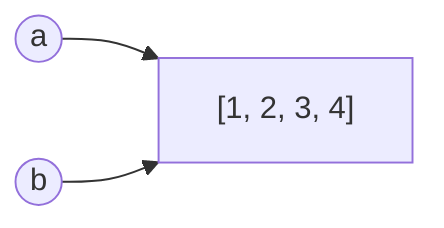

# ✍️ Sintaxe Básica e Variáveis

## 1. Como o Python lê seu código

Python executa o arquivo **de cima para baixo**, uma instrução por vez. Cada linha costuma ser uma **instrução** (*statement*).

```python
print("Primeira linha")
print("Segunda linha")
```

### Indentação importa!

Em muitas linguagens, blocos são delimitados por `{ }`. Em Python, são delimitados pela **indentação** (recuo). A convenção é **4 espaços**.

```python
if 5 > 3:
    print("Isso está dentro do if")   # 4 espaços
    print("Também está dentro")
print("Isso está fora")
```

> [!warning] Armadilha comum: indentação inconsistente
> ```python
> # ❌ Errado
> if 5 > 3:
> print("Olá")
> # IndentationError: expected an indented block after 'if' statement
>
> # ✅ Correto
> if 5 > 3:
>     print("Olá")
> ```
> Nunca misture **tabs** e **espaços**. Configure seu editor para inserir 4 espaços ao apertar Tab.

### Várias instruções e linhas longas
```python
x = 1; y = 2          # possível, mas desencorajado

total = (10 +
         20 +
         30)          # parênteses permitem quebrar a linha
```

> [!note] Sem ponto e vírgula
> Em Python **não** se usa `;` no fim das linhas. Quebra de linha encerra a instrução.

---

## 2. Variáveis

Uma **variável** é um **nome** que aponta para um valor na memória.

> [!example] Analogia
> Pense em uma **etiqueta** colada em uma caixa. A caixa guarda o valor; a etiqueta é o nome. Você pode mover a etiqueta para outra caixa a qualquer momento.

```python
idade = 25
nome = "Ada"
altura = 1.68
ativa = True

print(nome, idade)
```

O símbolo `=` é **atribuição** (não é "igual" da matemática!). Lê-se: *"`idade` passa a apontar para 25"*.

### Tipagem dinâmica
Você **não declara** o tipo. O tipo pertence ao **valor**, não à variável.

```python
x = 10          # x aponta para um int
print(type(x))  # <class 'int'>

x = "agora sou texto"
print(type(x))  # <class 'str'>
```

> [!tip] Descubra o tipo com `type()`
> Use `type(valor)` e `isinstance(valor, int)` no [[01 - Fundamentos/01 - Instalação e Ambiente#2. O interpretador interativo (REPL)|REPL]] sempre que ficar em dúvida.

Tipagem dinâmica não significa **fraca**: Python é **fortemente tipado**.
```python
"5" + 3      # TypeError: can only concatenate str (not "int") to str
```

---

## 3. Regras de nomes

| Regra | Válido | Inválido |
|-------|--------|----------|
| Começa com letra ou `_` | `nome`, `_x` | `1nome` |
| Contém letras, números, `_` | `nota_1` | `nota-1`, `nota 1` |
| Não pode ser palavra reservada | `classe` | `class`, `if`, `for` |
| **Diferencia** maiúsculas | `Nome` ≠ `nome` | — |

### Convenção de nomenclatura (PEP 8)
| O quê | Estilo | Exemplo |
|-------|--------|---------|
| Variáveis e funções | `snake_case` | `total_vendas` |
| Classes | `PascalCase` | `ContaBancaria` |
| Constantes | `MAIÚSCULAS_COM_UNDERSCORE` | `TAXA_JUROS` |
| "Privado" por convenção | `_prefixo` | `_cache` |

```python
# ❌ Ruim: nomes enigmáticos
x1 = 3.14
a = "Maria"

# ✅ Bom: nomes que explicam
pi_aproximado = 3.14
nome_cliente = "Maria"
```

> [!note] Constantes em Python
> Python **não tem** constantes de verdade. `PI = 3.14` é apenas uma **convenção**: o nome em maiúsculas avisa "não altere". Veja [[01 - Fundamentos/06 - Comentários e Boas Práticas|Boas Práticas]].

### Palavras reservadas
Veja todas com:
```python
import keyword
print(keyword.kwlist)
```
Entre elas: `True`, `False`, `None`, `and`, `or`, `not`, `if`, `elif`, `else`, `for`, `while`, `def`, `class`, `return`, `import`, `try`, `except`, `with`, `lambda`...

> [!warning] Não "esconda" funções nativas
> ```python
> # ❌ Errado
> list = [1, 2, 3]
> str = "texto"
> lista2 = list("abc")   # TypeError: 'list' object is not callable
>
> # ✅ Correto
> numeros = [1, 2, 3]
> texto = "texto"
> ```
> Evite nomear variáveis como `list`, `str`, `int`, `dict`, `sum`, `max`, `min`, `id`, `type`, `input`.

---

## 4. Atribuições úteis

### Múltipla
```python
x, y, z = 1, 2, 3
a = b = c = 0           # todas apontam para o mesmo 0
```

### Troca de valores (swap)
```python
a, b = 10, 20
a, b = b, a             # sem variável temporária!
print(a, b)             # 20 10
```

### Desempacotamento (prévia)
```python
primeiro, *resto = [1, 2, 3, 4]
print(primeiro)   # 1
print(resto)      # [2, 3, 4]
```
Veremos mais em [[02 - Controle de Fluxo e Estruturas de Dados/03 - Listas|Listas]] e [[02 - Controle de Fluxo e Estruturas de Dados/04 - Tuplas|Tuplas]].

### Atribuição aumentada
```python
contador = 0
contador += 1     # contador = contador + 1
contador *= 5
```

### Apagando um nome
```python
del contador
```

---

## 5. Variáveis são referências

Quando você faz `b = a`, **não copia o valor**: os dois nomes apontam para o **mesmo objeto**.

```python
a = [1, 2, 3]
b = a
b.append(4)
print(a)     # [1, 2, 3, 4]  😱  a também mudou!
print(a is b)  # True
```



> [!warning] Armadilha clássica
> ```python
> # ❌ Achar que b é uma cópia independente
> b = a
>
> # ✅ Crie uma cópia de verdade
> b = a.copy()        # ou list(a), ou a[:]
> ```
> Com tipos **imutáveis** (`int`, `str`, `tuple`), isso não causa problema, pois eles não mudam "por dentro". Aprofunde em [[01 - Fundamentos/03 - Tipos de Dados Primitivos#Mutável vs imutável|Mutável vs imutável]].

Use `id()` para ver a "identidade" do objeto:
```python
x = 1000
y = x
print(id(x) == id(y))   # True
```

---

## 6. Anotações de tipo (prévia)

Você pode **documentar** o tipo esperado. O Python **não obriga**, mas ferramentas (VS Code, mypy) usam:

```python
idade: int = 25
nome: str = "Ada"
```
Detalhes em [[07 - Programação Funcional e Intermediário/06 - Type Hints e typing|Type Hints e typing]].

---

> [!question] Exercícios
> 1. Crie variáveis `nome`, `idade` e `cidade` e imprima uma frase com elas.
> 2. Troque o valor de duas variáveis `x = 5` e `y = 9` sem usar variável auxiliar.
> 3. Explique por que o código abaixo imprime `[1, 2, 99]`:
>    ```python
>    a = [1, 2, 3]
>    b = a
>    b[2] = 99
>    print(a)
>    ```
> 4. Qual destes nomes é **inválido**? `_total`, `total2`, `2total`, `Total`.
> 5. Corrija: `class = "Python 101"`.

> [!success]- Soluções
> 1. ```python
>    nome, idade, cidade = "Ada", 28, "São Paulo"
>    print(f"{nome}, {idade} anos, mora em {cidade}.")
>    ```
> 2. ```python
>    x, y = 5, 9
>    x, y = y, x
>    ```
> 3. `b = a` faz os dois nomes apontarem para a **mesma lista**; alterar via `b` altera o objeto único que `a` também enxerga.
> 4. `2total` (começa com número).
> 5. `class` é palavra reservada: use `curso = "Python 101"` (ou `classe`).

---

⬅️ [[01 - Fundamentos/01 - Instalação e Ambiente|Instalação e Ambiente]] | ➡️ [[01 - Fundamentos/03 - Tipos de Dados Primitivos|Tipos de Dados Primitivos]]

#python #basico #sintaxe #variaveis #indentacao #pep8
