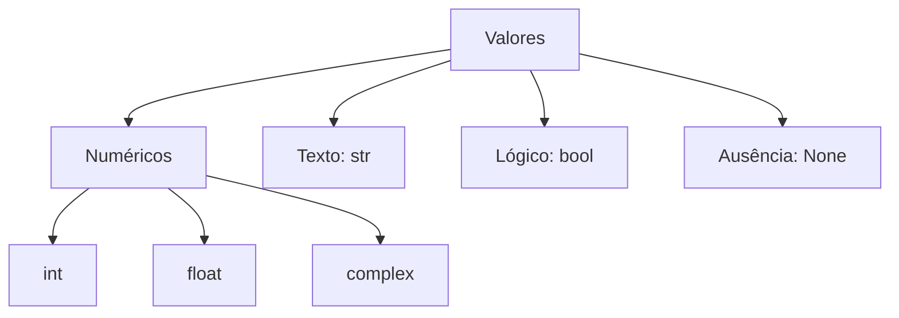

# 🔢 Tipos de Dados Primitivos

Todo valor em Python tem um **tipo**, que define o que ele guarda e o que você pode fazer com ele.

| Tipo | Nome | Exemplo | Mutável? |
|------|------|---------|----------|
| `int` | Inteiro | `42`, `-7`, `1_000_000` | ❌ |
| `float` | Decimal (ponto flutuante) | `3.14`, `-0.5`, `2e3` | ❌ |
| `complex` | Complexo | `3 + 4j` | ❌ |
| `str` | Texto | `"Olá"`, `'Python'` | ❌ |
| `bool` | Lógico | `True`, `False` | ❌ |
| `NoneType` | "Nada" | `None` | ❌ |



> [!tip] Descobrindo tipos
> `type(42)` → `<class 'int'>` · `isinstance(42, int)` → `True`

---

## 1. Inteiros (`int`)

Python não tem limite de tamanho para inteiros (só a memória).

```python
a = 42
b = -7
grande = 10 ** 100          # sem overflow!
populacao = 8_000_000_000   # underscores melhoram a leitura

print(0b1010)   # 10  (binário)
print(0o17)     # 15  (octal)
print(0xFF)     # 255 (hexadecimal)
```

## 2. Decimais (`float`)

```python
pi = 3.14159
cientifica = 1.5e3     # 1500.0
print(type(pi))        # <class 'float'>
```

> [!warning] Armadilha: precisão de ponto flutuante
> ```python
> # ❌ Surpresa
> print(0.1 + 0.2)            # 0.30000000000000004
> print(0.1 + 0.2 == 0.3)     # False
> ```
> Isso acontece porque computadores armazenam decimais em **binário**, e `0.1` não tem representação exata. **Não é um bug do Python.**
>
> ```python
> # ✅ Compare com tolerância
> import math
> print(math.isclose(0.1 + 0.2, 0.3))   # True
>
> # ✅ Para dinheiro, use Decimal
> from decimal import Decimal
> print(Decimal("0.1") + Decimal("0.2"))   # 0.3
> ```

### Funções numéricas úteis
```python
print(abs(-5))            # 5
print(round(3.14159, 2))  # 3.14
print(pow(2, 10))         # 1024
print(divmod(17, 5))      # (3, 2)  -> quociente e resto

import math
print(math.sqrt(16))      # 4.0
print(math.floor(3.9))    # 3
print(math.ceil(3.1))     # 4
```

> [!warning] `round()` usa "arredondamento do banqueiro"
> `round(0.5)` → `0` e `round(1.5)` → `2`, `round(2.5)` → `2`. Metades são arredondadas para o número **par** mais próximo.

---

## 3. Texto (`str`)

Strings são sequências **imutáveis** de caracteres Unicode.

```python
a = "Aspas duplas"
b = 'Aspas simples'
c = "Ela disse: 'olá'"
d = """Texto
com várias
linhas"""
```

### Escapes e strings brutas
```python
print("Linha1\nLinha2")       # \n = quebra de linha
print("Coluna1\tColuna2")     # \t = tab
print("Caminho: C:\\pasta")   # \\ = barra invertida
print(r"C:\novo\teste")       # r"" = raw string, ignora escapes
```

### Concatenação e repetição
```python
nome = "Ada" + " " + "Lovelace"
linha = "-" * 20
print(nome)
print(linha)
```

> [!warning] Não misture texto e número com `+`
> ```python
> idade = 25
> # ❌ Errado
> print("Idade: " + idade)       # TypeError
>
> # ✅ Correto
> print("Idade: " + str(idade))
> print(f"Idade: {idade}")       # melhor ainda!
> ```

### f-strings (a forma moderna)
```python
nome = "Ada"
preco = 1234.5678

print(f"Olá, {nome}!")
print(f"Preço: R$ {preco:.2f}")       # 2 casas decimais
print(f"Preço: R$ {preco:,.2f}")      # separador de milhar
print(f"{nome=}")                     # nome='Ada' (ótimo para debug)
print(f"{2 + 3 * 4}")                 # expressões dentro das chaves
```

> [!note] Novidade no Python 3.12
> A partir do 3.12 você pode reutilizar o mesmo tipo de aspas dentro de uma f-string e escrever expressões em várias linhas:
> ```python
> nomes = ["Ada", "Alan"]
> print(f"Pessoas: {", ".join(nomes)}")   # válido no 3.12+
> ```
> Em versões anteriores isso dava `SyntaxError`.

### Indexação e fatiamento (*slicing*)
Cada caractere tem uma posição (começando do **0**). Índices negativos contam do fim.

```text
 P  y  t  h  o  n
 0  1  2  3  4  5
-6 -5 -4 -3 -2 -1
```

```python
s = "Python"
print(s[0])       # 'P'
print(s[-1])      # 'n'
print(s[0:2])     # 'Py'   (fim exclusivo)
print(s[2:])      # 'thon'
print(s[:3])      # 'Pyt'
print(s[::2])     # 'Pto'  (passo 2)
print(s[::-1])    # 'nohtyP' (invertida!)
```

> [!warning] Strings são imutáveis
> ```python
> s = "Python"
> # ❌ Errado
> s[0] = "J"          # TypeError: 'str' object does not support item assignment
>
> # ✅ Correto: crie uma nova string
> s = "J" + s[1:]     # 'Jython'
> ```

### Métodos mais usados

| Método | O que faz | Exemplo → Resultado |
|--------|-----------|---------------------|
| `upper()` / `lower()` | Maiúsculas / minúsculas | `"oi".upper()` → `'OI'` |
| `title()` | Primeira letra de cada palavra | `"ola mundo".title()` → `'Ola Mundo'` |
| `capitalize()` | Primeira letra da frase | `"python".capitalize()` → `'Python'` |
| `strip()` | Remove espaços das pontas | `"  oi  ".strip()` → `'oi'` |
| `replace(a, b)` | Substitui | `"casa".replace("a","o")` → `'coso'` |
| `split(sep)` | Divide em lista | `"a,b,c".split(",")` → `['a','b','c']` |
| `join(lista)` | Une lista em string | `"-".join(["a","b"])` → `'a-b'` |
| `find(x)` | Posição (ou `-1`) | `"python".find("th")` → `2` |
| `count(x)` | Quantas vezes aparece | `"banana".count("a")` → `3` |
| `startswith(x)` / `endswith(x)` | Começa/termina com | `"arq.py".endswith(".py")` → `True` |
| `isdigit()` / `isalpha()` | Só dígitos / só letras | `"123".isdigit()` → `True` |
| `len(s)` | Tamanho | `len("Python")` → `6` |

```python
frase = "  Aprendendo Python  "
print(frase.strip().lower().replace("python", "programação"))
# 'aprendendo programação'
```

> [!tip] Encadeamento
> Como strings são imutáveis, cada método **devolve uma nova string**, o que permite encadear: `texto.strip().lower().title()`.

---

## 4. Booleanos (`bool`)

Apenas dois valores: `True` e `False` (com inicial **maiúscula**).

```python
maior = 10 > 5
print(maior)             # True
print(type(maior))       # <class 'bool'>
print(True + True)       # 2  (bool é subclasse de int)
```

### Truthiness: valores "verdadeiros" e "falsos"

Qualquer valor pode ser avaliado como booleano com `bool()`.

| Considerados **falsos** (`False`) | Todo o resto é **verdadeiro** |
|-----------------------------------|-------------------------------|
| `False`, `None` | `True` |
| `0`, `0.0`, `0j` | Números diferentes de zero |
| `""` (string vazia) | Strings com conteúdo (inclusive `"0"` e `"False"`!) |
| `[]`, `()`, `{}`, `set()` | Coleções com elementos |

```python
print(bool(0))        # False
print(bool(""))       # False
print(bool([]))       # False
print(bool("False"))  # True  😱 (string não vazia)
print(bool("0"))      # True
```

> [!warning] Armadilha
> ```python
> # ❌ Errado: bool("False") NÃO converte o texto "False" para False
> ativo = bool("False")     # True!
>
> # ✅ Correto
> ativo = "False".lower() == "true"    # False
> ```

---

## 5. `None`: a ausência de valor

`None` representa "nenhum valor". É o retorno padrão de funções que não retornam nada.

```python
resultado = None
print(resultado is None)    # True (use "is", não "==")
```

> [!warning] Compare `None` com `is`
> ```python
> # ❌ Funciona, mas é desencorajado
> if x == None: ...
> # ✅ Pythônico
> if x is None: ...
> ```

---

## 6. Complexos (`complex`)

Raramente usados no dia a dia, mas existem nativamente:
```python
z = 3 + 4j
print(z.real, z.imag)   # 3.0 4.0
print(abs(z))           # 5.0
```

---

## 7. Conversão de tipos (*casting*)

```python
int("42")          # 42
int(3.99)          # 3   (trunca, não arredonda!)
float("3.14")      # 3.14
float(10)          # 10.0
str(123)           # '123'
bool(1)            # True
int(True)          # 1
```

> [!warning] Conversões que falham
> ```python
> int("abc")        # ValueError: invalid literal for int()
> int("3.5")        # ValueError! (texto com ponto não vira int direto)
> int(float("3.5")) # ✅ 3
> ```
> Aprenda a tratá-los em [[05 - Tratamento de Erros e Arquivos/01 - try except else finally|try / except]].

---

## Mutável vs imutável

| Imutáveis (não mudam "por dentro") | Mutáveis |
|------------------------------------|----------|
| `int`, `float`, `bool`, `str`, `tuple`, `None` | `list`, `dict`, `set` |

Quando você "altera" um imutável, na verdade cria **outro objeto** e redireciona o nome. Isso afeta como variáveis se comportam (veja [[01 - Fundamentos/02 - Sintaxe Básica e Variáveis#5. Variáveis são referências|Variáveis são referências]]) e tem grande impacto em funções ([[03 - Funções e Modularização/01 - Definindo Funções|Funções]]).

---

> [!question] Exercícios
> 1. Qual o resultado de `type(3.0)`, `type("3")` e `type(3 > 2)`?
> 2. Dada `s = "programação"`, mostre: a 1ª letra, a última, as 3 primeiras e a string invertida.
> 3. Transforme `"  maria da silva  "` em `"Maria Da Silva"`.
> 4. Por que `0.1 + 0.2 == 0.3` é `False`? Como comparar corretamente?
> 5. Qual o valor de `bool([0])`? E de `bool([])`?
> 6. Imprima `preco = 7.5` no formato `R$ 7.50` com f-string.

> [!success]- Soluções
> 1. `float`, `str`, `bool`.
> 2. ```python
>    s = "programação"
>    print(s[0], s[-1], s[:3], s[::-1])   # p o pro oãçamargorp
>    ```
> 3. `"  maria da silva  ".strip().title()`
> 4. Por causa da representação binária de ponto flutuante. Use `math.isclose(0.1 + 0.2, 0.3)` ou `Decimal`.
> 5. `bool([0])` → `True` (lista com um elemento); `bool([])` → `False`.
> 6. `print(f"R$ {preco:.2f}")`

---

⬅️ [[01 - Fundamentos/02 - Sintaxe Básica e Variáveis|Sintaxe Básica e Variáveis]] | ➡️ [[01 - Fundamentos/04 - Operadores|Operadores]]

#python #basico #tipos #int #float #str #bool #fstrings
