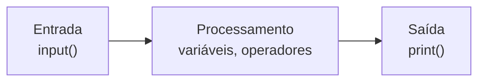

# 🖨️ Entrada e Saída

Um programa útil **recebe dados** (entrada), **processa** e **mostra resultados** (saída).



---

## 1. Saída com `print()`

```python
print("Olá, mundo!")
print("Soma:", 2 + 3)       # vários argumentos, separados por espaço
print()                      # linha em branco
```

### Parâmetros úteis

| Parâmetro | Função | Padrão |
|-----------|--------|--------|
| `sep` | Separador entre argumentos | `" "` |
| `end` | O que imprimir no final | `"\n"` |
| `file` | Destino da saída | `sys.stdout` |
| `flush` | Força a escrita imediata | `False` |

```python
print("a", "b", "c", sep="-")        # a-b-c
print("Carregando", end="...")
print("pronto!")                     # Carregando...pronto!

import sys
print("Mensagem de erro", file=sys.stderr)   # vai para o canal de erros
```

> [!tip] `print` aceita qualquer objeto
> Ele chama `str()` no objeto automaticamente: `print(42)`, `print([1, 2])`, `print(True)`.

---

## 2. Formatando a saída

Existem 3 jeitos. **Prefira f-strings.**

| Estilo | Exemplo | Quando usar |
|--------|---------|-------------|
| **f-string** ✅ | `f"Olá, {nome}"` | Sempre que possível (3.6+) |
| `str.format()` | `"Olá, {}".format(nome)` | Templates reutilizáveis |
| `%` (antigo) | `"Olá, %s" % nome` | Código legado |

### f-strings em detalhes

```python
nome = "Ada"
idade = 28
salario = 5432.1

print(f"{nome} tem {idade} anos")
print(f"Em 5 anos: {idade + 5}")
print(f"Salário: R$ {salario:.2f}")
print(f"{nome=}  {idade=}")             # nome='Ada'  idade=28
```

### Mini-linguagem de formatação: `{valor:especificação}`

| Especificação | Efeito | Exemplo | Resultado |
|---------------|--------|---------|-----------|
| `.2f` | 2 casas decimais | `f"{3.14159:.2f}"` | `3.14` |
| `,` | Separador de milhar | `f"{1234567:,}"` | `1,234,567` |
| `.1%` | Porcentagem | `f"{0.256:.1%}"` | `25.6%` |
| `>10` | Alinha à direita (largura 10) | `f"{'oi':>10}"` | `'        oi'` |
| `<10` | Alinha à esquerda | `f"{'oi':<10}"` | `'oi        '` |
| `^10` | Centraliza | `f"{'oi':^10}"` | `'    oi    '` |
| `*^10` | Centraliza com `*` | `f"{'oi':*^10}"` | `'****oi****'` |
| `05d` | Zeros à esquerda | `f"{42:05d}"` | `00042` |
| `b` | Binário | `f"{10:b}"` | `1010` |
| `x` | Hexadecimal | `f"{255:x}"` | `ff` |
| `e` | Notação científica | `f"{12345.678:.2e}"` | `1.23e+04` |

> [!example] Tabelinha alinhada
> ```python
> produtos = [("Caneta", 2.5), ("Caderno", 15.9), ("Mochila", 120)]
> print(f"{'Produto':<10}{'Preço':>10}")
> print("-" * 20)
> for nome, preco in produtos:
>     print(f"{nome:<10}{preco:>10.2f}")
> ```
> Saída:
> ```text
> Produto        Preço
> --------------------
> Caneta          2.50
> Caderno        15.90
> Mochila       120.00
> ```
> (O `for` será explicado em [[02 - Controle de Fluxo e Estruturas de Dados/02 - Loops for e while|Loops]].)

> [!note] Formato brasileiro de números
> O Python usa o padrão americano (`1,234.56`). Para exibir `1.234,56`, uma saída rápida:
> ```python
> valor = 1234.56
> br = f"{valor:,.2f}".replace(",", "X").replace(".", ",").replace("X", ".")
> print(br)   # 1.234,56
> ```
> Para algo robusto, use o módulo `locale` ou a biblioteca *Babel*.

---

## 3. Entrada com `input()`

`input()` pausa o programa, mostra uma mensagem e espera o usuário digitar e apertar Enter.

```python
nome = input("Qual é o seu nome? ")
print(f"Prazer, {nome}!")
```

> [!warning] Armadilha nº 1 dos iniciantes: `input()` SEMPRE devolve `str`
> ```python
> # ❌ Errado
> idade = input("Idade: ")        # usuário digita 20
> print(idade + 5)                # TypeError: can only concatenate str...
> print(idade * 2)                # '2020' (repetiu o texto!)
>
> # ✅ Correto: converta
> idade = int(input("Idade: "))
> print(idade + 5)                # 25
> ```

### Convertendo a entrada

```python
n1 = int(input("Primeiro número: "))
n2 = float(input("Segundo número: "))
print(f"Soma: {n1 + n2}")
```

### Várias entradas em uma linha
```python
a, b = input("Digite dois números: ").split()
a, b = int(a), int(b)
# ou, mais enxuto:
a, b = map(int, input("Digite dois números: ").split())
```
(`map` é explicado em [[07 - Programação Funcional e Intermediário/02 - Lambda map filter reduce|Lambda, map, filter, reduce]].)

### Limpando a entrada
Usuários digitam espaços e letras maiúsculas inesperadas:
```python
resposta = input("Continuar? (s/n) ").strip().lower()
print(resposta == "s")
```

> [!warning] E se o usuário digitar "abc"?
> ```python
> idade = int(input("Idade: "))    # ValueError se digitar "abc"
> ```
> Uma versão robusta (com recursos que veremos em [[05 - Tratamento de Erros e Arquivos/01 - try except else finally|try/except]] e em [[02 - Controle de Fluxo e Estruturas de Dados/02 - Loops for e while|while]]):
> ```python
> while True:
>     try:
>         idade = int(input("Idade: "))
>         break
>     except ValueError:
>         print("Digite um número inteiro!")
> ```

---

## 4. Argumentos de linha de comando (prévia)

Além do `input()`, programas podem receber dados ao serem executados:
```python
# ola_args.py
import sys
print(sys.argv)          # lista com o nome do script e os argumentos
```
```bash
python ola_args.py Ada 28
# ['ola_args.py', 'Ada', '28']
```
Para algo mais sofisticado há o módulo `argparse` (usado no [[09 - Projetos Práticos/Projeto 01 - Calculadora CLI|Projeto 01]]).

---

## 5. Exemplo completo

```python
# conversor_temperatura.py
celsius = float(input("Temperatura em °C: "))
fahrenheit = celsius * 9 / 5 + 32
kelvin = celsius + 273.15

print(f"\n{celsius:.1f} °C equivale a:")
print(f"  {fahrenheit:.1f} °F")
print(f"  {kelvin:.2f} K")
```

> [!tip] Use o debugger
> Coloque um breakpoint depois do `input()` e inspecione o **tipo** da variável. Você verá `str` até converter.

---

> [!question] Exercícios
> 1. Peça o nome e a idade do usuário e imprima: `Ada, daqui a 10 anos você terá 38 anos.`
> 2. Peça dois números e mostre soma, subtração, multiplicação e divisão, cada um em uma linha.
> 3. Peça o raio de um círculo e mostre a área com 2 casas decimais (`math.pi`).
> 4. Imprima `1 2 3` separados por `" | "` usando `sep`.
> 5. Faça `print("Carregando")` e `print("pronto")` aparecerem na **mesma linha**.
> 6. Corrija: `total = input("Valor: ") * 1.1`

> [!success]- Soluções
> 1. ```python
>    nome = input("Nome: ")
>    idade = int(input("Idade: "))
>    print(f"{nome}, daqui a 10 anos você terá {idade + 10} anos.")
>    ```
> 2. ```python
>    a = float(input("A: "))
>    b = float(input("B: "))
>    print(f"Soma: {a + b}")
>    print(f"Subtração: {a - b}")
>    print(f"Multiplicação: {a * b}")
>    print(f"Divisão: {a / b}")   # cuidado: b = 0!
>    ```
> 3. ```python
>    import math
>    r = float(input("Raio: "))
>    print(f"Área: {math.pi * r ** 2:.2f}")
>    ```
> 4. `print(1, 2, 3, sep=" | ")`
> 5. `print("Carregando", end=" "); print("pronto")`
> 6. `total = float(input("Valor: ")) * 1.1`

---

⬅️ [[01 - Fundamentos/04 - Operadores|Operadores]] | ➡️ [[01 - Fundamentos/06 - Comentários e Boas Práticas|Comentários e Boas Práticas]]

#python #basico #input #print #fstrings #formatacao
