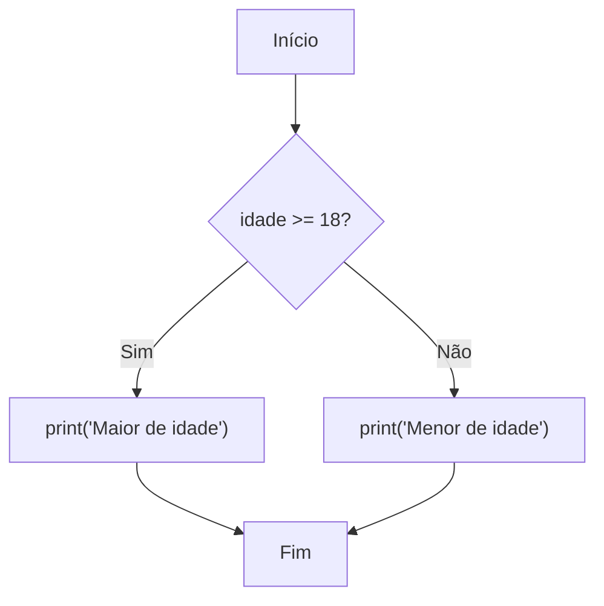

# 🔀 if / elif / else e match / case

Até aqui, seus programas executavam **todas as linhas, em ordem**. Com **condicionais**, o programa passa a **tomar decisões**.



---

## 1. `if`

```python
idade = 20

if idade >= 18:
    print("Maior de idade")
```

Estrutura:
1. A palavra `if`
2. Uma **condição** (qualquer expressão que vire `True`/`False`, veja [[01 - Fundamentos/04 - Operadores|operadores]])
3. Dois-pontos `:`
4. Um bloco **indentado** (4 espaços) que só roda se a condição for verdadeira

> [!warning] Armadilhas de sintaxe
> ```python
> # ❌ Esqueceu os dois-pontos
> if idade >= 18
>     print("ok")          # SyntaxError: expected ':'
>
> # ❌ Usou = em vez de ==
> if idade = 18:           # SyntaxError
>
> # ✅
> if idade == 18:
>     print("ok")
> ```

---

## 2. `if` / `else`

```python
idade = 15

if idade >= 18:
    print("Pode dirigir")
else:
    print("Ainda não pode dirigir")
```

## 3. `if` / `elif` / `else`

`elif` ("else if") permite testar **várias condições em sequência**. O Python executa o **primeiro bloco** cuja condição for verdadeira e ignora o resto.

```python
nota = 7.5

if nota >= 9:
    conceito = "A"
elif nota >= 7:
    conceito = "B"
elif nota >= 5:
    conceito = "C"
else:
    conceito = "D"

print(f"Conceito: {conceito}")   # B
```

> [!warning] Ordem das condições importa
> ```python
> # ❌ Errado: nota 9.5 cai no primeiro teste e vira "C"
> if nota >= 5:
>     conceito = "C"
> elif nota >= 7:
>     conceito = "B"
> elif nota >= 9:
>     conceito = "A"
>
> # ✅ Correto: do mais restritivo para o mais amplo
> ```

> [!tip] Use comparações encadeadas
> ```python
> if 18 <= idade < 65:
>     print("Adulto")
> ```

---

## 4. Condições compostas

Combine com `and`, `or`, `not`:

```python
idade = 25
tem_carteira = True

if idade >= 18 and tem_carteira:
    print("Pode dirigir")

dia = "sábado"
if dia == "sábado" or dia == "domingo":
    print("Fim de semana")
```

### Verificando vários valores com `in`
```python
# ❌ Verboso
if dia == "sábado" or dia == "domingo":
    ...

# ✅ Pythônico
if dia in ("sábado", "domingo"):
    ...
```

> [!warning] Erro clássico com `or`
> ```python
> # ❌ SEMPRE verdadeiro! ("domingo" é uma string não vazia)
> if dia == "sábado" or "domingo":
>
> # ✅
> if dia == "sábado" or dia == "domingo":
> ```

---

## 5. Truthiness nos `if`

Lembra da tabela de [[01 - Fundamentos/03 - Tipos de Dados Primitivos|valores falsos]]? Você pode usar qualquer valor como condição:

```python
nome = ""
if not nome:
    print("Nome vazio!")

itens = [1, 2]
if itens:
    print("Há itens")

# ❌ Verboso          # ✅ Pythônico
# if len(lista) > 0   # if lista:
# if x == True        # if x:
# if x == None        # if x is None:
```

> [!warning] Cuidado com o `0`
> ```python
> quantidade = 0
> # ❌ Se 0 é um valor válido, isso o trata como "ausente"
> if not quantidade:
>     print("Não informado")
>
> # ✅
> if quantidade is None:
>     print("Não informado")
> ```

---

## 6. `if` aninhado

```python
idade = 20
tem_ingresso = True

if idade >= 18:
    if tem_ingresso:
        print("Entrada liberada")
    else:
        print("Compre o ingresso")
else:
    print("Proibido para menores")
```

> [!tip] Evite aninhamento excessivo (cláusulas de guarda)
> ```python
> # ❌ "Pirâmide" difícil de ler
> if idade >= 18:
>     if tem_ingresso:
>         if not bloqueado:
>             print("Entrou")
>
> # ✅ Combine ou saia cedo
> if idade >= 18 and tem_ingresso and not bloqueado:
>     print("Entrou")
> ```
> Dentro de funções ([[03 - Funções e Modularização/01 - Definindo Funções|veja Funções]]), use `return` antecipado para reduzir o aninhamento.

---

## 7. Expressão condicional (ternário)

Uma forma compacta de escolher entre dois valores:

```python
idade = 20
status = "adulto" if idade >= 18 else "menor"
print(status)    # adulto
```

Formato: `valor_se_verdadeiro if condição else valor_se_falso`

> [!warning] Use com moderação
> ```python
> # ❌ Ilegível
> r = "A" if n > 9 else "B" if n > 7 else "C" if n > 5 else "D"
>
> # ✅ Para mais de duas opções, use if/elif/else
> ```

---

## 8. `pass`: bloco vazio

Quando a sintaxe exige um bloco mas você ainda não quer escrever nada:
```python
if condicao:
    pass     # TODO: implementar depois
```

---

## 9. `match` / `case` (Python 3.10+)

O `match` compara um valor com vários **padrões**. É o "*structural pattern matching*", bem mais poderoso que o `switch` de outras linguagens.

### 9.1 Valores literais
```python
comando = "iniciar"

match comando:
    case "iniciar":
        print("Iniciando...")
    case "parar":
        print("Parando...")
    case _:
        print("Comando desconhecido")
```
O `_` é o **curinga** (equivale ao `default`/`else`).

### 9.2 Vários valores com `|`
```python
match dia:
    case "sábado" | "domingo":
        print("Fim de semana")
    case _:
        print("Dia útil")
```

### 9.3 Captura de valor
```python
match resposta:
    case 200:
        print("OK")
    case 404:
        print("Não encontrado")
    case codigo:           # captura qualquer outro valor em "codigo"
        print(f"Código {codigo}")
```

> [!warning] Armadilha: nomes soltos são capturas, não comparações
> ```python
> ERRO = 404
>
> match status:
>     case ERRO:            # ❌ NÃO compara com 404! Captura QUALQUER valor
>         print("erro")
>
> # ✅ Para constantes, use nome qualificado (com ponto)
> import http
> match status:
>     case http.HTTPStatus.NOT_FOUND:
>         print("erro")
> ```

### 9.4 Guardas (`if` no `case`)
```python
match idade:
    case n if n < 0:
        print("Inválida")
    case n if n < 18:
        print("Menor")
    case _:
        print("Adulto")
```

### 9.5 Sequências (listas e tuplas)
```python
ponto = (0, 5)

match ponto:
    case (0, 0):
        print("Origem")
    case (x, 0):
        print(f"No eixo X em {x}")
    case (0, y):
        print(f"No eixo Y em {y}")     # este
    case (x, y):
        print(f"Ponto em ({x}, {y})")
```

```python
comando = ["ir", "norte", "3"]

match comando:
    case ["sair"]:
        print("Saindo")
    case ["ir", direcao]:
        print(f"Indo para {direcao}")
    case ["ir", direcao, passos]:
        print(f"Indo {passos} passos para {direcao}")
    case ["pegar", *itens]:
        print(f"Pegando {itens}")
```

### 9.6 Dicionários
```python
evento = {"tipo": "clique", "x": 10, "y": 20}

match evento:
    case {"tipo": "clique", "x": x, "y": y}:
        print(f"Clique em ({x}, {y})")
    case {"tipo": "tecla", "tecla": t}:
        print(f"Tecla {t}")
```
Dicionários casam mesmo que tenham **chaves extras**. Veja [[02 - Controle de Fluxo e Estruturas de Dados/06 - Dicionários|Dicionários]].

### 9.7 Objetos e classes
```python
from dataclasses import dataclass

@dataclass
class Ponto:
    x: int
    y: int

p = Ponto(0, 3)

match p:
    case Ponto(x=0, y=0):
        print("Origem")
    case Ponto(x=0, y=y):
        print(f"Eixo Y em {y}")
```
Mais sobre classes em [[04 - Programação Orientada a Objetos/01 - Classes e Objetos|POO]] e [[04 - Programação Orientada a Objetos/05 - Dataclasses e Slots|Dataclasses]].

### Quando usar `match` em vez de `if/elif`?

| Situação | Melhor escolha |
|----------|----------------|
| Condições booleanas simples (`x > 5`) | `if / elif` |
| Comparar um valor com várias opções fixas | `match` |
| Desmontar estruturas (listas, dicts, objetos) | `match` |
| Python < 3.10 | `if / elif` |

---

## 10. Exemplo completo: caixa eletrônico simples

```python
saldo = 1000.0

opcao = input("1-Saldo  2-Sacar  3-Sair: ").strip()

match opcao:
    case "1":
        print(f"Saldo: R$ {saldo:.2f}")
    case "2":
        valor = float(input("Valor do saque: "))
        if valor <= 0:
            print("Valor inválido")
        elif valor > saldo:
            print("Saldo insuficiente")
        else:
            saldo -= valor
            print(f"Saque realizado. Novo saldo: R$ {saldo:.2f}")
    case "3":
        print("Até logo!")
    case _:
        print("Opção inválida")
```

---

> [!question] Exercícios
> 1. Leia um número e diga se é **positivo**, **negativo** ou **zero**.
> 2. Leia um ano e diga se é bissexto (divisível por 4 e não por 100, **ou** divisível por 400).
> 3. Leia três lados e diga se formam um triângulo (cada lado menor que a soma dos outros dois) e, se formarem, se é **equilátero**, **isósceles** ou **escaleno**.
> 4. Reescreva com `match`: dado um número de 1 a 7, imprima o dia da semana (1 = domingo).
> 5. Dado `comando = ["mover", "10", "20"]`, use `match` para imprimir `Movendo para (10, 20)`.
> 6. O que há de errado? `if cor == "azul" or "verde":`

> [!success]- Soluções
> 1. ```python
>    n = float(input("Número: "))
>    if n > 0:
>        print("Positivo")
>    elif n < 0:
>        print("Negativo")
>    else:
>        print("Zero")
>    ```
> 2. ```python
>    ano = int(input("Ano: "))
>    if (ano % 4 == 0 and ano % 100 != 0) or ano % 400 == 0:
>        print("Bissexto")
>    else:
>        print("Não bissexto")
>    ```
> 3. ```python
>    a, b, c = (float(input(f"Lado {i}: ")) for i in "123")
>    if a < b + c and b < a + c and c < a + b:
>        if a == b == c:
>            print("Equilátero")
>        elif a == b or b == c or a == c:
>            print("Isósceles")
>        else:
>            print("Escaleno")
>    else:
>        print("Não forma triângulo")
>    ```
> 4. ```python
>    dia = int(input("Dia (1-7): "))
>    match dia:
>        case 1: print("Domingo")
>        case 2: print("Segunda")
>        case 3: print("Terça")
>        case 4: print("Quarta")
>        case 5: print("Quinta")
>        case 6: print("Sexta")
>        case 7: print("Sábado")
>        case _: print("Inválido")
>    ```
> 5. ```python
>    match comando:
>        case ["mover", x, y]:
>            print(f"Movendo para ({x}, {y})")
>    ```
> 6. `"verde"` é uma string não vazia, então a condição é **sempre** verdadeira. Correto: `cor == "azul" or cor == "verde"` ou `cor in ("azul", "verde")`.

---

⬅️ [[01 - Fundamentos/07 - Exercícios de Fundamentos|Exercícios de Fundamentos]] | ➡️ [[02 - Controle de Fluxo e Estruturas de Dados/02 - Loops for e while|Loops: for e while]]

#python #basico #condicionais #if #elif #match-case #fluxo
