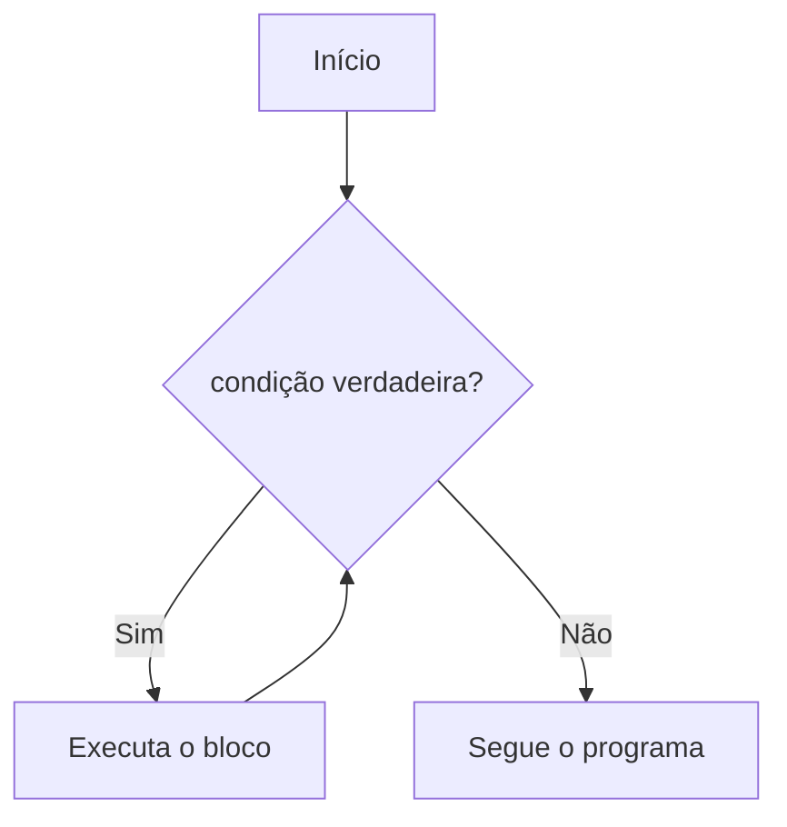

# 🔁 Loops: `for` e `while`

**Laços** (*loops*) repetem um bloco de código. Sem eles, imprimir de 1 a 1000 exigiria 1000 linhas.

| Laço | Use quando... |
|------|---------------|
| `for` | você sabe **sobre o quê** iterar (uma lista, um intervalo, um texto) |
| `while` | você repete **enquanto uma condição** for verdadeira |



---

## 1. `while`

```python
contador = 1

while contador <= 5:
    print(contador)
    contador += 1

print("Fim")
```
Saída: `1 2 3 4 5 Fim` (cada um em uma linha).

> [!warning] Armadilha nº 1: loop infinito
> ```python
> # ❌ contador nunca muda → roda para sempre
> contador = 1
> while contador <= 5:
>     print(contador)
>
> # ✅ Atualize a variável da condição
> while contador <= 5:
>     print(contador)
>     contador += 1
> ```
> Para interromper um programa travado no terminal, use `Ctrl + C`.

### Loop com entrada do usuário
```python
senha = ""
while senha != "python123":
    senha = input("Senha: ")
print("Acesso liberado!")
```

### `while True` + `break`
Padrão muito comum: repete "para sempre" e sai quando algo acontece.
```python
while True:
    resposta = input("Digite 'sair' para encerrar: ").strip().lower()
    if resposta == "sair":
        break
    print(f"Você digitou: {resposta}")
```

---

## 2. `for`

Percorre **cada item** de uma sequência (ou de qualquer *iterável*).

```python
for fruta in ["maçã", "banana", "uva"]:
    print(fruta)

for letra in "Python":
    print(letra)
```

> [!note] Como funciona
> A cada volta, a variável (`fruta`) recebe o próximo item. Quando acaba, o laço termina. Não há contador manual para "esquecer" de incrementar!

### `range()`: sequências de números
```python
range(5)           # 0, 1, 2, 3, 4          (fim exclusivo)
range(2, 6)        # 2, 3, 4, 5
range(0, 10, 2)    # 0, 2, 4, 6, 8          (passo 2)
range(5, 0, -1)    # 5, 4, 3, 2, 1          (contagem regressiva)
```

```python
for i in range(1, 6):
    print(f"{i} x 7 = {i * 7}")
```

> [!warning] Armadilha: o fim do `range` é exclusivo
> ```python
> # ❌ Queria de 1 a 10, mas vai só até 9
> for i in range(1, 10): ...
>
> # ✅
> for i in range(1, 11): ...
> ```

> [!tip] `range` é "preguiçoso"
> `range(1_000_000_000)` não ocupa memória: os números são gerados sob demanda. Para ver como lista: `list(range(5))`.

---

## 3. Ferramentas essenciais para `for`

### `enumerate()`: índice + valor
```python
# ❌ Estilo "de outra linguagem"
frutas = ["maçã", "banana", "uva"]
for i in range(len(frutas)):
    print(i, frutas[i])

# ✅ Pythônico
for i, fruta in enumerate(frutas):
    print(i, fruta)

for i, fruta in enumerate(frutas, start=1):   # começando de 1
    print(f"{i}. {fruta}")
```

### `zip()`: percorrer várias sequências juntas
```python
nomes = ["Ana", "Bruno", "Carla"]
notas = [8.5, 7.0, 9.2]

for nome, nota in zip(nomes, notas):
    print(f"{nome}: {nota}")
```
`zip` para na sequência **mais curta**. (Python 3.10+: `zip(a, b, strict=True)` levanta erro se os tamanhos diferirem.)

### `reversed()` e `sorted()`
```python
for n in reversed([1, 2, 3]):
    print(n)        # 3 2 1

for n in sorted([3, 1, 2]):
    print(n)        # 1 2 3
```

### Desempacotamento no `for`
```python
pares = [(1, "um"), (2, "dois")]
for numero, nome in pares:
    print(numero, nome)
```

### Iterando em dicionários (prévia)
```python
preco = {"café": 5.0, "pão": 1.5}
for produto, valor in preco.items():
    print(produto, valor)
```
Detalhes em [[02 - Controle de Fluxo e Estruturas de Dados/06 - Dicionários|Dicionários]].

---

## 4. Controlando o laço: `break`, `continue`, `else`

| Instrução | Efeito |
|-----------|--------|
| `break` | Encerra o laço imediatamente |
| `continue` | Pula para a próxima volta |
| `else` | Executa **se o laço terminar sem `break`** |

```python
# break: parar ao achar
for n in [4, 7, 10, 3]:
    if n > 8:
        print(f"Achei: {n}")
        break

# continue: pular itens
for n in range(1, 8):
    if n % 2 == 0:
        continue
    print(n)          # 1 3 5 7
```

### O `else` do laço (recurso único do Python)
```python
numeros = [2, 4, 6, 8]

for n in numeros:
    if n % 2 != 0:
        print("Achei um ímpar!")
        break
else:
    print("Todos são pares")    # roda porque não houve break
```

> [!warning] O `else` NÃO é "se o laço não rodou"
> Ele é "se o laço **não foi interrompido** por `break`". Muita gente confunde. Um exemplo útil é procurar um valor:
> ```python
> for item in lista:
>     if item == alvo:
>         print("Encontrado")
>         break
> else:
>     print("Não encontrado")
> ```

---

## 5. Laços aninhados

```python
for i in range(1, 4):
    for j in range(1, 4):
        print(f"{i} x {j} = {i * j}")
    print("---")
```

Desenhando um triângulo:
```python
for linha in range(1, 6):
    print("*" * linha)
```
```text
*
**
***
****
*****
```

> [!tip] Cuidado com a complexidade
> Dois laços aninhados de 1.000 itens = 1.000.000 de execuções. `break` e estruturas como [[02 - Controle de Fluxo e Estruturas de Dados/05 - Sets|sets]] e [[02 - Controle de Fluxo e Estruturas de Dados/06 - Dicionários|dicts]] ajudam a evitar isso.

---

## 6. Armadilhas comuns

### 6.1 Modificar uma lista enquanto a percorre
```python
numeros = [1, 2, 3, 4, 5, 6]

# ❌ Pula elementos!
for n in numeros:
    if n % 2 == 0:
        numeros.remove(n)
print(numeros)      # [1, 3, 5]  (parece certo, mas teste com [2, 4, 6]: sobra [4])

# ✅ Construa uma nova lista
impares = [n for n in numeros if n % 2 != 0]
# ✅ ou percorra uma cópia
for n in numeros[:]:
    if n % 2 == 0:
        numeros.remove(n)
```
Ver [[02 - Controle de Fluxo e Estruturas de Dados/07 - Comprehensions|Comprehensions]].

### 6.2 Reutilizar a variável do laço
A variável do `for` **continua existindo** depois do laço:
```python
for i in range(3):
    pass
print(i)    # 2
```

### 6.3 Acumuladores mal inicializados
```python
# ❌ Zerar dentro do laço
for n in [1, 2, 3]:
    soma = 0
    soma += n
print(soma)         # 3 (e não 6!)

# ✅ Inicialize ANTES do laço
soma = 0
for n in [1, 2, 3]:
    soma += n
print(soma)         # 6
```
(Ou simplesmente `sum([1, 2, 3])`.)

---

## 7. Padrões clássicos de laço

### Acumulador (soma, contagem)
```python
total = 0
for preco in [10.5, 20, 5.25]:
    total += preco
print(f"Total: {total:.2f}")
```

### Maior valor (sem usar `max`)
```python
numeros = [4, 9, 2, 7]
maior = numeros[0]
for n in numeros[1:]:
    if n > maior:
        maior = n
```

### Contagem com condição
```python
vogais = 0
for letra in "programação":
    if letra.lower() in "aeiouáâãéêíóôõú":
        vogais += 1
```

### Validação de entrada
```python
while True:
    texto = input("Digite um número positivo: ")
    if texto.isdigit() and int(texto) > 0:
        numero = int(texto)
        break
    print("Entrada inválida, tente de novo.")
```

### Lotes (Python 3.12+)
```python
from itertools import batched

for lote in batched(range(10), 4):
    print(lote)     # (0,1,2,3) (4,5,6,7) (8,9)
```

---

## 8. `for` ou `while`?

| Pergunta | Resposta |
|----------|----------|
| Sei quantas vezes ou sobre o quê vou iterar? | `for` |
| Vou repetir até algo acontecer (entrada válida, fim de arquivo)? | `while` |
| Preciso do índice? | `for ... in enumerate(...)` |
| Preciso de duas listas em paralelo? | `for ... in zip(...)` |

---

> [!question] Exercícios
> 1. Imprima os números de 1 a 20, pulando os múltiplos de 3.
> 2. Calcule o fatorial de um número lido (`5! = 120`) usando `while`.
> 3. Imprima a tabuada de um número lido (1 a 10).
> 4. Peça números ao usuário até ele digitar `0`; no final mostre a **soma** e a **média** dos números digitados.
> 5. Dada uma lista, descubra se **algum** número é negativo, usando `for/else`.
> 6. Imprima este padrão (altura lida):
>    ```text
>        *
>       ***
>      *****
>     *******
>    ```
> 7. Verifique se um número é **primo**.
> 8. Gere os primeiros 15 números de Fibonacci.

> [!success]- Soluções
> 1. ```python
>    for n in range(1, 21):
>        if n % 3 == 0:
>            continue
>        print(n)
>    ```
> 2. ```python
>    n = int(input("Número: "))
>    fat = 1
>    i = n
>    while i > 1:
>        fat *= i
>        i -= 1
>    print(f"{n}! = {fat}")
>    ```
> 3. ```python
>    n = int(input("Tabuada de: "))
>    for i in range(1, 11):
>        print(f"{n} x {i:2d} = {n * i}")
>    ```
> 4. ```python
>    soma = qtd = 0
>    while True:
>        n = float(input("Número (0 para sair): "))
>        if n == 0:
>            break
>        soma += n
>        qtd += 1
>    if qtd:
>        print(f"Soma: {soma} | Média: {soma / qtd:.2f}")
>    else:
>        print("Nenhum número informado")
>    ```
> 5. ```python
>    for n in lista:
>        if n < 0:
>            print("Há negativo")
>            break
>    else:
>        print("Nenhum negativo")
>    ```
> 6. ```python
>    altura = int(input("Altura: "))
>    for i in range(1, altura + 1):
>        print(" " * (altura - i) + "*" * (2 * i - 1))
>    ```
> 7. ```python
>    n = int(input("Número: "))
>    if n < 2:
>        print("Não é primo")
>    else:
>        for d in range(2, int(n ** 0.5) + 1):
>            if n % d == 0:
>                print("Não é primo")
>                break
>        else:
>            print("É primo")
>    ```
> 8. ```python
>    a, b = 0, 1
>    for _ in range(15):
>        print(a, end=" ")
>        a, b = b, a + b
>    ```

---

⬅️ [[02 - Controle de Fluxo e Estruturas de Dados/01 - if elif else e match case|if/elif/else e match/case]] | ➡️ [[02 - Controle de Fluxo e Estruturas de Dados/03 - Listas|Listas]]

#python #basico #loops #for #while #range #enumerate #zip
