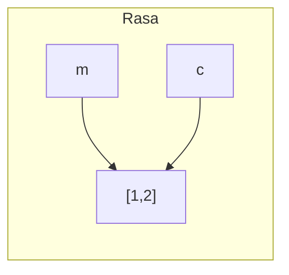

# 📋 Listas (`list`)

Uma **lista** é uma coleção **ordenada** e **mutável** de itens. É a estrutura de dados mais usada em Python.

> [!example] Analogia
> Uma lista é como uma **fila numerada** de caixas: cada caixa tem uma posição (começando do 0) e você pode trocar, adicionar ou remover caixas à vontade.

| Característica | Lista |
|----------------|-------|
| Ordenada | ✅ (mantém a ordem de inserção) |
| Mutável | ✅ |
| Permite repetidos | ✅ |
| Aceita tipos misturados | ✅ |
| Sintaxe | `[1, 2, 3]` |

---

## 1. Criando listas

```python
vazia = []
numeros = [10, 20, 30]
mista = [1, "dois", 3.0, True, None]
aninhada = [[1, 2], [3, 4]]       # lista de listas (matriz)

letras = list("abc")              # ['a', 'b', 'c']
inteiros = list(range(5))         # [0, 1, 2, 3, 4]
```

---

## 2. Acessando elementos

```text
  frutas = ["maçã", "banana", "uva", "pera"]
  índice:     0        1        2       3
  negativo:  -4       -3       -2      -1
```

```python
frutas = ["maçã", "banana", "uva", "pera"]

print(frutas[0])      # 'maçã'
print(frutas[-1])     # 'pera'
print(len(frutas))    # 4
```

> [!warning] `IndexError`
> ```python
> frutas[4]      # ❌ IndexError: list index out of range  (o último é o 3!)
> frutas[len(frutas) - 1]   # ✅ ou simplesmente frutas[-1]
> ```

### Fatiamento (*slicing*): `lista[início:fim:passo]`
```python
n = [0, 1, 2, 3, 4, 5, 6, 7, 8, 9]

print(n[2:5])     # [2, 3, 4]       (fim exclusivo)
print(n[:3])      # [0, 1, 2]
print(n[7:])      # [7, 8, 9]
print(n[::2])     # [0, 2, 4, 6, 8]
print(n[::-1])    # [9, 8, ..., 0]  (invertida)
print(n[-3:])     # [7, 8, 9]       (3 últimos)
```
Fatias **nunca** dão `IndexError` (se passar do limite, só devolvem o que existe). Funciona igual em strings: [[01 - Fundamentos/03 - Tipos de Dados Primitivos|veja slicing]].

---

## 3. Modificando listas

```python
cores = ["azul", "verde"]

cores[0] = "vermelho"      # troca um item
cores[1:] = ["rosa", "preto", "branco"]   # troca uma fatia
```

### Métodos para adicionar

| Método | O que faz | Exemplo |
|--------|-----------|---------|
| `append(x)` | Adiciona **um** item no fim | `l.append(4)` |
| `extend(iteravel)` | Adiciona **vários** itens no fim | `l.extend([5, 6])` |
| `insert(i, x)` | Insere na posição `i` | `l.insert(0, "início")` |

```python
l = [1, 2, 3]
l.append(4)          # [1, 2, 3, 4]
l.extend([5, 6])     # [1, 2, 3, 4, 5, 6]
l.insert(0, 0)       # [0, 1, 2, 3, 4, 5, 6]
```

> [!warning] `append` vs `extend`
> ```python
> l = [1, 2]
> l.append([3, 4])     # [1, 2, [3, 4]]   ← uma lista dentro da lista!
> l.extend([3, 4])     # [1, 2, 3, 4]     ← itens individuais
> ```

### Métodos para remover

| Método | O que faz | Observação |
|--------|-----------|-----------|
| `remove(x)` | Remove a **primeira ocorrência** do valor | `ValueError` se não existir |
| `pop()` | Remove e **devolve** o último | `IndexError` se vazia |
| `pop(i)` | Remove e devolve o item da posição `i` | |
| `clear()` | Esvazia a lista | |
| `del l[i]` | Remove por posição (ou fatia) | `del l[1:3]` |

```python
l = ["a", "b", "c", "b"]
l.remove("b")        # ['a', 'c', 'b']  (só a primeira!)
ultimo = l.pop()     # 'b'  → l = ['a', 'c']
primeiro = l.pop(0)  # 'a'  → l = ['c']
```

### Métodos de consulta

| Método | O que faz |
|--------|-----------|
| `index(x)` | Posição da 1ª ocorrência (`ValueError` se não existir) |
| `count(x)` | Quantas vezes `x` aparece |
| `x in l` / `x not in l` | Verifica pertencimento |
| `len(l)`, `min(l)`, `max(l)`, `sum(l)` | Funções nativas |

```python
notas = [7, 9, 7, 10]
print(notas.index(9))    # 1
print(notas.count(7))    # 2
print(max(notas), min(notas), sum(notas))   # 10 7 33
print(8 in notas)        # False
```

### Ordenação

| | Altera a original? | Retorno |
|---|---|---|
| `l.sort()` | ✅ Sim (in-place) | `None` |
| `sorted(l)` | ❌ Não | Nova lista |
| `l.reverse()` | ✅ Sim | `None` |
| `reversed(l)` | ❌ Não | Iterador |

```python
n = [3, 1, 2]
n.sort()                      # [1, 2, 3]
n.sort(reverse=True)          # [3, 2, 1]

palavras = ["banana", "kiwi", "maçã"]
print(sorted(palavras, key=len))             # ['kiwi', 'maçã', 'banana']
print(sorted(palavras, key=str.lower, reverse=True))
```

> [!warning] Armadilha: `sort()` devolve `None`
> ```python
> # ❌
> n = [3, 1, 2]
> n = n.sort()
> print(n)         # None 😱
>
> # ✅
> n.sort()                # altera a lista
> n = sorted(n)           # ou cria uma nova
> ```

> [!note] Ordenação estável e `key`
> `key` recebe uma função que extrai o critério. A ordenação é **estável** (itens iguais mantêm a ordem original), o que permite ordenar por vários critérios em passos.
> ```python
> alunos = [("Ana", 8), ("Bruno", 9), ("Carla", 8)]
> alunos.sort(key=lambda a: (-a[1], a[0]))   # nota desc, nome asc
> ```
> `lambda` será visto em [[07 - Programação Funcional e Intermediário/02 - Lambda map filter reduce|Lambda, map, filter, reduce]].

---

## 4. Operadores com listas

```python
print([1, 2] + [3])        # [1, 2, 3]     (concatenação, cria nova lista)
print([0] * 3)             # [0, 0, 0]
print([1, 2] == [1, 2])    # True
print([1, 2] < [1, 3])     # True          (comparação lexicográfica)
```

---

## 5. Percorrendo listas

```python
for fruta in frutas:
    print(fruta)

for i, fruta in enumerate(frutas):
    print(i, fruta)
```
Revise em [[02 - Controle de Fluxo e Estruturas de Dados/02 - Loops for e while|Loops]].

---

## 6. Cópias: o ponto mais traiçoeiro

```python
a = [1, 2, 3]
b = a            # ❌ NÃO é cópia: mesma lista, dois nomes
b.append(4)
print(a)         # [1, 2, 3, 4]
```

### Cópia rasa (*shallow copy*)
```python
b = a.copy()     # ou list(a) ou a[:]
b.append(5)
print(a)         # [1, 2, 3, 4]   (intacta)
```

### Cópia rasa NÃO copia listas internas
```python
m = [[1, 2], [3, 4]]
c = m.copy()
c[0].append(99)
print(m)         # [[1, 2, 99], [3, 4]]  😱  a interna é compartilhada
```

### Cópia profunda (*deep copy*)
```python
import copy
c = copy.deepcopy(m)    # copia tudo, recursivamente
```



### A armadilha das matrizes
```python
# ❌ Três referências à MESMA linha
matriz = [[0] * 3] * 3
matriz[0][0] = 1
print(matriz)    # [[1, 0, 0], [1, 0, 0], [1, 0, 0]]  😱

# ✅ Cada linha é uma lista nova
matriz = [[0] * 3 for _ in range(3)]
matriz[0][0] = 1
print(matriz)    # [[1, 0, 0], [0, 0, 0], [0, 0, 0]]
```

---

## 7. Desempacotamento

```python
a, b, c = [10, 20, 30]

primeiro, *meio, ultimo = [1, 2, 3, 4, 5]
print(primeiro, meio, ultimo)    # 1 [2, 3, 4] 5

x, y = [1, 2]
x, y = y, x                       # troca
```

---

## 8. Listas como pilha e fila

### Pilha (LIFO: último a entrar, primeiro a sair)
```python
pilha = []
pilha.append("a")
pilha.append("b")
print(pilha.pop())     # 'b'
```

### Fila (FIFO)
Usar `pop(0)` é lento em listas grandes (desloca todos os itens). Prefira `collections.deque`:
```python
from collections import deque

fila = deque(["a", "b", "c"])
fila.append("d")
print(fila.popleft())    # 'a'  (rápido)
```
Mais em [[06 - Módulos da Biblioteca Padrão Essenciais/03 - collections itertools e functools|collections, itertools, functools]].

---

## 9. Boas práticas e performance

| Operação | Custo | Observação |
|----------|-------|-----------|
| `l[i]`, `l.append(x)`, `l.pop()` | O(1) | Rápidos |
| `l.insert(0, x)`, `l.pop(0)` | O(n) | Evite em listas grandes |
| `x in l`, `l.index(x)`, `l.remove(x)` | O(n) | Busca linear; use [[02 - Controle de Fluxo e Estruturas de Dados/05 - Sets\|set]] para buscas frequentes |
| `l.sort()` | O(n log n) | |

> [!tip] Verificações em massa? Use set
> ```python
> # ❌ Lento: 'in' em lista é O(n) a cada teste
> proibidas = ["a", "b", "c", ...]
> if palavra in proibidas: ...
>
> # ✅ Rápido: set é O(1)
> proibidas = {"a", "b", "c", ...}
> ```

> [!warning] Nunca use lista como valor padrão de parâmetro
> ```python
> # ❌
> def adiciona(x, lista=[]):
>     lista.append(x)
>     return lista
> # a mesma lista é reutilizada entre chamadas!
>
> # ✅
> def adiciona(x, lista=None):
>     if lista is None:
>         lista = []
>     lista.append(x)
>     return lista
> ```
> Veja [[03 - Funções e Modularização/02 - args kwargs e Argumentos Padrão|Argumentos Padrão]].

---

## 10. Exemplo: lista de compras

```python
compras = []

while True:
    item = input("Item (ou ENTER para terminar): ").strip()
    if not item:
        break
    compras.append(item)

compras.sort()
print(f"\nVocê tem {len(compras)} itens:")
for i, item in enumerate(compras, start=1):
    print(f"{i}. {item}")
```

---

> [!question] Exercícios
> 1. Crie a lista `[5, 3, 8, 1]` e: adicione 10 no fim, insira 0 no início, remova o 8 e ordene em ordem decrescente.
> 2. Dada `n = [1, 2, 3, 4, 5, 6, 7, 8, 9, 10]`, obtenha: os pares, os 3 últimos e a lista invertida (usando fatias).
> 3. Qual a diferença entre `l.sort()` e `sorted(l)`?
> 4. Remova os duplicados de uma lista **mantendo a ordem original**.
> 5. Dadas duas listas `nomes` e `idades`, crie uma lista de tuplas `(nome, idade)`.
> 6. Explique por que o código abaixo imprime o que imprime:
>    ```python
>    a = [1, 2]
>    b = a
>    b += [3]
>    print(a)
>    ```
> 7. Crie uma matriz 3×3 com zeros e coloque 1 na diagonal principal.

> [!success]- Soluções
> 1. ```python
>    l = [5, 3, 8, 1]
>    l.append(10)
>    l.insert(0, 0)
>    l.remove(8)
>    l.sort(reverse=True)
>    print(l)    # [10, 5, 3, 1, 0]
>    ```
> 2. ```python
>    pares = n[1::2]       # [2, 4, 6, 8, 10]
>    ultimos = n[-3:]      # [8, 9, 10]
>    invertida = n[::-1]
>    ```
> 3. `sort()` altera a lista original e devolve `None`; `sorted()` devolve **nova** lista e mantém a original.
> 4. ```python
>    lista = [3, 1, 3, 2, 1]
>    unicos = []
>    for x in lista:
>        if x not in unicos:
>            unicos.append(x)
>    # versão curta: list(dict.fromkeys(lista))
>    ```
> 5. `list(zip(nomes, idades))`
> 6. `[1, 2, 3]`. `b += [3]` em listas faz `extend` **in-place**, alterando o objeto compartilhado por `a` e `b`.
> 7. ```python
>    m = [[0] * 3 for _ in range(3)]
>    for i in range(3):
>        m[i][i] = 1
>    ```

---

⬅️ [[02 - Controle de Fluxo e Estruturas de Dados/02 - Loops for e while|Loops]] | ➡️ [[02 - Controle de Fluxo e Estruturas de Dados/04 - Tuplas|Tuplas]]

#python #basico #listas #estruturas-de-dados #slicing #copia
