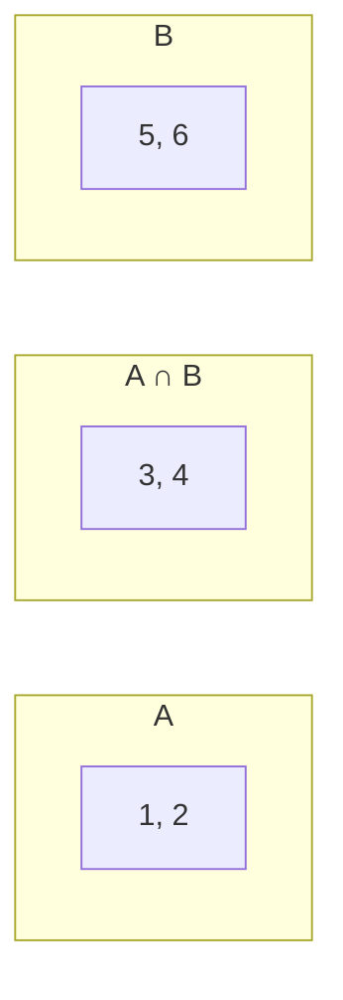

# 🧮 Sets (`set`)

Um **set** (conjunto) é uma coleção **sem repetidos** e **sem ordem garantida**, com busca de pertencimento **muito rápida**. Funciona como os conjuntos da matemática.

| Característica | Set |
|----------------|-----|
| Ordenado | ❌ (sem índices) |
| Mutável | ✅ (`add`, `remove`...) |
| Permite repetidos | ❌ |
| Itens | Precisam ser **hasheáveis** (imutáveis: `int`, `str`, `tuple`...) |
| Sintaxe | `{1, 2, 3}` |
| `x in s` | O(1) (muito rápido) |

> [!example] Analogia
> Um set é uma **sacola de bolinhas diferentes**: você só quer saber *se* uma bolinha está lá dentro, não em que posição.

---

## 1. Criando sets

```python
frutas = {"maçã", "banana", "uva"}
numeros = {1, 2, 2, 3, 3, 3}
print(numeros)                 # {1, 2, 3}  (repetidos somem)

letras = set("abracadabra")    # {'a', 'b', 'r', 'c', 'd'} (ordem pode variar)
de_lista = set([1, 2, 2, 3])
```

> [!warning] Armadilha: `{}` cria um **dicionário**, não um set!
> ```python
> # ❌
> vazio = {}
> print(type(vazio))     # <class 'dict'>
>
> # ✅ Set vazio
> vazio = set()
> ```

> [!warning] Itens precisam ser hasheáveis
> ```python
> {[1, 2], [3]}       # ❌ TypeError: unhashable type: 'list'
> {(1, 2), (3, 4)}    # ✅ tuplas funcionam
> ```

---

## 2. Sem índice, sem ordem

```python
s = {10, 20, 30}
s[0]      # ❌ TypeError: 'set' object is not subscriptable
```
Percorra com `for`; **não dependa da ordem**:
```python
for item in s:
    print(item)
```
Para ordem, use `sorted(s)` (devolve lista).

---

## 3. Adicionando e removendo

| Método | O que faz | Se o item não existe |
|--------|-----------|----------------------|
| `add(x)` | Adiciona um item | — |
| `update(iteravel)` | Adiciona vários itens | — |
| `remove(x)` | Remove o item | **`KeyError`** |
| `discard(x)` | Remove o item | Ignora (sem erro) |
| `pop()` | Remove e devolve um item **arbitrário** | `KeyError` se vazio |
| `clear()` | Esvazia | — |

```python
s = {1, 2}
s.add(3)             # {1, 2, 3}
s.add(3)             # nada acontece
s.update([4, 5])     # {1, 2, 3, 4, 5}
s.remove(5)
s.discard(99)        # sem erro
```

> [!tip] `remove` ou `discard`?
> Use `discard` quando não tiver certeza de que o item existe.

---

## 4. Operações de conjuntos

```python
a = {1, 2, 3, 4}
b = {3, 4, 5, 6}
```

| Operação | Operador | Método | Resultado |
|----------|----------|--------|-----------|
| **União** (todos) | `a \| b` | `a.union(b)` | `{1, 2, 3, 4, 5, 6}` |
| **Interseção** (em comum) | `a & b` | `a.intersection(b)` | `{3, 4}` |
| **Diferença** (só em a) | `a - b` | `a.difference(b)` | `{1, 2}` |
| **Diferença simétrica** (em um só) | `a ^ b` | `a.symmetric_difference(b)` | `{1, 2, 5, 6}` |



### Relações entre conjuntos
```python
x = {1, 2}
y = {1, 2, 3}

print(x <= y)            # True   subconjunto  (x.issubset(y))
print(y >= x)            # True   superconjunto (y.issuperset(x))
print(x.isdisjoint({9})) # True   sem itens em comum
print(x == {2, 1})       # True   a ordem não importa
```

### Versões que modificam o set (in-place)
```python
a |= {10}     # a.update({10})
a &= b        # a.intersection_update(b)
a -= b        # a.difference_update(b)
```

---

## 5. Usos mais comuns

### 5.1 Remover duplicados
```python
lista = [1, 2, 2, 3, 3, 3]
unicos = list(set(lista))      # [1, 2, 3]
```
> [!warning] `set` perde a ordem
> Para remover duplicados **mantendo a ordem**: `list(dict.fromkeys(lista))`.

### 5.2 Teste rápido de pertencimento
```python
# ❌ Lento com listas grandes: O(n) por consulta
permitidos = ["ana", "bia", "caio"]    # ... milhares
"bia" in permitidos

# ✅ O(1)
permitidos = {"ana", "bia", "caio"}
"bia" in permitidos
```

### 5.3 O que há em comum / o que falta
```python
alunos_python = {"Ana", "Bia", "Caio"}
alunos_sql = {"Bia", "Caio", "Davi"}

print(alunos_python & alunos_sql)   # fazem os dois
print(alunos_python - alunos_sql)   # só Python
print(alunos_python | alunos_sql)   # todos
```

### 5.4 Detectar duplicatas
```python
def tem_duplicados(lista):
    return len(lista) != len(set(lista))
```

### 5.5 Letras únicas de um texto
```python
print(sorted(set("banana")))     # ['a', 'b', 'n']
```

---

## 6. `frozenset`: set imutável

```python
fs = frozenset([1, 2, 3])
# fs.add(4)   ❌ AttributeError
```
É hasheável: pode ser **chave de dicionário** ou **item de outro set**.
```python
grupos = {frozenset({"a", "b"}): "grupo 1"}
```

---

## 7. Sets e outras coleções

| | list | tuple | set | dict |
|---|------|-------|-----|------|
| Ordenada | ✅ | ✅ | ❌ | ✅ (por inserção) |
| Mutável | ✅ | ❌ | ✅ | ✅ |
| Repetidos | ✅ | ✅ | ❌ | chaves únicas |
| Acesso por | índice | índice | — | chave |
| `in` | O(n) | O(n) | O(1) | O(1) |

> [!tip] Qual escolher?
> - Preciso de **ordem/índice** → lista ou tupla
> - Preciso de **unicidade e busca rápida** → set
> - Preciso associar **chave → valor** → [[02 - Controle de Fluxo e Estruturas de Dados/06 - Dicionários|dicionário]]

---

## 8. Comprehension de sets

```python
quadrados = {n ** 2 for n in [-2, -1, 0, 1, 2]}
print(quadrados)     # {0, 1, 4}
```
Veja [[02 - Controle de Fluxo e Estruturas de Dados/07 - Comprehensions|Comprehensions]].

---

> [!question] Exercícios
> 1. Crie um set com os números `1, 2, 2, 3, 3, 3` e mostre quantos elementos tem.
> 2. Dadas `a = [1, 2, 3, 4]` e `b = [3, 4, 5]`, mostre os elementos em comum, os exclusivos de `a` e a união.
> 3. Leia uma frase e diga quantas palavras **diferentes** ela tem (ignore maiúsculas/minúsculas).
> 4. Escreva uma função que diga se duas palavras são **anagramas** (mesmas letras, mesmas quantidades). Dica: pense se `set` basta (não basta!) e o que usar.
> 5. Qual a diferença entre `remove` e `discard`?
> 6. Por que `s = {}` não é um set vazio? Como criar um?
> 7. Dados dois e-mails de listas diferentes, encontre os que aparecem em **uma só** das listas.

> [!success]- Soluções
> 1. `s = {1, 2, 2, 3, 3, 3}; print(len(s))   # 3`
> 2. ```python
>    a, b = set(a), set(b)
>    print(a & b)   # {3, 4}
>    print(a - b)   # {1, 2}
>    print(a | b)   # {1, 2, 3, 4, 5}
>    ```
> 3. ```python
>    frase = input("Frase: ").lower().split()
>    print(len(set(frase)))
>    ```
> 4. `set` ignora repetições (`"aab"` e `"abb"` teriam o mesmo set). Use `sorted`:
>    ```python
>    def anagramas(p1, p2):
>        return sorted(p1.lower()) == sorted(p2.lower())
>    ```
>    (ou `collections.Counter`)
> 5. `remove` levanta `KeyError` se o item não existir; `discard` ignora.
> 6. `{}` é um dicionário vazio. Set vazio: `set()`.
> 7. `set(lista1) ^ set(lista2)`

---

⬅️ [[02 - Controle de Fluxo e Estruturas de Dados/04 - Tuplas|Tuplas]] | ➡️ [[02 - Controle de Fluxo e Estruturas de Dados/06 - Dicionários|Dicionários]]

#python #basico #sets #estruturas-de-dados #conjuntos
