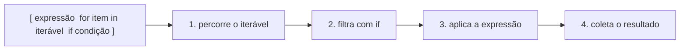

# ⚡ Comprehensions

**Comprehensions** são uma forma compacta e legível de **construir coleções a partir de outras**, substituindo o padrão "crie lista vazia → `for` → `append`".

```python
# Jeito tradicional
quadrados = []
for n in range(1, 6):
    quadrados.append(n ** 2)

# Com comprehension
quadrados = [n ** 2 for n in range(1, 6)]
print(quadrados)    # [1, 4, 9, 16, 25]
```

> [!note] Leitura natural
> `[n ** 2 for n in range(1, 6)]` lê-se: *"n ao quadrado, para cada n em range(1, 6)"*.



---

## 1. List comprehension

Sintaxe: `[expressão for item in iterável]`

```python
dobros = [x * 2 for x in [1, 2, 3]]          # [2, 4, 6]
maiusculas = [s.upper() for s in ["a", "b"]]  # ['A', 'B']
tamanhos = [len(p) for p in ["sol", "lua", "estrela"]]  # [3, 3, 7]
digitos = [int(c) for c in "2026"]            # [2, 0, 2, 6]
```

### Com filtro (`if` no final)
Sintaxe: `[expressão for item in iterável if condição]`

```python
pares = [n for n in range(10) if n % 2 == 0]        # [0, 2, 4, 6, 8]
positivos = [n for n in [-1, 5, -3, 8] if n > 0]    # [5, 8]
curtas = [p for p in ["sol", "estrela", "lua"] if len(p) <= 3]
```

### Com `if/else` (transformação condicional)
Aqui o `if/else` vem **antes** do `for`, porque faz parte da **expressão**:
Sintaxe: `[valor_a if condição else valor_b for item in iterável]`

```python
rotulos = ["par" if n % 2 == 0 else "ímpar" for n in range(5)]
# ['par', 'ímpar', 'par', 'ímpar', 'par']
```

> [!warning] Armadilha: posição do `if`
> ```python
> # ❌ SyntaxError: if/else no fim não existe
> [n for n in range(5) if n % 2 == 0 else 0]
>
> # ✅ Filtrar (if no FIM, sem else)
> [n for n in range(5) if n % 2 == 0]           # [0, 2, 4]
>
> # ✅ Transformar (if/else NO INÍCIO)
> [n if n % 2 == 0 else 0 for n in range(5)]    # [0, 0, 2, 0, 4]
> ```

| Objetivo | Forma |
|----------|-------|
| **Filtrar** (descartar itens) | `[x for x in it if cond]` |
| **Transformar** (escolher valor) | `[a if cond else b for x in it]` |
| **Ambos** | `[a if c1 else b for x in it if c2]` |

---

## 2. Comprehensions aninhadas e múltiplos `for`

### Dois `for` (achatar uma matriz)
```python
matriz = [[1, 2, 3], [4, 5, 6], [7, 8, 9]]

# Os "for" aparecem na MESMA ordem do código tradicional
plana = [n for linha in matriz for n in linha]
# [1, 2, 3, 4, 5, 6, 7, 8, 9]

# Equivalente:
plana = []
for linha in matriz:
    for n in linha:
        plana.append(n)
```

### Produto cartesiano
```python
pares = [(x, y) for x in [1, 2] for y in ["a", "b"]]
# [(1, 'a'), (1, 'b'), (2, 'a'), (2, 'b')]
```

### Criando uma matriz (a forma segura!)
```python
matriz = [[0] * 3 for _ in range(3)]
# ✅ cada linha é uma lista nova (veja a armadilha em Listas)
```
Veja [[02 - Controle de Fluxo e Estruturas de Dados/03 - Listas#A armadilha das matrizes|a armadilha das matrizes]].

### Transpondo uma matriz
```python
transposta = [[linha[i] for linha in matriz] for i in range(3)]
# ou: list(zip(*matriz))
```

> [!tip] Limite de legibilidade
> Mais de **2 `for`** ou condições muito longas: volte para o laço tradicional. Legibilidade vence concisão.

---

## 3. Dict comprehension

Sintaxe: `{chave: valor for item in iterável}`

```python
quadrados = {n: n ** 2 for n in range(1, 5)}
# {1: 1, 2: 4, 3: 9, 4: 16}

nomes = ["Ana", "Bruno"]
tamanhos = {nome: len(nome) for nome in nomes}
# {'Ana': 3, 'Bruno': 5}

# A partir de um dict existente
preco = {"café": 5.0, "pão": 1.5, "leite": 4.2}
com_desconto = {k: round(v * 0.9, 2) for k, v in preco.items()}
caros = {k: v for k, v in preco.items() if v > 4}
invertido = {v: k for k, v in preco.items()}

# Listas paralelas
dict_pares = {k: v for k, v in zip(["a", "b"], [1, 2])}
```
Veja [[02 - Controle de Fluxo e Estruturas de Dados/06 - Dicionários|Dicionários]].

---

## 4. Set comprehension

Sintaxe: `{expressão for item in iterável}` (sem `:`)

```python
letras = {c.lower() for c in "Banana Bread" if c.isalpha()}
# {'b', 'a', 'n', 'r', 'e', 'd'}

tamanhos = {len(p) for p in ["sol", "lua", "estrela"]}   # {3, 7}
```
Duplicados são removidos automaticamente ([[02 - Controle de Fluxo e Estruturas de Dados/05 - Sets|Sets]]).

> [!warning] Não existe "tuple comprehension"
> ```python
> t = (n for n in range(3))      # ← isto é um GERADOR, não uma tupla!
> t = tuple(n for n in range(3)) # ✅ (0, 1, 2)
> ```

---

## 5. Expressões geradoras (generator expressions)

Parecem list comprehensions, mas com **parênteses**: produzem os itens **sob demanda**, sem criar a lista inteira na memória.

```python
quadrados = (n ** 2 for n in range(1_000_000))   # quase não usa memória
print(next(quadrados))     # 0
print(next(quadrados))     # 1

# Ótimas como argumento de funções que consomem iteráveis
print(sum(n ** 2 for n in range(1000)))
print(any(n < 0 for n in [1, 2, -3]))     # True
print(all(n > 0 for n in [1, 2, 3]))      # True
print(max(len(p) for p in ["sol", "estrela"]))
```

> [!tip] Quando o argumento é único, dispense os parênteses duplos
> `sum(n ** 2 for n in range(10))`, e não `sum((n ** 2 for n in range(10)))`.

| | List comprehension `[...]` | Generator expression `(...)` |
|---|-----|-----|
| Memória | Cria a lista toda | Um item por vez |
| Reutilizável | ✅ (percorre várias vezes) | ❌ (esgota após 1 uso) |
| Indexável (`x[0]`) | ✅ | ❌ |
| Melhor quando | Precisa da lista completa | Só vai percorrer/agregar |

Veja mais em [[07 - Programação Funcional e Intermediário/04 - Generators e Iterators|Generators e Iterators]].

---

## 6. Operador morsa em comprehensions

Evita calcular algo duas vezes:
```python
dados = ["10", "x", "25", "abc", "7"]

# ❌ int() duas vezes (e isdigit antes)
numeros = [int(d) for d in dados if d.isdigit()]

# ✅ Calcula uma vez, usa no filtro e no resultado
def parse(s):
    return int(s) if s.isdigit() else None

validos = [n for d in dados if (n := parse(d)) is not None]
print(validos)    # [10, 25, 7]
```

---

## 7. Comprehension vs `map`/`filter` vs laço

```python
# map + filter + lambda (menos legível em Python)
list(map(lambda x: x * 2, filter(lambda x: x > 0, nums)))

# comprehension (preferida na comunidade Python)
[x * 2 for x in nums if x > 0]
```
Veja [[07 - Programação Funcional e Intermediário/02 - Lambda map filter reduce|map, filter e lambda]].

| Situação | Melhor escolha |
|----------|----------------|
| Transformar/filtrar para criar coleção | **Comprehension** |
| Lógica com vários passos, efeitos colaterais (`print`, gravar arquivo) | `for` tradicional |
| Só agregar (soma, máximo, contagem) | Expressão geradora dentro de `sum`/`max`/... |
| Precisa do escopo no estilo "função" | Função + laço |

> [!warning] Não use comprehension só pelos efeitos colaterais
> ```python
> # ❌ Cria uma lista inútil de Nones
> [print(x) for x in lista]
>
> # ✅
> for x in lista:
>     print(x)
> ```

> [!note] Escopo
> A variável de iteração da comprehension **não vaza** para fora (diferente do `for`):
> ```python
> [i for i in range(3)]
> print(i)     # NameError
> ```

---

## 8. Exemplos práticos

### Limpar entrada
```python
brutos = ["  Ana ", "bruno", "  CARLA"]
limpos = [n.strip().title() for n in brutos]
# ['Ana', 'Bruno', 'Carla']
```

### Palavras únicas e ordenadas
```python
frase = "o rato roeu a roupa do rei de roma"
palavras = sorted({p for p in frase.split()})
```

### Números primos até 50
```python
primos = [n for n in range(2, 51)
          if all(n % d != 0 for d in range(2, int(n ** 0.5) + 1))]
```

### Índice de palavras por tamanho
```python
palavras = ["sol", "lua", "mar", "estrela", "céu"]
por_tamanho = {t: [p for p in palavras if len(p) == t]
               for t in {len(p) for p in palavras}}
```

### Lendo números de um texto (prévia de arquivos)
```python
linhas = ["10", "20", "abc", "30"]
total = sum(int(l) for l in linhas if l.isdigit())    # 60
```

---

> [!question] Exercícios
> 1. Gere a lista dos cubos de 1 a 10.
> 2. A partir de `[-3, 5, 0, 8, -1]`, crie uma lista só com os positivos.
> 3. A partir de `["ana", "bruno", "cris"]`, crie uma lista com os nomes capitalizados e com mais de 3 letras.
> 4. Crie `{"a": 1, "b": 2, "c": 3}` a partir da string `"abc"` (valor = posição + 1).
> 5. Transforme `[1, 2, 3, 4, 5]` em `["ímpar", "par", "ímpar", "par", "ímpar"]`.
> 6. Achate `[[1, 2], [3], [4, 5, 6]]`.
> 7. Gere todos os pares `(x, y)` com `x` e `y` de 1 a 3 e `x != y`.
> 8. Calcule a soma dos quadrados dos números pares de 1 a 100 sem criar uma lista.
> 9. Reescreva com comprehension:
>    ```python
>    resultado = []
>    for p in palavras:
>        if len(p) > 3:
>            resultado.append(p.upper())
>    ```

> [!success]- Soluções
> 1. `[n ** 3 for n in range(1, 11)]`
> 2. `[n for n in [-3, 5, 0, 8, -1] if n > 0]`
> 3. `[n.capitalize() for n in nomes if len(n) > 3]` → `['Bruno', 'Cris']`
> 4. `{c: i + 1 for i, c in enumerate("abc")}`
> 5. `["par" if n % 2 == 0 else "ímpar" for n in [1, 2, 3, 4, 5]]`
> 6. `[n for sub in listas for n in sub]`
> 7. `[(x, y) for x in range(1, 4) for y in range(1, 4) if x != y]`
> 8. `sum(n ** 2 for n in range(2, 101, 2))`
> 9. `resultado = [p.upper() for p in palavras if len(p) > 3]`

---

⬅️ [[02 - Controle de Fluxo e Estruturas de Dados/06 - Dicionários|Dicionários]] | ➡️ [[02 - Controle de Fluxo e Estruturas de Dados/08 - Exercícios de Fluxo e Estruturas|Exercícios progressivos]]

#python #basico #comprehensions #listas #dicionarios #sets #geradores
