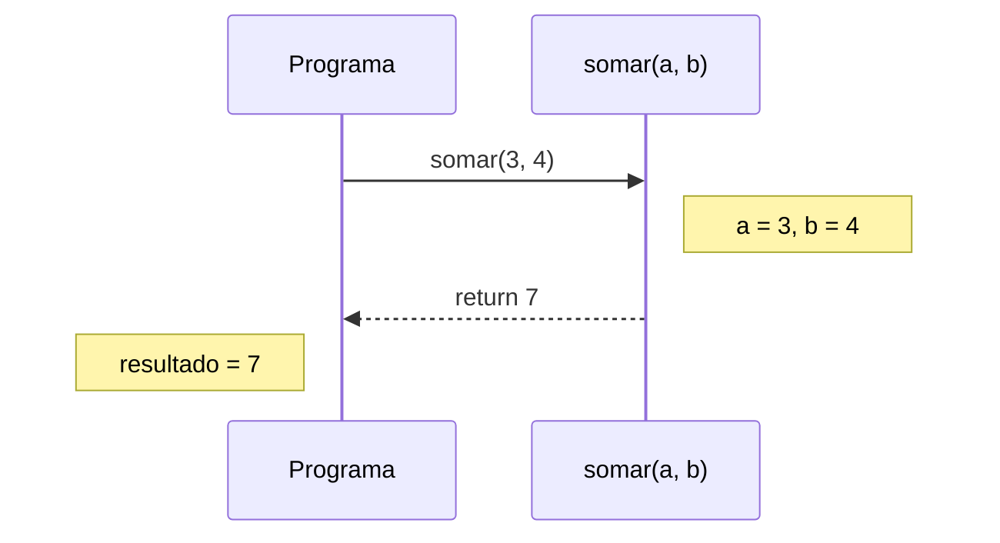
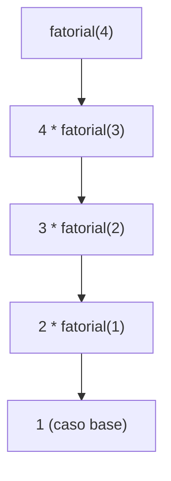

# 🧩 Definindo Funções

Uma **função** é um bloco de código com **nome**, que você escreve uma vez e **reutiliza** quantas vezes quiser.

> [!example] Analogia
> Uma função é como uma **receita**: você a escreve uma vez (definição) e, sempre que quiser o prato, é só "seguir a receita" (chamada), possivelmente com ingredientes diferentes (argumentos).

Por que usar funções?
- ♻️ **Reaproveitamento** (DRY: *Don't Repeat Yourself*)
- 🧠 **Abstração**: você usa sem precisar lembrar de como funciona por dentro
- 🧪 **Testabilidade**: pedaços pequenos são fáceis de testar
- 📖 **Legibilidade**: o nome da função documenta a intenção

---

## 1. Primeira função

```python
def saudar():
    print("Olá!")

saudar()      # chamada
saudar()      # pode chamar várias vezes
```

Estrutura:
```text
def  nome_da_funcao ( parâmetros ) :
    corpo indentado (4 espaços)
```

> [!warning] Definir não é executar
> ```python
> def saudar():
>     print("Olá!")
> # Nada acontece até você CHAMAR: saudar()
>
> # ❌ Esquecer os parênteses não chama a função
> saudar        # só referencia o objeto função
> # ✅
> saudar()
> ```

---

## 2. Parâmetros e argumentos

- **Parâmetro**: o nome na **definição** (`nome` em `def saudar(nome)`).
- **Argumento**: o valor passado na **chamada** (`"Ada"` em `saudar("Ada")`).

```python
def saudar(nome):
    print(f"Olá, {nome}!")

saudar("Ada")
saudar("Alan")
```

### Vários parâmetros
```python
def apresentar(nome, idade):
    print(f"{nome} tem {idade} anos")

apresentar("Ada", 28)           # posicionais (a ordem importa)
apresentar(idade=28, nome="Ada")   # nomeados (a ordem não importa)
```

> [!warning] Número de argumentos
> ```python
> apresentar("Ada")
> # TypeError: apresentar() missing 1 required positional argument: 'idade'
> ```

---

## 3. Retornando valores com `return`

```python
def somar(a, b):
    return a + b

resultado = somar(3, 4)
print(resultado)        # 7
print(somar(1, 2) * 10) # 30  (o retorno pode ser usado em expressões)
```

`return` **encerra** a função imediatamente:

```python
def dividir(a, b):
    if b == 0:
        return None          # saída antecipada
    return a / b             # só chega aqui se b != 0
```

### Funções sem `return` devolvem `None`
```python
def mostrar(x):
    print(x)

r = mostrar(10)
print(r)        # None
```

> [!warning] Armadilha nº 1: `print` ≠ `return`
> ```python
> # ❌ Só mostra na tela; não dá para reutilizar o valor
> def dobro(n):
>     print(n * 2)
>
> x = dobro(5)       # imprime 10
> print(x + 1)       # TypeError: None + int
>
> # ✅ Devolve o valor; quem chamou decide o que fazer
> def dobro(n):
>     return n * 2
>
> x = dobro(5)       # 10
> print(x + 1)       # 11
> ```

> [!tip] Regra de ouro
> Funções que **calculam** devem **retornar**. Deixe o `print` para o código que usa a função (ou para funções cujo objetivo é exibir).

### Retornando vários valores (tupla)
```python
def min_max(numeros):
    return min(numeros), max(numeros)

menor, maior = min_max([4, 9, 1])
print(menor, maior)      # 1 9
```
Veja [[02 - Controle de Fluxo e Estruturas de Dados/04 - Tuplas#6. Retornando vários valores de funções|retorno múltiplo com tuplas]].

> [!warning] `return` em todos os caminhos
> ```python
> # ❌ Se n for negativo, devolve None sem querer
> def raiz(n):
>     if n >= 0:
>         return n ** 0.5
>
> # ✅ Seja explícito
> def raiz(n):
>     if n < 0:
>         return None
>     return n ** 0.5
> ```

---

## 4. Fluxo de uma chamada



> [!tip] Visualize no debugger
> Coloque um breakpoint dentro da função e use `F11` (*Step Into*) para entrar nela. Observe o painel **Call Stack**: cada chamada empilha um "quadro" com suas variáveis locais.

---

## 5. Funções são objetos (cidadãs de primeira classe)

Em Python, funções podem ser guardadas em variáveis, passadas como argumento e retornadas:

```python
def quadrado(x):
    return x * x

f = quadrado               # sem parênteses: referência à função
print(f(5))                # 25

def aplicar(func, valor):
    return func(valor)

print(aplicar(quadrado, 4))     # 16
print(aplicar(str.upper, "oi")) # 'OI'

operacoes = {"dobro": lambda x: x * 2, "quadrado": quadrado}
print(operacoes["quadrado"](6))   # 36
```
Isso abre as portas para [[07 - Programação Funcional e Intermediário/01 - Funções de Ordem Superior|funções de ordem superior]] e [[07 - Programação Funcional e Intermediário/03 - Decorators|decorators]].

---

## 6. Parâmetros mutáveis: cuidado!

Argumentos são passados por **referência a objeto** (*pass by object reference*). Se o objeto for **mutável**, a função pode alterá-lo:

```python
def adicionar(lista, item):
    lista.append(item)       # altera a lista ORIGINAL

compras = ["pão"]
adicionar(compras, "leite")
print(compras)               # ['pão', 'leite']
```

Com **imutáveis** (`int`, `str`, `tuple`), reatribuir dentro da função não afeta quem chamou:
```python
def incrementa(n):
    n += 1                   # cria um novo int local
    return n

x = 5
incrementa(x)
print(x)                     # 5 (não mudou)
```

> [!warning] Efeito colateral inesperado
> ```python
> # ❌ Altera a lista de quem chamou sem avisar
> def ordenar(lista):
>     lista.sort()
>     return lista
>
> original = [3, 1, 2]
> ordenada = ordenar(original)
> print(original)      # [1, 2, 3]  😱
>
> # ✅ Não altere argumentos; trabalhe numa cópia
> def ordenar(lista):
>     return sorted(lista)
> ```
> Se a função **deve** alterar o argumento, deixe isso explícito no nome/documentação (`ordenar_no_lugar`) e retorne `None`, como `list.sort()` faz.

---

## 7. Boas práticas

### 7.1 Uma função, uma responsabilidade
```python
# ❌ Faz tudo
def processar():
    n = int(input("Número: "))
    print(n * 2)

# ✅ Separe: lógica pura + entrada/saída
def dobrar(n):
    return n * 2

def main():
    n = int(input("Número: "))
    print(dobrar(n))
```

### 7.2 Nomes verbais e descritivos
```python
def calcular_media(notas): ...
def eh_primo(n): ...         # funções booleanas: eh_*, tem_*, is_*
def carregar_usuarios(arquivo): ...
```

### 7.3 Funções curtas
Se passa de ~20–30 linhas ou precisa de muitos comentários explicando "blocos", divida em funções menores.

### 7.4 Evite variáveis globais
Passe dados por **parâmetros** e devolva por **`return`** (veja [[03 - Funções e Modularização/03 - Escopo e Closures|Escopo e Closures]]).

### 7.5 Dicas de tipo (prévia)
```python
def somar(a: int, b: int) -> int:
    return a + b
```
Não são obrigatórias, mas ajudam editores e ferramentas ([[07 - Programação Funcional e Intermediário/06 - Type Hints e typing|Type Hints]]).

### 7.6 Documente
```python
def eh_par(n):
    """Retorna True se n for par."""
    return n % 2 == 0
```
Veja [[03 - Funções e Modularização/06 - Docstrings|Docstrings]].

---

## 8. Recursão (introdução)

Uma função que **chama a si mesma**. Precisa de um **caso base** (para parar) e de um **passo recursivo**.

```python
def fatorial(n):
    if n <= 1:           # caso base
        return 1
    return n * fatorial(n - 1)    # passo recursivo

print(fatorial(5))       # 120
```



> [!warning] Sem caso base = `RecursionError`
> ```python
> def infinito(n):
>     return infinito(n + 1)
> infinito(0)    # RecursionError: maximum recursion depth exceeded
> ```
> O limite padrão é ~1000 chamadas (`sys.getrecursionlimit()`). Python **não** otimiza recursão de cauda; para laços muito longos, prefira iteração.

---

## 9. Exemplo completo: validador e calculadora de IMC

```python
def calcular_imc(peso, altura):
    """Calcula o IMC."""
    return peso / altura ** 2

def classificar_imc(imc):
    """Devolve a faixa do IMC como texto."""
    if imc < 18.5:
        return "Abaixo do peso"
    elif imc < 25:
        return "Peso normal"
    elif imc < 30:
        return "Sobrepeso"
    return "Obesidade"

def main():
    peso = float(input("Peso (kg): "))
    altura = float(input("Altura (m): "))
    imc = calcular_imc(peso, altura)
    print(f"IMC: {imc:.2f} - {classificar_imc(imc)}")

if __name__ == "__main__":
    main()
```
Sobre o `if __name__ == "__main__"`, veja [[03 - Funções e Modularização/04 - Módulos e Packages|Módulos e Packages]].

---

> [!question] Exercícios
> 1. Escreva `eh_par(n)` que retorne `True`/`False`.
> 2. Escreva `media(lista)` que retorne a média (devolva `0` se a lista for vazia).
> 3. O que há de errado?
>    ```python
>    def soma(a, b):
>        print(a + b)
>    total = soma(2, 3) * 10
>    ```
> 4. Escreva `contar_vogais(texto)` que retorne a quantidade de vogais.
> 5. Escreva `fibonacci(n)` recursiva e depois iterativa. Qual é mais eficiente?
> 6. Escreva `converter_temperatura(valor, de, para)` que converta entre `"C"`, `"F"` e `"K"`.
> 7. Por que esta função é problemática?
>    ```python
>    def limpar(lista):
>        lista.clear()
>        return lista
>    ```

> [!success]- Soluções
> 1. ```python
>    def eh_par(n):
>        return n % 2 == 0
>    ```
> 2. ```python
>    def media(lista):
>        if not lista:
>            return 0
>        return sum(lista) / len(lista)
>    ```
> 3. `soma` usa `print` em vez de `return`; devolve `None` e `None * 10` gera `TypeError`. Correto: `return a + b`.
> 4. ```python
>    def contar_vogais(texto):
>        return sum(1 for c in texto.lower() if c in "aeiouáâãàéêíóôõúü")
>    ```
> 5. ```python
>    def fib_rec(n):
>        return n if n < 2 else fib_rec(n - 1) + fib_rec(n - 2)   # exponencial!
>
>    def fib_iter(n):
>        a, b = 0, 1
>        for _ in range(n):
>            a, b = b, a + b
>        return a
>    ```
>    A iterativa é linear; a recursiva ingênua recalcula os mesmos valores (veja `functools.cache` em [[06 - Módulos da Biblioteca Padrão Essenciais/03 - collections itertools e functools|functools]]).
> 6. ```python
>    def converter_temperatura(valor, de, para):
>        celsius = {"C": valor, "F": (valor - 32) * 5 / 9, "K": valor - 273.15}[de]
>        return {"C": celsius, "F": celsius * 9 / 5 + 32, "K": celsius + 273.15}[para]
>    ```
> 7. Altera o argumento (efeito colateral) **e** o devolve, o que confunde: parece que cria algo novo. Melhor: só `lista.clear()` (retornando `None`) ou devolver `[]`.

---

⬅️ [[02 - Controle de Fluxo e Estruturas de Dados/08 - Exercícios de Fluxo e Estruturas|Exercícios do Módulo 02]] | ➡️ [[03 - Funções e Modularização/02 - args kwargs e Argumentos Padrão|*args, **kwargs e argumentos padrão]]

#python #basico #funcoes #def #return #recursao
