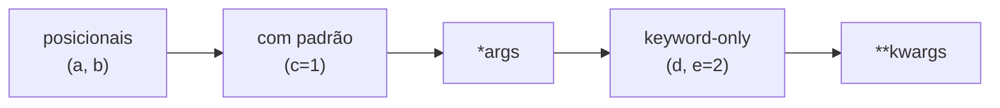

# 🎛️ `*args`, `**kwargs` e Argumentos Padrão

Aqui você aprende a criar funções **flexíveis**: com valores opcionais, quantidade variável de argumentos e controle de **como** eles podem ser passados.

---

## 1. Argumentos padrão (*default arguments*)

Dê um **valor padrão** ao parâmetro para torná-lo **opcional**:

```python
def saudar(nome, saudacao="Olá"):
    return f"{saudacao}, {nome}!"

print(saudar("Ada"))                # Olá, Ada!
print(saudar("Ada", "Bom dia"))     # Bom dia, Ada!
print(saudar("Ada", saudacao="Oi")) # Oi, Ada!
```

> [!warning] Parâmetros com padrão vêm **depois** dos obrigatórios
> ```python
> # ❌ SyntaxError: non-default argument follows default argument
> def f(a=1, b):
>     ...
>
> # ✅
> def f(b, a=1):
>     ...
> ```

### ⚠️ A armadilha mais famosa do Python: padrão mutável

O valor padrão é criado **uma única vez**, quando a função é **definida**, e não a cada chamada.

```python
# ❌ ERRADO
def adicionar(item, lista=[]):
    lista.append(item)
    return lista

print(adicionar("a"))    # ['a']
print(adicionar("b"))    # ['a', 'b']   😱 a mesma lista foi reaproveitada!
print(adicionar("c"))    # ['a', 'b', 'c']
```

```python
# ✅ CORRETO: use None como "sentinela" e crie a lista dentro da função
def adicionar(item, lista=None):
    if lista is None:
        lista = []
    lista.append(item)
    return lista

print(adicionar("a"))    # ['a']
print(adicionar("b"))    # ['b']
```

> [!note] Regra
> **Nunca** use `[]`, `{}`, `set()` ou qualquer objeto mutável como valor padrão. Use `None` e crie o objeto dentro da função. Valores **imutáveis** (`0`, `""`, `None`, `True`, tuplas) são seguros.

Inspecione o padrão guardado: `adicionar.__defaults__`.

> [!tip] Quando `None` é um valor válido?
> Crie um sentinela próprio:
> ```python
> _AUSENTE = object()
>
> def buscar(chave, padrao=_AUSENTE):
>     if padrao is _AUSENTE:
>         ...  # nenhum padrão foi informado
> ```

---

## 2. Argumentos posicionais e nomeados

```python
def criar_usuario(nome, idade, ativo=True):
    return {"nome": nome, "idade": idade, "ativo": ativo}

criar_usuario("Ada", 28)                    # posicionais
criar_usuario(idade=28, nome="Ada")         # nomeados (keyword)
criar_usuario("Ada", 28, ativo=False)       # misto
```

> [!warning] Posicionais sempre antes dos nomeados
> ```python
> criar_usuario(nome="Ada", 28)   # ❌ SyntaxError: positional argument follows keyword argument
> criar_usuario("Ada", idade=28)  # ✅
> ```

> [!warning] Argumento duplicado
> ```python
> criar_usuario("Ada", nome="Ada")
> # TypeError: got multiple values for argument 'nome'
> ```

> [!tip] Use nomes em chamadas com vários booleanos
> ```python
> # ❌ O que significam esses True/False?
> configurar(True, False, True)
> # ✅
> configurar(debug=True, cache=False, verbose=True)
> ```

---

## 3. `*args`: quantidade variável de argumentos posicionais

O `*` **empacota** os argumentos extras numa **tupla**:

```python
def somar(*numeros):
    print(numeros)              # tupla
    return sum(numeros)

print(somar(1, 2))              # (1, 2)         → 3
print(somar(1, 2, 3, 4, 5))     # (1,2,3,4,5)    → 15
print(somar())                  # ()             → 0
```

`args` é só **convenção** (o que vale é o `*`), mas use o nome padrão a menos que haja um nome melhor (`*numeros`, `*itens`).

```python
def mostrar(titulo, *itens):
    print(titulo)
    for item in itens:
        print(f" - {item}")

mostrar("Compras", "pão", "leite", "café")
```

---

## 4. `**kwargs`: quantidade variável de argumentos nomeados

O `**` empacota os argumentos nomeados extras num **dicionário**:

```python
def perfil(**dados):
    print(dados)                # dict
    for chave, valor in dados.items():
        print(f"{chave}: {valor}")

perfil(nome="Ada", idade=28, cidade="Londres")
# {'nome': 'Ada', 'idade': 28, 'cidade': 'Londres'}
```

### Combinando tudo
```python
def func(a, b, *args, **kwargs):
    print(a, b)
    print(args)
    print(kwargs)

func(1, 2, 3, 4, x=10, y=20)
# 1 2
# (3, 4)
# {'x': 10, 'y': 20}
```

### Ordem obrigatória dos parâmetros

```text
def f( obrigatórios, padrão=valor, *args, somente_nomeados, **kwargs ):
```



---

## 5. Desempacotando ao **chamar**: `*` e `**`

O mesmo símbolo funciona no sentido **inverso** na chamada: **espalha** o conteúdo.

```python
def somar3(a, b, c):
    return a + b + c

numeros = [1, 2, 3]
print(somar3(*numeros))           # equivale a somar3(1, 2, 3)

dados = {"a": 1, "b": 2, "c": 3}
print(somar3(**dados))            # equivale a somar3(a=1, b=2, c=3)
```

### Úteis no dia a dia
```python
print(*[1, 2, 3], sep=" | ")           # 1 | 2 | 3

lista = [*range(3), *"ab"]             # [0, 1, 2, 'a', 'b']
mesclado = {**{"a": 1}, **{"b": 2}}    # {'a': 1, 'b': 2}
```

> [!warning] Chaves precisam casar com os parâmetros
> ```python
> somar3(**{"a": 1, "b": 2, "x": 9})
> # TypeError: somar3() got an unexpected keyword argument 'x'
> ```

---

## 6. Parâmetros somente nomeados (*keyword-only*) com `*`

Tudo **depois** de um `*` (ou `*args`) só pode ser passado **pelo nome**:

```python
def abrir(arquivo, *, modo="r", encoding="utf-8"):
    ...

abrir("dados.txt", modo="w")       # ✅
abrir("dados.txt", "w")            # ❌ TypeError: takes 1 positional argument but 2 were given
```
Evita chamadas ambíguas e torna a API mais **legível e segura**.

## 7. Parâmetros somente posicionais com `/` (Python 3.8+)

Tudo **antes** de uma `/` só pode ser passado **por posição**:

```python
def dobro(x, /):
    return x * 2

dobro(5)        # ✅
dobro(x=5)      # ❌ TypeError
```

### Assinatura completa
```python
def f(pos_apenas, /, pos_ou_nome, *, nome_apenas):
    ...
```

| Zona | Como passar |
|------|-------------|
| antes de `/` | só posição |
| entre `/` e `*` | posição **ou** nome |
| depois de `*` | só nome |

Funções nativas usam `/`: veja `help(len)` → `len(obj, /)`.

---

## 8. Padrões úteis

### 8.1 Repassar argumentos (*wrapper*)
```python
def registrar(func, *args, **kwargs):
    print(f"Chamando {func.__name__}")
    return func(*args, **kwargs)

registrar(print, "oi", "mundo", sep="-")
```
É a base dos [[07 - Programação Funcional e Intermediário/03 - Decorators|decorators]].

### 8.2 Valores padrão com `kwargs`
```python
def conectar(**opcoes):
    config = {"host": "localhost", "porta": 5432, **opcoes}   # opcoes sobrescreve
    return config

print(conectar(porta=3306))
# {'host': 'localhost', 'porta': 3306}
```

### 8.3 Funções com quantidade variável
```python
def maior(primeiro, *outros):
    resultado = primeiro
    for n in outros:
        if n > resultado:
            resultado = n
    return resultado

print(maior(3, 9, 2))
```
(`maior(primeiro, *outros)` obriga **ao menos um** argumento, diferente de `*numeros`.)

### 8.4 Tipagem de `**kwargs` (3.12+)
Com `TypedDict` e `Unpack`, o editor sabe quais chaves esperar:
```python
from typing import TypedDict, Unpack

class Opcoes(TypedDict, total=False):
    cor: str
    tamanho: int

def desenhar(**opcoes: Unpack[Opcoes]) -> None:
    ...
```
Veja [[07 - Programação Funcional e Intermediário/06 - Type Hints e typing|Type Hints]].

---

## 9. Quando **não** usar `*args`/`**kwargs`

> [!warning] Flexibilidade demais esconde bugs
> ```python
> # ❌ O que esta função aceita? Impossível saber.
> def criar_pessoa(**dados):
>     ...
>
> # ✅ Parâmetros explícitos: documentados, autocompletáveis, erros claros
> def criar_pessoa(nome, idade, email=None):
>     ...
> ```
> Use `*args`/`**kwargs` quando a flexibilidade é **intencional** (repasse a outra função, APIs genéricas, decorators).

---

> [!question] Exercícios
> 1. Escreva `potencia(base, expoente=2)` e teste com 1 e 2 argumentos.
> 2. Escreva `media(*notas)` que aceite qualquer quantidade de notas e retorne `0` se não houver nenhuma.
> 3. Escreva `formatar_nome(nome, sobrenome, *, maiusculo=False)`. Mostre uma chamada **inválida**.
> 4. O que imprime?
>    ```python
>    def f(a, b=[]):
>        b.append(a)
>        return b
>    print(f(1), f(2))
>    ```
>    Corrija.
> 5. Dado `args = (2, 5)` e `kw = {"modo": "soma"}`, chame `calcular(*args, **kw)` escrevendo antes `calcular(a, b, modo="soma")` que faça a operação conforme o modo (`"soma"` ou `"produto"`).
> 6. Escreva `html_tag(nome, conteudo, **atributos)` que gere `<a href="x" class="y">texto</a>`.
> 7. Crie uma função `somente_posicional(a, b, /)` e uma `somente_nome(*, a, b)`; explique a diferença nas chamadas.

> [!success]- Soluções
> 1. ```python
>    def potencia(base, expoente=2):
>        return base ** expoente
>    print(potencia(3), potencia(2, 10))   # 9 1024
>    ```
> 2. ```python
>    def media(*notas):
>        return sum(notas) / len(notas) if notas else 0
>    ```
> 3. ```python
>    def formatar_nome(nome, sobrenome, *, maiusculo=False):
>        texto = f"{nome} {sobrenome}"
>        return texto.upper() if maiusculo else texto
>    formatar_nome("Ada", "Lovelace", True)   # ❌ TypeError
>    formatar_nome("Ada", "Lovelace", maiusculo=True)   # ✅
>    ```
> 4. Imprime `[1, 2] [1, 2]` (a mesma lista nas duas chamadas; ambos os `print` mostram o mesmo objeto já alterado). Correção: `b=None` e `if b is None: b = []`.
> 5. ```python
>    def calcular(a, b, modo="soma"):
>        return a + b if modo == "soma" else a * b
>
>    print(calcular(*args, **kw))   # 7
>    ```
> 6. ```python
>    def html_tag(nome, conteudo, **atributos):
>        attrs = "".join(f' {k.rstrip("_")}="{v}"' for k, v in atributos.items())
>        return f"<{nome}{attrs}>{conteudo}</{nome}>"
>
>    print(html_tag("a", "texto", href="x", class_="y"))
>    # <a href="x" class="y">texto</a>
>    ```
>    (`class` é palavra reservada, por isso `class_`.)
> 7. `somente_posicional(1, 2)` ✅, `somente_posicional(a=1, b=2)` ❌; `somente_nome(a=1, b=2)` ✅, `somente_nome(1, 2)` ❌.

---

⬅️ [[03 - Funções e Modularização/01 - Definindo Funções|Definindo Funções]] | ➡️ [[03 - Funções e Modularização/03 - Escopo e Closures|Escopo e Closures]]

#python #basico #funcoes #args #kwargs #argumentos #parametros
