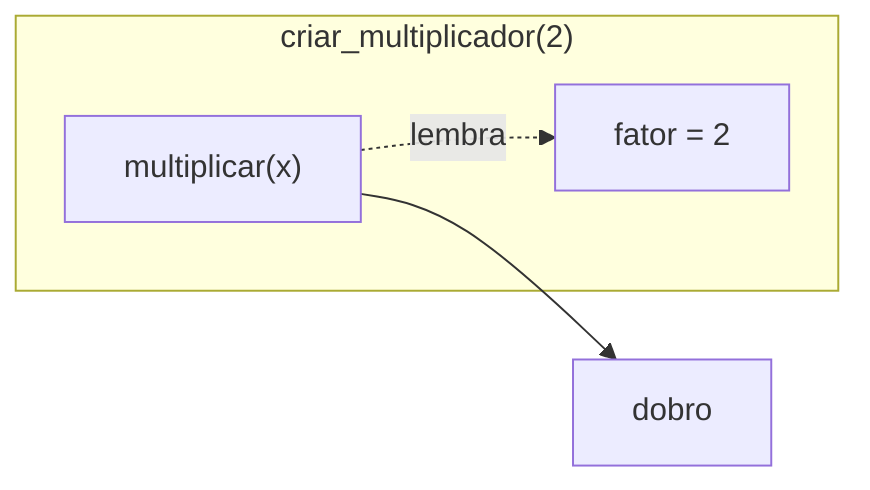

# 🔭 Escopo e Closures

**Escopo** (*scope*) define **onde** um nome (variável, função) é visível. **Closures** são funções que "lembram" variáveis do escopo onde nasceram.

---

## 1. Escopo local e global

```python
x = 10                 # global (fora de qualquer função)

def f():
    y = 5              # local (só existe dentro de f)
    print(x, y)        # 10 5  → f enxerga x global

f()
print(x)               # 10
print(y)               # ❌ NameError: name 'y' is not defined
```

> [!note] Regra básica
> Variáveis criadas **dentro** de uma função são **locais**: nascem quando a função é chamada e desaparecem quando ela termina. De dentro da função você pode **ler** variáveis globais.

---

## 2. A regra **LEGB**

Quando o Python procura um nome, segue esta ordem:


| Letra | Escopo | Exemplo |
|-------|--------|---------|
| **L** | Local | variáveis da própria função |
| **E** | Enclosing | variáveis de uma função que envolve a atual |
| **G** | Global | variáveis do arquivo/módulo |
| **B** | Built-in | `print`, `len`, `range`... |

```python
nome = "global"

def externa():
    nome = "enclosing"

    def interna():
        nome = "local"
        print(nome)        # local

    interna()
    print(nome)            # enclosing

externa()
print(nome)                # global
```

---

## 3. Atribuir cria uma variável **local**

```python
contador = 0

def incrementar():
    contador = contador + 1     # ❌
    print(contador)

incrementar()
# UnboundLocalError: cannot access local variable 'contador'
# where it is not associated with a value
```

**Por quê?** Como há uma **atribuição** a `contador` dentro da função, o Python a trata como **local** em toda a função. Ao ler o valor (lado direito), ela ainda não existe.

```python
# ✅ Forma recomendada: parâmetro + retorno
def incrementar(contador):
    return contador + 1

contador = incrementar(contador)
```

### Sombreamento (*shadowing*)
```python
total = 100

def f():
    total = 5          # cria OUTRA variável local, não altera a global
    return total

f()
print(total)           # 100
```

> [!warning] Cuidado com nomes iguais
> Dar à variável local o mesmo nome de uma global/embutida causa confusão (e bugs):
> ```python
> def f():
>     list = [1, 2]       # ❌ esconde a função nativa list()
>     sum = 10            # ❌ esconde sum()
> ```

---

## 4. `global`

Declara que o nome se refere à variável **global**, permitindo alterá-la:

```python
contador = 0

def incrementar():
    global contador
    contador += 1

incrementar()
incrementar()
print(contador)     # 2
```

> [!warning] Evite `global`
> Variáveis globais mutáveis criam **dependências ocultas**: qualquer função pode alterá-las, tornando o código difícil de entender, testar e depurar.
> ```python
> # ❌ Estado global
> saldo = 0
> def depositar(valor):
>     global saldo
>     saldo += valor
>
> # ✅ Dados explícitos
> def depositar(saldo, valor):
>     return saldo + valor
> ```
> Quando precisar de estado compartilhado, use **classes** ([[04 - Programação Orientada a Objetos/01 - Classes e Objetos|POO]]) ou **closures** (abaixo).

> [!note] Ler vs atribuir
> Para **mutar** um objeto global (ex.: `lista.append(1)`) **não** é preciso `global`, pois não há atribuição ao nome. `global` só é necessário para **reatribuir** o nome.

### Constantes globais são ok
```python
TAXA_IMPOSTO = 0.15       # leitura apenas, nome em MAIÚSCULAS

def calcular(preco):
    return preco * (1 + TAXA_IMPOSTO)
```

---

## 5. Funções aninhadas e `nonlocal`

Você pode definir funções **dentro** de funções. A interna enxerga o escopo da externa (**Enclosing**):

```python
def saudacao(prefixo):
    def saudar(nome):
        return f"{prefixo}, {nome}!"     # usa 'prefixo' da externa
    return saudar("Ada")

print(saudacao("Olá"))
```

Para **reatribuir** uma variável da função externa, use `nonlocal`:

```python
def externa():
    contagem = 0

    def interna():
        nonlocal contagem
        contagem += 1
        return contagem

    interna()
    interna()
    return contagem

print(externa())    # 2
```

| Palavra | Vincula a... |
|---------|--------------|
| `global x` | `x` do escopo do **módulo** |
| `nonlocal x` | `x` da **função envolvente** mais próxima |

---

## 6. Closures

Uma **closure** é uma função interna que **continua lembrando** das variáveis do escopo externo, **mesmo depois** de a função externa ter terminado.

```python
def criar_multiplicador(fator):
    def multiplicar(x):
        return x * fator          # 'fator' é "capturado"
    return multiplicar            # devolve a função, sem chamá-la

dobro = criar_multiplicador(2)
triplo = criar_multiplicador(3)

print(dobro(10))     # 20
print(triplo(10))    # 30
```

`criar_multiplicador` já terminou, mas `dobro` ainda "carrega" `fator = 2`.



> [!example] Analogia
> A closure é uma **mochila**: a função interna leva consigo, na mochila, as variáveis de que precisa.

### Inspecionando a closure
```python
print(dobro.__closure__[0].cell_contents)    # 2
print(dobro.__code__.co_freevars)            # ('fator',)
```

### Estado privado com closures
```python
def criar_contador(inicio=0):
    valor = inicio

    def proximo():
        nonlocal valor
        valor += 1
        return valor

    return proximo

c1 = criar_contador()
c2 = criar_contador(100)

print(c1(), c1(), c1())    # 1 2 3
print(c2())                # 101   (estado independente!)
```

`valor` não é acessível de fora: encapsulamento sem classe.

### Exemplo: fábrica de validadores
```python
def maior_que(limite):
    def validar(n):
        return n > limite
    return validar

maior_que_18 = maior_que(18)
print(maior_que_18(20), maior_que_18(10))   # True False

idades = [15, 22, 18, 40]
print(list(filter(maior_que_18, idades)))   # [22, 40]
```

### Para que servem?
- **Decorators** ([[07 - Programação Funcional e Intermediário/03 - Decorators|Decorators]]) são closures
- Fábricas de funções configuráveis
- *Callbacks* que guardam contexto
- Estado encapsulado simples

---

## 7. Armadilha clássica: *late binding* em loops

As closures capturam a **variável**, não o **valor** no momento da criação.

```python
# ❌ ERRADO
funcoes = []
for i in range(3):
    funcoes.append(lambda: i)

print([f() for f in funcoes])    # [2, 2, 2]  😱 todos veem o último i
```

```python
# ✅ Solução 1: valor padrão (captura na definição)
funcoes = [lambda i=i: i for i in range(3)]
print([f() for f in funcoes])    # [0, 1, 2]

# ✅ Solução 2: functools.partial
from functools import partial
def mostrar(i):
    return i
funcoes = [partial(mostrar, i) for i in range(3)]

# ✅ Solução 3: função fábrica
def fabrica(i):
    return lambda: i
funcoes = [fabrica(i) for i in range(3)]
```

---

## 8. Escopo em comprehensions e loops

```python
# Loops NÃO criam escopo novo
for k in range(3):
    pass
print(k)            # 2  (variável do for continua existindo)

# Comprehensions criam escopo próprio
[j for j in range(3)]
print(j)            # ❌ NameError
```

> [!note] Blocos `if`, `while`, `try`, `with` também **não** criam escopo
> Só **funções**, **classes**, **módulos** e **comprehensions** criam escopos novos.

---

## 9. Inspecionando escopos

```python
x = 10

def f():
    y = 5
    print(locals())     # {'y': 5}

f()
print("x" in globals())   # True
```

---

## 10. Resumo

| Situação | Solução |
|----------|---------|
| Ler variável global | Direto |
| Alterar variável global | `global` (evite!); prefira parâmetros + `return` |
| Alterar variável da função externa | `nonlocal` |
| Guardar estado numa função | Closure (ou classe) |
| Lambdas em loop | Capturar com `lambda i=i: ...` |

---

> [!question] Exercícios
> 1. O que imprime?
>    ```python
>    x = "global"
>    def f():
>        x = "local"
>    f()
>    print(x)
>    ```
> 2. Por que o código abaixo gera erro e como corrigir **sem** `global`?
>    ```python
>    total = 0
>    def somar(n):
>        total += n
>    somar(5)
>    ```
> 3. Escreva `criar_acumulador()` que devolva uma função; a cada chamada `acc(n)`, soma `n` ao total e retorna o total acumulado.
> 4. Escreva `criar_potencia(expoente)` que retorne uma função elevando um número ao `expoente`. Crie `quadrado` e `cubo`.
> 5. Crie uma função `contador_de_chamadas(func)` que devolva uma nova função que chama `func` e conta quantas vezes foi chamada (acessível via atributo `.chamadas`).
> 6. O que imprime e como corrigir para `[0, 1, 2]`?
>    ```python
>    fs = [lambda: n for n in range(3)]
>    print([f() for f in fs])
>    ```
> 7. Qual a diferença entre `global` e `nonlocal`?

> [!success]- Soluções
> 1. `global`: a atribuição em `f` cria uma `x` local.
> 2. `+=` é uma atribuição ⇒ `total` vira local ⇒ `UnboundLocalError`. Correção:
>    ```python
>    def somar(total, n):
>        return total + n
>    total = somar(total, 5)
>    ```
> 3. ```python
>    def criar_acumulador():
>        total = 0
>        def acc(n):
>            nonlocal total
>            total += n
>            return total
>        return acc
>
>    acc = criar_acumulador()
>    print(acc(10), acc(5))    # 10 15
>    ```
> 4. ```python
>    def criar_potencia(expoente):
>        return lambda base: base ** expoente
>
>    quadrado = criar_potencia(2)
>    cubo = criar_potencia(3)
>    print(quadrado(4), cubo(2))   # 16 8
>    ```
> 5. ```python
>    def contador_de_chamadas(func):
>        def wrapper(*args, **kwargs):
>            wrapper.chamadas += 1
>            return func(*args, **kwargs)
>        wrapper.chamadas = 0
>        return wrapper
>
>    soma = contador_de_chamadas(lambda a, b: a + b)
>    soma(1, 2); soma(3, 4)
>    print(soma.chamadas)    # 2
>    ```
> 6. Imprime `[2, 2, 2]` (late binding). Correção: `fs = [lambda n=n: n for n in range(3)]`.
> 7. `global` refere-se a variáveis do **módulo**; `nonlocal`, a variáveis da **função envolvente** mais próxima.

---

⬅️ [[03 - Funções e Modularização/02 - args kwargs e Argumentos Padrão|*args, **kwargs e padrões]] | ➡️ [[03 - Funções e Modularização/04 - Módulos e Packages|Módulos e Packages]]

#python #basico #funcoes #escopo #closures #legb #nonlocal
