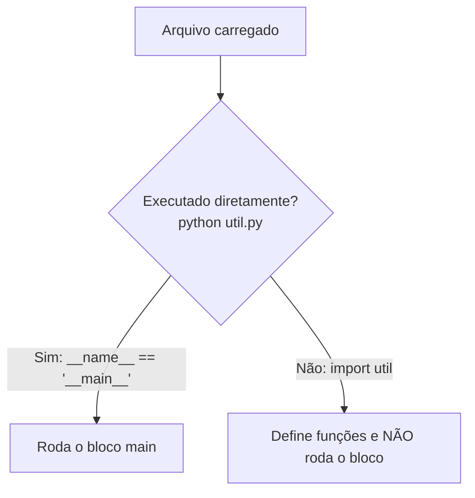

# 📦 Módulos e Packages

À medida que o programa cresce, colocar tudo em um único arquivo vira bagunça. **Modularizar** é dividir o código em **arquivos** (módulos) e **pastas** (packages) com responsabilidades claras.

| Conceito | O que é | Exemplo |
|----------|---------|---------|
| **Módulo** | Um arquivo `.py` | `calculos.py` |
| **Package** | Uma pasta de módulos (com `__init__.py`) | `meu_app/` |
| **Biblioteca** | Conjunto de packages distribuído | `requests`, `pandas` |
| **Biblioteca padrão** | Módulos que já vêm com o Python | `math`, `os`, `json` |

---

## 1. Importando módulos existentes

```python
import math
print(math.sqrt(16))        # 4.0
print(math.pi)

from math import sqrt, pi   # importa nomes específicos
print(sqrt(25), pi)

from math import sqrt as raiz     # alias
import datetime as dt             # alias comum
print(dt.date.today())
```

| Forma | Uso | Observação |
|-------|-----|-----------|
| `import modulo` | `modulo.funcao()` | Mantém o **namespace**: deixa claro de onde vem |
| `from modulo import nome` | `nome()` | Mais curto; cuidado com conflitos |
| `import modulo as apelido` | `apelido.funcao()` | Convenções: `np`, `pd`, `dt` |
| `from modulo import *` | — | ❌ **Evite**: polui o namespace |

> [!warning] Não use `import *`
> ```python
> # ❌ De onde veio "sqrt"? E se dois módulos tiverem o mesmo nome?
> from math import *
> from numpy import *      # sobrescreve funções de math!
>
> # ✅
> import math
> import numpy as np
> ```

### Explorando um módulo
```python
import math
print(dir(math))            # nomes disponíveis
help(math.sqrt)             # documentação
print(math.__file__)        # onde está no disco (módulos embutidos podem não ter)
```

> [!tip] Convenção PEP 8 para imports
> No topo do arquivo, um por linha, na ordem: **biblioteca padrão** → **terceiros** → **seus módulos**, separados por linha em branco.

---

## 2. Criando seu próprio módulo

Estrutura:
```text
projeto/
├── geometria.py
└── main.py
```

`geometria.py`:
```python
"""Funções de geometria básica."""

PI = 3.14159

def area_circulo(raio):
    return PI * raio ** 2

def area_retangulo(base, altura):
    return base * altura
```

`main.py`:
```python
import geometria
from geometria import area_retangulo

print(geometria.area_circulo(2))
print(area_retangulo(3, 4))
```
Rode: `python main.py`.

> [!warning] Nunca nomeie seu arquivo como um módulo existente
> ```text
> random.py   ❌ esconde o módulo random da biblioteca padrão
> math.py     ❌
> json.py     ❌
> ```
> Sintoma típico: `AttributeError: partially initialized module 'random' has no attribute 'randint'`. Renomeie o arquivo e apague a pasta `__pycache__`.

---

## 3. `if __name__ == "__main__"`

Quando um arquivo é **executado**, `__name__` vale `"__main__"`. Quando é **importado**, vale o nome do módulo.

`util.py`:
```python
def dobrar(n):
    return n * 2

print("Este print roda ao importar!")     # ❌ efeito colateral indesejado

if __name__ == "__main__":
    # só roda com: python util.py
    print(dobrar(21))
```



> [!tip] Padrão recomendado
> ```python
> def main():
>     ...
>
> if __name__ == "__main__":
>     main()
> ```

---

## 4. Como o Python encontra os módulos

Ao fazer `import x`, o Python procura **nesta ordem**:
1. Módulos já carregados (`sys.modules`, cache)
2. Módulos embutidos (*built-in*)
3. Pastas listadas em `sys.path`: pasta do script, `PYTHONPATH`, biblioteca padrão e `site-packages` (pacotes instalados com pip)

```python
import sys
for p in sys.path:
    print(p)
```

> [!warning] `ModuleNotFoundError`
> Causas comuns:
> - O módulo não está instalado → `python -m pip install nome` ([[03 - Funções e Modularização/05 - Virtual Environments e pip|pip e venvs]])
> - Você instalou em **outro** Python/ambiente virtual
> - O arquivo não está na pasta do script nem no `sys.path`
> - Erro de digitação ou de maiúsculas/minúsculas

> [!note] O módulo é executado **uma vez**
> Importar o mesmo módulo duas vezes **não** reexecuta o código dele (usa o cache). Para recarregar durante testes: `importlib.reload(modulo)`.

---

## 5. Packages (pacotes)

Um **package** é uma pasta com módulos. Tradicionalmente tem um arquivo `__init__.py` (pode ser vazio).

```text
meu_app/
├── main.py
└── loja/
    ├── __init__.py
    ├── produtos.py
    ├── carrinho.py
    └── pagamento/
        ├── __init__.py
        └── cartao.py
```

`loja/produtos.py`:
```python
def listar():
    return ["café", "pão"]
```

`main.py`:
```python
import loja.produtos
from loja import carrinho
from loja.pagamento.cartao import cobrar

print(loja.produtos.listar())
```

### O papel do `__init__.py`
Roda quando o package é importado. Serve para:
- Marcar a pasta como package
- Expor uma **API pública** mais limpa
- Inicializar configurações

`loja/__init__.py`:
```python
from .produtos import listar
from .carrinho import Carrinho

__all__ = ["listar", "Carrinho"]      # define o que 'from loja import *' exporta
```
Agora:
```python
from loja import listar, Carrinho      # sem precisar saber os submódulos
```

> [!note] Namespace packages
> Desde o Python 3.3, pastas **sem** `__init__.py` também funcionam como packages ("namespace packages"), mas para projetos comuns **mantenha o `__init__.py`**: é mais explícito e compatível com ferramentas.

---

## 6. Imports absolutos e relativos

Dentro de um package, você pode importar de duas formas:

```python
# loja/carrinho.py

# Absoluto: caminho completo a partir da raiz (recomendado pela PEP 8)
from loja.produtos import listar

# Relativo: a partir do package atual
from .produtos import listar          # . = mesma pasta
from ..utils import formatar          # .. = pasta acima
```

| Estilo | Vantagem | Desvantagem |
|--------|----------|-------------|
| Absoluto | Claro, funciona em qualquer arquivo | Mais longo |
| Relativo | Curto; package pode ser renomeado | Só funciona **dentro** de packages (não em scripts rodados diretamente) |

> [!warning] `ImportError: attempted relative import with no known parent package`
> Acontece ao rodar um arquivo de dentro de um package como script (`python loja/carrinho.py`). Rode como módulo a partir da raiz:
> ```bash
> python -m loja.carrinho
> ```

---

## 7. Importações circulares

```python
# a.py
from b import funcao_b      # b importa a... e a importa b 💥
def funcao_a(): ...

# b.py
from a import funcao_a
def funcao_b(): ...
# ImportError: cannot import name 'funcao_b' from partially initialized module
```

Soluções:
1. **Reorganizar**: extrair o código comum para um terceiro módulo
2. Importar o **módulo** em vez do nome (`import a` e usar `a.funcao_a()` mais tarde)
3. Importar **dentro da função** (último recurso)

> [!tip] Se há ciclo, o design provavelmente pode melhorar
> Dependências devem fluir em **uma direção**: módulos de alto nível usam os de baixo nível, nunca o contrário.

---

## 8. Estrutura de um projeto real

```text
meu_projeto/
├── .venv/                  # ambiente virtual (não vai para o Git)
├── src/
│   └── meu_pacote/
│       ├── __init__.py
│       ├── nucleo.py
│       └── utils.py
├── tests/
│   └── test_nucleo.py
├── README.md
├── requirements.txt        # ou pyproject.toml
└── .gitignore
```
Detalhes de empacotamento em [[08 - Avançado/07 - Packaging e Distribuição|Packaging e Distribuição]] e testes em [[08 - Avançado/06 - Testes com unittest e pytest|Testes]].

---

## 9. Executando módulos com `-m`

```bash
python -m http.server 8000      # servidor web simples
python -m venv .venv            # cria ambiente virtual
python -m pip install requests  # pip do Python correto
python -m json.tool arquivo.json
python -m meu_pacote            # executa meu_pacote/__main__.py
```
Um arquivo `__main__.py` dentro do package define o que roda com `python -m meu_pacote`.

---

## 10. Boas práticas

- ✅ Nomes de módulos em **minúsculas** e `snake_case`
- ✅ Um módulo = um assunto coeso
- ✅ Prefira `import modulo` quando houver risco de conflito
- ✅ Imports no **topo** do arquivo
- ✅ Use `if __name__ == "__main__":` em arquivos executáveis
- ❌ Evite `import *`, ciclos e efeitos colaterais ao importar

---

> [!question] Exercícios
> 1. Crie `conversores.py` com `celsius_para_fahrenheit(c)` e `km_para_milhas(km)`. Importe-o em `main.py` de **três** formas diferentes.
> 2. Faça com que `conversores.py` tenha testes rápidos executados **só** quando rodado diretamente.
> 3. Monte o package `utils/` com `texto.py` (`inverter`, `contar_palavras`) e `numeros.py` (`eh_primo`). Crie `__init__.py` expondo as 3 funções para `from utils import eh_primo`.
> 4. Por que `import random` pode falhar se você tiver um arquivo `random.py` na pasta?
> 5. Qual a diferença entre `python arquivo.py` e `python -m pacote.arquivo`?
> 6. Resolva o ciclo: `a.py` importa `b.py` e `b.py` importa `a.py`.

> [!success]- Soluções
> 1. ```python
>    import conversores
>    from conversores import km_para_milhas
>    import conversores as conv
>    print(conversores.celsius_para_fahrenheit(100), km_para_milhas(10), conv.km_para_milhas(1))
>    ```
> 2. ```python
>    # no fim de conversores.py
>    if __name__ == "__main__":
>        assert celsius_para_fahrenheit(0) == 32
>        print("Testes ok")
>    ```
> 3. ```python
>    # utils/__init__.py
>    from .texto import inverter, contar_palavras
>    from .numeros import eh_primo
>    __all__ = ["inverter", "contar_palavras", "eh_primo"]
>    ```
> 4. O Python encontra primeiro **seu** `random.py` (a pasta do script vem antes da biblioteca padrão em `sys.path`), "escondendo" o módulo oficial.
> 5. `python arquivo.py` executa o arquivo como script (`sys.path[0]` = pasta do arquivo). `python -m pacote.arquivo` executa como **módulo** a partir da raiz do projeto, permitindo imports relativos/absolutos do package.
> 6. Mova o código compartilhado para `comum.py` e faça `a.py` e `b.py` importarem dele; ou troque `from b import x` por `import b` e use `b.x` dentro das funções.

---

⬅️ [[03 - Funções e Modularização/03 - Escopo e Closures|Escopo e Closures]] | ➡️ [[03 - Funções e Modularização/05 - Virtual Environments e pip|Virtual Environments e pip]]

#python #basico #modulos #packages #import #organizacao
