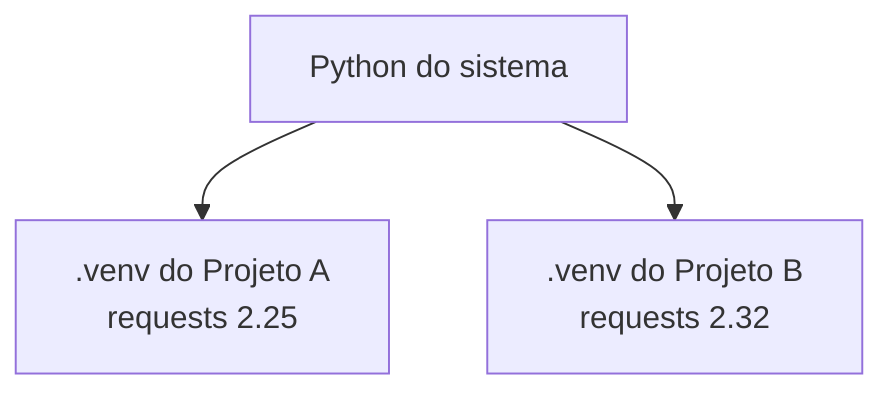
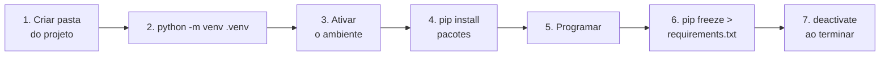

# 🧪 Virtual Environments e pip

Além da biblioteca padrão, o ecossistema Python tem **centenas de milhares de pacotes** no **PyPI** (*Python Package Index*). O **pip** instala esses pacotes; os **ambientes virtuais** os mantêm **isolados por projeto**.

---

## 1. Por que ambientes virtuais?

Imagine dois projetos:
- **Projeto A** precisa de `requests 2.25`
- **Projeto B** precisa de `requests 2.32`

Se ambos usarem o mesmo Python global, **um quebra o outro**. Um ambiente virtual é uma **pasta isolada** com seu próprio interpretador e seus próprios pacotes.



Benefícios:
- ✅ Isolamento entre projetos
- ✅ Versões reproduzíveis
- ✅ Não "suja" o Python do sistema
- ✅ Sem precisar de permissão de administrador

> [!note] Regra de ouro
> **Um ambiente virtual por projeto.** Sempre.

---

## 2. Criando e ativando (`venv`)

O módulo `venv` já vem com o Python.

### Criar
```bash
# Dentro da pasta do projeto
python -m venv .venv
```
Cria a pasta `.venv/` (o nome é convenção; `venv` e `env` também são comuns).

### Ativar

| Sistema | Comando |
|---------|---------|
| **Windows (PowerShell)** | `.venv\Scripts\Activate.ps1` |
| **Windows (cmd)** | `.venv\Scripts\activate.bat` |
| **macOS / Linux (bash/zsh)** | `source .venv/bin/activate` |

Quando ativo, o terminal mostra o prefixo `(.venv)`:
```text
(.venv) C:\projetos\meu_app>
```

> [!warning] PowerShell bloqueando scripts (Windows)
> Se aparecer *"a execução de scripts foi desabilitada neste sistema"*:
> ```powershell
> Set-ExecutionPolicy -Scope CurrentUser RemoteSigned
> ```
> Ou use o `cmd` / ative com `activate.bat`.

### Desativar
```bash
deactivate
```

### Conferir
```bash
which python        # macOS/Linux
where python        # Windows
python -c "import sys; print(sys.prefix)"
```
O caminho deve apontar para dentro de `.venv`.

> [!tip] VS Code
> `Ctrl+Shift+P` → **Python: Select Interpreter** → escolha o Python de `.venv`. O editor passa a usar e ativar o ambiente automaticamente nos terminais.

> [!warning] Nunca copie nem versione o `.venv`
> Ele contém caminhos absolutos da sua máquina. Coloque no `.gitignore`:
> ```text
> .venv/
> __pycache__/
> *.pyc
> ```
> Quem baixar o projeto recria o ambiente com o `requirements.txt` (veja abaixo).

---

## 3. pip: instalador de pacotes

> [!tip] Use sempre `python -m pip`
> Garante que o pip é o **do mesmo Python** que você está usando (evita instalar no lugar errado).

### Comandos essenciais

| Comando | O que faz |
|---------|-----------|
| `python -m pip install requests` | Instala a última versão |
| `python -m pip install requests==2.32.3` | Versão exata |
| `python -m pip install "requests>=2.30,<3"` | Faixa de versões |
| `python -m pip install --upgrade requests` | Atualiza |
| `python -m pip uninstall requests` | Remove |
| `python -m pip list` | Lista pacotes instalados |
| `python -m pip list --outdated` | Mostra os desatualizados |
| `python -m pip show requests` | Detalhes de um pacote |
| `python -m pip freeze` | Lista pacotes com versões exatas |
| `python -m pip check` | Verifica dependências quebradas |
| `python -m pip install --upgrade pip` | Atualiza o próprio pip |

```bash
python -m venv .venv
source .venv/bin/activate        # (ou o comando do seu sistema)
python -m pip install requests
```

```python
import requests

resposta = requests.get("https://api.github.com")
print(resposta.status_code)
```

### Especificadores de versão

| Operador | Significado | Exemplo |
|----------|-------------|---------|
| `==` | Exatamente | `requests==2.32.3` |
| `>=` / `<=` | Mínimo / máximo | `requests>=2.30` |
| `~=` | "Compatível" | `requests~=2.32` (≥2.32, <3.0) |
| `!=` | Exclui versão | `requests!=2.31.0` |

---

## 4. `requirements.txt`: reproduzindo ambientes

### Gerar
```bash
python -m pip freeze > requirements.txt
```
Conteúdo:
```text
certifi==2024.8.30
charset-normalizer==3.3.2
idna==3.8
requests==2.32.3
urllib3==2.2.2
```

### Recriar em outra máquina
```bash
git clone <repo>
cd projeto
python -m venv .venv
source .venv/bin/activate
python -m pip install -r requirements.txt
```

> [!tip] Dica: separe dependências
> O `freeze` lista **tudo**, inclusive dependências indiretas. Muita gente mantém:
> - `requirements.txt`: só o que o projeto **usa de fato** (com versões)
> - `requirements-dev.txt`: ferramentas de desenvolvimento (`pytest`, `ruff`...)
> ```text
> # requirements-dev.txt
> -r requirements.txt
> pytest>=8
> ruff
> ```
> O formato moderno é o **`pyproject.toml`** ([[08 - Avançado/07 - Packaging e Distribuição|Packaging e Distribuição]]).

---

## 5. Fluxo de trabalho completo



---

## 6. Problemas comuns

| Sintoma | Causa provável | Solução |
|---------|----------------|---------|
| `ModuleNotFoundError` após instalar | Instalou em outro Python / ambiente não ativo | Ative o venv e use `python -m pip install` |
| `error: externally-managed-environment` (Linux/macOS) | O Python do sistema é protegido (PEP 668) | **Use um venv** (não force com `--break-system-packages`) |
| `pip` não encontrado | PATH ou venv não ativo | Use `python -m pip` |
| Conflito de dependências | Pacotes exigem versões incompatíveis | Leia a mensagem; ajuste versões; recrie o venv |
| Ambiente "quebrado" após mover a pasta | O venv guarda caminhos absolutos | Apague `.venv` e recrie |
| Instalação lenta/falha de rede | Proxy, firewall | Configure proxy ou use outro mirror |

> [!warning] Não faça isso
> ```bash
> sudo pip install pacote      # ❌ mexe no Python do sistema
> pip install pacote           # ❌ qual Python? qual ambiente?
> ```
> ```bash
> python -m pip install pacote  # ✅ com o venv ativo
> ```

### Recriando do zero (sempre funciona)
```bash
deactivate
rm -rf .venv                 # Windows: rmdir /s /q .venv
python -m venv .venv
source .venv/bin/activate
python -m pip install -r requirements.txt
```

---

## 7. Outras ferramentas (para conhecer)

| Ferramenta | Para que serve |
|------------|----------------|
| **uv** | Gerenciador rápido de pacotes, ambientes e versões do Python (substitui pip/venv no dia a dia) |
| **Poetry** | Gerencia dependências, ambientes e publicação (`pyproject.toml`) |
| **pipx** | Instala **aplicações de linha de comando** em ambientes isolados (`pipx install ruff`) |
| **pyenv** | Instala e alterna **várias versões do Python** |
| **conda** | Gerenciador de ambientes/pacotes muito usado em ciência de dados |
| **pip-tools** | Gera `requirements.txt` travado a partir de dependências de alto nível |

> [!note] Comece simples
> `venv` + `pip` + `requirements.txt` resolvem a imensa maioria dos casos. Migre para `uv` ou Poetry quando sentir necessidade (veja [[08 - Avançado/07 - Packaging e Distribuição|Packaging]]).

---

## 8. Segurança básica

> [!warning] Instalar pacote = executar código de terceiros
> - Confira o **nome exato** (existem pacotes maliciosos com nomes parecidos: *typosquatting*, ex.: `reqeusts`)
> - Prefira pacotes populares e mantidos (página no PyPI, repositório, última atualização)
> - Fixe versões em projetos importantes
> - Rode `python -m pip list --outdated` de tempos em tempos para atualizar com cuidado

---

> [!question] Exercícios
> 1. Crie uma pasta `teste_venv`, um ambiente virtual `.venv` e ative-o. Confirme com `where/which python` que está usando o ambiente.
> 2. Instale `requests` e escreva um script que imprima o `status_code` de `https://www.python.org`.
> 3. Gere o `requirements.txt`, apague o `.venv`, recrie-o e reinstale a partir do arquivo.
> 4. Instale `rich` e use `from rich import print` para imprimir `[bold red]Olá![/]`.
> 5. Explique por que é melhor usar `python -m pip` do que `pip`.
> 6. Crie um `.gitignore` adequado para um projeto Python.
> 7. O que significa `requests~=2.32`?

> [!success]- Soluções
> 1. ```bash
>    mkdir teste_venv && cd teste_venv
>    python -m venv .venv
>    source .venv/bin/activate     # Windows: .venv\Scripts\activate
>    which python                  # Windows: where python
>    ```
> 2. ```python
>    import requests
>    print(requests.get("https://www.python.org").status_code)   # 200
>    ```
> 3. ```bash
>    python -m pip freeze > requirements.txt
>    deactivate && rm -rf .venv
>    python -m venv .venv && source .venv/bin/activate
>    python -m pip install -r requirements.txt
>    ```
> 4. ```python
>    from rich import print
>    print("[bold red]Olá![/]")
>    ```
> 5. `python -m pip` usa o pip **do interpretador `python` atual**; `pip` pode apontar para outro Python instalado na máquina.
> 6. ```text
>    .venv/
>    venv/
>    __pycache__/
>    *.pyc
>    .env
>    .pytest_cache/
>    dist/
>    build/
>    *.egg-info/
>    ```
> 7. "Versão compatível": `>=2.32` e `<3.0` (aceita 2.32.x e 2.33+, mas não 3.0).

---

⬅️ [[03 - Funções e Modularização/04 - Módulos e Packages|Módulos e Packages]] | ➡️ [[03 - Funções e Modularização/06 - Docstrings|Documentação com Docstrings]]

#python #basico #venv #pip #dependencias #ambientes-virtuais #pypi
