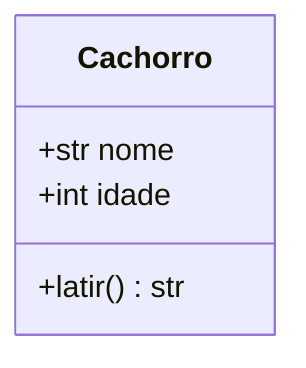
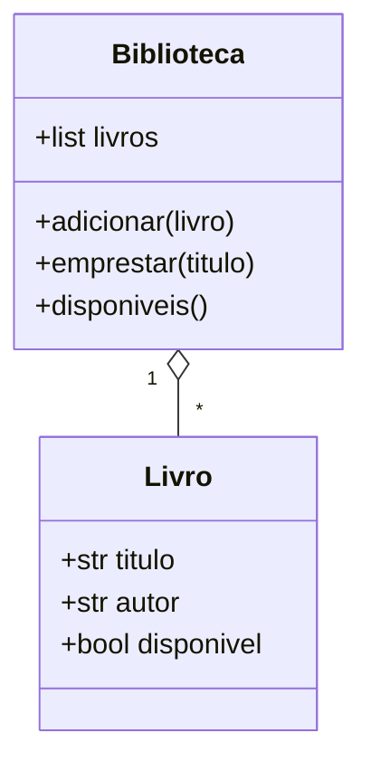

# 🏗️ Classes e Objetos

A **Programação Orientada a Objetos (POO)** organiza o código em torno de **objetos**: entidades que **juntam dados (atributos) e comportamentos (métodos)**.

> [!example] Analogia
> Uma **classe** é a **planta de uma casa**; cada **objeto** (instância) é uma **casa construída** a partir dela. A planta é uma só; as casas podem ser várias, cada uma com seus próprios móveis (dados).

| Conceito | O que é | Exemplo |
|----------|---------|---------|
| **Classe** | Molde que define atributos e métodos | `class Cachorro` |
| **Objeto / instância** | Exemplar criado a partir da classe | `rex = Cachorro("Rex")` |
| **Atributo** | Dado guardado no objeto | `rex.nome` |
| **Método** | Função que pertence à classe | `rex.latir()` |

> [!note] Em Python, **tudo** é objeto
> Números, strings, listas, funções, módulos e até as classes são objetos. Você já usa POO desde o começo: `"texto".upper()` é um **método** do objeto `str`.

---

## 1. Por que usar classes?

Sem classes, dados relacionados ficam espalhados:

```python
# ❌ Dados soltos: fácil se perder
nome1, saldo1 = "Ada", 100
nome2, saldo2 = "Alan", 50

def depositar(saldo, valor):
    return saldo + valor
```

Com classes, **dados e comportamento andam juntos**:

```python
# ✅ Um objeto representa a conta inteira
conta1 = ContaBancaria("Ada", 100)
conta1.depositar(50)
```

---

## 2. Sua primeira classe

```python
class Cachorro:
    """Representa um cachorro."""

    def __init__(self, nome, idade):
        self.nome = nome
        self.idade = idade

    def latir(self):
        return f"{self.nome} diz: Au au!"


rex = Cachorro("Rex", 3)      # cria um objeto (instância)
mel = Cachorro("Mel", 5)

print(rex.nome)               # Rex
print(mel.idade)              # 5
print(rex.latir())            # Rex diz: Au au!
```

Anatomia:

```text
class Cachorro:                       ← palavra 'class' + NomeEmPascalCase
    def __init__(self, nome, idade):  ← construtor (inicializador)
        self.nome = nome              ← atributo de instância
    def latir(self):                  ← método
```



> [!tip] Convenção de nomes
> - **Classes**: `PascalCase` (`ContaBancaria`)
> - **Métodos e atributos**: `snake_case` (`calcular_saldo`)

---

## 3. `__init__` e `self`

### `__init__`: o inicializador
É chamado **automaticamente** ao criar o objeto. Serve para definir o **estado inicial**.

```python
rex = Cachorro("Rex", 3)
# Por baixo dos panos:
# 1. Python cria um objeto vazio (__new__)
# 2. Chama Cachorro.__init__(objeto, "Rex", 3)
```

> [!note] `__init__` não "constrói"
> Tecnicamente, o objeto já existe quando `__init__` roda; ele apenas **inicializa**. Por isso não deve ter `return` (a não ser `None`).

### `self`: o próprio objeto
`self` é o **primeiro parâmetro** de todo método de instância e representa **o objeto que está chamando o método**. Você **não** o passa na chamada, o Python faz isso.

```python
rex.latir()
# equivale a:
Cachorro.latir(rex)
```

> [!warning] Armadilhas com `self`
> ```python
> class Pessoa:
>     # ❌ Esqueceu o self
>     def __init__(nome):
>         ...
>     # TypeError: __init__() takes 1 positional argument but 2 were given
>
>     def __init__(self, nome):
>         # ❌ Esqueceu de guardar no objeto
>         nome = nome           # variável local; some ao fim do __init__
>
>         # ✅
>         self.nome = nome
>
>     def saudar(self):
>         # ❌ Usar 'nome' sem self
>         return f"Olá, {nome}"      # NameError
>         # ✅
>         return f"Olá, {self.nome}"
> ```
> `self` é só **convenção** (poderia ter outro nome), mas **sempre** use `self`.

---

## 4. Atributos de instância vs de classe

```python
class Cachorro:
    especie = "Canis familiaris"      # atributo de CLASSE (compartilhado)

    def __init__(self, nome):
        self.nome = nome              # atributo de INSTÂNCIA (individual)

rex = Cachorro("Rex")
mel = Cachorro("Mel")

print(rex.especie, mel.especie)       # os dois veem o mesmo valor
print(rex.nome, mel.nome)             # Rex Mel (cada um tem o seu)
print(Cachorro.especie)               # acessível pela classe também
```

| | Atributo de **instância** | Atributo de **classe** |
|---|---|---|
| Definido em | `__init__` (`self.x = ...`) | No corpo da classe |
| Pertence a | Cada objeto | A classe (todos compartilham) |
| Uso típico | Estado individual (nome, saldo) | Constantes, contadores, valores padrão |

> [!warning] Armadilha: atributo de classe **mutável** é compartilhado
> ```python
> # ❌ Todas as instâncias compartilham a MESMA lista
> class Turma:
>     alunos = []
>     def adicionar(self, nome):
>         self.alunos.append(nome)
>
> a = Turma(); b = Turma()
> a.adicionar("Ana")
> print(b.alunos)        # ['Ana']  😱
>
> # ✅ Crie a lista no __init__ (um por objeto)
> class Turma:
>     def __init__(self):
>         self.alunos = []
> ```
> É a mesma ideia do [[03 - Funções e Modularização/02 - args kwargs e Argumentos Padrão|padrão mutável em funções]].

> [!warning] Atribuir pelo objeto **cria** atributo de instância
> ```python
> rex.especie = "Lobo"        # cria rex.especie (instância) e "esconde" o da classe
> print(Cachorro.especie)     # 'Canis familiaris' (intacto)
> print(mel.especie)          # 'Canis familiaris'
> ```

---

## 5. Métodos de instância

```python
class ContaBancaria:
    def __init__(self, titular, saldo=0.0):
        self.titular = titular
        self.saldo = saldo

    def depositar(self, valor):
        if valor <= 0:
            raise ValueError("O valor deve ser positivo")
        self.saldo += valor

    def sacar(self, valor):
        if valor > self.saldo:
            raise ValueError("Saldo insuficiente")
        self.saldo -= valor

    def extrato(self):
        return f"{self.titular}: R$ {self.saldo:.2f}"


conta = ContaBancaria("Ada", 100)
conta.depositar(50)
conta.sacar(30)
print(conta.extrato())      # Ada: R$ 120.00
```

> [!tip] Métodos mudam o **estado** do objeto
> Em `depositar`, o objeto altera seu próprio `saldo`: nenhuma variável global é necessária. Compare com o [[03 - Funções e Modularização/03 - Escopo e Closures|estado global]] que evitamos antes.

---

## 6. Representação textual: `__str__` e `__repr__`

Por padrão, imprimir um objeto é pouco útil:

```python
print(rex)       # <__main__.Cachorro object at 0x000001...>
```

Defina como o objeto se apresenta:

```python
class Cachorro:
    def __init__(self, nome, idade):
        self.nome = nome
        self.idade = idade

    def __str__(self):                  # para humanos: print(), str(), f"{}"
        return f"{self.nome} ({self.idade} anos)"

    def __repr__(self):                 # para desenvolvedores: REPL, debug, listas
        return f"Cachorro(nome={self.nome!r}, idade={self.idade})"

rex = Cachorro("Rex", 3)
print(rex)           # Rex (3 anos)
print(repr(rex))     # Cachorro(nome='Rex', idade=3)
print([rex])         # [Cachorro(nome='Rex', idade=3)]
```

> [!tip] Regra prática
> **Sempre** implemente `__repr__` (idealmente algo que pareça o código para recriar o objeto). Implemente `__str__` só se quiser uma versão "bonita" para o usuário final. Se só houver `__repr__`, o `print` também o usa.

Mais em [[04 - Programação Orientada a Objetos/04 - Propriedades e Métodos Mágicos|Métodos Mágicos]].

---

## 7. Objetos são independentes, mas podem ser referenciados

```python
a = Cachorro("Rex", 3)
b = a                  # mesma referência (não é cópia!)
b.nome = "Max"
print(a.nome)          # Max

c = Cachorro("Rex", 3)
print(a is c)          # False (objetos distintos)
print(a == c)          # False (por padrão, == compara identidade)
```

Revise [[01 - Fundamentos/02 - Sintaxe Básica e Variáveis#5. Variáveis são referências|variáveis como referências]]. Para igualdade por valor, veja `__eq__` em [[04 - Programação Orientada a Objetos/04 - Propriedades e Métodos Mágicos|Métodos Mágicos]] ou [[04 - Programação Orientada a Objetos/05 - Dataclasses e Slots|dataclasses]].

---

## 8. Inspecionando objetos

```python
print(type(rex))                     # <class '__main__.Cachorro'>
print(isinstance(rex, Cachorro))     # True
print(rex.__class__.__name__)        # 'Cachorro'
print(rex.__dict__)                  # {'nome': 'Rex', 'idade': 3}
print(dir(rex))                      # tudo que o objeto tem

print(hasattr(rex, "nome"))          # True
print(getattr(rex, "cor", "sem cor"))   # 'sem cor'
setattr(rex, "cor", "marrom")
```

> [!warning] Python permite criar atributos "do nada"
> ```python
> rex.nmoe = "Max"     # ❌ erro de digitação: cria um atributo novo, sem avisar!
> ```
> É flexível, mas perigoso. `__slots__` e `dataclass(slots=True)` ([[04 - Programação Orientada a Objetos/05 - Dataclasses e Slots|veja]]) impedem isso.

---

## 9. Quando usar classes?

| Use classe quando... | Use função/dict quando... |
|----------------------|---------------------------|
| Há **estado** + **comportamento** juntos | É só uma transformação de dados |
| Existem várias entidades similares | Há apenas uma operação isolada |
| Quer **polimorfismo** ou herança | Os dados são simples e sem regras |
| Há **invariantes** a proteger (saldo ≥ 0) | Um `dict`/`dataclass` basta |

> [!note] Python não obriga POO
> Python é **multiparadigma**. Muito código bom usa funções e módulos. Use classes quando elas **simplificarem** o problema.

---

## 10. Exemplo completo: sistema de biblioteca (mini)

```python
class Livro:
    def __init__(self, titulo, autor):
        self.titulo = titulo
        self.autor = autor
        self.disponivel = True

    def __repr__(self):
        estado = "disponível" if self.disponivel else "emprestado"
        return f"Livro({self.titulo!r}, {self.autor!r}, {estado})"


class Biblioteca:
    def __init__(self):
        self.livros = []

    def adicionar(self, livro):
        self.livros.append(livro)

    def emprestar(self, titulo):
        for livro in self.livros:
            if livro.titulo == titulo and livro.disponivel:
                livro.disponivel = False
                return livro
        return None

    def disponiveis(self):
        return [l for l in self.livros if l.disponivel]


bib = Biblioteca()
bib.adicionar(Livro("Dom Casmurro", "Machado de Assis"))
bib.adicionar(Livro("O Cortiço", "Aluísio Azevedo"))

bib.emprestar("Dom Casmurro")
print(bib.disponiveis())
# [Livro('O Cortiço', 'Aluísio Azevedo', disponível)]
```



> [!tip] Use o debugger!
> Coloque um breakpoint em `emprestar` e inspecione `self` no painel **Variables**: você verá todos os atributos do objeto.

---

> [!question] Exercícios
> 1. Crie a classe `Retangulo` com `base` e `altura`, e métodos `area()` e `perimetro()`.
> 2. Adicione `__repr__` ao `Retangulo` para que `print([Retangulo(2, 3)])` mostre `[Retangulo(base=2, altura=3)]`.
> 3. Crie `Contador` com um atributo de **classe** `total_criados` que conte quantas instâncias existem.
> 4. Corrija:
>    ```python
>    class Pessoa:
>        def __init__(nome, idade):
>            nome = nome
>            idade = idade
>    ```
> 5. Por que o código abaixo mostra `['x']` para `b`? Corrija.
>    ```python
>    class Caixa:
>        itens = []
>        def colocar(self, x): self.itens.append(x)
>    a, b = Caixa(), Caixa()
>    a.colocar("x")
>    print(b.itens)
>    ```
> 6. Crie `ContaBancaria` com `depositar` e `sacar` que levantem `ValueError` para valores inválidos.
> 7. Qual a diferença entre `__str__` e `__repr__`?

> [!success]- Soluções
> 1. ```python
>    class Retangulo:
>        def __init__(self, base, altura):
>            self.base = base
>            self.altura = altura
>        def area(self):
>            return self.base * self.altura
>        def perimetro(self):
>            return 2 * (self.base + self.altura)
>    ```
> 2. ```python
>        def __repr__(self):
>            return f"Retangulo(base={self.base}, altura={self.altura})"
>    ```
> 3. ```python
>    class Contador:
>        total_criados = 0
>        def __init__(self):
>            Contador.total_criados += 1
>    Contador(); Contador()
>    print(Contador.total_criados)    # 2
>    ```
> 4. Faltam `self` e o `self.` nas atribuições:
>    ```python
>    class Pessoa:
>        def __init__(self, nome, idade):
>            self.nome = nome
>            self.idade = idade
>    ```
> 5. `itens` é atributo de **classe** (compartilhado). Crie no `__init__`: `self.itens = []`.
> 6. ```python
>    class ContaBancaria:
>        def __init__(self, saldo=0.0):
>            self.saldo = saldo
>        def depositar(self, valor):
>            if valor <= 0:
>                raise ValueError("Valor deve ser positivo")
>            self.saldo += valor
>        def sacar(self, valor):
>            if valor <= 0 or valor > self.saldo:
>                raise ValueError("Valor inválido ou saldo insuficiente")
>            self.saldo -= valor
>    ```
> 7. `__str__` é a versão legível para o usuário final (`print`); `__repr__` é a versão para desenvolvedores, sem ambiguidade, usada no REPL, em listas e no debug.

---

⬅️ [[03 - Funções e Modularização/07 - Exercícios de Funções e Modularização|Exercícios do Módulo 03]] | ➡️ [[04 - Programação Orientada a Objetos/02 - Atributos e Métodos|Atributos e Métodos]]

#python #intermediario #poo #classes #objetos #init #self
