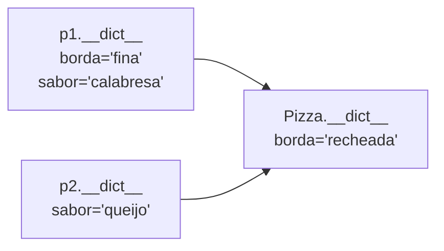

# 🔧 Atributos e Métodos

Na nota anterior ([[04 - Programação Orientada a Objetos/01 - Classes e Objetos|Classes e Objetos]]) você criou classes simples. Agora vamos distinguir os **tipos de atributos e de métodos** e quando usar cada um.

---

## 1. Visão geral

| Tipo | Declarado com | Recebe | Acessa | Uso típico |
|------|---------------|--------|--------|-----------|
| **Método de instância** | `def m(self)` | a **instância** (`self`) | Estado do objeto | Comportamento de cada objeto |
| **Método de classe** | `@classmethod` `def m(cls)` | a **classe** (`cls`) | Estado da classe | Construtores alternativos, fábricas |
| **Método estático** | `@staticmethod` `def m()` | nada | Nada (independente) | Utilitários relacionados à classe |
| **Atributo de instância** | `self.x = ...` | | | Dado individual |
| **Atributo de classe** | no corpo da classe | | | Dado compartilhado, constantes |

```python
class Exemplo:
    contador = 0                      # atributo de classe

    def __init__(self, valor):
        self.valor = valor            # atributo de instância
        Exemplo.contador += 1

    def dobro(self):                  # método de instância
        return self.valor * 2

    @classmethod
    def total(cls):                   # método de classe
        return cls.contador

    @staticmethod
    def eh_positivo(n):               # método estático
        return n > 0
```

---

## 2. Atributos em detalhe

### 2.1 De instância

Criados normalmente no `__init__`:

```python
class Produto:
    def __init__(self, nome, preco):
        self.nome = nome
        self.preco = preco
        self.estoque = 0       # valor inicial sem parâmetro
```

> [!tip] Defina **todos** os atributos no `__init__`
> Mesmo que comecem como `None` ou `0`. Assim o leitor vê "a forma" do objeto em um só lugar, e você evita `AttributeError` por atributos que só existem em certos caminhos.
> ```python
> # ❌ Atributo só existe depois de certo método
> def ativar(self):
>     self.ativo = True       # antes disso, obj.ativo dá AttributeError
> # ✅ self.ativo = False no __init__
> ```

### 2.2 De classe

Compartilhados por **todas** as instâncias:

```python
class Pizza:
    borda = "tradicional"       # padrão da classe
    TAXA_ENTREGA = 5.0          # constante (convenção MAIÚSCULAS)

    def __init__(self, sabor):
        self.sabor = sabor

p1 = Pizza("calabresa")
p2 = Pizza("queijo")
print(p1.borda, p2.borda)       # tradicional tradicional

Pizza.borda = "recheada"        # altera para TODOS (que não a sobrescreveram)
print(p1.borda, p2.borda)       # recheada recheada

p1.borda = "fina"               # cria atributo de INSTÂNCIA só em p1
print(p1.borda, p2.borda)       # fina recheada
```



**Ordem de busca de um atributo** (`obj.x`):
1. No próprio **objeto** (`obj.__dict__`)
2. Na **classe** do objeto
3. Nas **superclasses** (veja [[04 - Programação Orientada a Objetos/03 - Herança Polimorfismo e Encapsulamento|Herança]])

> [!warning] Contadores: altere pela **classe**, não pela instância
> ```python
> class Conta:
>     total = 0
>     def __init__(self):
>         # ❌ self.total += 1  → lê Conta.total, cria self.total (instância)
>         #    e deixa Conta.total sempre 0
>         Conta.total += 1       # ✅ (ou type(self).total += 1)
> ```

---

## 3. Métodos de instância

O tipo mais comum. Recebem `self` e **leem/alteram o estado** do objeto.

```python
class Termostato:
    def __init__(self, temperatura=20):
        self.temperatura = temperatura

    def aquecer(self, graus):
        self.temperatura += graus
        return self                # permite encadear (fluent interface)

    def esfriar(self, graus):
        self.temperatura -= graus
        return self

t = Termostato()
t.aquecer(5).esfriar(2)            # encadeamento
print(t.temperatura)               # 23
```

Um método pode **chamar outros métodos** da mesma classe via `self`:
```python
class Calculadora:
    def quadrado(self, x):
        return x * x

    def hipotenusa(self, a, b):
        return (self.quadrado(a) + self.quadrado(b)) ** 0.5
```

> [!warning] Esquecer o `self.` ao chamar outro método
> ```python
> def hipotenusa(self, a, b):
>     return (quadrado(a) + quadrado(b)) ** 0.5   # ❌ NameError
>     return (self.quadrado(a) + self.quadrado(b)) ** 0.5   # ✅
> ```

### Métodos "ligados" (*bound methods*)
```python
t = Termostato()
f = t.aquecer          # método já "preso" ao objeto t
f(10)                  # equivale a t.aquecer(10)
print(t.temperatura)   # 30
```

---

## 4. Métodos de classe: `@classmethod`

Recebem a **classe** (`cls`) em vez da instância. O uso mais comum: **construtores alternativos** (*factory methods*).

```python
from datetime import date

class Pessoa:
    def __init__(self, nome, ano_nascimento):
        self.nome = nome
        self.ano_nascimento = ano_nascimento

    @classmethod
    def de_idade(cls, nome, idade):
        """Cria uma Pessoa a partir da idade."""
        return cls(nome, date.today().year - idade)

    @classmethod
    def de_texto(cls, texto):
        """Cria uma Pessoa a partir de 'Nome,Ano'."""
        nome, ano = texto.split(",")
        return cls(nome.strip(), int(ano))

p1 = Pessoa("Ada", 1815)
p2 = Pessoa.de_idade("Alan", 30)
p3 = Pessoa.de_texto("Grace, 1906")
```

> [!tip] Por que `cls(...)` e não `Pessoa(...)`?
> Com `cls`, a **herança funciona**: se `Aluno(Pessoa)` chamar `Aluno.de_idade(...)`, será criado um `Aluno`, não uma `Pessoa`.

Outro uso: **acessar/alterar estado da classe**:
```python
class Config:
    modo = "producao"

    @classmethod
    def ativar_debug(cls):
        cls.modo = "debug"
```

---

## 5. Métodos estáticos: `@staticmethod`

Não recebem `self` nem `cls`: são **funções comuns** agrupadas dentro da classe por organização.

```python
class Matematica:
    @staticmethod
    def eh_par(n):
        return n % 2 == 0

    @staticmethod
    def media(*valores):
        return sum(valores) / len(valores)

print(Matematica.eh_par(4))      # True (sem criar objeto)
```

> [!warning] Se não usa a classe, talvez nem precise estar nela
> Em Python, uma **função de módulo** costuma ser mais simples que um `@staticmethod`. Use estáticos quando a função **pertence conceitualmente** à classe (ex.: validação de CPF dentro de `Cliente`).

### Comparação rápida

```python
class Demo:
    def instancia(self):   return "instância", self
    @classmethod
    def classe(cls):       return "classe", cls
    @staticmethod
    def estatico():        return "estático"

d = Demo()
d.instancia()      # ('instância', <Demo object>)
d.classe()         # ('classe', <class 'Demo'>)
d.estatico()       # 'estático'
Demo.classe()      # funciona sem instância
Demo.instancia()   # ❌ TypeError: missing 1 required positional argument: 'self'
```

| Método | Pode usar `self.x` | Pode usar `cls.x` | Precisa de instância |
|--------|:------------------:|:-----------------:|:--------------------:|
| Instância | ✅ | ✅ (`type(self)`) | ✅ |
| Classe | ❌ | ✅ | ❌ |
| Estático | ❌ | ❌ | ❌ |

---

## 6. Acesso dinâmico a atributos

```python
class Pessoa:
    def __init__(self, nome):
        self.nome = nome

p = Pessoa("Ada")

print(getattr(p, "nome"))              # 'Ada'
print(getattr(p, "idade", None))       # None (valor padrão, sem erro)
setattr(p, "idade", 36)                # cria/altera atributo
print(hasattr(p, "idade"))             # True
delattr(p, "idade")
print(p.__dict__)                      # {'nome': 'Ada'}
```

Útil para **configurações dinâmicas** e para evitar longos `if/elif`:
```python
campos = ["nome", "idade"]
for campo in campos:
    print(campo, getattr(p, campo, "-"))
```

---

## 7. Métodos privados e "helpers" (convenção)

Python não tem `private` real. Use **convenções**:

```python
class Relatorio:
    def gerar(self):
        dados = self._coletar()
        return self._formatar(dados)

    def _coletar(self):          # 1 underscore: "uso interno, não é API pública"
        return [1, 2, 3]

    def _formatar(self, dados):
        return ", ".join(map(str, dados))
```
Detalhes (inclusive `__nome` com *name mangling*) em [[04 - Programação Orientada a Objetos/03 - Herança Polimorfismo e Encapsulamento|Encapsulamento]].

---

## 8. Atributos calculados e validação (prévia)

Em vez de métodos `get_x()` e `set_x()` (estilo Java), Python usa **`@property`**:

```python
class Circulo:
    def __init__(self, raio):
        self.raio = raio

    @property
    def area(self):                  # usa-se como atributo: c.area
        return 3.14159 * self.raio ** 2
```
Veja [[04 - Programação Orientada a Objetos/04 - Propriedades e Métodos Mágicos|Propriedades e Métodos Mágicos]].

---

## 9. Exemplo completo: loja com contador e fábricas

```python
class Produto:
    _proximo_id = 1                      # atributo de classe (privado por convenção)
    IMPOSTO = 0.10                       # constante de classe

    def __init__(self, nome, preco):
        self.id = Produto._proximo_id
        Produto._proximo_id += 1
        self.nome = nome
        self.preco = preco

    # método de instância
    def preco_final(self):
        return self.preco * (1 + self.IMPOSTO)

    # construtor alternativo
    @classmethod
    def de_dict(cls, dados):
        return cls(dados["nome"], dados["preco"])

    # utilitário
    @staticmethod
    def formatar_preco(valor):
        return f"R$ {valor:,.2f}"

    def __repr__(self):
        return f"Produto(id={self.id}, nome={self.nome!r}, preco={self.preco})"


p1 = Produto("Café", 12.5)
p2 = Produto.de_dict({"nome": "Pão", "preco": 1.5})

for p in (p1, p2):
    print(p, "→", Produto.formatar_preco(p.preco_final()))
```

---

> [!question] Exercícios
> 1. Crie `Aluno` com atributo de classe `escola = "Python School"`; mostre que alterar `Aluno.escola` muda para todos, mas `a1.escola = "X"` só para `a1`.
> 2. Crie a classe `Temperatura` com `celsius` e os métodos de instância `para_fahrenheit()` e `para_kelvin()`; e os `@classmethod` `de_fahrenheit(f)` e `de_kelvin(k)`.
> 3. Crie `Utilidades` com `@staticmethod` `eh_cpf_formato_valido(texto)` (apenas confere o formato `000.000.000-00` com 11 dígitos).
> 4. Corrija o contador de instâncias:
>    ```python
>    class Conta:
>        total = 0
>        def __init__(self):
>            self.total += 1
>    ```
> 5. Escreva uma classe `Carrinho` com métodos encadeáveis `adicionar(item, preco)` e `remover(item)`, e `total()`.
> 6. Explique a diferença entre `@classmethod` e `@staticmethod` e dê um exemplo de uso de cada.
> 7. Use `getattr` para imprimir os atributos `nome`, `idade` e `cidade` de um objeto, mostrando `-` quando não existirem.

> [!success]- Soluções
> 1. ```python
>    class Aluno:
>        escola = "Python School"
>    a1, a2 = Aluno(), Aluno()
>    Aluno.escola = "Nova Escola"
>    print(a1.escola, a2.escola)      # Nova Escola Nova Escola
>    a1.escola = "X"
>    print(a1.escola, a2.escola)      # X Nova Escola
>    ```
> 2. ```python
>    class Temperatura:
>        def __init__(self, celsius):
>            self.celsius = celsius
>        def para_fahrenheit(self):
>            return self.celsius * 9 / 5 + 32
>        def para_kelvin(self):
>            return self.celsius + 273.15
>        @classmethod
>        def de_fahrenheit(cls, f):
>            return cls((f - 32) * 5 / 9)
>        @classmethod
>        def de_kelvin(cls, k):
>            return cls(k - 273.15)
>    ```
> 3. ```python
>    import re
>    class Utilidades:
>        @staticmethod
>        def eh_cpf_formato_valido(texto):
>            return bool(re.fullmatch(r"\d{3}\.\d{3}\.\d{3}-\d{2}", texto))
>    ```
> 4. Use `Conta.total += 1` (ou `type(self).total += 1`).
> 5. ```python
>    class Carrinho:
>        def __init__(self):
>            self.itens = {}
>        def adicionar(self, item, preco):
>            self.itens[item] = preco
>            return self
>        def remover(self, item):
>            self.itens.pop(item, None)
>            return self
>        def total(self):
>            return sum(self.itens.values())
>    print(Carrinho().adicionar("pão", 5).adicionar("leite", 6).total())   # 11
>    ```
> 6. `@classmethod` recebe `cls` e é ideal para **construtores alternativos** (`Pessoa.de_texto(...)`) e para mexer no estado da classe; `@staticmethod` não recebe nada e serve para utilitários que pertencem ao "assunto" da classe (`Matematica.eh_par(n)`).
> 7. ```python
>    for campo in ("nome", "idade", "cidade"):
>        print(campo, getattr(obj, campo, "-"))
>    ```

---

⬅️ [[04 - Programação Orientada a Objetos/01 - Classes e Objetos|Classes e Objetos]] | ➡️ [[04 - Programação Orientada a Objetos/03 - Herança Polimorfismo e Encapsulamento|Herança, Polimorfismo e Encapsulamento]]

#python #intermediario #poo #atributos #metodos #classmethod #staticmethod
