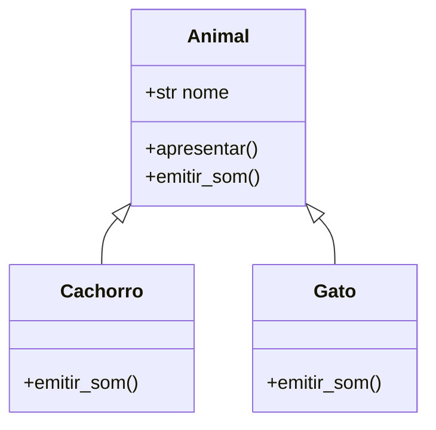
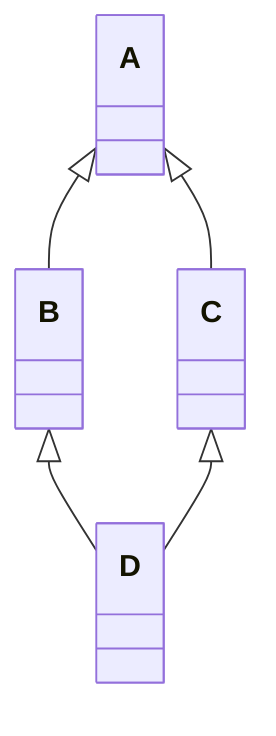
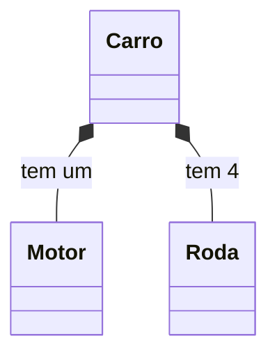

# 🧬 Herança, Polimorfismo e Encapsulamento

Os **pilares da POO** (junto com a abstração):

| Pilar | Ideia em uma frase |
|-------|--------------------|
| **Herança** | Uma classe **reaproveita** e **estende** outra |
| **Polimorfismo** | Objetos diferentes respondem à **mesma chamada** de jeitos diferentes |
| **Encapsulamento** | **Esconder** detalhes internos e proteger o estado |
| **Abstração** | Expor só o **essencial** (contratos) |

---

## 1. Herança

Uma **subclasse** (filha) herda atributos e métodos de uma **superclasse** (mãe/base).

```python
class Animal:
    def __init__(self, nome):
        self.nome = nome

    def apresentar(self):
        return f"Eu sou {self.nome}"

    def emitir_som(self):
        return "..."


class Cachorro(Animal):          # Cachorro herda de Animal
    def emitir_som(self):        # sobrescreve (override)
        return "Au au!"


class Gato(Animal):
    def emitir_som(self):
        return "Miau!"


rex = Cachorro("Rex")
print(rex.apresentar())   # Eu sou Rex       ← herdado de Animal
print(rex.emitir_som())   # Au au!           ← sobrescrito
```



> [!note] Relação "é um"
> Herança modela **"é um"**: um `Cachorro` **é um** `Animal`. Se a frase não faz sentido, **não use herança** (veja composição, abaixo).

### 1.1 `super()`: chamando a classe mãe

```python
class Animal:
    def __init__(self, nome):
        self.nome = nome


class Cachorro(Animal):
    def __init__(self, nome, raca):
        super().__init__(nome)       # inicializa a parte da classe mãe
        self.raca = raca             # e acrescenta o que é novo
```

> [!warning] Esquecer o `super().__init__()`
> ```python
> class Cachorro(Animal):
>     def __init__(self, nome, raca):
>         self.raca = raca           # ❌ Animal.__init__ não rodou
> rex = Cachorro("Rex", "Lab")
> print(rex.nome)                    # AttributeError: 'Cachorro' has no attribute 'nome'
> ```

`super()` também serve para **estender** (e não só substituir) um método:
```python
class Cachorro(Animal):
    def emitir_som(self):
        base = super().emitir_som()          # "..."
        return f"{base} Au au!"
```

### 1.2 `@override` (Python 3.12+)
Marca explicitamente que você está sobrescrevendo; o verificador de tipos (mypy/pyright) avisa se o método **não existe** na mãe (ótimo contra erros de digitação):

```python
from typing import override

class Gato(Animal):
    @override
    def emitir_som(self):
        return "Miau!"

    @override
    def emitr_som(self):     # ⚠️ o checker avisa: não existe na classe base
        ...
```

### 1.3 Verificando relações
```python
print(isinstance(rex, Cachorro))     # True
print(isinstance(rex, Animal))       # True  (é também um Animal)
print(issubclass(Cachorro, Animal))  # True
print(type(rex) is Animal)           # False (tipo exato)
print(Cachorro.__mro__)              # ordem de busca (veja 1.5)
```
> [!tip] Prefira `isinstance` a `type(x) == Classe`
> `isinstance` respeita a herança; a comparação de tipo exato, não.

### 1.4 Herança múltipla
Uma classe pode herdar de **várias** classes:

```python
class Voador:
    def voar(self):
        return "Voando!"

class Nadador:
    def nadar(self):
        return "Nadando!"

class Pato(Voador, Nadador):
    pass

p = Pato()
print(p.voar(), p.nadar())
```

### 1.5 MRO: a ordem de busca
O Python segue o **Method Resolution Order** (algoritmo C3): primeiro a própria classe, depois as bases, da **esquerda para a direita**, sem repetir.

```python
class A:
    def quem(self): return "A"
class B(A):
    def quem(self): return "B"
class C(A):
    def quem(self): return "C"
class D(B, C):
    pass

print(D().quem())                 # B
print([k.__name__ for k in D.__mro__])   # ['D', 'B', 'C', 'A', 'object']
```



> [!warning] Cuidado com herança múltipla
> Fica confusa rapidamente (o "problema do diamante"). Use com **mixins** pequenos e específicos, e sempre com `super()` cooperativo.

### 1.6 Mixins
Classes pequenas que adicionam **uma capacidade**, sem serem usadas sozinhas:

```python
import json

class JsonMixin:
    def to_json(self):
        return json.dumps(self.__dict__, ensure_ascii=False)

class Pessoa(JsonMixin):
    def __init__(self, nome, idade):
        self.nome = nome
        self.idade = idade

print(Pessoa("Ada", 36).to_json())   # {"nome": "Ada", "idade": 36}
```

---

## 2. Polimorfismo

> *"Muitas formas"*: o mesmo **método** funciona com objetos de **tipos diferentes**.

```python
animais = [Cachorro("Rex"), Gato("Mia"), Animal("Bicho")]

for animal in animais:
    print(f"{animal.nome}: {animal.emitir_som()}")   # sem if/elif por tipo!
```
Saída:
```text
Rex: Au au!
Mia: Miau!
Bicho: ...
```

> [!tip] Elimine `if tipo == ...`
> ```python
> # ❌ Cada novo tipo exige mexer nesta função
> def som(animal):
>     if isinstance(animal, Cachorro): return "Au"
>     elif isinstance(animal, Gato): return "Miau"
>
> # ✅ Cada classe sabe se comportar; novo tipo = nova classe
> animal.emitir_som()
> ```

### 2.1 *Duck typing*: "se anda como pato..."
Python **não exige herança** para polimorfismo: basta o objeto ter o método.

```python
class Pato:
    def falar(self): return "Quack!"

class Robo:
    def falar(self): return "Bip bop!"

def conversar(coisa):
    print(coisa.falar())

conversar(Pato())
conversar(Robo())      # funciona: Robo não herda de nada
```

### 2.2 Polimorfismo com operadores
Os [[04 - Programação Orientada a Objetos/04 - Propriedades e Métodos Mágicos|métodos mágicos]] fazem `+`, `len()`, `==`... funcionarem com seus objetos.

### 2.3 Classes abstratas (`abc`): contratos obrigatórios
Para **forçar** que subclasses implementem certos métodos:

```python
from abc import ABC, abstractmethod

class Forma(ABC):
    @abstractmethod
    def area(self):
        """Toda forma precisa calcular sua área."""

    def descrever(self):                       # método concreto herdável
        return f"{type(self).__name__} com área {self.area():.2f}"


class Quadrado(Forma):
    def __init__(self, lado):
        self.lado = lado
    def area(self):
        return self.lado ** 2


class Circulo(Forma):
    def __init__(self, raio):
        self.raio = raio
    def area(self):
        return 3.14159 * self.raio ** 2


Forma()               # ❌ TypeError: Can't instantiate abstract class Forma
print(Quadrado(3).descrever())     # Quadrado com área 9.00
```

> [!warning] Subclasse esqueceu de implementar
> ```python
> class Triangulo(Forma):
>     pass
> Triangulo()   # TypeError: Can't instantiate abstract class Triangulo
>               # without an implementation for abstract method 'area'
> ```
> O erro aparece **na criação do objeto**, e não só quando o método for chamado: falha cedo.

### 2.4 `Protocol`: contrato por estrutura (tipagem de pato)
Quando você quer o contrato **sem** exigir herança (veja [[07 - Programação Funcional e Intermediário/06 - Type Hints e typing|Type Hints]]):

```python
from typing import Protocol

class TemArea(Protocol):
    def area(self) -> float: ...

def somar_areas(formas: list[TemArea]) -> float:
    return sum(f.area() for f in formas)
```
Qualquer objeto com `area()` serve; o verificador de tipos confere.

---

## 3. Composição vs herança

> [!note] "Prefira composição à herança"
> **Herança** = "**é um**". **Composição** = "**tem um**": um objeto **contém** outros.

```python
# ❌ Herança forçada: Carro NÃO "é um" Motor
class Carro(Motor):
    ...

# ✅ Composição: Carro TEM um Motor
class Motor:
    def __init__(self, potencia):
        self.potencia = potencia
    def ligar(self):
        return "Vrum!"

class Carro:
    def __init__(self, modelo, motor):
        self.modelo = modelo
        self.motor = motor          # composição
    def ligar(self):
        return f"{self.modelo}: {self.motor.ligar()}"

print(Carro("Fusca", Motor(60)).ligar())
```

| | Herança | Composição |
|---|---------|------------|
| Relação | "é um" | "tem um" |
| Acoplamento | Forte (filha depende da mãe) | Fraco |
| Flexibilidade | Fixa (em tempo de definição) | Pode trocar o componente em execução |
| Quando usar | Hierarquia **natural** e estável | Quase sempre que estiver em dúvida |



---

## 4. Encapsulamento

> Proteger o **estado interno** do objeto, expondo uma **interface pública** controlada.

Python **não tem** `private`/`protected` impostos pelo compilador. Usa-se **convenção** ("somos todos adultos aqui"):

| Notação | Significado | Exemplo |
|---------|-------------|---------|
| `nome` | **Público**: parte da API | `conta.saldo` |
| `_nome` | **Protegido** (convenção): uso interno / subclasses | `conta._historico` |
| `__nome` | **Privado** com *name mangling* | `conta.__senha` |

```python
class ContaBancaria:
    def __init__(self, titular, saldo=0):
        self.titular = titular          # público
        self._saldo = saldo             # "protegido" por convenção
        self.__pin = "1234"             # "privado" (mangling)

    def depositar(self, valor):
        if valor <= 0:
            raise ValueError("Valor inválido")
        self._saldo += valor

    @property
    def saldo(self):                    # leitura controlada
        return self._saldo
```

### Name mangling (`__x`)
O Python **renomeia** `__pin` para `_ContaBancaria__pin`: dificulta acessos acidentais e conflitos em subclasses.

```python
c = ContaBancaria("Ada")
print(c.saldo)                  # 0
# print(c.__pin)                # AttributeError
print(c._ContaBancaria__pin)    # '1234'  (ainda acessível!)
```

> [!warning] `__` NÃO é segurança
> O mangling serve para **evitar colisão de nomes** em herança, não para proteger dados sensíveis. Para segredos de verdade, não os guarde em atributos de objetos em memória acessível ao usuário.

> [!tip] Qual usar?
> - **`_nome`**: para quase todo "detalhe interno" (o mais comum e pythônico)
> - **`__nome`**: só quando precisa evitar choque de nomes com subclasses
> - Não crie `get_x()`/`set_x()` à toa: comece com atributo público e, se precisar de validação, **evolua para `@property`** sem quebrar quem usa ([[04 - Programação Orientada a Objetos/04 - Propriedades e Métodos Mágicos|veja]]).

### Invariantes: o objetivo do encapsulamento
```python
# ❌ Qualquer um quebra a regra "saldo nunca negativo"
conta.saldo = -1_000_000

# ✅ A classe garante a regra via métodos/propriedades
conta.sacar(1_000_000)    # levanta ValueError
```

---

## 5. Exemplo completo: sistema de funcionários

```python
from abc import ABC, abstractmethod

class Funcionario(ABC):
    def __init__(self, nome, salario_base):
        self.nome = nome
        self._salario_base = salario_base

    @abstractmethod
    def salario(self):
        ...

    def __repr__(self):
        return f"{type(self).__name__}({self.nome!r})"


class Operario(Funcionario):
    def salario(self):
        return self._salario_base


class Gerente(Funcionario):
    def __init__(self, nome, salario_base, bonus):
        super().__init__(nome, salario_base)
        self.bonus = bonus

    def salario(self):
        return self._salario_base + self.bonus


class Vendedor(Funcionario):
    def __init__(self, nome, salario_base, vendas):
        super().__init__(nome, salario_base)
        self.vendas = vendas

    def salario(self):
        return self._salario_base + 0.05 * self.vendas


equipe = [
    Operario("Ana", 3000),
    Gerente("Bruno", 6000, bonus=2000),
    Vendedor("Carla", 2500, vendas=20_000),
]

for f in equipe:                          # polimorfismo
    print(f"{f!r:<22} R$ {f.salario():>9,.2f}")

print(f"Folha total: R$ {sum(f.salario() for f in equipe):,.2f}")
```

---

> [!question] Exercícios
> 1. Crie `Veiculo` com `marca` e `acelerar()`; derive `Carro` e `Moto`, sobrescrevendo `acelerar()`. Chame `super().__init__`.
> 2. Escreva uma classe abstrata `Pagamento` com `pagar(valor)` abstrato, e as filhas `Cartao`, `Pix` e `Boleto`. Itere sobre uma lista delas.
> 3. Dada `class D(B, C)` com `B(A)` e `C(A)`, qual é o MRO? Como verificar no Python?
> 4. Transforme a herança abaixo em composição e explique por quê:
>    ```python
>    class Pilha(list):
>        def empilhar(self, x): self.append(x)
>    ```
> 5. Por que o código falha? Corrija:
>    ```python
>    class A:
>        def __init__(self): self.x = 1
>    class B(A):
>        def __init__(self): self.y = 2
>    print(B().x)
>    ```
> 6. Qual a diferença entre `_x` e `__x`? Como Python torna `__x` "privado"?
> 7. Escreva `Banco` com uma lista de contas `ContaCorrente` e `ContaPoupanca` (herdando de `Conta`), com `rendimento()` polimórfico.

> [!success]- Soluções
> 1. ```python
>    class Veiculo:
>        def __init__(self, marca):
>            self.marca = marca
>        def acelerar(self):
>            return f"{self.marca} acelerando"
>    class Carro(Veiculo):
>        def acelerar(self):
>            return super().acelerar() + " (4 rodas)"
>    class Moto(Veiculo):
>        def __init__(self, marca, cilindradas):
>            super().__init__(marca)
>            self.cilindradas = cilindradas
>        def acelerar(self):
>            return f"{self.marca} {self.cilindradas}cc: vrum!"
>    ```
> 2. ```python
>    from abc import ABC, abstractmethod
>    class Pagamento(ABC):
>        @abstractmethod
>        def pagar(self, valor): ...
>    class Cartao(Pagamento):
>        def pagar(self, valor): return f"Cartão: R$ {valor:.2f}"
>    class Pix(Pagamento):
>        def pagar(self, valor): return f"Pix: R$ {valor:.2f}"
>    class Boleto(Pagamento):
>        def pagar(self, valor): return f"Boleto: R$ {valor:.2f}"
>    for p in (Cartao(), Pix(), Boleto()):
>        print(p.pagar(100))
>    ```
> 3. `[D, B, C, A, object]`. Verifique com `D.__mro__`.
> 4. ```python
>    class Pilha:
>        def __init__(self):
>            self._itens = []
>        def empilhar(self, x): self._itens.append(x)
>        def desempilhar(self): return self._itens.pop()
>        def __len__(self): return len(self._itens)
>    ```
>    Uma `Pilha` **não é uma** lista: herdando de `list`, ela expõe `insert`, `sort`, `[0]`... quebrando o contrato LIFO. Com composição, só oferecemos o que faz sentido.
> 5. `B.__init__` não chama `A.__init__`, então `x` não existe. Corrija com `super().__init__()` na primeira linha de `B.__init__`.
> 6. `_x` é só convenção ("interno"). `__x` sofre *name mangling*: vira `_Classe__x`, evitando colisão com subclasses (não é segurança real).
> 7. ```python
>    class Conta:
>        def __init__(self, saldo): self.saldo = saldo
>        def rendimento(self): return 0
>    class ContaCorrente(Conta): ...
>    class ContaPoupanca(Conta):
>        def rendimento(self): return self.saldo * 0.005
>    contas = [ContaCorrente(1000), ContaPoupanca(1000)]
>    print([c.rendimento() for c in contas])   # [0, 5.0]
>    ```

---

⬅️ [[04 - Programação Orientada a Objetos/02 - Atributos e Métodos|Atributos e Métodos]] | ➡️ [[04 - Programação Orientada a Objetos/04 - Propriedades e Métodos Mágicos|Propriedades e Métodos Mágicos]]

#python #intermediario #poo #heranca #polimorfismo #encapsulamento #abc #mro
