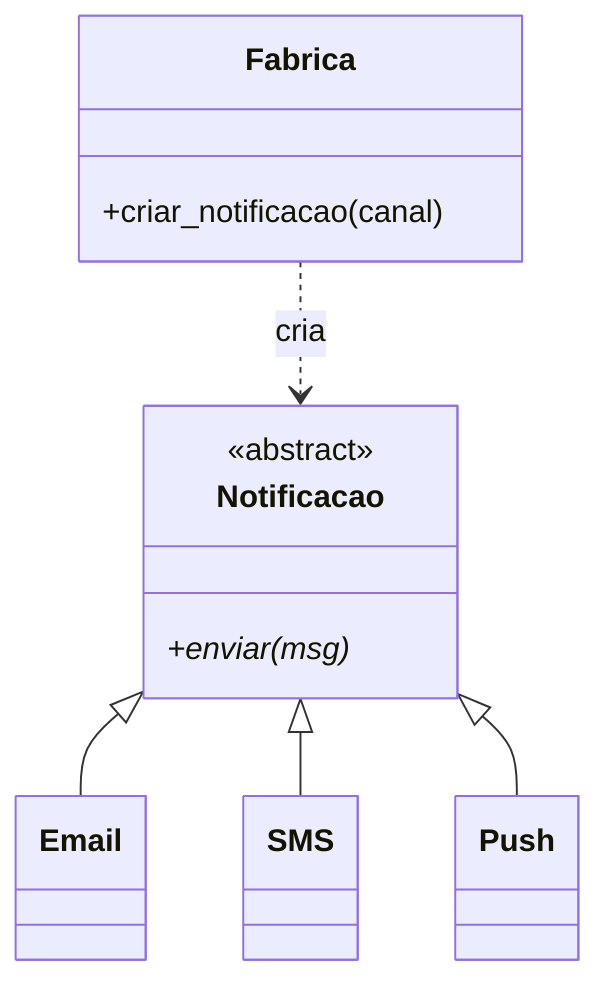
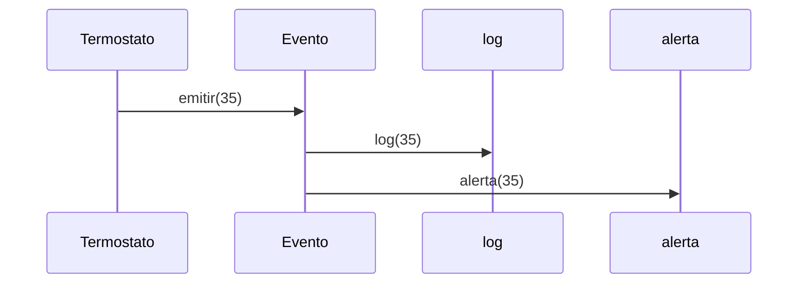

# 🧱 Design Patterns Básicos em Python

**Padrões de projeto** (*design patterns*) são **soluções reutilizáveis** para problemas recorrentes de design de software. Não são código pronto: são **receitas** que você adapta.

> [!note] Python não é Java
> Muitos padrões clássicos (do livro "Gang of Four") foram pensados para linguagens mais rígidas. Em Python, funções são objetos, há *duck typing*, módulos e decoradores, e vários padrões viram **uma função** ou **uma linha**. Aprenda a **ideia**, e use a forma **pythônica**.

| Categoria | Objetivo | Padrões nesta nota |
|-----------|----------|--------------------|
| **Criacionais** | Como criar objetos | Singleton, Factory, Builder |
| **Estruturais** | Como combinar objetos | Adapter, Decorator, Facade |
| **Comportamentais** | Como objetos interagem | Strategy, Observer, Command, Template Method |

> [!warning] Não aplique padrões "por esporte"
> Um padrão resolve um problema **que você tem**. Código simples e claro vale mais que arquitetura sofisticada. ("Simples é melhor que complexo", [[01 - Fundamentos/06 - Comentários e Boas Práticas#4. O Zen do Python|Zen do Python]].)

Padrões **avançados** e *clean code* em [[08 - Avançado/08 - Design Patterns Avançados e Clean Code|Design Patterns Avançados]].

---

## 🏭 Criacionais

## 1. Singleton: uma única instância

**Problema:** garantir que exista **apenas um** objeto de uma classe (configuração, conexão, cache).

### ✅ O jeito mais pythônico: um módulo
Módulos são carregados **uma vez**; são singletons naturais:

```python
# config.py
DEBUG = False
HOST = "localhost"

def ativar_debug():
    global DEBUG
    DEBUG = True
```
```python
# em qualquer arquivo
import config
config.ativar_debug()     # todos veem o mesmo estado
```

### Com classe (`__new__`)
```python
class Configuracao:
    _instancia = None

    def __new__(cls, *args, **kwargs):
        if cls._instancia is None:
            cls._instancia = super().__new__(cls)
        return cls._instancia

    def __init__(self):
        if not hasattr(self, "valores"):
            self.valores = {}

a = Configuracao()
b = Configuracao()
print(a is b)       # True
a.valores["x"] = 1
print(b.valores)    # {'x': 1}
```

> [!warning] Singletons escondem dependências
> São, na prática, **estado global** com outro nome. Dificultam testes. Prefira **passar** o objeto como parâmetro (injeção de dependência) e use singleton só quando for realmente necessário.

---

## 2. Factory: criar objetos sem acoplar à classe concreta

**Problema:** escolher **qual classe** instanciar com base em dados/entrada, sem espalhar `if/elif` pelo código.

```python
from abc import ABC, abstractmethod

class Notificacao(ABC):
    @abstractmethod
    def enviar(self, mensagem): ...

class Email(Notificacao):
    def enviar(self, mensagem):
        print(f"📧 E-mail: {mensagem}")

class SMS(Notificacao):
    def enviar(self, mensagem):
        print(f"📱 SMS: {mensagem}")

class Push(Notificacao):
    def enviar(self, mensagem):
        print(f"🔔 Push: {mensagem}")
```

### Forma pythônica: dicionário de classes
```python
CANAIS = {"email": Email, "sms": SMS, "push": Push}

def criar_notificacao(canal: str) -> Notificacao:
    try:
        return CANAIS[canal.lower()]()
    except KeyError:
        raise ValueError(f"Canal desconhecido: {canal!r}") from None

criar_notificacao("sms").enviar("Seu pedido saiu!")
```
Para novos canais, basta **registrar** no dicionário. Nenhum `if/elif` novo.

### Com `@classmethod` (construtor alternativo)
```python
class Pessoa:
    def __init__(self, nome, idade): ...

    @classmethod
    def de_dict(cls, dados):
        return cls(dados["nome"], dados["idade"])
```
Veja [[04 - Programação Orientada a Objetos/02 - Atributos e Métodos|métodos de classe]].



---

## 3. Builder: construção passo a passo

**Problema:** objetos com **muitas opções** e construção complexa.

Em Python, **argumentos nomeados com padrão** (ou `dataclass(kw_only=True)`) já resolvem 90% dos casos:

```python
@dataclass(kw_only=True)
class Requisicao:
    url: str
    metodo: str = "GET"
    timeout: float = 10.0
    headers: dict = field(default_factory=dict)

Requisicao(url="https://api.com", timeout=5)
```

Quando a construção é **realmente** em etapas, use encadeamento (*fluent builder*):

```python
class ConsultaSQL:
    def __init__(self, tabela):
        self._tabela = tabela
        self._campos = ["*"]
        self._filtros = []
        self._limite = None

    def campos(self, *campos):
        self._campos = list(campos)
        return self

    def onde(self, condicao):
        self._filtros.append(condicao)
        return self

    def limite(self, n):
        self._limite = n
        return self

    def construir(self):
        sql = f"SELECT {', '.join(self._campos)} FROM {self._tabela}"
        if self._filtros:
            sql += " WHERE " + " AND ".join(self._filtros)
        if self._limite:
            sql += f" LIMIT {self._limite}"
        return sql

print(ConsultaSQL("usuarios").campos("nome", "idade").onde("idade > 18").limite(10).construir())
# SELECT nome, idade FROM usuarios WHERE idade > 18 LIMIT 10
```

---

## 🧩 Estruturais

## 4. Adapter: fazer interfaces incompatíveis conversarem

**Problema:** você tem uma classe com interface **diferente** da esperada pelo seu código (ex.: biblioteca de terceiros).

```python
class ApiAntiga:                       # não podemos alterar
    def obter_dados_xml(self):
        return "<usuario><nome>Ada</nome></usuario>"

class AdaptadorJson:                   # adapta para a interface que usamos: .obter()
    def __init__(self, api):
        self._api = api

    def obter(self):
        xml = self._api.obter_dados_xml()
        nome = xml.split("<nome>")[1].split("</nome>")[0]
        return {"nome": nome}

print(AdaptadorJson(ApiAntiga()).obter())    # {'nome': 'Ada'}
```

---

## 5. Decorator: adicionar comportamento dinamicamente

**Problema:** acrescentar funcionalidade a objetos/funções **sem modificá-los** e sem herança.

> [!note] Não confunda
> O **padrão** Decorator (envolver objetos) é diferente da **sintaxe** `@decorator` do Python, embora a sintaxe seja a forma mais natural de aplicar a ideia a **funções**.

```python
import time
from functools import wraps

def cronometrar(func):
    @wraps(func)
    def wrapper(*args, **kwargs):
        inicio = time.perf_counter()
        resultado = func(*args, **kwargs)
        print(f"{func.__name__} levou {time.perf_counter() - inicio:.4f}s")
        return resultado
    return wrapper

@cronometrar
def somar_ate(n):
    return sum(range(n))

somar_ate(1_000_000)
```
Detalhes em [[07 - Programação Funcional e Intermediário/03 - Decorators|Decorators]]. Versão com **objetos** (envolvendo):

```python
class Cafe:
    def custo(self): return 5.0
    def descricao(self): return "Café"

class ComLeite:
    def __init__(self, bebida):
        self._bebida = bebida
    def custo(self): return self._bebida.custo() + 1.5
    def descricao(self): return self._bebida.descricao() + " + leite"

class ComChantilly:
    def __init__(self, bebida):
        self._bebida = bebida
    def custo(self): return self._bebida.custo() + 2.0
    def descricao(self): return self._bebida.descricao() + " + chantilly"

pedido = ComChantilly(ComLeite(Cafe()))
print(pedido.descricao(), pedido.custo())    # Café + leite + chantilly 8.5
```

---

## 6. Facade: uma interface simples para um sistema complexo

```python
class Estoque:
    def reservar(self, item): print(f"Estoque: {item} reservado")
class Pagamento:
    def cobrar(self, valor): print(f"Pagamento: R$ {valor} cobrado")
class Envio:
    def despachar(self, item): print(f"Envio: {item} despachado")

class LojaFacade:
    """Esconde a complexidade dos subsistemas."""
    def __init__(self):
        self._estoque, self._pagamento, self._envio = Estoque(), Pagamento(), Envio()

    def comprar(self, item, valor):
        self._estoque.reservar(item)
        self._pagamento.cobrar(valor)
        self._envio.despachar(item)

LojaFacade().comprar("Livro", 49.9)    # uma chamada em vez de três
```

---

## 🎭 Comportamentais

## 7. Strategy: algoritmos intercambiáveis

**Problema:** vários jeitos de fazer algo (calcular frete, ordenar, aplicar desconto) e você quer **trocá-los** sem `if/elif` gigantes.

### ✅ Em Python: **funções** são estratégias
```python
def desconto_nenhum(preco):   return preco
def desconto_vip(preco):      return preco * 0.8
def desconto_black(preco):    return preco * 0.5

class Pedido:
    def __init__(self, preco, estrategia=desconto_nenhum):
        self.preco = preco
        self.estrategia = estrategia

    def total(self):
        return self.estrategia(self.preco)

print(Pedido(100, desconto_vip).total())      # 80.0
print(Pedido(100, lambda p: p - 15).total())  # 85  (estratégia ad hoc)
```

### Com classes (quando a estratégia tem estado)
```python
from abc import ABC, abstractmethod

class Frete(ABC):
    @abstractmethod
    def calcular(self, peso): ...

class Sedex(Frete):
    def calcular(self, peso): return 20 + peso * 5

class Normal(Frete):
    def calcular(self, peso): return 10 + peso * 2

def total_compra(valor, peso, frete: Frete):
    return valor + frete.calcular(peso)

print(total_compra(100, 2, Sedex()))    # 130
```

> [!tip] Dicionário de estratégias
> ```python
> ESTRATEGIAS = {"vip": desconto_vip, "black": desconto_black}
> preco = ESTRATEGIAS.get(tipo, desconto_nenhum)(100)
> ```
> (Mesma ideia do [[02 - Controle de Fluxo e Estruturas de Dados/06 - Dicionários#6. Padrões clássicos|despacho por dicionário]].)

---

## 8. Observer: notificar interessados sobre mudanças

**Problema:** quando um objeto muda, vários outros precisam **reagir**, sem acoplamento direto.

```python
class Evento:
    def __init__(self):
        self._ouvintes = []

    def inscrever(self, callback):
        self._ouvintes.append(callback)

    def cancelar(self, callback):
        self._ouvintes.remove(callback)

    def emitir(self, *args, **kwargs):
        for ouvinte in list(self._ouvintes):
            ouvinte(*args, **kwargs)


class Termostato:
    def __init__(self):
        self.temperatura_mudou = Evento()
        self._temp = 20

    @property
    def temperatura(self):
        return self._temp

    @temperatura.setter
    def temperatura(self, valor):
        self._temp = valor
        self.temperatura_mudou.emitir(valor)


def alerta(t):
    if t > 30:
        print(f"🔥 Alerta: {t}°C")

def log(t):
    print(f"[log] temperatura = {t}")

termo = Termostato()
termo.temperatura_mudou.inscrever(log)
termo.temperatura_mudou.inscrever(alerta)

termo.temperatura = 25     # [log] temperatura = 25
termo.temperatura = 35     # [log] ... + 🔥 Alerta
```



> [!note] Callbacks são observers
> Em Python, os "observadores" costumam ser **funções** (callbacks), sem necessidade de interface formal.

---

## 9. Command: transformar ações em objetos

**Problema:** guardar, enfileirar ou **desfazer** operações.

```python
class Editor:
    def __init__(self):
        self.texto = ""
        self._historico = []

    def executar(self, comando):
        comando.executar(self)
        self._historico.append(comando)

    def desfazer(self):
        if self._historico:
            self._historico.pop().desfazer(self)


class Inserir:
    def __init__(self, trecho):
        self.trecho = trecho
    def executar(self, editor):
        editor.texto += self.trecho
    def desfazer(self, editor):
        editor.texto = editor.texto[: -len(self.trecho)]


ed = Editor()
ed.executar(Inserir("Olá"))
ed.executar(Inserir(", mundo"))
print(ed.texto)         # Olá, mundo
ed.desfazer()
print(ed.texto)         # Olá
```

---

## 10. Template Method: esqueleto fixo, passos variáveis

```python
from abc import ABC, abstractmethod

class ProcessadorArquivo(ABC):
    def processar(self, caminho):          # template (não sobrescreva)
        dados = self.ler(caminho)
        dados = self.transformar(dados)
        self.salvar(dados)

    @abstractmethod
    def ler(self, caminho): ...

    def transformar(self, dados):          # gancho opcional
        return dados

    @abstractmethod
    def salvar(self, dados): ...
```
Subclasses preenchem só os passos que variam ([[04 - Programação Orientada a Objetos/03 - Herança Polimorfismo e Encapsulamento|herança e classes abstratas]]).

---

## 11. Outros padrões "embutidos" no Python

| Padrão | Já vem como... |
|--------|----------------|
| **Iterator** | `for`, `__iter__`, geradores ([[07 - Programação Funcional e Intermediário/04 - Generators e Iterators\|Generators]]) |
| **Decorator** | Sintaxe `@` ([[07 - Programação Funcional e Intermediário/03 - Decorators\|Decorators]]) |
| **Context Manager (RAII)** | `with` ([[05 - Tratamento de Erros e Arquivos/04 - Context Managers com with\|Context Managers]]) |
| **Singleton** | Módulos |
| **Strategy / Command** | Funções de primeira classe |
| **Prototype** | `copy.copy` / `copy.deepcopy` |
| **Observer** | Callbacks, sinais de frameworks |

---

## 12. Resumo: qual padrão para qual problema?

| Se você precisa de... | Considere |
|-----------------------|-----------|
| Uma única instância compartilhada | Módulo / Singleton |
| Criar objetos conforme um parâmetro | Factory (dict de classes) |
| Construir objeto com muitas opções | `kw_only` dataclass / Builder |
| Usar API com interface diferente | Adapter |
| Adicionar comportamento sem alterar o original | Decorator |
| Esconder subsistema complexo | Facade |
| Trocar algoritmos em runtime | Strategy (funções) |
| Reagir a eventos | Observer (callbacks) |
| Desfazer / enfileirar ações | Command |

---

> [!question] Exercícios
> 1. Implemente uma **Factory** de `Forma` (`"circulo"`, `"quadrado"`, `"triangulo"`) usando um dicionário.
> 2. Crie uma estratégia de **desconto** com funções e um dicionário `{"vip": ..., "normal": ...}`; aplique a uma lista de pedidos.
> 3. Implemente um `Evento` (Observer) e use-o em uma classe `Botao` com o evento `ao_clicar`.
> 4. Crie um **Decorator de objetos**: `Texto` básico e decoradores `Negrito`, `Italico` que envolvem o texto em `<b>`/`<i>`.
> 5. Implemente um **Singleton** `Logger` que acumule mensagens, e prove que duas "instâncias" são o mesmo objeto.
> 6. Implemente **Command** para uma calculadora com `Somar(n)` e `Multiplicar(n)` e `desfazer()`.
> 7. Quais padrões acima já existem "de graça" em Python? Cite pelo menos 4.

> [!success]- Soluções
> 1. ```python
>    import math
>    class Circulo:
>        def __init__(self, r): self.r = r
>        def area(self): return math.pi * self.r ** 2
>    class Quadrado:
>        def __init__(self, l): self.l = l
>        def area(self): return self.l ** 2
>    class Triangulo:
>        def __init__(self, b, h): self.b, self.h = b, h
>        def area(self): return self.b * self.h / 2
>
>    FORMAS = {"circulo": Circulo, "quadrado": Quadrado, "triangulo": Triangulo}
>
>    def criar_forma(tipo, *args):
>        try:
>            return FORMAS[tipo](*args)
>        except KeyError:
>            raise ValueError(f"Forma desconhecida: {tipo}") from None
>
>    print(criar_forma("quadrado", 3).area())    # 9
>    ```
> 2. ```python
>    DESCONTOS = {"vip": lambda p: p * 0.8, "normal": lambda p: p}
>    pedidos = [("vip", 100), ("normal", 50)]
>    print([DESCONTOS[tipo](preco) for tipo, preco in pedidos])   # [80.0, 50]
>    ```
> 3. ```python
>    class Botao:
>        def __init__(self):
>            self.ao_clicar = Evento()
>        def clicar(self):
>            self.ao_clicar.emitir()
>    b = Botao()
>    b.ao_clicar.inscrever(lambda: print("Clicou!"))
>    b.clicar()
>    ```
>    (usando a classe `Evento` da seção 8)
> 4. ```python
>    class Texto:
>        def __init__(self, t): self.t = t
>        def render(self): return self.t
>    class Negrito:
>        def __init__(self, base): self.base = base
>        def render(self): return f"<b>{self.base.render()}</b>"
>    class Italico:
>        def __init__(self, base): self.base = base
>        def render(self): return f"<i>{self.base.render()}</i>"
>    print(Negrito(Italico(Texto("oi"))).render())   # <b><i>oi</i></b>
>    ```
> 5. ```python
>    class Logger:
>        _inst = None
>        def __new__(cls):
>            if cls._inst is None:
>                cls._inst = super().__new__(cls)
>                cls._inst.mensagens = []
>            return cls._inst
>        def log(self, msg): self.mensagens.append(msg)
>    a, b = Logger(), Logger()
>    a.log("oi")
>    print(a is b, b.mensagens)   # True ['oi']
>    ```
> 6. ```python
>    class Calculadora:
>        def __init__(self):
>            self.valor, self._hist = 0, []
>        def executar(self, cmd):
>            cmd.executar(self); self._hist.append(cmd)
>        def desfazer(self):
>            if self._hist: self._hist.pop().desfazer(self)
>    class Somar:
>        def __init__(self, n): self.n = n
>        def executar(self, c): c.valor += self.n
>        def desfazer(self, c): c.valor -= self.n
>    class Multiplicar:
>        def __init__(self, n): self.n = n
>        def executar(self, c): c.valor *= self.n
>        def desfazer(self, c): c.valor /= self.n
>    ```
> 7. Singleton (módulos), Iterator (`for`/geradores), Decorator (`@`), Context Manager (`with`), Strategy/Command (funções de primeira classe), Prototype (`copy`).

---

⬅️ [[04 - Programação Orientada a Objetos/05 - Dataclasses e Slots|Dataclasses e Slots]] | ➡️ [[04 - Programação Orientada a Objetos/07 - Exercícios de POO|Exercícios de POO]]

#python #intermediario #poo #design-patterns #padroes-de-projeto #singleton #factory #strategy #observer
