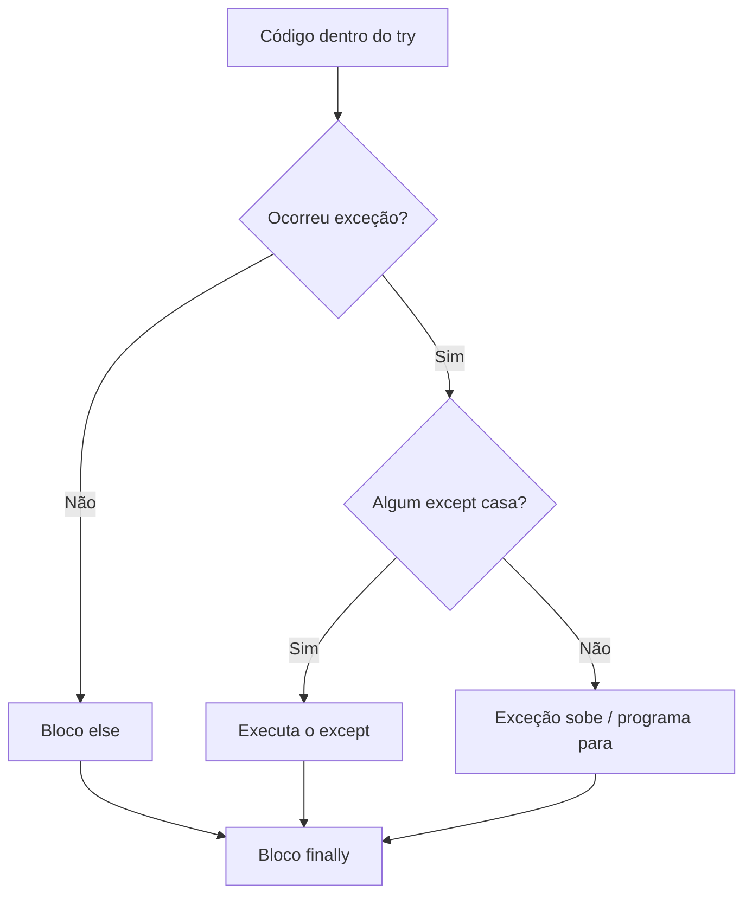
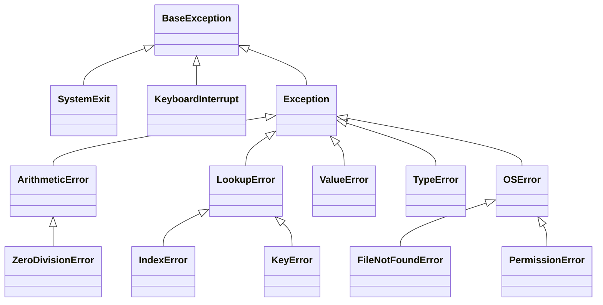

# 🛡️ try / except / else / finally

Erros acontecem: o usuário digita "abc" onde se espera um número, o arquivo não existe, a rede cai. Um programa robusto **antecipa** essas situações e reage de forma controlada em vez de "quebrar".

> [!note] Erro de sintaxe vs exceção
> - **Erro de sintaxe** (`SyntaxError`): o código está **mal escrito**; o Python nem começa a executar.
> - **Exceção**: o código está bem escrito, mas **algo dá errado durante a execução**. É isso que tratamos aqui.

---

## 1. O que acontece quando há uma exceção

```python
numero = int("abc")
```
```text
Traceback (most recent call last):
  File "app.py", line 1, in <module>
    numero = int("abc")
ValueError: invalid literal for int() with base 10: 'abc'
```

Sem tratamento, o programa **encerra**. O *traceback* mostra o caminho percorrido até o erro (leia **de baixo para cima**: tipo do erro → mensagem → onde ocorreu). Revise em [[01 - Fundamentos/06 - Comentários e Boas Práticas|lendo um traceback]].



---

## 2. `try` / `except`

```python
try:
    numero = int(input("Digite um número: "))
    print(f"Dobro: {numero * 2}")
except ValueError:
    print("Isso não é um número inteiro!")
```

- Se **não** houver erro no `try`, o `except` é **ignorado**.
- Se houver um `ValueError`, o restante do `try` é **abandonado** e o `except` roda.

### Vários `except`
```python
try:
    a = int(input("A: "))
    b = int(input("B: "))
    print(a / b)
except ValueError:
    print("Digite apenas números inteiros.")
except ZeroDivisionError:
    print("Não é possível dividir por zero.")
```

### Agrupando exceções
```python
try:
    ...
except (ValueError, TypeError):
    print("Valor ou tipo inválido")
```

### Capturando o objeto da exceção (`as`)
```python
try:
    int("abc")
except ValueError as erro:
    print(f"Detalhe: {erro}")
    print(type(erro).__name__)     # ValueError
    print(erro.args)
```

> [!warning] Ordem importa: do mais **específico** para o mais **geral**
> ```python
> try:
>     ...
> except Exception:            # ❌ pega tudo; os de baixo nunca executam
>     ...
> except ValueError:
>     ...
>
> # ✅
> except ValueError:
>     ...
> except Exception:
>     ...
> ```

---

## 3. A hierarquia de exceções

As exceções formam uma **árvore de classes**: capturar uma classe captura também suas **filhas**.



### As mais comuns

| Exceção | Quando ocorre | Exemplo |
|---------|---------------|---------|
| `ValueError` | Valor com tipo certo, mas conteúdo inválido | `int("abc")` |
| `TypeError` | Operação com tipo inadequado | `"5" + 3` |
| `ZeroDivisionError` | Divisão por zero | `1 / 0` |
| `IndexError` | Índice fora da sequência | `[1, 2][5]` |
| `KeyError` | Chave inexistente no dict | `{}["x"]` |
| `AttributeError` | Atributo inexistente | `None.upper()` |
| `NameError` | Nome não definido | `print(xyz)` |
| `FileNotFoundError` | Arquivo não encontrado | `open("nao_existe.txt")` |
| `PermissionError` | Sem permissão | abrir arquivo protegido |
| `ModuleNotFoundError` | Módulo inexistente | `import xyz` |
| `RecursionError` | Recursão profunda demais | função sem caso base |
| `StopIteration` | Iterador esgotado | `next(iter([]))` |
| `KeyboardInterrupt` | Usuário apertou `Ctrl+C` | |

> [!note] `BaseException` vs `Exception`
> `Exception` é a base das exceções "normais". `KeyboardInterrupt` e `SystemExit` herdam direto de `BaseException`: um `except Exception` **não** as captura (de propósito!).

---

## 4. `else` e `finally`

```python
try:
    arquivo = open("dados.txt", encoding="utf-8")
except FileNotFoundError:
    print("Arquivo não encontrado")
else:
    # roda SÓ se o try terminou SEM exceção
    print(f"Lidas {len(arquivo.readlines())} linhas")
    arquivo.close()
finally:
    # roda SEMPRE (com ou sem erro, mesmo com return/break)
    print("Fim da tentativa")
```

| Bloco | Executa quando... |
|-------|-------------------|
| `try` | Sempre (é o código "arriscado") |
| `except` | Ocorre uma exceção do tipo indicado |
| `else` | **Nenhuma** exceção ocorreu |
| `finally` | **Sempre**, no final |

### Por que `else`?
Mantém **no `try` apenas o que pode falhar**, evitando capturar erros de outras partes:

```python
# ❌ O try é amplo demais: um erro em processar() seria tratado como "arquivo ruim"
try:
    dados = ler_arquivo(caminho)
    resultado = processar(dados)
except ValueError:
    print("Arquivo inválido")

# ✅ try mínimo; o resto no else
try:
    dados = ler_arquivo(caminho)
except ValueError:
    print("Arquivo inválido")
else:
    resultado = processar(dados)
```

### `finally`: limpeza garantida
```python
conexao = abrir_conexao()
try:
    conexao.enviar(dados)
finally:
    conexao.fechar()          # roda mesmo se enviar() falhar
```

> [!tip] Para limpeza, prefira `with`
> Em muitos casos o [[05 - Tratamento de Erros e Arquivos/04 - Context Managers com with|`with`]] substitui o `try/finally` de forma mais limpa.

> [!warning] `return` dentro de `finally` engole exceções
> ```python
> def f():
>     try:
>         raise ValueError("erro")
>     finally:
>         return "ok"        # ❌ a exceção desaparece silenciosamente
> ```

---

## 5. Levantando exceções: `raise`

Você também **provoca** exceções quando uma regra é violada:

```python
def calcular_raiz(n):
    if n < 0:
        raise ValueError(f"Não existe raiz real de {n}")
    return n ** 0.5

try:
    calcular_raiz(-4)
except ValueError as e:
    print(e)               # Não existe raiz real de -4
```

### Relançando: `raise` sem argumento
```python
try:
    processar()
except Exception as e:
    registrar_log(e)
    raise                  # repassa a MESMA exceção (preserva o traceback)
```

### Encadeando: `raise ... from ...`
```python
import json

def carregar_config(texto):
    try:
        return json.loads(texto)
    except json.JSONDecodeError as erro:
        raise ValueError("Configuração inválida") from erro
```
O traceback mostra a causa original (`The above exception was the direct cause...`). Use `from None` para **esconder** a causa quando ela só confundiria.

> [!tip] Escolha a exceção certa
> - Argumento com valor ruim → `ValueError`
> - Tipo errado → `TypeError`
> - Chave/índice ausente → `KeyError` / `IndexError`
> - Funcionalidade ainda não pronta → `NotImplementedError`
> - Regra do seu domínio → [[05 - Tratamento de Erros e Arquivos/02 - Exceções Personalizadas|exceção personalizada]]

### `assert`
```python
assert idade >= 0, "Idade não pode ser negativa"   # AssertionError se falso
```
> [!warning] `assert` não é validação de entrada
> É removido com `python -O`. Use-o para **verificar suposições internas** (testes, invariantes), **nunca** para validar dados do usuário.

---

## 6. Notas em exceções e grupos (Python 3.11+)

### `add_note()`
```python
try:
    int("abc")
except ValueError as e:
    e.add_note(f"Ocorreu ao ler a linha {42} do arquivo")
    raise
```

### `ExceptionGroup` e `except*`
Para erros **simultâneos** (típico em [[08 - Avançado/02 - Asyncio|asyncio]] e concorrência):
```python
try:
    raise ExceptionGroup("vários erros", [ValueError("a"), TypeError("b")])
except* ValueError as grupo:
    print("Valores:", grupo.exceptions)
except* TypeError as grupo:
    print("Tipos:", grupo.exceptions)
```

---

## 7. Padrões de uso: EAFP vs LBYL

| Estilo | Significa | Exemplo |
|--------|-----------|---------|
| **LBYL** | *Look Before You Leap* ("olhe antes de pular") | `if chave in d: valor = d[chave]` |
| **EAFP** | *Easier to Ask Forgiveness than Permission* | `try: valor = d[chave] except KeyError: ...` |

```python
# LBYL
if os.path.exists(caminho):
    with open(caminho) as f:         # ⚠️ o arquivo pode sumir entre o if e o open!
        ...

# EAFP (mais pythônico e sem "condição de corrida")
try:
    with open(caminho, encoding="utf-8") as f:
        ...
except FileNotFoundError:
    ...
```
O Python favorece **EAFP** quando a falha é a exceção (e não a regra).

---

## 8. Boas práticas

> [!warning] ❌ Nunca faça isso
> ```python
> try:
>     ...
> except:                      # "bare except": captura até Ctrl+C e SystemExit!
>     pass                     # e ainda engole o erro silenciosamente
>
> try:
>     ...
> except Exception:
>     pass                     # esconde bugs; você nunca saberá o que houve
> ```
> "Erros nunca devem passar silenciosamente." (Zen do Python)

### ✅ Faça assim
1. **Capture exceções específicas**: `except ValueError`, não `except Exception`.
2. **`try` curto**: só a linha que pode falhar.
3. **Trate onde sabe o que fazer** (re-pergunta, valor padrão, mensagem). Se não sabe, **deixe subir**.
4. **Registre** (log) em vez de `print` quando for erro real ([[06 - Módulos da Biblioteca Padrão Essenciais/07 - logging|logging]]).
5. **Preserve a causa** (`raise ... from e`).
6. Use **mensagens úteis** (o quê, com qual valor, o que fazer).

```python
import logging
logger = logging.getLogger(__name__)

try:
    dados = carregar(caminho)
except FileNotFoundError:
    logger.warning("Arquivo %s não encontrado; usando padrão", caminho)
    dados = {}
except PermissionError:
    logger.error("Sem permissão para ler %s", caminho)
    raise
```

---

## 9. Padrões prontos

### Validação de entrada com laço
```python
def ler_inteiro(mensagem, minimo=None, maximo=None):
    while True:
        texto = input(mensagem)
        try:
            n = int(texto)
        except ValueError:
            print("Digite um número inteiro.")
            continue
        if minimo is not None and n < minimo:
            print(f"O valor deve ser >= {minimo}.")
        elif maximo is not None and n > maximo:
            print(f"O valor deve ser <= {maximo}.")
        else:
            return n

idade = ler_inteiro("Idade: ", minimo=0, maximo=130)
```

### Tentar novamente (*retry*)
```python
import time

def com_tentativas(func, tentativas=3, espera=1.0):
    for tentativa in range(1, tentativas + 1):
        try:
            return func()
        except ConnectionError as e:
            print(f"Tentativa {tentativa} falhou: {e}")
            if tentativa == tentativas:
                raise
            time.sleep(espera)
```

### Ignorar exceção específica de propósito
```python
from contextlib import suppress
import os

with suppress(FileNotFoundError):
    os.remove("temporario.txt")      # se não existir, tudo bem
```

### Valor padrão
```python
def converter(texto, padrao=0):
    try:
        return int(texto)
    except ValueError:
        return padrao
```

---

## 10. Depurando exceções

```python
import traceback

try:
    1 / 0
except ZeroDivisionError:
    print(traceback.format_exc())    # traceback completo como texto
```

> [!tip] No debugger
> No VS Code, ative **Raised Exceptions** / **Uncaught Exceptions** nos *breakpoints* para parar exatamente onde o erro nasce. Em testes, `pytest.raises` verifica exceções ([[08 - Avançado/06 - Testes com unittest e pytest|Testes]]).

---

> [!question] Exercícios
> 1. Peça dois números e divida; trate `ValueError` e `ZeroDivisionError` com mensagens diferentes.
> 2. Escreva `ler_float(mensagem)` que repete a pergunta até receber um número válido (aceitando vírgula decimal: `"3,5"`).
> 3. Escreva `obter(lista, indice, padrao=None)` que devolva o item ou o padrão se o índice não existir (use `try/except IndexError`).
> 4. O que imprime?
>    ```python
>    def f():
>        try:
>            return "try"
>        finally:
>            print("finally")
>    print(f())
>    ```
> 5. Por que `except:` sem tipo é perigoso? E `except Exception: pass`?
> 6. Escreva `carregar_json(caminho)` que devolva `{}` se o arquivo não existir, mas relance `ValueError("JSON inválido") from erro` se o conteúdo estiver corrompido.
> 7. Explique `try/except/else/finally` com um exemplo de abrir um arquivo e somar os números.
> 8. Transforme o código LBYL em EAFP:
>    ```python
>    if "chave" in dados and dados["chave"] is not None:
>        x = dados["chave"]
>    else:
>        x = 0
>    ```

> [!success]- Soluções
> 1. ```python
>    try:
>        a = int(input("A: "))
>        b = int(input("B: "))
>        print(a / b)
>    except ValueError:
>        print("Digite apenas inteiros.")
>    except ZeroDivisionError:
>        print("Não dá para dividir por zero.")
>    ```
> 2. ```python
>    def ler_float(mensagem):
>        while True:
>            try:
>                return float(input(mensagem).replace(",", "."))
>            except ValueError:
>                print("Número inválido.")
>    ```
> 3. ```python
>    def obter(lista, indice, padrao=None):
>        try:
>            return lista[indice]
>        except IndexError:
>            return padrao
>    ```
> 4. Imprime `finally` e depois `try`: o `finally` roda **antes** de o valor ser devolvido a quem chamou.
> 5. `except:` captura até `KeyboardInterrupt`/`SystemExit` (impede `Ctrl+C`). `except Exception: pass` esconde bugs silenciosamente: você não vê o que deu errado.
> 6. ```python
>    import json
>    def carregar_json(caminho):
>        try:
>            with open(caminho, encoding="utf-8") as f:
>                return json.load(f)
>        except FileNotFoundError:
>            return {}
>        except json.JSONDecodeError as erro:
>            raise ValueError("JSON inválido") from erro
>    ```
> 7. ```python
>    try:
>        f = open("numeros.txt", encoding="utf-8")
>    except FileNotFoundError:
>        print("Arquivo não encontrado")
>    else:
>        try:
>            print(sum(int(l) for l in f))
>        except ValueError:
>            print("Há linhas que não são números")
>        finally:
>            f.close()
>    ```
> 8. ```python
>    try:
>        x = dados["chave"]
>    except KeyError:
>        x = 0
>    if x is None:
>        x = 0
>    # ou simplesmente: x = dados.get("chave") or 0
>    ```

---

⬅️ [[04 - Programação Orientada a Objetos/07 - Exercícios de POO|Exercícios de POO]] | ➡️ [[05 - Tratamento de Erros e Arquivos/02 - Exceções Personalizadas|Exceções Personalizadas]]

#python #intermediario #excecoes #try-except #erros #raise #finally
