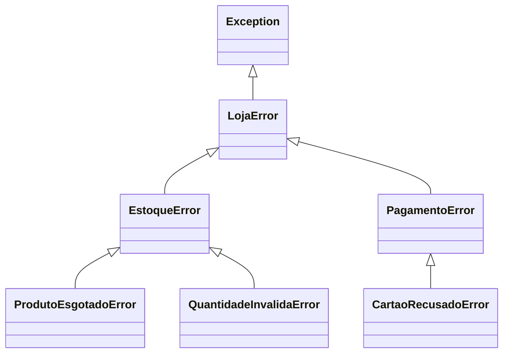

# 🧯 Exceções Personalizadas

As exceções embutidas (`ValueError`, `KeyError`...) são genéricas. Para erros do **seu domínio** ("saldo insuficiente", "pedido já cancelado"), crie **suas próprias exceções**: elas tornam o código mais **expressivo**, **filtrável** e **testável**.

> [!example] Analogia
> Um alerta de "erro" genérico é como um alarme que só diz "algo deu errado". Uma exceção personalizada diz **exatamente o quê**, e quem trata pode reagir de forma específica.

---

## 1. Por que criar exceções próprias?

```python
# ❌ Genérico: quem chama não sabe diferenciar os casos
def sacar(saldo, valor):
    if valor <= 0:
        raise ValueError("Valor inválido")
    if valor > saldo:
        raise ValueError("Saldo insuficiente")
    return saldo - valor

try:
    sacar(100, 500)
except ValueError as e:
    # É valor inválido ou falta de saldo? Só lendo a mensagem (frágil)
    ...
```

```python
# ✅ Específico: cada situação tem seu tipo
class SaldoInsuficienteError(Exception):
    pass

class ValorInvalidoError(ValueError):
    pass

def sacar(saldo, valor):
    if valor <= 0:
        raise ValorInvalidoError(f"Valor inválido: {valor}")
    if valor > saldo:
        raise SaldoInsuficienteError(f"Saldo {saldo} insuficiente para sacar {valor}")
    return saldo - valor

try:
    sacar(100, 500)
except SaldoInsuficienteError:
    print("Ofereça crédito ao cliente")
except ValorInvalidoError:
    print("Peça um valor positivo")
```

| Vantagem | Explicação |
|----------|-----------|
| **Clareza** | O nome da classe descreve o problema |
| **Tratamento seletivo** | `except SaldoInsuficienteError` captura só ele |
| **Informação extra** | Podem carregar dados (saldo, valor...) |
| **Hierarquia** | Capture um grupo de erros com a classe-base |
| **API estável** | Quem usa sua biblioteca não depende de mensagens de texto |

---

## 2. Criando uma exceção

Basta **herdar de `Exception`** (nunca de `BaseException`):

```python
class MeuErro(Exception):
    """Erro específico da minha aplicação."""

raise MeuErro("Algo deu errado")
```

Pode ficar até **sem corpo** (só a docstring), pois herda tudo de `Exception`.

> [!tip] Convenção de nome
> Termine com **`Error`** quando representar um erro (`SaldoInsuficienteError`). Para condições que não são erros propriamente (avisos, fim de fluxo), pode usar sem o sufixo (`StopIteration`).

> [!warning] Herde da exceção **mais apropriada**
> ```python
> class IdadeInvalidaError(ValueError): ...     # é um tipo de ValueError ✅
> class ChaveAusenteError(KeyError): ...        # é um tipo de KeyError ✅
> class ArquivoCorrompidoError(Exception): ...  # erro de domínio genérico ✅
> class Ruim(BaseException): ...                # ❌ não capturável por `except Exception`
> ```
> Herdar de uma exceção embutida deixa o código que já trata `ValueError` funcionando com a sua.

---

## 3. Adicionando dados à exceção

```python
class SaldoInsuficienteError(Exception):
    def __init__(self, saldo, valor):
        self.saldo = saldo
        self.valor = valor
        self.faltam = valor - saldo
        super().__init__(
            f"Saldo R$ {saldo:.2f} insuficiente para sacar R$ {valor:.2f} "
            f"(faltam R$ {self.faltam:.2f})"
        )

try:
    raise SaldoInsuficienteError(saldo=100, valor=350)
except SaldoInsuficienteError as e:
    print(e)                       # mensagem formatada
    print(e.faltam)                # 250  ← dado estruturado para quem trata
```

> [!warning] Chame `super().__init__(...)`
> Sem isso, `str(e)` e `e.args` ficam vazios, e a exceção perde mensagem ao imprimir o *traceback*.

> [!note] Pickle e exceções com `__init__` customizado
> Exceções com **vários argumentos obrigatórios** no `__init__` podem falhar ao serem serializadas (ex.: entre processos em [[08 - Avançado/03 - Multiprocessing|multiprocessing]]). Se for o caso, passe os argumentos também ao `super().__init__(saldo, valor)` e monte a mensagem em `__str__`.

### Com `dataclass`? Cuidado
É possível, mas a exceção precisa de `args` corretos. Em geral, uma classe simples é mais segura.

---

## 4. Hierarquia de exceções do seu projeto

Crie **uma exceção-base** do seu pacote/aplicação e derive as específicas dela:

```python
class LojaError(Exception):
    """Base de todas as exceções da loja."""

class EstoqueError(LojaError):
    """Problemas de estoque."""

class ProdutoEsgotadoError(EstoqueError):
    def __init__(self, produto):
        self.produto = produto
        super().__init__(f"Produto esgotado: {produto}")

class QuantidadeInvalidaError(EstoqueError, ValueError):
    pass

class PagamentoError(LojaError):
    """Problemas de pagamento."""

class CartaoRecusadoError(PagamentoError):
    pass
```



Agora o **nível de detalhe** do tratamento é escolhido por quem chama:

```python
try:
    finalizar_compra()
except ProdutoEsgotadoError as e:       # específico
    sugerir_alternativa(e.produto)
except EstoqueError:                    # grupo
    avisar_suporte()
except LojaError:                       # qualquer erro da loja
    mostrar_erro_generico()
```

> [!tip] Bibliotecas fazem assim
> `requests.RequestException` é a base de `ConnectionError`, `Timeout`, `HTTPError`... Um único `except requests.RequestException` cobre todos.

---

## 5. Encadeamento: preservando a causa

Ao traduzir um erro de **baixo nível** para o seu domínio, mantenha a causa original:

```python
class ConfiguracaoError(Exception):
    pass

import json

def carregar_config(caminho):
    try:
        with open(caminho, encoding="utf-8") as f:
            return json.load(f)
    except FileNotFoundError as e:
        raise ConfiguracaoError(f"Arquivo de configuração ausente: {caminho}") from e
    except json.JSONDecodeError as e:
        raise ConfiguracaoError(f"Configuração inválida em {caminho}") from e
```

Saída do traceback:
```text
FileNotFoundError: [Errno 2] No such file or directory: 'config.json'

The above exception was the direct cause of the following exception:

ConfiguracaoError: Arquivo de configuração ausente: config.json
```
- `raise X from e` → causa **explícita**
- `raise X from None` → esconde a causa (use quando só atrapalha)
- Sem `from`, dentro de um `except`, o Python liga automaticamente a exceção anterior (*"During handling of the above exception, another exception occurred"*).

---

## 6. Quando criar (e quando **não** criar)

| ✅ Crie quando... | ❌ Evite quando... |
|------------------|--------------------|
| O erro é uma **regra do seu domínio** | Uma exceção embutida já descreve bem (`ValueError`, `TypeError`) |
| Quem chama precisa **reagir de forma diferente** | Você só precisa de uma mensagem diferente |
| Quer **agrupar** erros relacionados | Cada exceção teria um uso único e raro |
| Está construindo **biblioteca** com API pública | O projeto é um script pequeno |

> [!warning] Não exagere
> Dezenas de exceções minúsculas só complicam. Comece com poucas e **cresça conforme a necessidade**.

---

## 7. Boas práticas

1. **Documente** (docstring) quando cada exceção é levantada ([[03 - Funções e Modularização/06 - Docstrings|seção `Raises`]]).
2. Coloque as exceções num módulo próprio (`excecoes.py` / `errors.py`).
3. Mensagens **acionáveis**: o que aconteceu, com quais valores, e (se possível) como resolver.
4. Não use exceções para **controle de fluxo normal** (loops de `StopIteration` à parte): são para situações excepcionais.
5. Garanta que a exceção seja **instanciável sem argumentos mágicos** quando possível (mais fácil de testar).
6. Mantenha o **estado consistente**: se uma operação falhar no meio, desfaça o que foi alterado (ou use transações).

```python
# Exemplo de estado consistente
def transferir(origem, destino, valor):
    origem.sacar(valor)            # pode levantar SaldoInsuficienteError
    try:
        destino.depositar(valor)
    except Exception:
        origem.depositar(valor)    # compensa (rollback manual)
        raise
```

---

## 8. Exemplo completo: sistema de validação de cadastro

```python
import re

class CadastroError(Exception):
    """Base para erros de cadastro."""

class CampoObrigatorioError(CadastroError):
    def __init__(self, campo):
        self.campo = campo
        super().__init__(f"Campo obrigatório ausente: {campo!r}")

class CampoInvalidoError(CadastroError, ValueError):
    def __init__(self, campo, valor, motivo):
        self.campo, self.valor, self.motivo = campo, valor, motivo
        super().__init__(f"{campo}={valor!r} inválido: {motivo}")


def validar_cadastro(dados: dict) -> dict:
    """Valida os dados de um novo usuário.

    Raises:
        CampoObrigatorioError: Se faltar nome ou e-mail.
        CampoInvalidoError: Se e-mail ou idade forem inválidos.
    """
    for campo in ("nome", "email"):
        if not dados.get(campo):
            raise CampoObrigatorioError(campo)

    if not re.fullmatch(r"[^@\s]+@[^@\s]+\.[^@\s]+", dados["email"]):
        raise CampoInvalidoError("email", dados["email"], "formato incorreto")

    idade = dados.get("idade", 0)
    if not isinstance(idade, int) or not 0 <= idade <= 130:
        raise CampoInvalidoError("idade", idade, "deve ser inteiro entre 0 e 130")

    return dados


testes = [
    {"nome": "Ada", "email": "ada@x.com", "idade": 36},
    {"nome": "Alan"},
    {"nome": "Grace", "email": "grace-sem-arroba", "idade": 40},
    {"nome": "Linus", "email": "linus@x.com", "idade": -5},
]

for t in testes:
    try:
        validar_cadastro(t)
        print(f"✅ {t['nome']}")
    except CampoObrigatorioError as e:
        print(f"⚠️  Falta preencher: {e.campo}")
    except CadastroError as e:                 # qualquer outro erro de cadastro
        print(f"❌ {e}")
```

---

> [!question] Exercícios
> 1. Crie `SaldoInsuficienteError` com atributos `saldo` e `valor`, e use-a em um `sacar()`.
> 2. Crie a hierarquia `AppError` → `ValidacaoError` → `EmailInvalidoError` e `SenhaFracaError`. Capture apenas `ValidacaoError` e mostre que pega as duas filhas.
> 3. Por que é bom herdar de `ValueError` em `IdadeInvalidaError`?
> 4. Escreva `ler_config(caminho)` que traduza `FileNotFoundError` e `JSONDecodeError` para `ConfigError` usando `raise ... from`.
> 5. O que acontece (e por que é um problema) se você omitir `super().__init__()` e usar `print(e)`?
> 6. Modele um sistema de **estoque** com `ProdutoNaoEncontradoError(KeyError)` e `QuantidadeInsuficienteError`. `retirar(estoque, produto, qtd)` deve usá-las.
> 7. Quando **não** vale a pena criar uma exceção própria?

> [!success]- Soluções
> 1. ```python
>    class SaldoInsuficienteError(Exception):
>        def __init__(self, saldo, valor):
>            self.saldo, self.valor = saldo, valor
>            super().__init__(f"Saldo {saldo} < valor {valor}")
>
>    def sacar(saldo, valor):
>        if valor > saldo:
>            raise SaldoInsuficienteError(saldo, valor)
>        return saldo - valor
>    ```
> 2. ```python
>    class AppError(Exception): ...
>    class ValidacaoError(AppError): ...
>    class EmailInvalidoError(ValidacaoError): ...
>    class SenhaFracaError(ValidacaoError): ...
>
>    for exc in (EmailInvalidoError("x"), SenhaFracaError("y")):
>        try:
>            raise exc
>        except ValidacaoError as e:
>            print(type(e).__name__, "capturado")
>    ```
> 3. Códigos que já tratam `ValueError` (ou bibliotecas que o esperam) continuam funcionando com a sua exceção, e ela segue semanticamente correta ("valor inválido").
> 4. ```python
>    import json
>    class ConfigError(Exception): ...
>
>    def ler_config(caminho):
>        try:
>            with open(caminho, encoding="utf-8") as f:
>                return json.load(f)
>        except FileNotFoundError as e:
>            raise ConfigError(f"{caminho} não existe") from e
>        except json.JSONDecodeError as e:
>            raise ConfigError(f"{caminho} é inválido") from e
>    ```
> 5. `print(e)` mostraria uma linha vazia e `e.args` seria `()`; o *traceback* ficaria sem mensagem, dificultando o diagnóstico.
> 6. ```python
>    class EstoqueError(Exception): ...
>    class ProdutoNaoEncontradoError(EstoqueError, KeyError): ...
>    class QuantidadeInsuficienteError(EstoqueError):
>        def __init__(self, produto, disponivel, pedido):
>            self.produto, self.disponivel, self.pedido = produto, disponivel, pedido
>            super().__init__(f"{produto}: disponível {disponivel}, pedido {pedido}")
>
>    def retirar(estoque, produto, qtd):
>        if produto not in estoque:
>            raise ProdutoNaoEncontradoError(produto)
>        if estoque[produto] < qtd:
>            raise QuantidadeInsuficienteError(produto, estoque[produto], qtd)
>        estoque[produto] -= qtd
>    ```
> 7. Quando uma embutida (`ValueError`, `TypeError`...) já expressa o problema, quando só a mensagem muda, ou quando o projeto é um script pequeno em que ninguém vai tratar o erro de forma diferenciada.

---

⬅️ [[05 - Tratamento de Erros e Arquivos/01 - try except else finally|try / except / else / finally]] | ➡️ [[05 - Tratamento de Erros e Arquivos/03 - Arquivos Texto CSV e JSON|Arquivos: texto, CSV e JSON]]

#python #intermediario #excecoes #excecoes-personalizadas #raise #hierarquia
