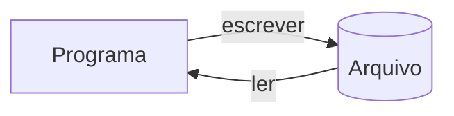

# 📁 Arquivos: Texto, CSV e JSON

Programas "esquecem" tudo ao terminar. **Arquivos** permitem **persistir** dados, trocar informações com outros sistemas e processar volumes que não cabem na memória.



---

## 1. Abrindo arquivos: `open()`

```python
with open("notas.txt", "r", encoding="utf-8") as arquivo:
    conteudo = arquivo.read()
```

### Modos

| Modo | Significado | Se o arquivo não existe | Se existe |
|------|-------------|-------------------------|-----------|
| `"r"` | **Ler** (padrão) | `FileNotFoundError` | lê |
| `"w"` | **Escrever** | cria | ⚠️ **apaga o conteúdo** |
| `"a"` | **Acrescentar** (*append*) | cria | adiciona ao final |
| `"x"` | Criar **exclusivo** | cria | `FileExistsError` |
| `"r+"` | Ler **e** escrever | `FileNotFoundError` | lê/escreve |
| `"b"` | Modo **binário** (combina: `"rb"`, `"wb"`) | | |
| `"t"` | Modo **texto** (padrão) | | |

> [!warning] `"w"` apaga sem perguntar!
> ```python
> open("dados.txt", "w")      # ❌ se dados.txt já existia, agora está VAZIO
> # Para não sobrescrever acidentalmente:
> open("dados.txt", "x")      # ✅ falha com FileExistsError se já existir
> open("dados.txt", "a")      # ✅ ou acrescente
> ```

### Sempre informe o `encoding`
```python
open("arquivo.txt", encoding="utf-8")     # ✅ explícito
open("arquivo.txt")                       # ❌ depende do sistema (cp1252 no Windows, utf-8 no Linux)
```

> [!warning] `UnicodeDecodeError` / acentos estranhos (`é`)
> O arquivo foi gravado em outra codificação. Experimente `encoding="utf-8-sig"` (arquivos com BOM, comuns no Excel) ou `encoding="latin-1"` / `"cp1252"` (Windows antigo).

---

## 2. Por que `with`?

```python
# ❌ Fácil de esquecer o close(); se der erro antes, o arquivo fica aberto
f = open("dados.txt", encoding="utf-8")
conteudo = f.read()
f.close()

# ✅ O with fecha o arquivo SEMPRE, mesmo se houver exceção
with open("dados.txt", encoding="utf-8") as f:
    conteudo = f.read()
# aqui o arquivo já está fechado
```
Entenda o mecanismo em [[05 - Tratamento de Erros e Arquivos/04 - Context Managers com with|Context Managers]].

---

## 3. Lendo arquivos de texto

Suponha `poema.txt`:
```text
Linha um
Linha dois
Linha três
```

| Método | Retorno | Quando usar |
|--------|---------|-------------|
| `f.read()` | **Toda** a string | Arquivos pequenos |
| `f.read(n)` | Os próximos `n` caracteres | Leitura em blocos |
| `f.readline()` | **Uma** linha (com `\n`) | Controle manual |
| `f.readlines()` | Lista com **todas** as linhas | Arquivos pequenos |
| `for linha in f` | Itera **linha a linha** | ✅ **Melhor** para arquivos grandes |

```python
with open("poema.txt", encoding="utf-8") as f:
    tudo = f.read()

with open("poema.txt", encoding="utf-8") as f:
    for numero, linha in enumerate(f, start=1):
        print(f"{numero}: {linha.rstrip()}")      # rstrip() tira o \n
```

> [!tip] Itere o arquivo, não use `readlines()` em arquivos grandes
> `for linha in f` lê **uma linha por vez** (memória constante). `readlines()` carrega **tudo** de uma vez.

```python
# Contar linhas não vazias de um arquivo gigante
with open("log.txt", encoding="utf-8") as f:
    total = sum(1 for linha in f if linha.strip())
```

### Ponteiro de leitura
```python
with open("poema.txt", encoding="utf-8") as f:
    print(f.read(5))     # 'Linha'
    print(f.tell())      # 5   (posição atual)
    f.seek(0)            # volta ao início
    print(f.readline())  # 'Linha um\n'
```

> [!warning] Depois do `read()`, o arquivo "acabou"
> ```python
> f.read()      # lê tudo
> f.read()      # '' (vazio!): o ponteiro está no fim → use f.seek(0)
> ```

---

## 4. Escrevendo arquivos de texto

```python
with open("saida.txt", "w", encoding="utf-8") as f:
    f.write("Primeira linha\n")             # write NÃO adiciona \n sozinho
    f.write("Segunda linha\n")
    f.writelines(["a\n", "b\n"])            # várias de uma vez (também sem \n)
    print("Terceira linha", file=f)         # print adiciona \n automaticamente
```

### Acrescentando
```python
with open("log.txt", "a", encoding="utf-8") as f:
    f.write("Nova entrada\n")
```

> [!warning] `write()` só aceita `str`
> ```python
> f.write(42)             # ❌ TypeError: write() argument must be str, not int
> f.write(str(42))        # ✅
> f.write(f"{42}\n")      # ✅
> ```

### Buffer e `flush`
O Python guarda dados em **buffer** antes de gravar. `with` e `close()` fazem o `flush`. Para forçar: `f.flush()`.

---

## 5. Caminhos com `pathlib`

A forma moderna de lidar com caminhos (multiplataforma). Aprofunde em [[06 - Módulos da Biblioteca Padrão Essenciais/01 - os pathlib e sys|os, pathlib, sys]].

```python
from pathlib import Path

pasta = Path("dados")
caminho = pasta / "clientes.txt"          # o operador / une caminhos

pasta.mkdir(exist_ok=True)                # cria a pasta se não existir
caminho.write_text("Ada\nAlan\n", encoding="utf-8")
print(caminho.read_text(encoding="utf-8"))

print(caminho.exists(), caminho.is_file())
print(caminho.name, caminho.suffix, caminho.stem)   # clientes.txt .txt clientes
print(caminho.parent)                               # dados

for arq in pasta.glob("*.txt"):           # listar
    print(arq)

with caminho.open(encoding="utf-8") as f:   # open também existe no Path
    ...
```

> [!tip] Caminhos relativos ao **script**, não ao terminal
> ```python
> BASE = Path(__file__).parent
> arquivo = BASE / "dados" / "config.json"
> ```
> Evita o clássico `FileNotFoundError` quando você roda o script de outra pasta.

> [!warning] Barras invertidas no Windows
> ```python
> open("C:\novo\teste.txt")     # ❌ \n e \t viram caracteres especiais
> open(r"C:\novo\teste.txt")    # ✅ raw string
> open("C:/novo/teste.txt")     # ✅ barras normais funcionam no Windows
> Path("C:/novo") / "teste.txt" # ✅ pathlib
> ```

---

## 6. Tratando erros com arquivos

```python
from pathlib import Path

def ler_linhas(caminho):
    try:
        with open(caminho, encoding="utf-8") as f:
            return [linha.rstrip("\n") for linha in f]
    except FileNotFoundError:
        print(f"Arquivo {caminho!r} não encontrado.")
    except PermissionError:
        print(f"Sem permissão para ler {caminho!r}.")
    except UnicodeDecodeError:
        print(f"{caminho!r} não está em UTF-8.")
    return []
```
Veja [[05 - Tratamento de Erros e Arquivos/01 - try except else finally|try/except]] (e o estilo **EAFP**: tente abrir e trate a falha, em vez de verificar `exists()` antes).

---

## 📊 CSV

**CSV** (*Comma-Separated Values*) é o formato de planilhas simples: cada linha é um registro, campos separados por vírgula (ou `;` no padrão brasileiro do Excel).

`vendas.csv`:
```text
produto,quantidade,preco
Café,10,12.5
Pão,50,1.5
Leite,20,5.0
```

> [!warning] Não faça `linha.split(",")` à mão
> Campos podem conter vírgulas e aspas (`"Silva, João"`). Use o módulo **`csv`**.

## 7. Lendo CSV

### Como listas: `csv.reader`
```python
import csv

with open("vendas.csv", newline="", encoding="utf-8") as f:
    leitor = csv.reader(f)
    cabecalho = next(leitor)              # pula/guarda a 1ª linha
    for linha in leitor:
        print(linha)                      # ['Café', '10', '12.5']  (tudo str!)
```

### Como dicionários: `csv.DictReader` ✅
```python
with open("vendas.csv", newline="", encoding="utf-8") as f:
    for linha in csv.DictReader(f):
        total = int(linha["quantidade"]) * float(linha["preco"])
        print(f"{linha['produto']}: R$ {total:.2f}")
```

> [!warning] Tudo vem como `str`
> Converta: `int(linha["quantidade"])`, `float(linha["preco"])`.

> [!warning] Sempre `newline=""` com csv
> O módulo gerencia as quebras de linha; sem isso você pode ter **linhas em branco extras** no Windows.

### Delimitadores diferentes (Excel brasileiro usa `;`)
```python
csv.reader(f, delimiter=";")
csv.DictReader(f, delimiter=";")
```

## 8. Escrevendo CSV

```python
import csv

produtos = [
    {"produto": "Café", "quantidade": 10, "preco": 12.5},
    {"produto": "Pão", "quantidade": 50, "preco": 1.5},
]

with open("saida.csv", "w", newline="", encoding="utf-8") as f:
    campos = ["produto", "quantidade", "preco"]
    escritor = csv.DictWriter(f, fieldnames=campos)
    escritor.writeheader()
    escritor.writerows(produtos)

# Com listas
with open("saida2.csv", "w", newline="", encoding="utf-8") as f:
    w = csv.writer(f)
    w.writerow(["produto", "preco"])
    w.writerow(["Café", 12.5])
```
Para abrir no Excel com acentos corretos, grave com `encoding="utf-8-sig"`.

> [!tip] Muitos dados? Considere o **pandas**
> `pd.read_csv("vendas.csv")` lê, tipa e analisa colunas com uma linha. Veja o [[09 - Projetos Práticos/Projeto 03 - Análise de Dados com CSV|Projeto 03]].

---

## 🧾 JSON

**JSON** (*JavaScript Object Notation*) é o formato universal de troca de dados (APIs, configurações). Casa com **dicionários e listas** do Python.

| JSON | Python |
|------|--------|
| `object` `{}` | `dict` |
| `array` `[]` | `list` |
| `string` | `str` |
| `number` | `int` / `float` |
| `true` / `false` | `True` / `False` |
| `null` | `None` |

`pessoa.json`:
```json
{
  "nome": "Ada",
  "idade": 36,
  "linguagens": ["Python", "Analytical Engine"],
  "endereco": {"cidade": "Londres", "pais": "Reino Unido"},
  "ativo": true,
  "premio": null
}
```

## 9. Lendo e escrevendo JSON

```python
import json

# Ler de arquivo
with open("pessoa.json", encoding="utf-8") as f:
    pessoa = json.load(f)           # → dict
print(pessoa["endereco"]["cidade"])

# Escrever em arquivo
dados = {"nome": "Ada", "idade": 36, "ativo": True, "premio": None}
with open("saida.json", "w", encoding="utf-8") as f:
    json.dump(dados, f, ensure_ascii=False, indent=2)
```

### Strings (`s` de *string*): `loads` / `dumps`
```python
texto = '{"a": 1, "b": [1, 2, 3]}'
objeto = json.loads(texto)          # str → Python
print(objeto["b"])                  # [1, 2, 3]

como_texto = json.dumps(objeto, ensure_ascii=False, indent=2)   # Python → str
```

| Função | Entrada → Saída |
|--------|-----------------|
| `json.load(f)` | **arquivo** → Python |
| `json.loads(s)` | **string** → Python |
| `json.dump(obj, f)` | Python → **arquivo** |
| `json.dumps(obj)` | Python → **string** |

> [!tip] Opções úteis do `dump`/`dumps`
> - `ensure_ascii=False`: mantém acentos (`"São Paulo"`) em vez de `"S\u00e3o Paulo"`
> - `indent=2`: formata de forma legível
> - `sort_keys=True`: ordena as chaves
> - `default=func`: converte tipos não suportados

### Tipos não serializáveis
```python
from datetime import date
json.dumps({"hoje": date.today()})
# TypeError: Object of type date is not JSON serializable

# ✅ Converta com default=
json.dumps({"hoje": date.today()}, default=str)
# '{"hoje": "2026-10-05"}'

# ✅ Dataclasses
from dataclasses import asdict
json.dumps(asdict(meu_objeto))
```

> [!warning] Armadilhas do JSON
> - **Chaves** viram **strings**: `{1: "a"}` → `{"1": "a"}`.
> - **Tuplas** viram **listas**; **sets** não são serializáveis (`list(s)`).
> - Aspas simples **não** são JSON válido (`{'a': 1}` ❌ → `{"a": 1}` ✅).
> - `NaN`/`Infinity` não são JSON padrão.
> - Nunca use `eval()` para ler JSON/dados externos: use `json.loads`.

### Erros ao ler JSON
```python
try:
    dados = json.loads(texto)
except json.JSONDecodeError as e:
    print(f"JSON inválido na linha {e.lineno}, coluna {e.colno}: {e.msg}")
```

### JSON Lines (um JSON por linha): ótimo para logs e arquivos grandes
```python
# escrever
with open("eventos.jsonl", "w", encoding="utf-8") as f:
    for evento in eventos:
        f.write(json.dumps(evento, ensure_ascii=False) + "\n")

# ler (linha a linha, sem carregar tudo)
with open("eventos.jsonl", encoding="utf-8") as f:
    for linha in f:
        evento = json.loads(linha)
```

---

## 10. Arquivos binários (introdução)

Imagens, PDFs, áudio: use o modo `"b"` e **bytes**:

```python
# Copiar um arquivo qualquer em blocos
with open("origem.png", "rb") as src, open("copia.png", "wb") as dst:
    while bloco := src.read(1024 * 1024):     # 1 MB por vez
        dst.write(bloco)
```
Para cópias, `shutil.copyfile("origem", "destino")` é mais simples. Para objetos Python serializados: `pickle` (veja [[06 - Módulos da Biblioteca Padrão Essenciais/05 - json csv e pickle|json, csv e pickle]]).

> [!warning] Nunca carregue `pickle` de fontes não confiáveis
> `pickle.load` pode **executar código arbitrário**. Para dados externos, use JSON.

---

## 11. Boas práticas

- ✅ Sempre `with`
- ✅ Sempre `encoding="utf-8"` (e `newline=""` com `csv`)
- ✅ Use `pathlib.Path` para caminhos
- ✅ Itere linha a linha em arquivos grandes
- ✅ Trate `FileNotFoundError`, `PermissionError`, `JSONDecodeError`
- ✅ **Escrita atômica** em dados importantes: grave em arquivo temporário e renomeie:

```python
from pathlib import Path
import json, os

def salvar_json_seguro(caminho, dados):
    caminho = Path(caminho)
    tmp = caminho.with_suffix(caminho.suffix + ".tmp")
    with open(tmp, "w", encoding="utf-8") as f:
        json.dump(dados, f, ensure_ascii=False, indent=2)
    os.replace(tmp, caminho)      # troca atômica: nunca fica "meio escrito"
```

---

## 12. Exemplo completo: agenda persistente

```python
import json
from pathlib import Path

ARQUIVO = Path(__file__).parent / "agenda.json"

def carregar():
    try:
        return json.loads(ARQUIVO.read_text(encoding="utf-8"))
    except FileNotFoundError:
        return {}
    except json.JSONDecodeError:
        print("⚠️  agenda.json corrompido; começando vazio.")
        return {}

def salvar(agenda):
    ARQUIVO.write_text(
        json.dumps(agenda, ensure_ascii=False, indent=2), encoding="utf-8"
    )

def main():
    agenda = carregar()
    while True:
        print("\n1-Adicionar  2-Buscar  3-Listar  4-Sair")
        opcao = input("Opção: ").strip()
        match opcao:
            case "1":
                nome = input("Nome: ").strip().title()
                agenda[nome] = input("Telefone: ").strip()
                salvar(agenda)
            case "2":
                nome = input("Nome: ").strip().title()
                print(agenda.get(nome, "Não encontrado"))
            case "3":
                for nome, tel in sorted(agenda.items()):
                    print(f"{nome:<15} {tel}")
            case "4":
                break
            case _:
                print("Opção inválida")

if __name__ == "__main__":
    main()
```
Os dados **sobrevivem** entre execuções! Evolua para um banco de dados no [[09 - Projetos Práticos/Projeto 07 - Login com SQLite|Projeto 07]].

---

> [!question] Exercícios
> 1. Escreva um programa que peça 5 nomes e os grave em `nomes.txt` (um por linha), e depois leia e mostre o arquivo numerado.
> 2. Conte as **palavras** e as **linhas** de um arquivo de texto qualquer (tratando arquivo inexistente).
> 3. Dado `vendas.csv` (produto, quantidade, preco), mostre o **faturamento total** e o produto **mais vendido**.
> 4. Converta `vendas.csv` em `vendas.json` (lista de objetos com tipos corretos).
> 5. Crie um **diário**: cada execução acrescenta uma entrada com data/hora em `diario.txt` (modo `"a"`).
> 6. Leia `config.json` e devolva um dicionário com valores **padrão** para chaves ausentes (`{"tema": "claro", "idioma": "pt-BR"}`).
> 7. Escreva `copiar(origem, destino)` que copie um arquivo **em blocos** (binário).
> 8. Por que `open("x.txt", "w")` pode ser perigoso? Que alternativa evita sobrescrever?
> 9. Leia um arquivo `.jsonl` gigante e some o campo `valor` sem carregar tudo em memória.

> [!success]- Soluções
> 1. ```python
>    nomes = [input(f"Nome {i}: ") for i in range(1, 6)]
>    with open("nomes.txt", "w", encoding="utf-8") as f:
>        f.writelines(n + "\n" for n in nomes)
>    with open("nomes.txt", encoding="utf-8") as f:
>        for i, linha in enumerate(f, start=1):
>            print(f"{i}. {linha.rstrip()}")
>    ```
> 2. ```python
>    try:
>        with open("texto.txt", encoding="utf-8") as f:
>            linhas = palavras = 0
>            for linha in f:
>                linhas += 1
>                palavras += len(linha.split())
>        print(f"{linhas} linhas, {palavras} palavras")
>    except FileNotFoundError:
>        print("Arquivo não encontrado")
>    ```
> 3. ```python
>    import csv
>    total, por_produto = 0.0, {}
>    with open("vendas.csv", newline="", encoding="utf-8") as f:
>        for l in csv.DictReader(f):
>            q, p = int(l["quantidade"]), float(l["preco"])
>            total += q * p
>            por_produto[l["produto"]] = por_produto.get(l["produto"], 0) + q
>    print(f"Faturamento: R$ {total:.2f}")
>    print("Mais vendido:", max(por_produto, key=por_produto.get))
>    ```
> 4. ```python
>    import csv, json
>    with open("vendas.csv", newline="", encoding="utf-8") as f:
>        dados = [{"produto": l["produto"], "quantidade": int(l["quantidade"]),
>                  "preco": float(l["preco"])} for l in csv.DictReader(f)]
>    with open("vendas.json", "w", encoding="utf-8") as f:
>        json.dump(dados, f, ensure_ascii=False, indent=2)
>    ```
> 5. ```python
>    from datetime import datetime
>    texto = input("Hoje eu... ")
>    with open("diario.txt", "a", encoding="utf-8") as f:
>        f.write(f"[{datetime.now():%d/%m/%Y %H:%M}] {texto}\n")
>    ```
> 6. ```python
>    import json
>    PADRAO = {"tema": "claro", "idioma": "pt-BR"}
>    def ler_config(caminho="config.json"):
>        try:
>            with open(caminho, encoding="utf-8") as f:
>                return {**PADRAO, **json.load(f)}
>        except (FileNotFoundError, json.JSONDecodeError):
>            return dict(PADRAO)
>    ```
> 7. ```python
>    def copiar(origem, destino, bloco=1024 * 1024):
>        with open(origem, "rb") as src, open(destino, "wb") as dst:
>            while dados := src.read(bloco):
>                dst.write(dados)
>    ```
> 8. O modo `"w"` **apaga** o conteúdo existente ao abrir. Use `"x"` (falha se existir) ou `"a"` (acrescenta), ou confira com `Path.exists()` quando fizer sentido.
> 9. ```python
>    import json
>    total = 0
>    with open("eventos.jsonl", encoding="utf-8") as f:
>        for linha in f:
>            total += json.loads(linha).get("valor", 0)
>    ```

---

⬅️ [[05 - Tratamento de Erros e Arquivos/02 - Exceções Personalizadas|Exceções Personalizadas]] | ➡️ [[05 - Tratamento de Erros e Arquivos/04 - Context Managers com with|Context Managers (`with`)]]

#python #intermediario #arquivos #csv #json #pathlib #encoding
