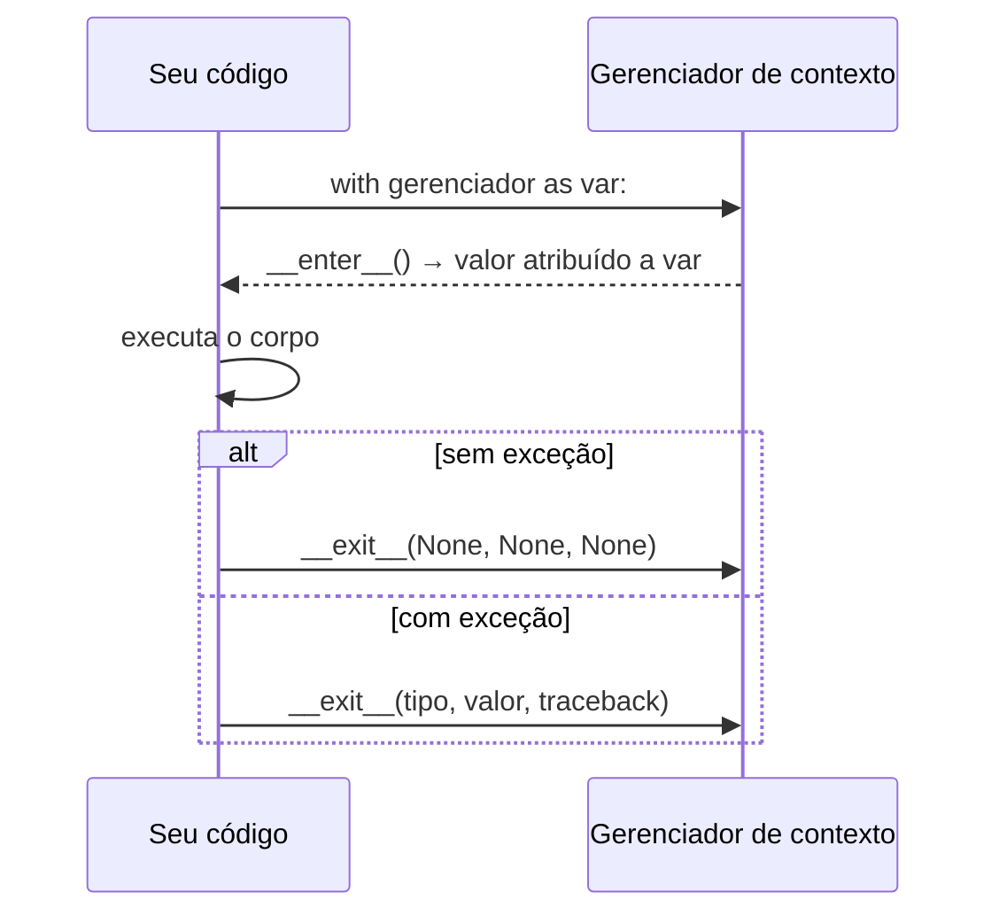

# 🚪 Context Managers (`with`)

Muitos recursos precisam ser **adquiridos** e **liberados**: arquivos, conexões, *locks*, transações. Esquecer de liberar causa vazamentos e bugs sutis. O **`with`** garante a **limpeza automática**, mesmo quando há exceções.

> [!example] Analogia
> É como **alugar uma bicicleta** num sistema de compartilhamento: você a pega (`__enter__`), usa, e ao terminar ela é **devolvida automaticamente** (`__exit__`), mesmo que você caia no meio do caminho.

---

## 1. O problema que o `with` resolve

```python
# ❌ Se processar() falhar, o arquivo NUNCA é fechado
f = open("dados.txt", encoding="utf-8")
processar(f)
f.close()

# ⚠️ Correto, mas verboso
f = open("dados.txt", encoding="utf-8")
try:
    processar(f)
finally:
    f.close()

# ✅ Com with
with open("dados.txt", encoding="utf-8") as f:
    processar(f)
# aqui f já está fechado, aconteça o que acontecer
```

O `with` é **açúcar sintático** para o `try/finally` ([[05 - Tratamento de Erros e Arquivos/01 - try except else finally|veja `finally`]]).

---

## 2. Anatomia

```python
with expressao as variavel:
    # corpo
```

Passo a passo:



- `__enter__()` roda ao **entrar** e seu retorno vai para a variável depois do `as`.
- `__exit__()` roda ao **sair**: **sempre**, com ou sem exceção.

### Vários recursos ao mesmo tempo
```python
with open("entrada.txt", encoding="utf-8") as src, \
     open("saida.txt", "w", encoding="utf-8") as dst:
    for linha in src:
        dst.write(linha.upper())

# Python 3.10+: parênteses para quebrar linhas
with (
    open("entrada.txt", encoding="utf-8") as src,
    open("saida.txt", "w", encoding="utf-8") as dst,
):
    dst.write(src.read())
```
Os recursos são liberados na **ordem inversa** da aquisição.

---

## 3. Context managers que você já tem

| Recurso | Exemplo |
|---------|---------|
| **Arquivos** | `with open(...) as f:` |
| **Locks (threads)** | `with lock:` ([[06 - Módulos da Biblioteca Padrão Essenciais/06 - concurrent futures e threading\|threading]]) |
| **Banco SQLite** | `with sqlite3.connect("db.sqlite") as conn:` (transação) |
| **Pool de processos/threads** | `with ThreadPoolExecutor() as ex:` |
| **Diretório temporário** | `with tempfile.TemporaryDirectory() as pasta:` |
| **Testes** | `with pytest.raises(ValueError):` |
| **Precisão decimal** | `with decimal.localcontext() as ctx:` |
| **Arquivos zip/tar** | `with zipfile.ZipFile("a.zip") as z:` |
| **Requisições HTTP** | `with requests.Session() as s:` |

```python
import tempfile
from pathlib import Path

with tempfile.TemporaryDirectory() as pasta:
    arquivo = Path(pasta) / "teste.txt"
    arquivo.write_text("temporário")
    print(arquivo.exists())      # True
print(arquivo.exists())          # False: a pasta foi apagada ao sair
```

---

## 4. Criando seu próprio: com uma classe

Implemente `__enter__` e `__exit__`:

```python
import time

class Cronometro:
    def __enter__(self):
        self.inicio = time.perf_counter()
        return self                       # valor do "as"

    def __exit__(self, tipo_exc, valor_exc, traceback):
        self.duracao = time.perf_counter() - self.inicio
        print(f"Levou {self.duracao:.4f}s")
        return False                      # False: NÃO suprime exceções

with Cronometro() as c:
    sum(range(5_000_000))
print(c.duracao)       # ainda acessível depois do with
```

### Os argumentos de `__exit__`
| Argumento | Conteúdo |
|-----------|----------|
| `tipo_exc` | Classe da exceção (`None` se não houve) |
| `valor_exc` | Instância da exceção |
| `traceback` | Objeto traceback |

### O valor de retorno de `__exit__`
- `False` / `None` → a exceção **continua** sendo propagada (comportamento normal)
- `True` → a exceção é **suprimida** (engolida)

```python
class IgnorarErro:
    def __init__(self, *excecoes):
        self.excecoes = excecoes

    def __enter__(self):
        return self

    def __exit__(self, tipo, valor, tb):
        return tipo is not None and issubclass(tipo, self.excecoes)

with IgnorarErro(ZeroDivisionError):
    1 / 0
print("seguiu em frente")
```

> [!warning] Suprimir exceções é perigoso
> Só retorne `True` quando for **intencional** e específico. Engolir tudo esconde bugs.

---

## 5. Criando com `@contextmanager` (a forma fácil)

O módulo `contextlib` permite escrever um context manager com uma **função geradora**: o código antes do `yield` é o `__enter__`; depois, o `__exit__`.

```python
from contextlib import contextmanager
import time

@contextmanager
def cronometrar(nome):
    inicio = time.perf_counter()
    try:
        yield                              # ← o corpo do with roda aqui
    finally:
        print(f"{nome}: {time.perf_counter() - inicio:.4f}s")

with cronometrar("soma"):
    sum(range(5_000_000))
```

### Entregando um valor (`as`)
```python
@contextmanager
def abrir_ou_criar(caminho):
    f = open(caminho, "a+", encoding="utf-8")
    try:
        f.seek(0)
        yield f                            # o valor vai para o "as"
    finally:
        f.close()

with abrir_ou_criar("notas.txt") as f:
    print(f.read())
```

> [!warning] Use `try/finally` ao redor do `yield`
> Se o corpo do `with` levantar exceção, ela é **relançada no ponto do `yield`**. Sem `try/finally`, o código de limpeza **não roda**.
> ```python
> @contextmanager
> def ruim():
>     recurso = abrir()
>     yield recurso
>     fechar(recurso)       # ❌ não executa se o corpo falhar
>
> @contextmanager
> def bom():
>     recurso = abrir()
>     try:
>         yield recurso
>     finally:
>         fechar(recurso)   # ✅ sempre executa
> ```

### Exemplos úteis

**Mudar de diretório temporariamente**
```python
import os
from contextlib import contextmanager

@contextmanager
def mudar_pasta(destino):
    origem = os.getcwd()
    os.chdir(destino)
    try:
        yield
    finally:
        os.chdir(origem)
```

**Transação simples**
```python
@contextmanager
def transacao(conexao):
    try:
        yield conexao
        conexao.commit()
    except Exception:
        conexao.rollback()
        raise
```

**Variável de ambiente temporária**
```python
import os
from contextlib import contextmanager

@contextmanager
def env_temporaria(**vars):
    antigas = {k: os.environ.get(k) for k in vars}
    os.environ.update({k: str(v) for k, v in vars.items()})
    try:
        yield
    finally:
        for k, v in antigas.items():
            if v is None:
                os.environ.pop(k, None)
            else:
                os.environ[k] = v
```

---

## 6. Ferramentas do `contextlib`

| Ferramenta | Para que serve |
|------------|----------------|
| `@contextmanager` | Criar context manager com gerador |
| `suppress(*exc)` | Ignorar exceções específicas |
| `closing(obj)` | Chamar `.close()` ao sair (objetos sem suporte a `with`) |
| `redirect_stdout(f)` | Redirecionar `print` para outro destino |
| `nullcontext()` | "Context manager vazio" (útil para código condicional) |
| `ExitStack` | Gerenciar **vários** contextos dinâmicos |
| `chdir(path)` | Mudar de diretório temporariamente (3.11+) |

```python
from contextlib import suppress, redirect_stdout, closing, nullcontext, ExitStack
import io, os

# suppress
with suppress(FileNotFoundError):
    os.remove("talvez_exista.tmp")

# redirect_stdout: capturar a saída de um print
buffer = io.StringIO()
with redirect_stdout(buffer):
    print("isto não aparece na tela")
print("Capturado:", buffer.getvalue())

# nullcontext: with condicional
def processar(lock=None):
    with lock or nullcontext():
        ...

# ExitStack: abrir um número variável de arquivos
arquivos = ["a.txt", "b.txt", "c.txt"]
with ExitStack() as pilha:
    handles = [pilha.enter_context(open(a, encoding="utf-8")) for a in arquivos]
    for h in handles:
        print(h.readline())
# todos os arquivos são fechados ao sair
```

Avançado (async `async with`, `ExitStack.callback`, reentrada) em [[07 - Programação Funcional e Intermediário/05 - Context Managers Avançados|Context Managers Avançados]].

---

## 7. Armadilhas comuns

> [!warning] Usar o objeto depois do `with`
> ```python
> with open("a.txt", encoding="utf-8") as f:
>     pass
> f.read()      # ValueError: I/O operation on closed file.
> ```

> [!warning] Esquecer o `return self` no `__enter__`
> ```python
> class R:
>     def __enter__(self):
>         pass                # ❌ devolve None
>     def __exit__(self, *a): ...
>
> with R() as r:
>     r.usar()                # AttributeError: 'NoneType'...
> ```

> [!warning] `yield` mais de uma vez em `@contextmanager`
> O gerador deve ter **exatamente um** `yield`. Dois causam `RuntimeError`.

> [!warning] Reuso de instância
> Alguns context managers (como o resultado de `@contextmanager`) **só podem ser usados uma vez**. Crie uma instância nova a cada `with`.

> [!tip] `with` com `return` e `break`
> O `__exit__` roda mesmo se você sair do bloco com `return`, `break` ou `continue`.

---

## 8. Exemplo completo: log de operações com tempo e erro

```python
import logging
import time
from contextlib import contextmanager

logging.basicConfig(level=logging.INFO, format="%(levelname)s %(message)s")
log = logging.getLogger("app")

@contextmanager
def operacao(nome):
    log.info("▶ %s iniciada", nome)
    inicio = time.perf_counter()
    try:
        yield
    except Exception:
        log.exception("✖ %s falhou", nome)
        raise
    else:
        log.info("✔ %s concluída em %.3fs", nome, time.perf_counter() - inicio)

with operacao("carga de dados"):
    time.sleep(0.2)

try:
    with operacao("conversão"):
        int("abc")
except ValueError:
    print("Erro tratado fora do with")
```

---

> [!question] Exercícios
> 1. Reescreva com `with`:
>    ```python
>    f = open("a.txt", "w")
>    f.write("oi")
>    f.close()
>    ```
> 2. Copie `entrada.txt` para `saida.txt` (linhas em maiúsculas) com **um único** `with` para os dois arquivos.
> 3. Crie uma classe `Cronometro` com `__enter__`/`__exit__` que guarde a duração em `self.duracao`.
> 4. Crie, com `@contextmanager`, `ocultar_prints()` que descarte tudo o que for impresso dentro do bloco.
> 5. Crie `mudar_pasta(destino)` e prove que, mesmo com exceção dentro do bloco, o diretório original é restaurado.
> 6. Use `suppress` para apagar um arquivo que pode ou não existir.
> 7. Por que `@contextmanager` precisa de `try/finally` ao redor do `yield`?
> 8. Use `ExitStack` para abrir uma lista de arquivos (tamanho variável) e imprimir a 1ª linha de cada um.
> 9. Implemente `Transacao` (classe) que, ao sair **com exceção**, execute `rollback()` e, sem exceção, `commit()` em um objeto de conexão fictício.

> [!success]- Soluções
> 1. ```python
>    with open("a.txt", "w", encoding="utf-8") as f:
>        f.write("oi")
>    ```
> 2. ```python
>    with open("entrada.txt", encoding="utf-8") as src, \
>         open("saida.txt", "w", encoding="utf-8") as dst:
>        for linha in src:
>            dst.write(linha.upper())
>    ```
> 3. ```python
>    import time
>    class Cronometro:
>        def __enter__(self):
>            self.inicio = time.perf_counter()
>            return self
>        def __exit__(self, *exc):
>            self.duracao = time.perf_counter() - self.inicio
>            return False
>    ```
> 4. ```python
>    import io
>    from contextlib import contextmanager, redirect_stdout
>    @contextmanager
>    def ocultar_prints():
>        with redirect_stdout(io.StringIO()):
>            yield
>    ```
> 5. ```python
>    import os
>    from contextlib import contextmanager
>    @contextmanager
>    def mudar_pasta(destino):
>        origem = os.getcwd()
>        os.chdir(destino)
>        try:
>            yield
>        finally:
>            os.chdir(origem)
>
>    antes = os.getcwd()
>    try:
>        with mudar_pasta("/tmp"):
>            raise RuntimeError("falha")
>    except RuntimeError:
>        pass
>    assert os.getcwd() == antes
>    ```
> 6. ```python
>    from contextlib import suppress
>    import os
>    with suppress(FileNotFoundError):
>        os.remove("arquivo.tmp")
>    ```
> 7. Quando o corpo do `with` falha, a exceção é lançada **dentro do gerador, no ponto do `yield`**. Sem `try/finally`, o código após o `yield` não executa e a limpeza é perdida.
> 8. ```python
>    from contextlib import ExitStack
>    with ExitStack() as pilha:
>        arqs = [pilha.enter_context(open(c, encoding="utf-8")) for c in caminhos]
>        for a in arqs:
>            print(a.readline().rstrip())
>    ```
> 9. ```python
>    class Transacao:
>        def __init__(self, conexao):
>            self.conexao = conexao
>        def __enter__(self):
>            return self.conexao
>        def __exit__(self, tipo, valor, tb):
>            if tipo is None:
>                self.conexao.commit()
>            else:
>                self.conexao.rollback()
>            return False        # propaga a exceção
>    ```

---

⬅️ [[05 - Tratamento de Erros e Arquivos/03 - Arquivos Texto CSV e JSON|Arquivos: texto, CSV e JSON]] | ➡️ [[05 - Tratamento de Erros e Arquivos/05 - Exercícios de Erros e Arquivos|Exercícios do Módulo 05]]

#python #intermediario #with #context-managers #contextlib #recursos
