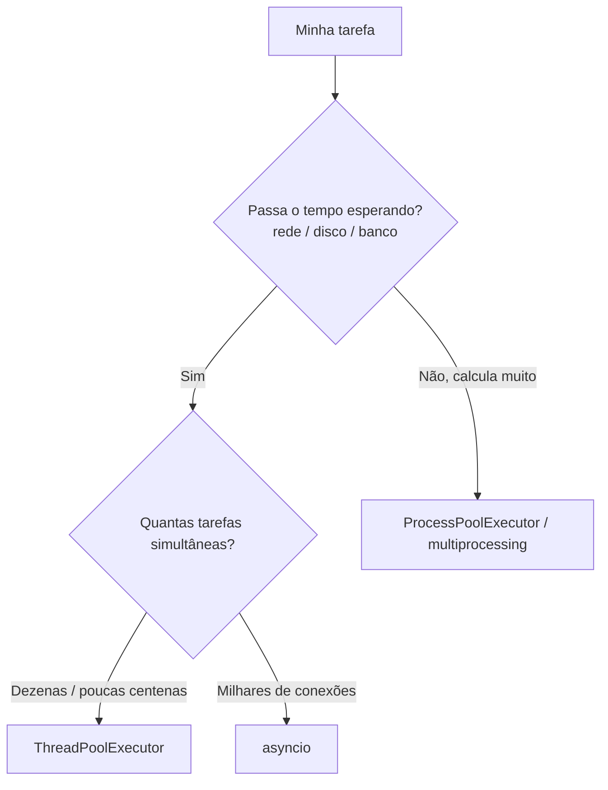

# 🧵 `concurrent.futures` e `threading`

**Concorrência** é lidar com várias tarefas ao mesmo tempo (ou parecendo ao mesmo tempo). Em Python, as opções principais são:

| Ferramenta | Modelo | Ideal para |
|------------|--------|------------|
| `threading` / `ThreadPoolExecutor` | **Threads** (mesmo processo) | Tarefas **I/O-bound** (rede, disco, APIs) |
| `multiprocessing` / `ProcessPoolExecutor` | **Processos** separados | Tarefas **CPU-bound** (cálculo pesado) |
| `asyncio` | **Corrotinas** (uma thread, cooperativo) | Muitas conexões simultâneas de I/O |

> [!example] Analogia
> Um **cozinheiro** (processo) com várias **tarefas**. Se ele só **espera** (água ferver = I/O), pode adiantar outras coisas enquanto espera (**threads**). Se a tarefa exige **trabalho constante** dele (picar tudo = CPU), só contratando **mais cozinheiros** (processos) para acelerar.

---

## 1. I/O-bound vs CPU-bound

| Tipo | O programa passa o tempo... | Exemplos | Solução |
|------|------------------------------|----------|---------|
| **I/O-bound** | **Esperando** (rede, disco, banco) | Baixar páginas, chamar APIs, ler arquivos | Threads / `asyncio` |
| **CPU-bound** | **Calculando** | Processar imagens, criptografia, simulações | Processos |

### E o GIL?
O CPython tem o **GIL** (*Global Interpreter Lock*): só **uma thread** executa bytecode Python por vez. Consequências:
- ✅ Threads **ajudam** em I/O: enquanto uma espera, outra roda (o GIL é liberado durante a espera).
- ❌ Threads **não aceleram** cálculo puro em Python: uma só CPU é usada.
- Para CPU-bound, use **processos** ([[08 - Avançado/03 - Multiprocessing|Multiprocessing]]) ou bibliotecas em C (NumPy).

Detalhes em [[08 - Avançado/04 - CPython Internals|CPython Internals]].

> [!note] Python 3.13+
> Existe uma versão experimental *free-threaded* (sem GIL), mas ainda **não é o padrão**. Este material assume o CPython com GIL.

---

## 🏊 `concurrent.futures`: a forma moderna e simples

## 2. `ThreadPoolExecutor`

Um **pool** de threads reutilizáveis que executa funções para você.

```python
import time
from concurrent.futures import ThreadPoolExecutor

def baixar(n):
    time.sleep(1)                     # simula uma requisição de 1s
    return f"página {n}"

# Sequencial: ~5 s
inicio = time.perf_counter()
resultados = [baixar(i) for i in range(5)]
print(f"Sequencial: {time.perf_counter() - inicio:.1f}s")

# Com threads: ~1 s
inicio = time.perf_counter()
with ThreadPoolExecutor(max_workers=5) as pool:
    resultados = list(pool.map(baixar, range(5)))
print(f"Com threads: {time.perf_counter() - inicio:.1f}s")
print(resultados)
```

> [!tip] `with` encerra o pool
> Ao sair do `with`, o pool **espera** todas as tarefas terminarem e libera os recursos ([[05 - Tratamento de Erros e Arquivos/04 - Context Managers com with|Context Managers]]).

### `map`: aplica a função a cada item
```python
with ThreadPoolExecutor(max_workers=8) as pool:
    for resultado in pool.map(baixar, range(10)):    # mantém a ORDEM dos itens
        print(resultado)
```
- Devolve os resultados **na ordem de entrada**.
- Se uma tarefa levantar exceção, ela é **relançada** quando você consome o resultado correspondente.

### `submit` e `Future`
`submit` agenda **uma** chamada e devolve um **`Future`** (uma "promessa" de resultado):

```python
with ThreadPoolExecutor(max_workers=3) as pool:
    futuro = pool.submit(baixar, 42)
    print(futuro.done())        # False (provavelmente ainda rodando)
    print(futuro.result())      # BLOQUEIA até terminar → 'página 42'
```

| Método do `Future` | O que faz |
|--------------------|-----------|
| `result(timeout=None)` | Espera e devolve o resultado (relança exceções) |
| `exception()` | Devolve a exceção (ou `None`) |
| `done()` | Terminou? |
| `running()` | Está rodando? |
| `cancel()` | Tenta cancelar (só se ainda não começou) |
| `add_done_callback(fn)` | Chama `fn(futuro)` ao terminar |

### `as_completed`: processar **conforme terminam**
```python
from concurrent.futures import ThreadPoolExecutor, as_completed
import random

def tarefa(n):
    time.sleep(random.uniform(0.1, 1))
    if n == 3:
        raise ValueError("falha na tarefa 3")
    return n * n

with ThreadPoolExecutor(max_workers=4) as pool:
    futuros = {pool.submit(tarefa, n): n for n in range(6)}

    for futuro in as_completed(futuros):         # na ordem de CONCLUSÃO
        n = futuros[futuro]
        try:
            print(f"tarefa {n} → {futuro.result()}")
        except ValueError as e:
            print(f"tarefa {n} falhou: {e}")
```

> [!tip] `map` vs `submit`
> | | `map` | `submit` + `as_completed` |
> |---|-------|-----------------------------|
> | Ordem do resultado | Mesma da entrada | Ordem de conclusão |
> | Tratar erro por tarefa | Mais difícil | ✅ Fácil (`try` por futuro) |
> | Argumentos diferentes por tarefa | Menos flexível | ✅ |
> | Simplicidade | ✅ | Mais código |

### `wait`
```python
from concurrent.futures import wait, FIRST_COMPLETED
feitos, pendentes = wait(lista_de_futuros, timeout=5, return_when=FIRST_COMPLETED)
```

---

## 3. `ProcessPoolExecutor` (CPU-bound)

A API é **idêntica**, mas usa **processos** (cada um com seu GIL):

```python
from concurrent.futures import ProcessPoolExecutor
import time

def contar_primos(limite):
    return sum(
        1 for n in range(2, limite)
        if all(n % d for d in range(2, int(n ** 0.5) + 1))
    )

if __name__ == "__main__":                       # OBRIGATÓRIO com processos!
    limites = [200_000] * 4

    inicio = time.perf_counter()
    [contar_primos(l) for l in limites]
    print(f"Sequencial: {time.perf_counter() - inicio:.2f}s")

    inicio = time.perf_counter()
    with ProcessPoolExecutor() as pool:          # usa todas as CPUs por padrão
        resultados = list(pool.map(contar_primos, limites))
    print(f"Processos: {time.perf_counter() - inicio:.2f}s")
```

> [!warning] Cuidados com processos
> - **Sempre** proteja com `if __name__ == "__main__":` (no Windows/macOS, os processos reimportam o módulo).
> - Funções e argumentos precisam ser **serializáveis** (pickle): nada de lambdas ou objetos com recursos abertos ([[06 - Módulos da Biblioteca Padrão Essenciais/05 - json csv e pickle|veja pickle]]).
> - Criar processos tem **custo**: só vale a pena para tarefas que demoram.
> - Cada processo tem **memória própria**: dados não são compartilhados automaticamente.

### Qual escolher?


---

## 🧶 `threading`: controle de baixo nível

## 4. Criando threads

```python
import threading
import time

def trabalhar(nome, segundos):
    print(f"[{nome}] começou")
    time.sleep(segundos)
    print(f"[{nome}] terminou")

t1 = threading.Thread(target=trabalhar, args=("A", 2))
t2 = threading.Thread(target=trabalhar, args=("B", 1))

t1.start()          # inicia (não bloqueia)
t2.start()
t1.join()           # espera terminar
t2.join()
print("Todas terminaram")
```

| Método/atributo | Função |
|-----------------|--------|
| `start()` | Inicia a thread (**uma vez só**) |
| `join(timeout=None)` | Espera a thread terminar |
| `is_alive()` | Ainda está executando? |
| `daemon=True` | Thread "de fundo": **morre** quando o programa principal termina |
| `name` | Nome (útil em logs) |
| `threading.current_thread()` | A thread atual |

> [!warning] Armadilha: chamar a função em vez de passá-la
> ```python
> threading.Thread(target=trabalhar("A", 2))     # ❌ executa AGORA e passa o retorno (None)
> threading.Thread(target=trabalhar, args=("A", 2))   # ✅
> ```

> [!warning] Exceções em threads **não** chegam à thread principal
> Uma exceção dentro de uma `Thread` é impressa e a thread morre, mas o programa **segue**. Com `ThreadPoolExecutor`, ela fica guardada no `Future` e é relançada em `result()`: mais um motivo para preferi-lo.

### Herdando de `Thread`
```python
class Contador(threading.Thread):
    def __init__(self, ate):
        super().__init__(daemon=True)
        self.ate = ate
        self.resultado = None

    def run(self):                     # o que a thread executa
        self.resultado = sum(range(self.ate))
```

---

## 5. Condições de corrida (*race conditions*) e `Lock`

Quando várias threads **alteram o mesmo dado**, o resultado pode ser errado:

```python
import threading

contador = 0

def incrementar():
    global contador
    for _ in range(100_000):
        contador += 1          # NÃO é atômico: ler → somar → gravar

threads = [threading.Thread(target=incrementar) for _ in range(4)]
for t in threads: t.start()
for t in threads: t.join()
print(contador)                # ❌ esperado 400000; pode vir menos!
```

`contador += 1` são **três passos** (ler, somar, escrever). Se duas threads os intercalam, atualizações se **perdem**.

### Solução: `Lock`
```python
lock = threading.Lock()
contador = 0

def incrementar():
    global contador
    for _ in range(100_000):
        with lock:                 # só uma thread por vez nesta seção
            contador += 1

# ... mesmo código de threads acima
print(contador)                    # ✅ 400000
```

> [!tip] Sempre use `with lock:`
> Garante a liberação mesmo se houver exceção. Evite `lock.acquire()`/`release()` manuais.

> [!warning] Deadlock
> Duas threads esperando locks uma da outra **travam para sempre**:
> ```python
> # Thread 1: pega A e depois B      Thread 2: pega B e depois A  → 💀
> ```
> Prevenção: sempre adquira múltiplos locks **na mesma ordem**, mantenha seções críticas **curtas**, use `timeout` e prefira **filas** em vez de locks.

### Outras primitivas

| Primitiva | Uso |
|-----------|-----|
| `RLock` | Lock **reentrante** (a mesma thread pode adquiri-lo várias vezes) |
| `Semaphore(n)` | Limita a `n` threads simultâneas (ex.: limite de conexões) |
| `Event` | Sinalizador (`set`/`wait`/`clear`): "pode começar!", "parem!" |
| `Condition` | Esperar por uma condição complexa |
| `Barrier(n)` | Todos esperam até `n` threads chegarem |
| `Timer(seg, fn)` | Executa `fn` após `seg` segundos |
| `local()` | Dados **exclusivos de cada thread** |

```python
# Semaphore: no máximo 3 downloads simultâneos
limite = threading.Semaphore(3)

def baixar_limitado(url):
    with limite:
        ...

# Event: parar threads com educação
parar = threading.Event()

def trabalhador():
    while not parar.is_set():
        ...                          # trabalho
        parar.wait(timeout=1)        # dorme até 1s, ou acorda se for sinalizado

# ... depois: parar.set()
```

---

## 6. `queue.Queue`: comunicação segura entre threads

A forma **recomendada** de compartilhar dados: filas já são *thread-safe* (sem precisar de locks).

```python
import queue
import threading

fila = queue.Queue()
SENTINELA = None                      # sinal de "acabou"

def produtor():
    for i in range(5):
        fila.put(f"item {i}")
    for _ in range(2):                # um sinal para cada consumidor
        fila.put(SENTINELA)

def consumidor(nome):
    while True:
        item = fila.get()
        if item is SENTINELA:
            fila.task_done()
            break
        print(f"[{nome}] processou {item}")
        fila.task_done()

threads = [threading.Thread(target=produtor)] + [
    threading.Thread(target=consumidor, args=(f"C{i}",)) for i in (1, 2)
]
for t in threads: t.start()
for t in threads: t.join()
```

| Método | Função |
|--------|--------|
| `put(item)` / `get()` | Coloca / retira (**bloqueiam** se cheia/vazia) |
| `put_nowait` / `get_nowait` | Não bloqueiam (levantam `queue.Full`/`Empty`) |
| `task_done()` / `join()` | Controle de tarefas concluídas |
| `Queue(maxsize=N)` | Fila limitada (controla a pressão) |
| `PriorityQueue`, `LifoQueue` | Prioridade / pilha |

> [!tip] Padrão **produtor–consumidor**
> Um grupo de threads **produz** trabalho, outro **consome**. A fila desacopla os dois e dispensa locks manuais.

---

## 7. Dados locais da thread
```python
dados = threading.local()

def tarefa(n):
    dados.valor = n                 # cada thread vê o SEU valor
    ...
```

---

## 8. Boas práticas e armadilhas

> [!warning] Armadilhas comuns
> - **Threads não aceleram CPU-bound** em Python (GIL). Meça antes de paralelizar.
> - **Compartilhar estado mutável** sem sincronização → bugs intermitentes, difíceis de reproduzir.
> - **`print` intercalado** entre threads: use `logging` (é thread-safe; [[06 - Módulos da Biblioteca Padrão Essenciais/07 - logging|logging]]).
> - **Muitas threads** (milhares) consomem memória; limite com `max_workers`.
> - **Threads `daemon`** podem ser interrompidas no meio de uma gravação.
> - **`time.sleep` em loops de espera** (*busy waiting*) desperdiça CPU: use `Event.wait`, `Queue.get`.

> [!tip] Regras de ouro
> 1. Prefira **`concurrent.futures`** a criar threads manualmente.
> 2. **Compartilhe pouco**; passe dados por argumentos e devolva por `return`/`Future`.
> 3. Use **`Queue`** para comunicação e **`with lock:`** quando precisar de estado compartilhado.
> 4. **Meça** (`time.perf_counter`) para confirmar o ganho.
> 5. Muitas conexões de I/O? Considere [[08 - Avançado/02 - Asyncio|asyncio]].

---

## 9. Exemplo completo: verificador de sites em paralelo

```python
import time
import urllib.request
from concurrent.futures import ThreadPoolExecutor, as_completed

SITES = [
    "https://www.python.org",
    "https://docs.python.org",
    "https://pypi.org",
    "https://github.com",
    "https://site-que-nao-existe-12345.com",
]

def verificar(url, timeout=5):
    inicio = time.perf_counter()
    try:
        with urllib.request.urlopen(url, timeout=timeout) as resp:
            return url, resp.status, time.perf_counter() - inicio
    except Exception as e:                               # simplificação para o exemplo
        return url, f"ERRO ({type(e).__name__})", time.perf_counter() - inicio

def main():
    inicio = time.perf_counter()
    with ThreadPoolExecutor(max_workers=5) as pool:
        futuros = [pool.submit(verificar, url) for url in SITES]
        for futuro in as_completed(futuros):
            url, status, dur = futuro.result()
            print(f"{url:<42} {str(status):<22} {dur:5.2f}s")
    print(f"Total: {time.perf_counter() - inicio:.2f}s")

if __name__ == "__main__":
    main()
```
O tempo total fica próximo ao do site **mais lento**, e não à soma de todos.

---

> [!question] Exercícios
> 1. Rode 5 tarefas de `time.sleep(1)` sequencialmente e com `ThreadPoolExecutor`; compare os tempos.
> 2. Use `submit` + `as_completed` para processar 10 tarefas e **tratar erros** individuais (uma delas deve falhar).
> 3. Reproduza a condição de corrida do contador e depois corrija com `Lock`. Quantas vezes você precisou rodar para ver o erro?
> 4. Por que `ThreadPoolExecutor` não acelera uma função que apenas soma números grandes? Qual ferramenta usar?
> 5. Implemente produtor–consumidor com `queue.Queue` e 3 consumidores.
> 6. Limite a 2 execuções simultâneas de uma função com `Semaphore`.
> 7. Escreva `executar_em_paralelo(func, itens, max_workers=8)` que devolva os resultados **na ordem original** e colete (sem abortar) os erros.
> 8. Para que serve `if __name__ == "__main__":` ao usar `ProcessPoolExecutor`?
> 9. Baixe 20 URLs com threads e conte quantas deram status 200 (use `urllib.request`).

> [!success]- Soluções
> 1. ```python
>    import time
>    from concurrent.futures import ThreadPoolExecutor
>    def t(_): time.sleep(1)
>    ini = time.perf_counter(); [t(i) for i in range(5)]
>    print(f"seq: {time.perf_counter() - ini:.1f}s")        # ~5s
>    ini = time.perf_counter()
>    with ThreadPoolExecutor(5) as p: list(p.map(t, range(5)))
>    print(f"thr: {time.perf_counter() - ini:.1f}s")        # ~1s
>    ```
> 2. ```python
>    from concurrent.futures import ThreadPoolExecutor, as_completed
>    def f(n):
>        if n == 4: raise RuntimeError("falhou")
>        return n * 2
>    with ThreadPoolExecutor(4) as p:
>        fs = {p.submit(f, n): n for n in range(10)}
>        for fut in as_completed(fs):
>            try: print(fs[fut], fut.result())
>            except RuntimeError as e: print(fs[fut], "erro:", e)
>    ```
> 3. Veja os dois blocos da seção 5 (com e sem `Lock`). Em CPython recente o erro pode ser raro; aumente o número de iterações/threads para vê-lo.
> 4. É CPU-bound: o GIL permite só uma thread executando Python por vez. Use `ProcessPoolExecutor`/`multiprocessing` (ou NumPy).
> 5. Use o código da seção 6 com `range(3)` consumidores e 3 sentinelas.
> 6. ```python
>    import threading, time
>    sem = threading.Semaphore(2)
>    def tarefa(n):
>        with sem:
>            print("inicia", n); time.sleep(1); print("fim", n)
>    for n in range(6): threading.Thread(target=tarefa, args=(n,)).start()
>    ```
> 7. ```python
>    from concurrent.futures import ThreadPoolExecutor
>    def executar_em_paralelo(func, itens, max_workers=8):
>        resultados, erros = [None] * len(itens), {}
>        with ThreadPoolExecutor(max_workers) as pool:
>            futuros = [pool.submit(func, item) for item in itens]
>            for i, fut in enumerate(futuros):
>                try:
>                    resultados[i] = fut.result()
>                except Exception as e:
>                    erros[i] = e
>        return resultados, erros
>    ```
> 8. Em sistemas que usam *spawn* (Windows/macOS), cada processo filho **reimporta** o módulo principal; sem o guard, ele recriaria processos indefinidamente. O guard impede que o código "de entrada" rode de novo nos filhos.
> 9. ```python
>    import urllib.request
>    from concurrent.futures import ThreadPoolExecutor
>    def status(url):
>        try:
>            with urllib.request.urlopen(url, timeout=5) as r: return r.status
>        except Exception: return None
>    with ThreadPoolExecutor(10) as p:
>        print(sum(1 for s in p.map(status, urls) if s == 200))
>    ```

---

⬅️ [[06 - Módulos da Biblioteca Padrão Essenciais/05 - json csv e pickle|json, csv e pickle]] | ➡️ [[06 - Módulos da Biblioteca Padrão Essenciais/07 - logging|logging]]

#python #intermediario #stdlib #concorrencia #threading #concurrent-futures #gil
