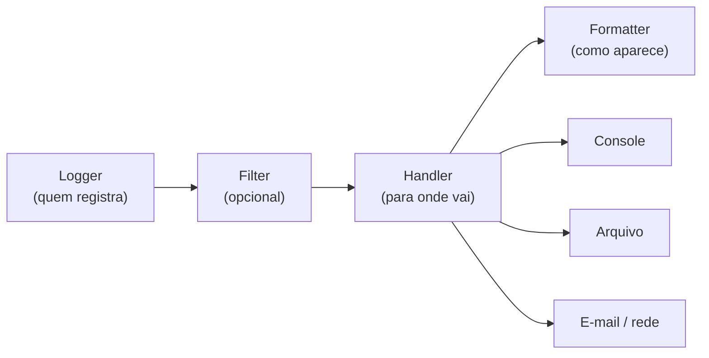

# 📋 `logging`

**Logs** são o "diário de bordo" do programa: registram o que aconteceu, quando e com que gravidade. São essenciais para **depurar**, **monitorar** e investigar problemas em produção, onde você não pode simplesmente olhar o terminal.

> [!note] Por que não só `print()`?
> | | `print` | `logging` |
> |---|---------|-----------|
> | Níveis de gravidade | ❌ | ✅ (DEBUG → CRITICAL) |
> | Ligar/desligar sem editar o código | ❌ | ✅ (muda o nível) |
> | Data/hora, módulo, linha automáticos | ❌ | ✅ |
> | Vários destinos (tela, arquivo, e-mail, rede) | ❌ | ✅ |
> | Rotação de arquivos | ❌ | ✅ |
> | Seguro com threads | ⚠️ intercala | ✅ |
> | Registra *tracebacks* de exceções | ❌ | ✅ (`logger.exception`) |

---

## 1. Primeiros passos

```python
import logging

logging.basicConfig(level=logging.INFO)

logging.debug("Detalhe para depuração")          # não aparece (nível INFO)
logging.info("Aplicação iniciada")
logging.warning("Espaço em disco baixo")
logging.error("Falha ao salvar arquivo")
logging.critical("Banco de dados indisponível")
```
Saída:
```text
INFO:root:Aplicação iniciada
WARNING:root:Espaço em disco baixo
ERROR:root:Falha ao salvar arquivo
CRITICAL:root:Banco de dados indisponível
```

### Níveis de gravidade

| Nível | Valor | Quando usar |
|-------|:-----:|-------------|
| `DEBUG` | 10 | Detalhes para diagnóstico (valores de variáveis, passos internos) |
| `INFO` | 20 | Eventos normais ("servidor iniciado", "usuário logou") |
| `WARNING` | 30 | Algo **inesperado**, mas o programa segue (padrão do `root`) |
| `ERROR` | 40 | Uma operação **falhou** |
| `CRITICAL` | 50 | Falha **grave**; o programa pode não continuar |

O logger só registra mensagens com nível **igual ou superior** ao configurado.

---

## 2. Configuração com `basicConfig`

```python
import logging

logging.basicConfig(
    level=logging.DEBUG,
    format="%(asctime)s | %(levelname)-8s | %(name)s:%(lineno)d | %(message)s",
    datefmt="%Y-%m-%d %H:%M:%S",
    filename="app.log",          # grava em arquivo (omita para ir ao terminal)
    encoding="utf-8",
)
```

> [!warning] `basicConfig` só funciona **na primeira vez**
> Se o `root` logger já tem handlers, chamadas posteriores são **ignoradas** (a menos que use `force=True`). Configure **uma vez**, no ponto de entrada do programa.

### Campos úteis do `format`

| Campo | Conteúdo |
|-------|----------|
| `%(asctime)s` | Data e hora |
| `%(levelname)s` | Nível (`INFO`, `ERROR`...) |
| `%(name)s` | Nome do logger |
| `%(message)s` | A mensagem |
| `%(filename)s`, `%(module)s` | Arquivo / módulo |
| `%(funcName)s` | Função |
| `%(lineno)d` | Linha |
| `%(process)d`, `%(threadName)s` | Processo / thread |

---

## 3. A arquitetura: loggers, handlers, formatters



| Peça | Responsabilidade |
|------|------------------|
| **Logger** | Ponto de entrada: `logger.info(...)`. Tem nome e nível |
| **Handler** | Destino: console, arquivo, rede... Tem nível próprio |
| **Formatter** | Layout da linha de log |
| **Filter** | Regras extras para aceitar/rejeitar/enriquecer registros |

### O jeito **recomendado**: um logger por módulo

```python
# meu_modulo.py
import logging

logger = logging.getLogger(__name__)      # ← nome = nome do módulo

def processar(x):
    logger.debug("Processando %s", x)
    if x < 0:
        logger.warning("Valor negativo recebido: %s", x)
    return abs(x)
```

```python
# main.py (ponto de entrada: configura UMA vez)
import logging
from meu_modulo import processar

logging.basicConfig(level=logging.DEBUG, format="%(name)s - %(levelname)s - %(message)s")
processar(-3)
```
```text
meu_modulo - DEBUG - Processando -3
meu_modulo - WARNING - Valor negativo recebido: -3
```

> [!tip] Por que `getLogger(__name__)`?
> Cria uma **hierarquia** de loggers (`app.db`, `app.web`...) que herdam configuração do pai e permite ajustar o nível de cada parte do sistema. **Não** use `logging.info()` direto em bibliotecas/módulos: isso usa o `root`.

### Hierarquia e propagação
```text
root
└── app                 (logging.getLogger("app"))
    ├── app.db          (logging.getLogger("app.db"))
    └── app.web
```
Uma mensagem em `app.db` **sobe** (*propaga*) para `app` e `root`, onde os handlers costumam estar.

```python
logging.getLogger("app.db").setLevel(logging.DEBUG)      # só o módulo db em DEBUG
logging.getLogger("urllib3").setLevel(logging.WARNING)   # silenciar bibliotecas ruidosas
```

---

## 4. Handlers e formatters manuais

```python
import logging
import sys

logger = logging.getLogger("app")
logger.setLevel(logging.DEBUG)                  # nível do logger (o mais baixo permitido)
logger.propagate = False                        # evita duplicar no root

formato = logging.Formatter(
    "%(asctime)s | %(levelname)-8s | %(name)s | %(message)s", "%H:%M:%S"
)

console = logging.StreamHandler(sys.stderr)
console.setLevel(logging.INFO)                  # console: só INFO ou mais
console.setFormatter(formato)

arquivo = logging.FileHandler("app.log", encoding="utf-8")
arquivo.setLevel(logging.DEBUG)                 # arquivo: tudo
arquivo.setFormatter(formato)

logger.addHandler(console)
logger.addHandler(arquivo)

logger.debug("só no arquivo")
logger.info("no console e no arquivo")
```

> [!warning] Handlers duplicados = mensagens repetidas
> Chamar o código de configuração **duas vezes** (ou adicionar handler em cada import) multiplica as linhas. Configure **uma vez** e proteja: `if not logger.handlers:`.

### Handlers prontos

| Handler | Destino |
|---------|---------|
| `StreamHandler` | Console (`stderr` por padrão) |
| `FileHandler` | Arquivo |
| `RotatingFileHandler` | Arquivo com **rotação por tamanho** |
| `TimedRotatingFileHandler` | Rotação por **tempo** (diária, semanal...) |
| `SMTPHandler` | E-mail |
| `HTTPHandler` | Servidor HTTP |
| `SysLogHandler` | syslog |
| `QueueHandler` | Fila (log assíncrono em apps multi-thread) |
| `NullHandler` | Não faz nada (**use em bibliotecas**) |

### Rotação de arquivos
```python
from logging.handlers import RotatingFileHandler, TimedRotatingFileHandler

# 5 MB por arquivo, mantém 3 backups (app.log.1, .2, .3)
rot = RotatingFileHandler("app.log", maxBytes=5_000_000, backupCount=3, encoding="utf-8")

# Um arquivo por dia, guarda 7 dias
diario = TimedRotatingFileHandler("app.log", when="midnight", backupCount=7, encoding="utf-8")
```
Sem rotação, arquivos de log **crescem sem limite** e podem encher o disco.

---

## 5. Boas práticas ao registrar mensagens

### Formatação **preguiçosa** (`%s`), não f-strings
```python
# ❌ A string é montada SEMPRE, mesmo que o DEBUG esteja desligado
logger.debug(f"Usuário {usuario} fez {acao} com {dados}")

# ✅ Só é formatada se a mensagem for realmente registrada
logger.debug("Usuário %s fez %s com %s", usuario, acao, dados)
```
Isso evita custo de formatação (e de `repr` de objetos grandes) quando o nível está desligado.

### Registrando exceções
```python
try:
    resultado = 10 / 0
except ZeroDivisionError:
    logger.exception("Falha ao calcular")      # ERROR + traceback completo
    # equivale a: logger.error("...", exc_info=True)
```

```python
logger.error("Falha ao processar pedido %s", pedido_id, exc_info=True)
logger.warning("Tentativa %d de %d", tentativa, maximo)
```

> [!warning] Não "engula" nem duplique o erro
> ```python
> # ❌ Loga e relança em várias camadas → o mesmo erro aparece 5 vezes
> except Exception as e:
>     logger.exception("erro")
>     raise
> ```
> Registre **uma vez**, onde a exceção for realmente **tratada** (ou no topo da aplicação). Veja [[05 - Tratamento de Erros e Arquivos/01 - try except else finally#8. Boas práticas|boas práticas com exceções]].

### Escolhendo o nível certo
```python
logger.debug("Consulta SQL: %s", sql)                 # diagnóstico fino
logger.info("Pedido %s criado", pedido.id)            # fluxo normal importante
logger.warning("API lenta: %.1fs", segundos)          # algo estranho, mas funciona
logger.error("Pagamento %s recusado", pedido.id)      # falha de uma operação
logger.critical("Sem conexão com o banco; encerrando")# colapso
```

### O que **não** registrar
> [!warning] Segurança e privacidade
> - ❌ **Senhas, tokens, chaves de API, números de cartão, CPF** completos.
> - ❌ Dados pessoais sem necessidade (LGPD).
> - ✅ Mascare: `logger.info("Login: %s", email_mascarado)`.

---

## 6. Logging em bibliotecas vs aplicações

| | Aplicação | Biblioteca |
|---|-----------|-----------|
| Configura handlers/níveis? | ✅ **Sim**, uma vez, na entrada | ❌ **Nunca** |
| Usa `getLogger(__name__)`? | ✅ | ✅ |
| Adiciona `NullHandler`? | — | ✅ |

```python
# em uma biblioteca (ex.: meu_pacote/__init__.py)
import logging
logging.getLogger(__name__).addHandler(logging.NullHandler())
```
Assim, quem usa sua biblioteca decide **se e como** ver os logs.

---

## 7. Configuração avançada: `dictConfig`

Para projetos maiores, configure tudo em um dicionário (ou YAML/JSON/TOML):

```python
import logging.config

CONFIG = {
    "version": 1,
    "disable_existing_loggers": False,
    "formatters": {
        "simples": {"format": "%(levelname)s | %(name)s | %(message)s"},
        "detalhado": {
            "format": "%(asctime)s | %(levelname)-8s | %(name)s:%(lineno)d | %(message)s",
        },
    },
    "handlers": {
        "console": {
            "class": "logging.StreamHandler",
            "level": "INFO",
            "formatter": "simples",
        },
        "arquivo": {
            "class": "logging.handlers.RotatingFileHandler",
            "level": "DEBUG",
            "formatter": "detalhado",
            "filename": "app.log",
            "maxBytes": 5_000_000,
            "backupCount": 3,
            "encoding": "utf-8",
        },
    },
    "loggers": {
        "app": {"level": "DEBUG", "handlers": ["console", "arquivo"], "propagate": False},
        "urllib3": {"level": "WARNING"},
    },
    "root": {"level": "WARNING", "handlers": ["console"]},
}

logging.config.dictConfig(CONFIG)
logging.getLogger("app.db").info("pronto")
```

### Nível via variável de ambiente
```python
import logging, os
nivel = os.getenv("LOG_LEVEL", "INFO").upper()
logging.basicConfig(level=getattr(logging, nivel, logging.INFO))
```
```bash
LOG_LEVEL=DEBUG python app.py       # muda o nível SEM editar o código
```

---

## 8. Recursos extras

### Filtros e contexto (ex.: ID de requisição)
```python
class FiltroContexto(logging.Filter):
    def __init__(self, request_id):
        super().__init__()
        self.request_id = request_id

    def filter(self, registro):
        registro.request_id = self.request_id        # novo campo disponível no formato
        return True                                  # True = aceita o registro

logger.addFilter(FiltroContexto("req-123"))
# format="%(request_id)s | %(message)s"
```

### Dados extras com `extra=`
```python
logger.info("Pedido criado", extra={"pedido_id": 42, "cliente": "Ada"})
# format="%(message)s | pedido=%(pedido_id)s"
```

### Logs estruturados (JSON)
Em sistemas modernos (observabilidade, ELK, Datadog), logs em **JSON** são mais fáceis de consultar:

```python
import json
import logging

class JsonFormatter(logging.Formatter):
    def format(self, registro):
        dados = {
            "ts": self.formatTime(registro, "%Y-%m-%dT%H:%M:%S"),
            "nivel": registro.levelname,
            "logger": registro.name,
            "msg": registro.getMessage(),
        }
        if registro.exc_info:
            dados["erro"] = self.formatException(registro.exc_info)
        return json.dumps(dados, ensure_ascii=False)

h = logging.StreamHandler()
h.setFormatter(JsonFormatter())
logging.getLogger("app").addHandler(h)
```
Bibliotecas como `structlog` e `loguru` facilitam ainda mais (terceiros).

### `warnings`: avisos de **uso**, não de execução
```python
import warnings

def funcao_antiga():
    warnings.warn("funcao_antiga() está obsoleta; use funcao_nova()", DeprecationWarning, stacklevel=2)
```
Use `warnings` para **avisar o desenvolvedor** sobre APIs obsoletas e `logging` para **registrar eventos** da execução.

---

## 9. Logging e concorrência

O `logging` é **thread-safe**: várias threads podem registrar ao mesmo tempo sem misturar linhas. Inclua `%(threadName)s` no formato para identificar quem escreveu ([[06 - Módulos da Biblioteca Padrão Essenciais/06 - concurrent futures e threading|threads]]).

```python
logging.basicConfig(
    level=logging.INFO,
    format="%(asctime)s [%(threadName)s] %(message)s",
)
```
Com **múltiplos processos** gravando no mesmo arquivo, use `QueueHandler`/`QueueListener` ou um servidor de logs (os handlers de arquivo **não** são seguros entre processos).

---

## 10. Exemplo completo: aplicação com logging profissional

```python
# app.py
import logging
import logging.config
import os
import sys

logger = logging.getLogger("app")


def configurar_logs():
    nivel = os.getenv("LOG_LEVEL", "INFO").upper()
    logging.config.dictConfig({
        "version": 1,
        "disable_existing_loggers": False,
        "formatters": {
            "padrao": {
                "format": "%(asctime)s | %(levelname)-8s | %(name)s | %(message)s",
                "datefmt": "%H:%M:%S",
            }
        },
        "handlers": {
            "console": {"class": "logging.StreamHandler", "formatter": "padrao",
                        "level": nivel, "stream": sys.stderr},
            "arquivo": {"class": "logging.handlers.RotatingFileHandler",
                        "formatter": "padrao", "level": "DEBUG",
                        "filename": "app.log", "maxBytes": 1_000_000,
                        "backupCount": 2, "encoding": "utf-8"},
        },
        "loggers": {"app": {"level": "DEBUG", "handlers": ["console", "arquivo"]}},
    })


def dividir(a, b):
    logger.debug("dividir(%s, %s)", a, b)
    try:
        return a / b
    except ZeroDivisionError:
        logger.exception("Divisão por zero com a=%s", a)
        return None


def main():
    configurar_logs()
    logger.info("Aplicação iniciada")
    for a, b in [(10, 2), (5, 0), (9, 3)]:
        resultado = dividir(a, b)
        logger.info("Resultado: %s", resultado)
    logger.info("Aplicação finalizada")


if __name__ == "__main__":
    main()
```
```bash
python app.py                    # console em INFO; arquivo em DEBUG
LOG_LEVEL=DEBUG python app.py    # console também em DEBUG
```

---

> [!question] Exercícios
> 1. Configure `basicConfig` com formato `hora | NÍVEL | mensagem` e registre uma mensagem de cada nível, em `DEBUG`.
> 2. Crie um logger `"loja.estoque"` com **console em INFO** e **arquivo em DEBUG**.
> 3. Explique a diferença entre `logging.info(...)` e `logger = logging.getLogger(__name__); logger.info(...)`.
> 4. Registre, com `logger.exception`, um erro de divisão por zero e observe o traceback.
> 5. Reescreva `logger.info(f"Usuário {u} logou às {h}")` com formatação preguiçosa e explique a vantagem.
> 6. Configure um `RotatingFileHandler` de 10 KB com 2 backups e gere logs suficientes para ver a rotação.
> 7. Faça o nível de log vir da variável de ambiente `LOG_LEVEL` (padrão `INFO`).
> 8. Escreva um decorator `@logar_chamada` que registre entrada, saída (com duração) e exceções de uma função.
> 9. Por que bibliotecas não devem chamar `basicConfig`? O que usar em vez disso?
> 10. Quais informações **nunca** devem ir para o log?

> [!success]- Soluções
> 1. ```python
>    import logging
>    logging.basicConfig(level=logging.DEBUG, format="%(asctime)s | %(levelname)s | %(message)s", datefmt="%H:%M:%S")
>    for fn in (logging.debug, logging.info, logging.warning, logging.error, logging.critical):
>        fn("mensagem de teste")
>    ```
> 2. ```python
>    import logging, sys
>    log = logging.getLogger("loja.estoque")
>    log.setLevel(logging.DEBUG)
>    fmt = logging.Formatter("%(asctime)s | %(levelname)s | %(message)s")
>    c = logging.StreamHandler(sys.stderr); c.setLevel(logging.INFO); c.setFormatter(fmt)
>    a = logging.FileHandler("estoque.log", encoding="utf-8"); a.setLevel(logging.DEBUG); a.setFormatter(fmt)
>    log.addHandler(c); log.addHandler(a)
>    ```
> 3. `logging.info` usa o logger **root** (sem nome), dificultando filtrar por módulo; `getLogger(__name__)` cria um logger **nomeado**, na hierarquia, com nível e handlers ajustáveis por parte do sistema.
> 4. ```python
>    try:
>        1 / 0
>    except ZeroDivisionError:
>        logger.exception("Falha ao dividir")
>    ```
> 5. `logger.info("Usuário %s logou às %s", u, h)`. A string só é montada se o nível `INFO` estiver ativo, economizando processamento.
> 6. ```python
>    from logging.handlers import RotatingFileHandler
>    h = RotatingFileHandler("teste.log", maxBytes=10_000, backupCount=2, encoding="utf-8")
>    log = logging.getLogger("rot"); log.setLevel(logging.INFO); log.addHandler(h)
>    for i in range(2000): log.info("linha de teste número %d", i)
>    ```
> 7. ```python
>    import logging, os
>    logging.basicConfig(level=getattr(logging, os.getenv("LOG_LEVEL", "INFO").upper(), logging.INFO))
>    ```
> 8. ```python
>    import functools, logging, time
>    log = logging.getLogger(__name__)
>    def logar_chamada(func):
>        @functools.wraps(func)
>        def wrapper(*a, **kw):
>            log.debug("→ %s args=%s kwargs=%s", func.__name__, a, kw)
>            ini = time.perf_counter()
>            try:
>                r = func(*a, **kw)
>            except Exception:
>                log.exception("✖ %s falhou", func.__name__)
>                raise
>            log.debug("← %s (%.4fs) = %r", func.__name__, time.perf_counter() - ini, r)
>            return r
>        return wrapper
>    ```
> 9. `basicConfig` altera o `root` logger da **aplicação** (que é quem decide como logar). Bibliotecas só devem usar `getLogger(__name__)` e adicionar `NullHandler`.
> 10. Senhas, tokens, chaves de API, números completos de cartão/CPF e dados pessoais desnecessários (LGPD).

---

⬅️ [[06 - Módulos da Biblioteca Padrão Essenciais/06 - concurrent futures e threading|concurrent.futures e threading]] | ➡️ [[06 - Módulos da Biblioteca Padrão Essenciais/08 - Exercícios da Biblioteca Padrão|Exercícios do Módulo 06]]

#python #intermediario #stdlib #logging #depuracao #observabilidade
