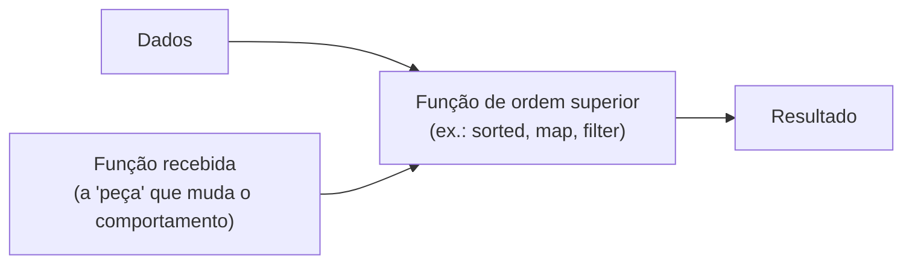

# 🧠 Funções de Ordem Superior

Uma **função de ordem superior** (*higher-order function*) é uma função que **recebe outras funções como argumento** e/ou **devolve uma função** como resultado.

Isso só é possível porque, em Python, **funções são objetos de primeira classe**: podem ser guardadas em variáveis, passadas como argumentos, devolvidas por outras funções e guardadas em estruturas de dados. (Você viu a semente disso em [[03 - Funções e Modularização/01 - Definindo Funções#5. Funções são objetos (cidadãs de primeira classe)|Definindo Funções]] e em [[03 - Funções e Modularização/03 - Escopo e Closures|Escopo e Closures]].)

> [!example] Analogia
> Uma função comum é uma **máquina que processa dados**. Uma função de ordem superior é uma **máquina que recebe outra máquina** como peça: você troca a peça e o comportamento muda, sem reconstruir tudo.



---

## 1. Funções como valores

```python
def saudar(nome):
    return f"Olá, {nome}!"

f = saudar                     # sem parênteses: referência à função
print(f("Ada"))                # Olá, Ada!
print(f.__name__)              # 'saudar'

# Em estruturas de dados
acoes = [str.upper, str.lower, str.title]
for acao in acoes:
    print(acao("pYtHoN"))

# Em dicionários (tabela de despacho)
operacoes = {
    "soma": lambda a, b: a + b,
    "mult": lambda a, b: a * b,
}
print(operacoes["mult"](3, 4))     # 12
```

> [!warning] Referenciar vs chamar
> ```python
> f = saudar       # ✅ guarda a função
> f = saudar()     # ❌ CHAMA agora (e guarda o retorno, ou dá TypeError por falta de argumento)
> ```

---

## 2. Recebendo funções como argumento

### O padrão básico
```python
def aplicar(func, valores):
    return [func(v) for v in valores]

print(aplicar(len, ["sol", "estrela", "lua"]))     # [3, 7, 3]
print(aplicar(abs, [-1, 2, -3]))                   # [1, 2, 3]
print(aplicar(lambda x: x ** 2, [1, 2, 3]))        # [1, 4, 9]
```

### Funções embutidas que você já usa

| Função | Parâmetro de função | Exemplo |
|--------|---------------------|---------|
| `sorted(it, key=f)` | `key` extrai o critério | `sorted(nomes, key=len)` |
| `list.sort(key=f)` | idem | `lista.sort(key=str.lower)` |
| `min(it, key=f)` / `max(it, key=f)` | critério de comparação | `max(palavras, key=len)` |
| `map(f, it)` | transforma cada item | veja [[07 - Programação Funcional e Intermediário/02 - Lambda map filter reduce\|map/filter/reduce]] |
| `filter(f, it)` | mantém quem satisfaz | |
| `any(...)` / `all(...)` | condições sobre itens | |
| `itertools.groupby(it, key=f)` | chave de agrupamento | |
| `functools.reduce(f, it)` | combina itens | |

```python
palavras = ["banana", "kiwi", "maçã", "abacaxi"]

print(sorted(palavras, key=len))                 # ['kiwi', 'maçã', 'banana', 'abacaxi']
print(sorted(palavras, key=lambda p: p[-1]))     # pela última letra
print(max(palavras, key=len))                    # 'abacaxi'
print(min(palavras, key=str.lower))              # 'abacaxi'
```

### Callbacks: "chame isto quando acontecer"
```python
def processar(itens, ao_terminar_item=None, ao_falhar=None):
    for item in itens:
        try:
            resultado = int(item)
        except ValueError as e:
            if ao_falhar:
                ao_falhar(item, e)
            continue
        if ao_terminar_item:
            ao_terminar_item(item, resultado)

processar(
    ["1", "x", "3"],
    ao_terminar_item=lambda i, r: print(f"ok {i} → {r}"),
    ao_falhar=lambda i, e: print(f"falhou {i!r}: {e}"),
)
```
É a base de *event handlers*, *hooks* e das APIs de muitas bibliotecas (veja também o [[04 - Programação Orientada a Objetos/06 - Design Patterns Básicos|Observer]]).

### Estratégia: comportamento como parâmetro
```python
def calcular_total(precos, desconto):
    return sum(desconto(p) for p in precos)

sem_desconto = lambda p: p
promocao = lambda p: p * 0.9
print(calcular_total([100, 50], promocao))      # 135.0
```
Esse é o padrão **Strategy**, aqui sem classes.

---

## 3. Devolvendo funções (fábricas de funções)

```python
def criar_multiplicador(fator):
    def multiplicar(x):
        return x * fator          # 'fator' é capturado (closure)
    return multiplicar

dobro = criar_multiplicador(2)
triplo = criar_multiplicador(3)
print(dobro(10), triplo(10))      # 20 30
```

```python
def criar_validador(minimo, maximo):
    return lambda valor: minimo <= valor <= maximo

idade_valida = criar_validador(0, 130)
print(idade_valida(25), idade_valida(-5))    # True False
```

```python
def criar_formatador(prefixo="", sufixo="", maiusculas=False):
    def formatar(texto):
        t = texto.upper() if maiusculas else texto
        return f"{prefixo}{t}{sufixo}"
    return formatar

aviso = criar_formatador("⚠️  ", "!", maiusculas=True)
print(aviso("cuidado"))           # ⚠️  CUIDADO!
```

Esse mecanismo é o que dá origem aos [[07 - Programação Funcional e Intermediário/03 - Decorators|decorators]].

---

## 4. Composição de funções

**Compor** é encadear funções: a saída de uma é a entrada da próxima.

```python
def compor(*funcoes):
    """compor(f, g, h)(x) == f(g(h(x)))"""
    def composta(x):
        for f in reversed(funcoes):
            x = f(x)
        return x
    return composta

limpar = str.strip
minusculas = str.lower
sem_espacos_duplos = lambda s: " ".join(s.split())

normalizar = compor(sem_espacos_duplos, minusculas, limpar)
print(normalizar("   OLÁ    Mundo  "))       # 'olá mundo'
```

### *Pipeline* (da esquerda para a direita, mais legível)
```python
from functools import reduce

def pipeline(*funcoes):
    return lambda x: reduce(lambda acc, f: f(acc), funcoes, x)

processar = pipeline(str.strip, str.lower, lambda s: s.replace(" ", "-"))
print(processar("  Meu Título Incrível "))   # 'meu-título-incrível'
```

---

## 5. Aplicação parcial e *currying*

### `functools.partial`: fixa alguns argumentos
```python
from functools import partial

def potencia(base, expoente):
    return base ** expoente

quadrado = partial(potencia, expoente=2)
print(quadrado(7))                 # 49

para_binario = partial(int, base=2)
print(para_binario("1101"))        # 13
```
Veja [[06 - Módulos da Biblioteca Padrão Essenciais/03 - collections itertools e functools|partial]].

### *Currying* manual
Transformar `f(a, b, c)` em `f(a)(b)(c)`:
```python
def somar(a):
    return lambda b: lambda c: a + b + c

print(somar(1)(2)(3))              # 6
```
Em Python, `partial` e closures costumam ser mais práticos que o currying "puro".

---

## 6. O módulo `operator`: funções prontas para operadores

Evita lambdas triviais e costuma ser mais rápido:

```python
import operator

operator.add(2, 3)             # 5   (a + b)
operator.mul(4, 5)             # 20
operator.itemgetter(1)         # função que pega o item de índice 1
operator.attrgetter("nome")    # função que pega .nome
operator.methodcaller("upper") # função que chama .upper()
```

```python
from operator import itemgetter, attrgetter, methodcaller

pessoas = [("Ada", 36), ("Alan", 41), ("Grace", 85)]
print(sorted(pessoas, key=itemgetter(1), reverse=True))    # por idade desc
print(max(pessoas, key=itemgetter(1)))                     # ('Grace', 85)

dicts = [{"nome": "Ada", "nota": 9}, {"nome": "Alan", "nota": 7}]
print(sorted(dicts, key=itemgetter("nota")))               # por nota
print(sorted(dicts, key=itemgetter("nota", "nome")))       # critérios múltiplos

class Aluno:
    def __init__(self, nome, nota):
        self.nome, self.nota = nome, nota
    def __repr__(self):
        return f"Aluno({self.nome!r}, {self.nota})"

alunos = [Aluno("Bia", 8), Aluno("Ana", 9)]
print(sorted(alunos, key=attrgetter("nota", "nome")))

print(list(map(methodcaller("upper"), ["a", "b"])))        # ['A', 'B']
```

| Em vez de... | Use |
|--------------|-----|
| `lambda x: x[1]` | `itemgetter(1)` |
| `lambda p: p.nome` | `attrgetter("nome")` |
| `lambda s: s.upper()` | `str.upper` ou `methodcaller("upper")` |
| `lambda a, b: a + b` | `operator.add` |

---

## 7. Programação funcional em Python: ideias-chave

Python é **multiparadigma**: você pode usar o estilo funcional **quando ajudar**.

| Conceito | Significado | Em Python |
|----------|-------------|-----------|
| **Função pura** | Mesmo argumento → mesmo resultado, **sem efeitos colaterais** | Sem alterar globais, argumentos ou arquivos |
| **Imutabilidade** | Não alterar dados; criar novos | `tuple`, `frozenset`, `dataclass(frozen=True)` |
| **Funções de primeira classe** | Funções como valores | Nativo |
| **Funções de ordem superior** | Recebem/devolvem funções | `map`, `filter`, `sorted(key=)`, decorators |
| **Composição** | Combinar funções pequenas | `compor`, pipelines |
| **Declarativo** | Dizer *o quê*, não *como* | comprehensions, `sum(...)`, `any(...)` |
| **Avaliação preguiçosa** | Calcular só quando preciso | geradores, `map`/`filter` ([[07 - Programação Funcional e Intermediário/04 - Generators e Iterators\|Generators]]) |

### Pura vs impura
```python
# ❌ Impura: depende de estado externo e o altera
total = 0
def somar_global(x):
    global total
    total += x

# ❌ Impura: altera o argumento
def adicionar(lista, item):
    lista.append(item)

# ✅ Pura: só usa argumentos, devolve novo valor
def somar(a, b):
    return a + b

def adicionar_puro(lista, item):
    return [*lista, item]
```

> [!tip] Por que funções puras?
> São **fáceis de testar** (sem preparação de estado), **fáceis de raciocinar**, **cacheáveis** (`@cache`) e **seguras para concorrência**. Pense em um **núcleo puro** (a lógica) com **bordas impuras** (entrada e saída).

### Imperativo vs funcional
```python
# Imperativo
resultado = []
for p in pedidos:
    if p["pago"]:
        resultado.append(p["total"] * 1.1)

# Funcional/declarativo
resultado = [p["total"] * 1.1 for p in pedidos if p["pago"]]

# Agregação direta com gerador
total = sum(p["total"] for p in pedidos if p["pago"])
```

> [!note] Python **não** é Haskell
> Não há otimização de recursão de cauda, e as lambdas são limitadas a uma expressão. A comunidade prefere **comprehensions** e **geradores** a cadeias longas de `map`/`filter`/`reduce`. Use o que for mais **legível**.

---

## 8. Exemplos práticos

### Tabela de despacho (substituindo `if/elif`)
```python
def somar(a, b): return a + b
def subtrair(a, b): return a - b
def dividir(a, b): return a / b

COMANDOS = {"+": somar, "-": subtrair, "/": dividir}

def calcular(a, op, b):
    try:
        return COMANDOS[op](a, b)
    except KeyError:
        raise ValueError(f"Operador desconhecido: {op!r}") from None
```

### Ordenação por múltiplos critérios
```python
from operator import itemgetter

vendas = [("Ana", "SP", 100), ("Bia", "RJ", 150), ("Caio", "SP", 80), ("Davi", "RJ", 150)]

# Queremos: estado (asc), valor (desc), nome (asc).
# Como sort() é estável, ordene do critério MENOS importante ao MAIS importante:
vendas.sort(key=itemgetter(0))                   # nome
vendas.sort(key=itemgetter(2), reverse=True)     # valor (desc)
vendas.sort(key=itemgetter(1))                   # estado
print(vendas)
# [('Bia', 'RJ', 150), ('Davi', 'RJ', 150), ('Ana', 'SP', 100), ('Caio', 'SP', 80)]
```
(A ordenação é **estável**: os empates mantêm a ordem dos passos anteriores.)

### Registro de funções (plugins)
```python
HANDLERS = {}

def registrar(nome):
    def decorador(func):
        HANDLERS[nome] = func
        return func
    return decorador

@registrar("json")
def exportar_json(dados): ...

@registrar("csv")
def exportar_csv(dados): ...

HANDLERS["json"]([])
```

### Memoização manual (função de ordem superior)
```python
def memoizar(func):
    cache = {}
    def interna(*args):
        if args not in cache:
            cache[args] = func(*args)
        return cache[args]
    return interna

@memoizar
def fib(n):
    return n if n < 2 else fib(n - 1) + fib(n - 2)
```

---

## 9. Armadilhas

> [!warning] Armadilhas comuns
> - **Late binding** em lambdas criadas num laço ([[03 - Funções e Modularização/03 - Escopo e Closures|veja]]).
> - **Esconder efeitos colaterais** em funções passadas a `map`: como `map` é preguiçoso, nada acontece até o resultado ser consumido.
>   ```python
>   map(print, [1, 2, 3])                 # ❌ não imprime nada!
>   list(map(print, [1, 2, 3]))           # imprime, mas é feio: use um for
>   ```
> - **Funções com muitos parâmetros** passadas como callbacks: use `partial` ou lambdas finas.
> - **Callbacks aninhados** ("callback hell"): prefira `async/await` ([[08 - Avançado/02 - Asyncio|asyncio]]) ou decomponha em funções nomeadas.
> - **Lambdas complexas**: se não cabe numa linha legível, use `def`.

---

> [!question] Exercícios
> 1. Escreva `aplicar_n_vezes(func, n, valor)` que aplique `func` `n` vezes: `aplicar_n_vezes(lambda x: x * 2, 3, 1)` → `8`.
> 2. Escreva `criar_contador_de(palavra)` que devolva uma função que conte quantas vezes `palavra` aparece em um texto.
> 3. Implemente `compor(*funcoes)` (da direita para a esquerda) e use-a para criar `slugify`.
> 4. Ordene uma lista de dicionários `{"nome": ..., "idade": ...}` por idade (desc) e depois por nome (asc), usando `itemgetter`.
> 5. Escreva `filtrar_por(lista, **criterios)` que devolva os dicionários que casam com todos os critérios (`filtrar_por(pessoas, cidade="SP", ativo=True)`).
> 6. Crie uma tabela de despacho para uma mini calculadora com `+ - * / ** %` usando o módulo `operator`.
> 7. Explique a diferença entre uma função **pura** e uma **impura** com um exemplo de cada, e reescreva a impura como pura.
> 8. Escreva `tentar(func, *args, padrao=None)` que chame `func(*args)` e devolva `padrao` se houver exceção.
> 9. Por que `map(print, lista)` não imprime nada? Como fazer corretamente?

> [!success]- Soluções
> 1. ```python
>    def aplicar_n_vezes(func, n, valor):
>        for _ in range(n):
>            valor = func(valor)
>        return valor
>    print(aplicar_n_vezes(lambda x: x * 2, 3, 1))    # 8
>    ```
> 2. ```python
>    def criar_contador_de(palavra):
>        palavra = palavra.lower()
>        return lambda texto: texto.lower().split().count(palavra)
>    contar_gato = criar_contador_de("gato")
>    print(contar_gato("O gato viu outro Gato"))      # 2
>    ```
> 3. ```python
>    def compor(*fs):
>        def composta(x):
>            for f in reversed(fs):
>                x = f(x)
>            return x
>        return composta
>
>    slugify = compor(lambda s: s.replace(" ", "-"), str.lower, str.strip)
>    print(slugify("  Olá Mundo "))      # 'olá-mundo'
>    ```
> 4. ```python
>    from operator import itemgetter
>    pessoas.sort(key=itemgetter("nome"))
>    pessoas.sort(key=itemgetter("idade"), reverse=True)
>    ```
> 5. ```python
>    def filtrar_por(lista, **criterios):
>        return [d for d in lista if all(d.get(k) == v for k, v in criterios.items())]
>    ```
> 6. ```python
>    import operator
>    OPS = {"+": operator.add, "-": operator.sub, "*": operator.mul,
>           "/": operator.truediv, "**": operator.pow, "%": operator.mod}
>    print(OPS["**"](2, 10))      # 1024
>    ```
> 7. Pura: `def somar(a, b): return a + b`. Impura: `def add(l, x): l.append(x)` (altera o argumento). Versão pura: `def add(l, x): return [*l, x]`.
> 8. ```python
>    def tentar(func, *args, padrao=None):
>        try:
>            return func(*args)
>        except Exception:
>            return padrao
>    print(tentar(int, "abc", padrao=0))     # 0
>    ```
> 9. `map` é **preguiçoso**: só calcula quando o resultado é consumido. Correto: `for x in lista: print(x)` (ou `print(*lista, sep="\n")`).

---

⬅️ [[06 - Módulos da Biblioteca Padrão Essenciais/08 - Exercícios da Biblioteca Padrão|Exercícios do Módulo 06]] | ➡️ [[07 - Programação Funcional e Intermediário/02 - Lambda map filter reduce|Lambda, map, filter, reduce]]

#python #intermediario #funcional #funcoes #ordem-superior #composicao #operator
