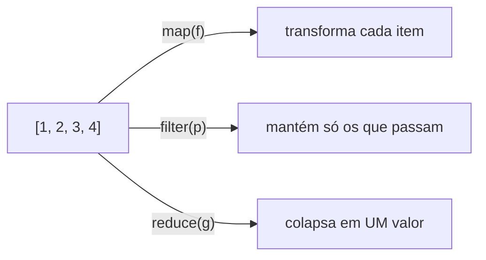

# λ Lambda, `map`, `filter` e `reduce`

Na nota anterior ([[07 - Programação Funcional e Intermediário/01 - Funções de Ordem Superior|Funções de Ordem Superior]]) vimos que funções podem ser passadas como valores. Agora conheceremos a **função anônima** (`lambda`) e as três ferramentas funcionais clássicas.



---

## 1. `lambda`: função de uma linha

Uma `lambda` é uma função **sem nome**, limitada a **uma única expressão**.

```python
# Função normal
def dobro(x):
    return x * 2

# Equivalente com lambda
dobro = lambda x: x * 2

print(dobro(5))                       # 10
print((lambda a, b: a + b)(2, 3))     # 5  (chamada imediata)
```

### Sintaxe

```text
lambda parâmetros: expressão
```

| Característica | `def` | `lambda` |
|----------------|-------|----------|
| Tem nome | Sim | Não (anônima) |
| Quantidade de instruções | Várias | **Uma expressão** |
| `return` explícito | Sim | Implícito |
| Docstring / type hints | Sim | Não |
| Ideal para | Lógica reutilizável | Funções curtas, descartáveis |

> [!warning] Armadilha: atribuir lambda a uma variável
> A PEP 8 desaconselha isso. Se vai dar nome, use `def`: você ganha nome no *traceback*, docstring e hints.
> ```python
> # ❌ Evite
> quadrado = lambda x: x ** 2
>
> # ✅ Prefira
> def quadrado(x):
>     return x ** 2
> ```

### Onde a lambda brilha: argumentos `key=`

```python
pessoas = [("Ana", 31), ("Bruno", 25), ("Carla", 28)]

print(sorted(pessoas, key=lambda p: p[1]))        # por idade
print(max(pessoas, key=lambda p: p[1]))           # ('Ana', 31)
print(sorted(["banana", "kiwi", "maçã"], key=lambda s: len(s)))
```

### Lambdas com valores padrão, `*args` e condicional

```python
saudacao = lambda nome, prefixo="Olá": f"{prefixo}, {nome}!"
print(saudacao("Ada"))                 # Olá, Ada!

soma = lambda *nums: sum(nums)
print(soma(1, 2, 3))                   # 6

classifica = lambda n: "par" if n % 2 == 0 else "ímpar"
print(classifica(7))                   # ímpar
```

> [!warning] Armadilha clássica: lambdas em laços (*late binding*)
> ```python
> # ❌ Todas usam o MESMO i (o valor final)
> funcs = [lambda: i for i in range(3)]
> print([f() for f in funcs])        # [2, 2, 2]
>
> # ✅ Fixe o valor com argumento padrão
> funcs = [lambda i=i: i for i in range(3)]
> print([f() for f in funcs])        # [0, 1, 2]
> ```
> A lambda guarda a **variável**, não o valor. Veja mais em [[03 - Funções e Modularização/03 - Escopo e Closures|Escopo e Closures]].

> [!note] Lambda não pode...
> - ter `if` sem `else` como instrução (só como expressão ternária);
> - conter atribuições (`x = 1`), `for`, `while`, `try` ou `return`;
> - (com o operador morsa `:=` até dá, mas não faça isso).

---

## 2. `map()`: transformar cada item

`map(função, iterável)` aplica a função a **cada elemento** e devolve um **iterador preguiçoso**.

```python
numeros = [1, 2, 3, 4]

quadrados = map(lambda n: n ** 2, numeros)
print(quadrados)             # <map object at 0x...>  (preguiçoso!)
print(list(quadrados))       # [1, 4, 9, 16]
```

```python
# Com função existente (sem lambda!)
nomes = ["ada", "alan", "grace"]
print(list(map(str.title, nomes)))    # ['Ada', 'Alan', 'Grace']
print(list(map(len, nomes)))          # [3, 4, 5]
print(list(map(int, ["1", "2", "3"])))  # [1, 2, 3]
```

### `map` com vários iteráveis

```python
a = [1, 2, 3]
b = [10, 20, 30]
print(list(map(lambda x, y: x + y, a, b)))   # [11, 22, 33]
```
Para quando o **menor** iterável acabar. (Em Python 3.14+ existe `strict=True`; em 3.12, use `zip` com `strict=True` se precisar dessa garantia.)

> [!warning] Armadilha: `map` é preguiçoso e de uso único
> ```python
> m = map(str.upper, ["a", "b"])
> print(list(m))      # ['A', 'B']
> print(list(m))      # []  ← esgotado!
> ```
> Se precisa reutilizar, converta para `list` uma vez.

---

## 3. `filter()`: manter só o que passa no teste

`filter(predicado, iterável)` devolve apenas os itens para os quais o predicado é **verdadeiro**.

```python
numeros = range(1, 11)

pares = filter(lambda n: n % 2 == 0, numeros)
print(list(pares))            # [2, 4, 6, 8, 10]
```

```python
# Predicado None → remove valores "falsy" (0, "", None, [], False)
dados = [0, 1, "", "ok", None, [], [1], False]
print(list(filter(None, dados)))     # [1, 'ok', [1]]

# Com função nomeada
def eh_adulto(pessoa):
    return pessoa["idade"] >= 18

pessoas = [{"nome": "Ana", "idade": 20}, {"nome": "Léo", "idade": 15}]
print([p["nome"] for p in filter(eh_adulto, pessoas)])   # ['Ana']
```

> [!tip] `itertools.filterfalse`
> O oposto de `filter`: mantém os que **não** passam.
> ```python
> from itertools import filterfalse
> print(list(filterfalse(lambda n: n % 2 == 0, range(10))))  # [1, 3, 5, 7, 9]
> ```

---

## 4. `reduce()`: colapsar em um único valor

`functools.reduce(função, iterável, inicial)` aplica uma função de **dois argumentos** acumulando o resultado.

```python
from functools import reduce

numeros = [1, 2, 3, 4, 5]
produto = reduce(lambda acc, n: acc * n, numeros)
print(produto)       # 120
```

Passo a passo:

| Passo | `acc` | `n` | Resultado |
|-------|-------|-----|-----------|
| 1 | 1 | 2 | 2 |
| 2 | 2 | 3 | 6 |
| 3 | 6 | 4 | 24 |
| 4 | 24 | 5 | 120 |

### Sempre que possível, informe o valor inicial

```python
from functools import reduce

# ❌ Sem inicial: lista vazia gera erro
reduce(lambda a, b: a + b, [])
# TypeError: reduce() of empty iterable with no initial value

# ✅ Com inicial
print(reduce(lambda a, b: a + b, [], 0))       # 0
```

### Exemplo: achatar listas e contar palavras

```python
listas = [[1, 2], [3], [4, 5]]
print(reduce(lambda a, b: a + b, listas, []))   # [1, 2, 3, 4, 5]

frases = ["oi mundo", "oi python"]
total = reduce(lambda acc, f: acc + len(f.split()), frases, 0)
print(total)    # 4
```

> [!note] Por que `reduce` mora em `functools`?
> Guido van Rossum achava `reduce` pouco legível e o tirou dos *builtins* no Python 3. Em muitos casos há alternativas melhores.

| Em vez de... | Use |
|--------------|-----|
| `reduce(lambda a, b: a + b, xs, 0)` | `sum(xs)` |
| `reduce(lambda a, b: a * b, xs, 1)` | `math.prod(xs)` |
| `reduce(lambda a, b: a if a > b else b, xs)` | `max(xs)` |
| `reduce(lambda a, b: a and b, xs, True)` | `all(xs)` |
| `reduce(lambda a, b: a or b, xs, False)` | `any(xs)` |
| `reduce(lambda a, b: a + b, listas, [])` | `itertools.chain.from_iterable(listas)` |

### `itertools.accumulate`: guarda os passos intermediários

```python
from itertools import accumulate
import operator

print(list(accumulate([1, 2, 3, 4])))                 # [1, 3, 6, 10]
print(list(accumulate([1, 2, 3, 4], operator.mul)))   # [1, 2, 6, 24]
print(list(accumulate([3, 1, 4, 1, 5], max)))         # [3, 3, 4, 4, 5]
```

---

## 5. `map`/`filter` ou comprehension?

```python
numeros = range(10)

# Estilo funcional
r1 = list(map(lambda n: n ** 2, filter(lambda n: n % 2 == 0, numeros)))

# Comprehension (mais legível na maioria dos casos)
r2 = [n ** 2 for n in numeros if n % 2 == 0]

print(r1 == r2)      # True → [0, 4, 16, 36, 64]
```

| Critério | `map` / `filter` | Comprehension |
|----------|------------------|---------------|
| Legibilidade com lambda | Pior | **Melhor** |
| Legibilidade com função existente | **Melhor** (`map(str.strip, xs)`) | Boa |
| Preguiçoso | Sim | Não (a menos que use `( )`) |
| Combina transformar + filtrar | Precisa aninhar | Natural |
| Opinião da comunidade | Aceito | **Preferido** |

> [!tip] Regra prática
> - Já existe uma função pronta (`str.strip`, `int`, `len`)? → `map(função, xs)` fica limpo.
> - Precisaria escrever uma `lambda`? → use uma [[02 - Controle de Fluxo e Estruturas de Dados/07 - Comprehensions|comprehension]].
> - Precisa de **preguiça** (dados enormes)? → expressão geradora (próxima: [[07 - Programação Funcional e Intermediário/04 - Generators e Iterators|Generators]]).

---

## 6. Exemplo integrado: pipeline de vendas

```python
from functools import reduce

vendas = [
    {"produto": "Caneta",  "qtd": 10, "preco": 2.5,  "ativo": True},
    {"produto": "Caderno", "qtd": 3,  "preco": 15.9, "ativo": True},
    {"produto": "Régua",   "qtd": 0,  "preco": 4.0,  "ativo": False},
    {"produto": "Mochila", "qtd": 1,  "preco": 120,  "ativo": True},
]

ativas = filter(lambda v: v["ativo"], vendas)                   # 1. filtra
totais = map(lambda v: v["qtd"] * v["preco"], ativas)           # 2. transforma
receita = reduce(lambda acc, t: acc + t, totais, 0)             # 3. agrega

print(f"Receita: R$ {receita:.2f}")      # Receita: R$ 192.70
```

Mesma coisa, mais "pythônica":

```python
receita = sum(v["qtd"] * v["preco"] for v in vendas if v["ativo"])
```

> [!tip] Depure o pipeline
> Como `map`/`filter` são preguiçosos, nada roda até você consumir. No REPL, envolva cada etapa com `list(...)` para ver os valores intermediários.

---

> [!question] Exercícios
> 1. Escreva uma `lambda` que receba `x` e devolva `True` se for múltiplo de 5.
> 2. Use `map` para converter `["1.5", "2.0", "3.25"]` em floats.
> 3. Use `filter` para obter as palavras com mais de 4 letras de uma lista.
> 4. Use `reduce` para encontrar o **maior** número de uma lista (sem `max`).
> 5. Ordene `["Zé", "ana", "Bia"]` ignorando maiúsculas/minúsculas com `key=` e `lambda`.
> 6. Corrija: `funcs = [lambda x: x * i for i in range(3)]` para que `funcs[2](10)` devolva `20`.
> 7. Reescreva `list(map(lambda n: n + 1, filter(lambda n: n > 0, xs)))` como comprehension.
> 8. Com `accumulate`, gere o saldo acumulado de `[100, -30, 50, -20]` (começando de 0).

> [!success]- Soluções
> 1. `multiplo5 = lambda x: x % 5 == 0` (ou direto: `lambda x: x % 5 == 0`).
> 2. ```python
>    print(list(map(float, ["1.5", "2.0", "3.25"])))   # [1.5, 2.0, 3.25]
>    ```
> 3. ```python
>    palavras = ["sol", "python", "lua", "estrela"]
>    print(list(filter(lambda p: len(p) > 4, palavras)))   # ['python', 'estrela']
>    ```
> 4. ```python
>    from functools import reduce
>    xs = [4, 9, 2, 7]
>    print(reduce(lambda a, b: a if a > b else b, xs))     # 9
>    ```
> 5. ```python
>    print(sorted(["Zé", "ana", "Bia"], key=lambda s: s.lower()))
>    # ['ana', 'Bia', 'Zé']   (ou key=str.lower)
>    ```
> 6. ```python
>    funcs = [lambda x, i=i: x * i for i in range(3)]
>    print(funcs[2](10))     # 20
>    ```
> 7. `[n + 1 for n in xs if n > 0]`
> 8. ```python
>    from itertools import accumulate
>    print(list(accumulate([100, -30, 50, -20], initial=0)))
>    # [0, 100, 70, 120, 100]
>    ```

---

⬅️ [[07 - Programação Funcional e Intermediário/01 - Funções de Ordem Superior|Funções de Ordem Superior]] | ➡️ [[07 - Programação Funcional e Intermediário/03 - Decorators|Decorators]]

#python #intermediario #funcional #lambda #map #filter #reduce #itertools
