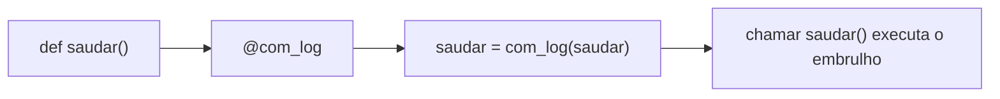
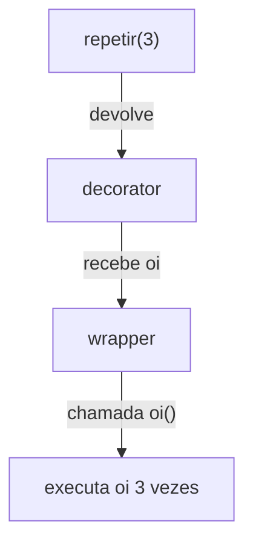

# 🎀 Decorators

Um **decorator** é uma função que **recebe uma função** e **devolve outra** (geralmente com comportamento extra), sem você alterar o código original.

> [!note] Analogia
> Pense em **embrulhar um presente**: o presente (função) continua o mesmo, mas o papel (decorator) adiciona algo: laço, cartão, proteção. Você pode empilhar vários embrulhos.

Pré-requisitos: [[07 - Programação Funcional e Intermediário/01 - Funções de Ordem Superior|Funções de Ordem Superior]] e [[03 - Funções e Modularização/03 - Escopo e Closures|Closures]]. Se algo parecer mágico demais, revise essas notas.

---

## 1. Construindo um decorator do zero

### Passo 1: funções são valores

```python
def saudar():
    print("Olá!")

outra = saudar        # sem parênteses: só referência
outra()               # Olá!
```

### Passo 2: uma função que embrulha outra

```python
def com_log(funcao):
    def embrulho():
        print(f"→ chamando {funcao.__name__}")
        resultado = funcao()
        print(f"← {funcao.__name__} terminou")
        return resultado
    return embrulho

def saudar():
    print("Olá!")

saudar = com_log(saudar)     # substitui pela versão embrulhada
saudar()
```
```text
→ chamando saudar
Olá!
← saudar terminou
```

### Passo 3: o açúcar sintático `@`

```python
@com_log
def saudar():
    print("Olá!")
```
`@com_log` acima de `def saudar` é **exatamente** `saudar = com_log(saudar)`.



---

## 2. Decorator genérico: `*args`, `**kwargs` e `functools.wraps`

O decorator acima só funciona com funções sem parâmetros. A versão **correta e reutilizável**:

```python
import functools

def com_log(funcao):
    @functools.wraps(funcao)              # preserva nome, docstring, etc.
    def embrulho(*args, **kwargs):
        print(f"→ {funcao.__name__}{args} {kwargs}")
        resultado = funcao(*args, **kwargs)
        print(f"← retornou {resultado!r}")
        return resultado                  # NUNCA esqueça de devolver!
    return embrulho

@com_log
def somar(a, b=0):
    """Soma dois números."""
    return a + b

somar(2, b=3)
```
```text
→ somar(2,) {'b': 3}
← retornou 5
```

> [!warning] Armadilha nº 1: esquecer `functools.wraps`
> ```python
> # ❌ Sem wraps
> def meu_dec(f):
>     def embrulho(*a, **k):
>         return f(*a, **k)
>     return embrulho
>
> @meu_dec
> def somar(a, b):
>     """Soma."""
>     return a + b
>
> print(somar.__name__)   # 'embrulho'  😱
> print(somar.__doc__)    # None
>
> # ✅ Com @functools.wraps(f): __name__ == 'somar' e a docstring é mantida
> ```
> Isso quebra depuração, `help()`, documentação e frameworks (Flask, pytest...).

> [!warning] Armadilha nº 2: esquecer o `return`
> Se o embrulho não devolve `resultado`, a função decorada **passa a devolver `None`**.

> [!tip] Acesso à função original
> `functools.wraps` adiciona o atributo `__wrapped__`: `somar.__wrapped__(1, 2)` chama a versão sem decorator (ótimo para testes).

---

## 3. Decorators úteis (receitas)

### 3.1 Cronômetro

```python
import functools, time

def cronometro(func):
    @functools.wraps(func)
    def wrapper(*args, **kwargs):
        inicio = time.perf_counter()
        try:
            return func(*args, **kwargs)
        finally:
            dur = time.perf_counter() - inicio
            print(f"{func.__name__} levou {dur:.4f}s")
    return wrapper

@cronometro
def lenta():
    time.sleep(0.2)

lenta()      # lenta levou 0.2002s
```

### 3.2 Cache (memoização)

```python
import functools

@functools.cache                 # 3.9+: cache ilimitado
def fib(n):
    return n if n < 2 else fib(n - 1) + fib(n - 2)

print(fib(80))                   # instantâneo
print(fib.cache_info())          # CacheInfo(hits=..., misses=..., ...)

@functools.lru_cache(maxsize=128)   # cache limitado (descarta os menos usados)
def consulta(x): ...
```

> [!warning] Só use cache em funções **puras** com argumentos **hasheáveis**
> `fib([1, 2])` falha: listas não são hasheáveis. E funções com efeitos colaterais (ler arquivo, hora atual) devolveriam resultados desatualizados.

### 3.3 Contagem de chamadas (decorator com estado)

```python
def conta_chamadas(func):
    @functools.wraps(func)
    def wrapper(*args, **kwargs):
        wrapper.chamadas += 1
        return func(*args, **kwargs)
    wrapper.chamadas = 0          # funções aceitam atributos!
    return wrapper

@conta_chamadas
def ping(): ...

ping(); ping()
print(ping.chamadas)    # 2
```

### 3.4 Validação de argumentos

```python
def positivos(func):
    @functools.wraps(func)
    def wrapper(*args, **kwargs):
        if any(a < 0 for a in args):
            raise ValueError("Só números positivos!")
        return func(*args, **kwargs)
    return wrapper

@positivos
def raiz(x):
    return x ** 0.5
```

### 3.5 Repetição com tratamento de erro (*retry*)

Esse precisa de **parâmetros**, o assunto da próxima seção.

---

## 4. Decorators com parâmetros

Queremos escrever `@repetir(3)`. Isso significa que `repetir(3)` deve **devolver o decorator**. Resultado: **três níveis** de função.

```python
import functools

def repetir(vezes):                       # nível 1: recebe os parâmetros
    def decorator(func):                  # nível 2: recebe a função
        @functools.wraps(func)
        def wrapper(*args, **kwargs):     # nível 3: roda a cada chamada
            resultado = None
            for _ in range(vezes):
                resultado = func(*args, **kwargs)
            return resultado
        return wrapper
    return decorator

@repetir(3)
def oi():
    print("oi!")

oi()     # oi! oi! oi!
```

`@repetir(3)` é lido como: `oi = repetir(3)(oi)`.



> [!warning] Armadilha: `@repetir` sem parênteses
> ```python
> # ❌ Passa a função como 'vezes'!
> @repetir
> def oi(): ...
> oi()      # TypeError (decorator() missing 1 required argument: 'func'...)
>
> # ✅
> @repetir(3)
> def oi(): ...
> ```

### Receita: *retry* com espera

```python
import functools, time

def retry(tentativas=3, espera=0.5, excecoes=(Exception,)):
    def decorator(func):
        @functools.wraps(func)
        def wrapper(*args, **kwargs):
            for n in range(1, tentativas + 1):
                try:
                    return func(*args, **kwargs)
                except excecoes as erro:
                    print(f"Tentativa {n}/{tentativas} falhou: {erro}")
                    if n == tentativas:
                        raise                    # esgotou: propaga o erro
                    time.sleep(espera)
        return wrapper
    return decorator

@retry(tentativas=3, espera=0.1, excecoes=(ConnectionError,))
def baixar():
    raise ConnectionError("sem rede")
```

### Truque: decorator que funciona **com e sem** parênteses

```python
import functools

def log(func=None, *, prefixo="LOG"):
    def decorator(f):
        @functools.wraps(f)
        def wrapper(*a, **k):
            print(f"[{prefixo}] {f.__name__}")
            return f(*a, **k)
        return wrapper
    if func is None:          # chamado como @log(prefixo="X")
        return decorator
    return decorator(func)    # chamado como @log

@log
def a(): ...

@log(prefixo="DEBUG")
def b(): ...
```

---

## 5. Empilhando decorators

```python
@cronometro
@com_log
def tarefa():
    ...
```
Equivale a `tarefa = cronometro(com_log(tarefa))`. O decorator **mais próximo** da função é aplicado **primeiro**; na execução, o **mais externo** roda primeiro.

```python
def negrito(f):
    @functools.wraps(f)
    def w(*a, **k): return f"<b>{f(*a, **k)}</b>"
    return w

def italico(f):
    @functools.wraps(f)
    def w(*a, **k): return f"<i>{f(*a, **k)}</i>"
    return w

@negrito
@italico
def texto():
    return "Python"

print(texto())     # <b><i>Python</i></b>
```

> [!tip] A ordem importa
> `@cache` por cima de `@cronometro` mede só as chamadas que **não** acertam o cache? Experimente inverter a ordem e observe a diferença no REPL.

---

## 6. Decorators baseados em classes

Uma classe com `__call__` também serve, útil quando o decorator precisa guardar **estado**.

```python
import functools

class ContaChamadas:
    def __init__(self, func):
        functools.update_wrapper(self, func)   # equivalente ao @wraps
        self.func = func
        self.chamadas = 0

    def __call__(self, *args, **kwargs):
        self.chamadas += 1
        print(f"Chamada nº {self.chamadas} de {self.func.__name__}")
        return self.func(*args, **kwargs)

@ContaChamadas
def ola(nome):
    return f"Olá, {nome}"

ola("Ada"); ola("Alan")
print(ola.chamadas)      # 2
```

### Com parâmetros

```python
class Limitar:
    def __init__(self, maximo):
        self.maximo = maximo

    def __call__(self, func):
        @functools.wraps(func)
        def wrapper(*args, **kwargs):
            wrapper.usos += 1
            if wrapper.usos > self.maximo:
                raise RuntimeError(f"Limite de {self.maximo} chamadas")
            return func(*args, **kwargs)
        wrapper.usos = 0
        return wrapper

@Limitar(2)
def api(): return "ok"
```

> [!warning] Armadilha: classes-decorator e métodos
> Uma classe com `__call__` **não** vira método automaticamente (não implementa `__get__`). Em métodos de classe, `self` não será passado como esperado. Para decorar métodos, prefira decorators de **função**.

---

## 7. Decorators **de** classes

Um decorator também pode receber uma **classe** e devolvê-la modificada.

```python
def registrar(cls):
    """Adiciona um método descritivo à classe."""
    def descricao(self):
        return f"{cls.__name__}({self.__dict__})"
    cls.descricao = descricao
    return cls

@registrar
class Carro:
    def __init__(self, marca):
        self.marca = marca

print(Carro("Fiat").descricao())    # Carro({'marca': 'Fiat'})
```

### Registro de plugins

```python
PLUGINS = {}

def plugin(nome):
    def decorator(cls):
        PLUGINS[nome] = cls
        return cls
    return decorator

@plugin("csv")
class LeitorCSV: ...

@plugin("json")
class LeitorJSON: ...

print(PLUGINS)    # {'csv': <class ...LeitorCSV>, 'json': <class ...LeitorJSON>}
```

### Singleton

```python
def singleton(cls):
    instancias = {}
    @functools.wraps(cls, updated=())
    def obter(*args, **kwargs):
        if cls not in instancias:
            instancias[cls] = cls(*args, **kwargs)
        return instancias[cls]
    return obter

@singleton
class Config: ...

print(Config() is Config())    # True
```

> [!note] Já viu isso?
> `@dataclass` é um decorator de classe da biblioteca padrão. Ele gera `__init__`, `__repr__`, `__eq__`... (veja [[04 - Programação Orientada a Objetos/07 - Exercícios de POO|a prática de POO]]). Também são decorators: `@property`, `@staticmethod`, `@classmethod`, `@functools.total_ordering`.

---

## 8. Decorators para métodos e funções assíncronas

```python
import functools

def log_metodo(func):
    @functools.wraps(func)
    def wrapper(self, *args, **kwargs):          # self vem em args também
        print(f"{type(self).__name__}.{func.__name__}")
        return func(self, *args, **kwargs)
    return wrapper

class Conta:
    @log_metodo
    def depositar(self, valor): ...
```

Para funções `async def`, o wrapper também precisa ser `async` (veja [[08 - Avançado/02 - Asyncio|Asyncio]]):

```python
def cronometro_async(func):
    @functools.wraps(func)
    async def wrapper(*args, **kwargs):
        inicio = time.perf_counter()
        try:
            return await func(*args, **kwargs)
        finally:
            print(f"{func.__name__}: {time.perf_counter() - inicio:.3f}s")
    return wrapper
```

---

## 9. Resumo: qual estrutura usar?

| Cenário | Estrutura |
|---------|-----------|
| Decorator simples | `def dec(func): ... return wrapper` |
| Com parâmetros | `def dec(param): def deco(func): def wrapper...` (3 níveis) |
| Precisa de estado complexo | Classe com `__call__` |
| Modificar/registrar uma classe | Decorator que recebe `cls` e devolve `cls` |
| Sempre | `@functools.wraps(func)` no wrapper |

> [!tip] Depure com o debugger
> Coloque um breakpoint dentro do `wrapper` e use *Step Into* para ver a chamada original. No REPL, `help(funcao)` e `funcao.__wrapped__` mostram se o `wraps` está correto.

> [!note] Novo na 3.12: sintaxe de generics e decorators
> A partir do Python 3.9 (PEP 614), o que vem depois do `@` pode ser qualquer expressão: `@buttons[0].clicked.connect`. Ainda é raro, mas existe.

---

> [!question] Exercícios
> 1. Escreva um decorator `anunciar` que imprima `"Começou"` antes e `"Terminou"` depois da função.
> 2. Escreva `cronometro` e aplique em uma função que soma `range(10_000_000)`.
> 3. Corrija o decorator abaixo para preservar `__name__` e devolver o resultado:
>    ```python
>    def dec(f):
>        def w(*a, **k):
>            f(*a, **k)
>        return w
>    ```
> 4. Crie `@repetir(n)` que chama a função `n` vezes e devolve a **lista** com os resultados.
> 5. Crie `@somente_admin` que verifica se `usuario["admin"]` é `True` (primeiro argumento) e senão levanta `PermissionError`.
> 6. Implemente `@memoize` manualmente (com dict) e compare o tempo de `fib(35)` com e sem ele.
> 7. Crie uma classe-decorator `Contador` que guarde quantas vezes a função foi chamada.
> 8. Crie um decorator de classe `@com_id` que dê a cada instância um `id_` sequencial (1, 2, 3...).

> [!success]- Soluções
> 1. ```python
>    import functools
>    def anunciar(f):
>        @functools.wraps(f)
>        def w(*a, **k):
>            print("Começou")
>            r = f(*a, **k)
>            print("Terminou")
>            return r
>        return w
>    ```
> 2. ```python
>    @cronometro
>    def soma():
>        return sum(range(10_000_000))
>    soma()
>    ```
> 3. ```python
>    import functools
>    def dec(f):
>        @functools.wraps(f)
>        def w(*a, **k):
>            return f(*a, **k)       # faltava o return
>        return w
>    ```
> 4. ```python
>    def repetir(n):
>        def deco(f):
>            @functools.wraps(f)
>            def w(*a, **k):
>                return [f(*a, **k) for _ in range(n)]
>            return w
>        return deco
>    ```
> 5. ```python
>    def somente_admin(f):
>        @functools.wraps(f)
>        def w(usuario, *a, **k):
>            if not usuario.get("admin"):
>                raise PermissionError("Acesso negado")
>            return f(usuario, *a, **k)
>        return w
>    ```
> 6. ```python
>    def memoize(f):
>        cache = {}
>        @functools.wraps(f)
>        def w(*args):
>            if args not in cache:
>                cache[args] = f(*args)
>            return cache[args]
>        return w
>
>    @memoize
>    def fib(n):
>        return n if n < 2 else fib(n - 1) + fib(n - 2)
>    ```
>    Sem cache, `fib(35)` leva segundos; com cache, é instantâneo (complexidade exponencial → linear).
> 7. ```python
>    class Contador:
>        def __init__(self, func):
>            functools.update_wrapper(self, func)
>            self.func, self.n = func, 0
>        def __call__(self, *a, **k):
>            self.n += 1
>            return self.func(*a, **k)
>    ```
> 8. ```python
>    import itertools
>    def com_id(cls):
>        contador = itertools.count(1)
>        original = cls.__init__
>        @functools.wraps(original)
>        def novo_init(self, *a, **k):
>            self.id_ = next(contador)
>            original(self, *a, **k)
>        cls.__init__ = novo_init
>        return cls
>
>    @com_id
>    class Item:
>        def __init__(self, nome): self.nome = nome
>
>    print(Item("a").id_, Item("b").id_)    # 1 2
>    ```

---

⬅️ [[07 - Programação Funcional e Intermediário/02 - Lambda map filter reduce|Lambda, map, filter, reduce]] | ➡️ [[07 - Programação Funcional e Intermediário/04 - Generators e Iterators|Generators e Iterators]]

#python #intermediario #decorators #functools #wraps #closures #cache
