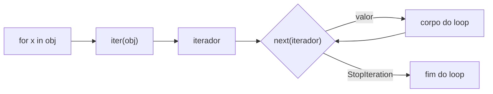
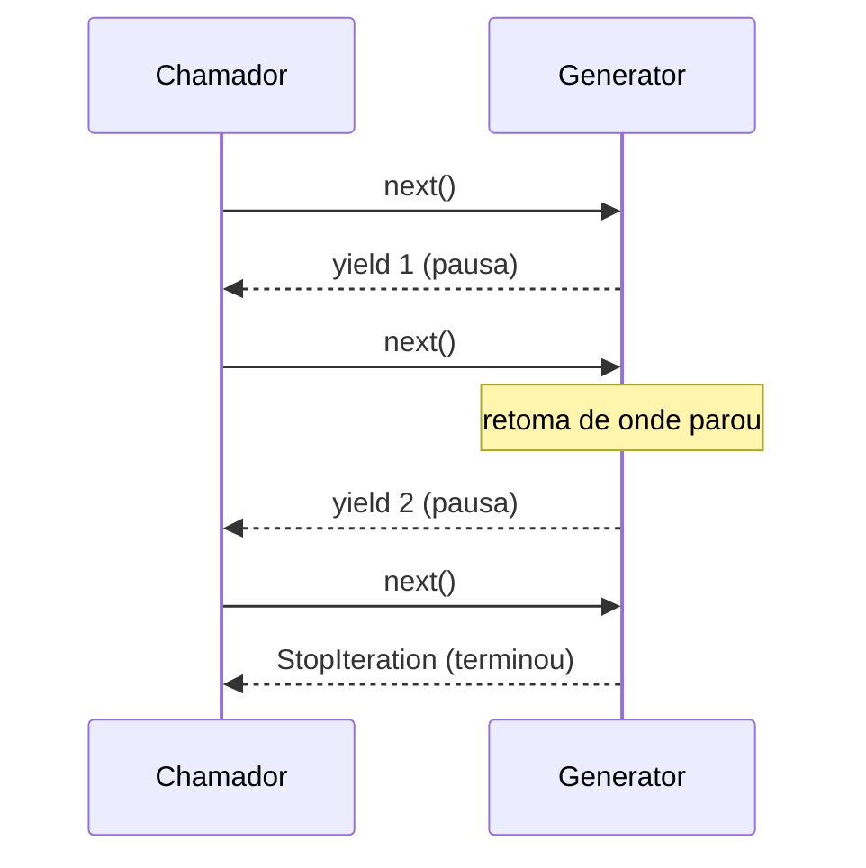

# 🔁 Generators e Iterators

> [!note] Onde estamos
> Você já usou `for` em listas, strings, dicionários e arquivos ([[02 - Controle de Fluxo e Estruturas de Dados/02 - Loops for e while|Loops]]). Agora vamos entender **o que acontece por baixo** e como criar suas próprias sequências *preguiçosas* (lazy), que produzem valores sob demanda e gastam quase nenhuma memória.

## 1. Iterável vs. Iterador

São dois conceitos diferentes:

| Conceito | Protocolo | O que faz | Exemplos |
|---|---|---|---|
| **Iterável** (*iterable*) | `__iter__()` | Sabe **devolver** um iterador | `list`, `str`, `dict`, `set`, `range`, arquivos |
| **Iterador** (*iterator*) | `__iter__()` + `__next__()` | Sabe **entregar o próximo** valor e lembra onde parou | `iter([1,2,3])`, generators, `map`, `zip` |

> [!tip] Analogia
> Um **iterável** é um livro. Um **iterador** é o marcador de página: ele sabe em que página você está e vai para a próxima. Você pode ter vários marcadores no mesmo livro.



### O `for` desmontado

```python
numeros = [10, 20, 30]

# O que o for faz por você:
it = iter(numeros)          # chama numeros.__iter__()
while True:
    try:
        x = next(it)        # chama it.__next__()
    except StopIteration:
        break
    print(x)
```

> [!example] No REPL
> ```python
> >>> it = iter("ab")
> >>> next(it)
> 'a'
> >>> next(it)
> 'b'
> >>> next(it)
> Traceback (most recent call last):
> StopIteration
> >>> next(it, "acabou")   # valor padrão evita a exceção
> 'acabou'
> ```

> [!warning] Iteradores se esgotam
> ```python
> it = iter([1, 2, 3])
> print(list(it))   # [1, 2, 3]
> print(list(it))   # []  ← já foi consumido!
> ```
> Uma `list` pode ser percorrida várias vezes; um iterador, **uma só**.

## 2. Criando um iterador "na mão"

```python
class Contagem:
    """Conta de inicio até fim (inclusive)."""

    def __init__(self, inicio: int, fim: int):
        self.atual = inicio
        self.fim = fim

    def __iter__(self):
        return self                      # ele mesmo é o iterador

    def __next__(self) -> int:
        if self.atual > self.fim:
            raise StopIteration          # sinal de fim
        valor = self.atual
        self.atual += 1
        return valor


for n in Contagem(1, 3):
    print(n)          # 1 2 3
```

Funciona, mas é **verboso**. Para isso existem os generators.

> [!warning] Pegadinha: iterável que é seu próprio iterador
> A classe acima só pode ser percorrida **uma vez**. Se quiser reuso, `__iter__` deve devolver um **novo** iterador a cada chamada:
> ```python
> class Intervalo:
>     def __init__(self, a, b):
>         self.a, self.b = a, b
>
>     def __iter__(self):                 # generator: novo a cada for
>         atual = self.a
>         while atual <= self.b:
>             yield atual
>             atual += 1
>
> r = Intervalo(1, 3)
> print(list(r), list(r))   # [1, 2, 3] [1, 2, 3] ✅
> ```

## 3. Generators com `yield`

Uma função com `yield` vira uma **função geradora**: chamá-la **não executa o corpo**, apenas devolve um generator (que é um iterador).

```python
def contagem(inicio, fim):
    atual = inicio
    while atual <= fim:
        yield atual          # entrega e PAUSA aqui
        atual += 1

g = contagem(1, 3)
print(type(g))      # <class 'generator'>
print(next(g))      # 1
print(next(g))      # 2
print(next(g))      # 3
# next(g) → StopIteration
```



> [!tip] Use o debugger!
> Coloque um `breakpoint()` dentro de um generator e avance com `n` (next). Você verá a execução **pausar e retomar** no `yield`, com as variáveis locais preservadas.

### `return` vs `yield`

| | `return` | `yield` |
|---|---|---|
| Quantidade de valores | 1 | vários, um por vez |
| Estado local | descartado | **preservado** entre chamadas |
| Memória | tudo de uma vez | sob demanda |

### Ver o laziness acontecendo

```python
def verboso():
    print("início")
    yield 1
    print("meio")
    yield 2
    print("fim")

g = verboso()      # nada impresso ainda!
print("criado")
print(next(g))     # início / 1
print(next(g))     # meio / 2
```

## 4. Por que usar? Memória e infinito

```python
import sys

lista = [x * x for x in range(1_000_000)]
gen   = (x * x for x in range(1_000_000))     # generator expression

print(sys.getsizeof(lista))   # ~8 MB
print(sys.getsizeof(gen))     # ~200 bytes
```

### Sequências infinitas

```python
def fibonacci():
    a, b = 0, 1
    while True:              # infinito, mas tudo bem: é lazy
        yield a
        a, b = b, a + b

from itertools import islice
print(list(islice(fibonacci(), 10)))   # [0, 1, 1, 2, 3, 5, 8, 13, 21, 34]
```

> [!warning] ❌ Nunca faça `list()` de um generator infinito
> ```python
> list(fibonacci())   # ❌ trava o computador consumindo memória
> ```
> ✅ Use `islice`, `takewhile` ou um `break`.

## 5. Generator expressions

Mesma sintaxe da list comprehension, com **parênteses**:

```python
quadrados = (x * x for x in range(10))
print(sum(quadrados))          # 285  (parênteses extras podem sumir em chamadas)
print(any(x > 5 for x in range(10)))
```

| Sintaxe | Resultado | Memória |
|---|---|---|
| `[x for x in ...]` | `list` | tudo |
| `{x for x in ...}` | `set` | tudo |
| `{k: v for ...}` | `dict` | tudo |
| `(x for x in ...)` | `generator` | **1 item** |

## 6. Lendo arquivos gigantes

```python
from collections.abc import Iterator
from pathlib import Path


def linhas_com_erro(caminho: Path) -> Iterator[str]:
    with caminho.open(encoding="utf-8") as f:
        for linha in f:                     # arquivo já é iterador lazy
            if "ERROR" in linha:
                yield linha.rstrip()

for l in linhas_com_erro(Path("app.log")):
    print(l)
```

Um log de 20 GB é processado com poucos KB de RAM. Veja também [[05 - Tratamento de Erros e Arquivos/03 - Arquivos Texto CSV e JSON|Trabalhando com Arquivos]].

## 7. `yield from`: delegando

```python
def achatar(estrutura):
    for item in estrutura:
        if isinstance(item, list):
            yield from achatar(item)     # delega ao sub-generator
        else:
            yield item

print(list(achatar([1, [2, [3, 4]], 5])))   # [1, 2, 3, 4, 5]
```

`yield from x` equivale a `for i in x: yield i`, mas também repassa `send`, `throw` e o valor de `return`.

## 8. Generators como pipelines

```python
def ler(linhas):
    for l in linhas:
        yield l.strip()

def nao_vazias(linhas):
    return (l for l in linhas if l)

def para_int(linhas):
    return (int(l) for l in linhas)

dados = ["10", " 20 ", "", "30"]
total = sum(para_int(nao_vazias(ler(dados))))
print(total)   # 60
```

Cada item passa por **todas** as etapas antes do próximo ser lido: sem listas intermediárias. Compare com [[07 - Programação Funcional e Intermediário/02 - Lambda map filter reduce|map/filter]].

## 9. Recursos avançados: `send`, `throw`, `close`

```python
def media_movel():
    total, n = 0.0, 0
    media = None
    while True:
        valor = yield media          # recebe via send()
        total += valor
        n += 1
        media = total / n

m = media_movel()
next(m)              # "prepara" o generator até o primeiro yield
print(m.send(10))    # 10.0
print(m.send(20))    # 15.0
print(m.send(60))    # 30.0
m.close()            # levanta GeneratorExit dentro dele
```

| Método | Efeito |
|---|---|
| `next(g)` | retoma, entrega o próximo valor |
| `g.send(v)` | retoma, e `yield` **vira** `v` |
| `g.throw(Exc)` | levanta `Exc` no ponto do `yield` |
| `g.close()` | encerra com `GeneratorExit` |

> [!note] `send` é a base das corrotinas antigas
> O `async/await` moderno ([[08 - Avançado/02 - Asyncio|Asyncio]]) evoluiu desta ideia.

### `return` em generator

```python
def com_retorno():
    yield 1
    return "fim"      # vira o .value de StopIteration

def wrapper():
    resultado = yield from com_retorno()
    print("recebi:", resultado)   # recebi: fim
    yield 2
```

## 10. `itertools`: a caixa de ferramentas

Já vimos em [[06 - Módulos da Biblioteca Padrão Essenciais/03 - collections itertools e functools|collections, itertools e functools]]. Aqui, o essencial para iteradores:

```python
from itertools import count, cycle, islice, chain, takewhile, batched, pairwise, tee

print(list(islice(count(10, 5), 4)))            # [10, 15, 20, 25]
print(list(islice(cycle("AB"), 5)))             # ['A','B','A','B','A']
print(list(chain([1, 2], "ab")))                # [1, 2, 'a', 'b']
print(list(takewhile(lambda x: x < 3, count())))# [0, 1, 2]
print(list(batched(range(7), 3)))               # [(0,1,2), (3,4,5), (6,)]  (3.12+)
print(list(pairwise([1, 4, 9, 16])))            # [(1,4), (4,9), (9,16)]
```

> [!tip] `batched` (Python 3.12+)
> Perfeito para enviar dados em lotes (APIs, bancos). Antes era preciso escrever o laço manualmente.

## 11. Pegadinhas comuns

> [!warning] 1. Reutilizar generator esgotado
> ```python
> g = (x for x in range(3))
> print(sum(g))   # 3
> print(sum(g))   # 0  ❌ já consumido
> ```
> ✅ Recrie o generator, ou use uma lista se precisar percorrer mais de uma vez.

> [!warning] 2. `len()` e indexação não funcionam
> ```python
> g = (x for x in range(3))
> len(g)     # ❌ TypeError
> g[0]       # ❌ TypeError
> ```
> ✅ `list(g)` se realmente precisar (e souber que cabe na memória).

> [!warning] 3. Variável de loop em generator expression (late binding)
> ```python
> fs = [(lambda: i) for i in range(3)]
> print([f() for f in fs])    # ❌ [2, 2, 2]
> fs = [(lambda i=i: i) for i in range(3)]
> print([f() for f in fs])    # ✅ [0, 1, 2]
> ```

> [!warning] 4. Esquecer `StopIteration` dentro de generator
> Desde o Python 3.7, levantar `StopIteration` dentro de um generator vira `RuntimeError`. Use `return`.

> [!warning] 5. `with` + generator
> Se um generator abre um recurso e o consumidor para no meio, o recurso só fecha quando o generator for finalizado. Use `contextlib.closing(gen)` ou consuma tudo.

## 12. Quando usar o quê

| Situação | Use |
|---|---|
| Coleção pequena, vai reusar/indexar | `list` |
| Pipeline de transformação, uma passada | generator expression |
| Lógica complexa com estado | função geradora (`yield`) |
| Fluxo infinito | generator + `islice` |
| Reuso múltiplo da mesma sequência | classe iterável com `__iter__` que é generator |

## 13. Exercícios

> [!question] Exercício 1 – Pares
> Escreva `pares(limite)` que gera os pares de 0 até `limite`.

> [!success]- Solução
> ```python
> def pares(limite):
>     for n in range(0, limite + 1, 2):
>         yield n
>
> print(list(pares(10)))   # [0, 2, 4, 6, 8, 10]
> ```

> [!question] Exercício 2 – Primos infinitos
> Crie um generator `primos()` infinito e pegue os 10 primeiros com `islice`.

> [!success]- Solução
> ```python
> from itertools import islice, count
>
> def primos():
>     for n in count(2):
>         if all(n % d for d in range(2, int(n ** 0.5) + 1)):
>             yield n
>
> print(list(islice(primos(), 10)))
> # [2, 3, 5, 7, 11, 13, 17, 19, 23, 29]
> ```

> [!question] Exercício 3 – Pipeline de log
> Dada uma lista de linhas `"INFO|ok"`, `"ERROR|falha"`, gere apenas mensagens de erro em maiúsculas, usando generators encadeados.

> [!success]- Solução
> ```python
> linhas = ["INFO|ok", "ERROR|falha", "ERROR|disco", "INFO|fim"]
>
> partes = (l.split("|") for l in linhas)
> erros  = (msg.upper() for nivel, msg in partes if nivel == "ERROR")
> print(list(erros))   # ['FALHA', 'DISCO']
> ```

> [!question] Exercício 4 – Janela deslizante
> Implemente `janela(seq, n)` que gera tuplas de `n` elementos consecutivos.

> [!success]- Solução
> ```python
> from collections import deque
> from itertools import islice
>
> def janela(seq, n):
>     it = iter(seq)
>     w = deque(islice(it, n), maxlen=n)
>     if len(w) == n:
>         yield tuple(w)
>     for x in it:
>         w.append(x)
>         yield tuple(w)
>
> print(list(janela([1, 2, 3, 4, 5], 3)))
> # [(1,2,3), (2,3,4), (3,4,5)]
> ```

> [!question] Exercício 5 – Iterável reutilizável
> Crie a classe `Countdown(n)` que pode ser percorrida várias vezes (`5, 4, ..., 1`).

> [!success]- Solução
> ```python
> class Countdown:
>     def __init__(self, n):
>         self.n = n
>
>     def __iter__(self):
>         yield from range(self.n, 0, -1)
>
> c = Countdown(3)
> print(list(c), list(c))   # [3, 2, 1] [3, 2, 1]
> ```

---

⬅️ [[07 - Programação Funcional e Intermediário/03 - Decorators|Decorators]] | ➡️ [[07 - Programação Funcional e Intermediário/05 - Context Managers Avançados|Context Managers Avançados]]

#python #intermediario #generators #iterators #yield #lazy #itertools
