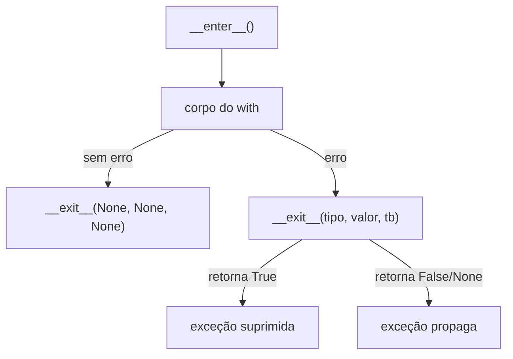

# 🧰 Context Managers Avançados

> [!note] Revisão rápida
> Em [[05 - Tratamento de Erros e Arquivos/04 - Context Managers com with|Context Managers]] você viu o básico do `with`. Aqui vamos além: `@contextmanager`, `ExitStack`, reentrância, uso como decorator, `async with` e padrões do dia a dia.

## 1. O protocolo

```python
with expr as nome:
    corpo
```

é, essencialmente:

```python
mgr = expr
nome = mgr.__enter__()
try:
    corpo
except BaseException as exc:
    if not mgr.__exit__(type(exc), exc, exc.__traceback__):
        raise                     # não suprimiu → propaga
else:
    mgr.__exit__(None, None, None)
```



### Versão em classe

```python
import time

class Cronometro:
    def __enter__(self):
        self.inicio = time.perf_counter()
        return self

    def __exit__(self, exc_type, exc, tb):
        self.duracao = time.perf_counter() - self.inicio
        print(f"levou {self.duracao:.4f}s")
        return False          # nunca suprime exceções

with Cronometro() as c:
    sum(range(1_000_000))
```

> [!warning] Pegadinha: `return True` em `__exit__`
> Retornar valor *truthy* **engole** a exceção. Faça isso só de propósito.
> ```python
> class Silencia:
>     def __enter__(self): return self
>     def __exit__(self, *a): return True    # ❌ esconde qualquer bug
> ```

## 2. `@contextmanager`: com generator

Muito mais curto:

```python
from contextlib import contextmanager
import time

@contextmanager
def cronometro(rotulo: str):
    inicio = time.perf_counter()
    try:
        yield                        # corpo do with roda aqui
    finally:                         # sempre executa
        dur = time.perf_counter() - inicio
        print(f"{rotulo}: {dur:.4f}s")

with cronometro("soma"):
    sum(range(1_000_000))
```

### Entregando um valor

```python
from pathlib import Path

@contextmanager
def abrir_ou_criar(caminho: Path):
    caminho.touch(exist_ok=True)
    f = caminho.open("a+", encoding="utf-8")
    try:
        yield f                       # vira "as f"
    finally:
        f.close()
```

> [!warning] ❌ Sem `try/finally` o cleanup não roda em caso de erro
> ```python
> @contextmanager
> def ruim():
>     print("abre")
>     yield
>     print("fecha")        # ❌ não roda se o corpo levantar exceção
>
> @contextmanager
> def bom():
>     print("abre")
>     try:
>         yield
>     finally:
>         print("fecha")    # ✅ sempre
> ```

### Suprimindo exceções específicas

```python
@contextmanager
def ignorar(*excecoes):
    try:
        yield
    except excecoes:
        pass

with ignorar(FileNotFoundError):
    open("nao_existe.txt")
```

A biblioteca padrão já tem isso pronto: `contextlib.suppress`.

## 3. Ferramentas prontas do `contextlib`

| Ferramenta | Para quê |
|---|---|
| `suppress(*exc)` | ignora exceções específicas |
| `redirect_stdout(f)` / `redirect_stderr(f)` | captura `print` |
| `closing(obj)` | chama `.close()` ao sair |
| `nullcontext(x)` | "context manager" que não faz nada (opcional) |
| `chdir(path)` | muda de diretório temporariamente (3.11+) |
| `ExitStack` | empilha N context managers dinamicamente |
| `ContextDecorator` | usar o mesmo objeto como `with` **e** decorator |
| `aclosing`, `asynccontextmanager` | versões assíncronas |

```python
import io
from contextlib import redirect_stdout, suppress, chdir, nullcontext

buf = io.StringIO()
with redirect_stdout(buf):
    print("capturado")
print(repr(buf.getvalue()))        # 'capturado\n'

with suppress(KeyError):
    {}["x"]

with chdir("/tmp"):
    ...                             # cwd = /tmp só aqui dentro

# nullcontext: lock opcional
def processar(lock=None):
    with lock or nullcontext():
        ...
```

## 4. `ExitStack`: quantidade dinâmica

Como abrir **N arquivos** sem N `with` aninhados?

```python
from contextlib import ExitStack
from pathlib import Path

caminhos = [Path("a.txt"), Path("b.txt"), Path("c.txt")]

with ExitStack() as stack:
    arquivos = [stack.enter_context(p.open(encoding="utf-8")) for p in caminhos]
    for f in arquivos:
        print(f.readline())
# todos fechados ao sair, na ordem inversa (LIFO)
```

### `callback` e `push`

```python
with ExitStack() as stack:
    stack.callback(print, "limpeza 1")
    stack.callback(print, "limpeza 2")
    print("trabalho")
# trabalho / limpeza 2 / limpeza 1
```

### Cleanup condicional com `pop_all`

```python
def abrir_todos(caminhos):
    with ExitStack() as stack:
        arqs = [stack.enter_context(open(c)) for c in caminhos]
        # se algo falhar acima, todos fecham automaticamente
        # se der certo, transferimos a responsabilidade:
        return arqs, stack.pop_all()

arqs, fechador = abrir_todos(["a.txt", "b.txt"])
...
fechador.close()     # fecha tudo depois
```

## 5. Reentrância e reuso

| Tipo | Pode usar o **mesmo objeto** em `with` aninhado? |
|---|---|
| `@contextmanager` | ❌ uma vez só (generator esgota) |
| `suppress`, `redirect_stdout`, `ExitStack` | ✅ reentrantes/reusáveis |
| Classe sua | depende do que `__enter__` guarda em `self` |

```python
from contextlib import contextmanager

@contextmanager
def cm():
    yield

c = cm()
with c: pass
with c: pass      # ❌ RuntimeError: generator didn't yield
```

✅ Chame a *função* de novo: `with cm(): ...`

## 6. Context manager que também é decorator

```python
from contextlib import ContextDecorator
import time

class medir(ContextDecorator):
    def __init__(self, rotulo):
        self.rotulo = rotulo

    def __enter__(self):
        self.t = time.perf_counter()
        return self

    def __exit__(self, *exc):
        print(f"{self.rotulo}: {time.perf_counter() - self.t:.4f}s")
        return False

@medir("calculo")           # como decorator
def calcular():
    return sum(range(10**6))

with medir("bloco"):        # como with
    calcular()
```

> [!tip] `@contextmanager` já faz isso
> Funções criadas com `@contextmanager` também podem ser usadas como decorator: `@cronometro("x")`.
> Ver [[07 - Programação Funcional e Intermediário/03 - Decorators|Decorators]].

## 7. Padrões úteis

### Transação / rollback

```python
@contextmanager
def transacao(conn):
    try:
        yield conn
        conn.commit()
    except Exception:
        conn.rollback()
        raise
```

(`sqlite3.Connection` já funciona assim como context manager: commit/rollback, **mas não fecha** a conexão! Veja [[09 - Projetos Práticos/Projeto 07 - Login com SQLite|Projeto 07]].)

### Mudar configuração temporariamente

```python
import os
from contextlib import contextmanager

@contextmanager
def env(**vars):
    antigo = {k: os.environ.get(k) for k in vars}
    os.environ.update(vars)
    try:
        yield
    finally:
        for k, v in antigo.items():
            if v is None:
                os.environ.pop(k, None)
            else:
                os.environ[k] = v

with env(DEBUG="1"):
    ...
```

### Arquivo temporário

```python
import tempfile
from pathlib import Path

with tempfile.TemporaryDirectory() as d:
    p = Path(d) / "x.txt"
    p.write_text("oi")
# diretório removido
```

### Lock

```python
import threading
lock = threading.Lock()

with lock:             # acquire/release automáticos
    ...
```

## 8. Tratando exceções dentro do manager

```python
class Tolerante:
    def __enter__(self):
        return self

    def __exit__(self, exc_type, exc, tb):
        if exc_type is ValueError:
            print(f"ignorando: {exc}")
            return True                   # suprime só ValueError
        return False                      # outras propagam

with Tolerante():
    int("abc")                            # ignorado
print("continua")

with Tolerante():
    1 / 0                                 # ZeroDivisionError propaga
```

> [!tip] ExceptionGroup (3.11+)
> Em `__exit__`, `exc` pode ser um `ExceptionGroup`. Use `exc.split(...)`/`except*` fora do `with` para tratar cada tipo.

## 9. Async context managers

Para recursos assíncronos (conexões, sessões HTTP):

```python
import asyncio
from contextlib import asynccontextmanager

@asynccontextmanager
async def conexao(nome):
    print(f"abrindo {nome}")
    try:
        yield nome.upper()
    finally:
        await asyncio.sleep(0)       # cleanup assíncrono
        print(f"fechando {nome}")

async def main():
    async with conexao("db") as c:
        print("usando", c)

asyncio.run(main())
```

Em classe: `__aenter__` e `__aexit__` (ambos `async def`). Também existe `AsyncExitStack`. Mergulhe em [[08 - Avançado/02 - Asyncio|Asyncio]].

## 10. Parênteses em `with` (3.10+)

```python
with (
    open("entrada.txt", encoding="utf-8") as ent,
    open("saida.txt", "w", encoding="utf-8") as sai,
):
    sai.write(ent.read().upper())
```

## 11. Comparação

| Abordagem | Quando |
|---|---|
| Classe com `__enter__/__exit__` | estado complexo, reuso, herança |
| `@contextmanager` | 90% dos casos simples |
| `ExitStack` | quantidade dinâmica de recursos |
| `ContextDecorator` | precisa servir como decorator também |
| `try/finally` | cleanup único e pontual |

## 12. Pegadinhas

> [!warning] 1. `as` recebe o retorno de `__enter__`, não o objeto
> ```python
> class A:
>     def __enter__(self): return 42
>     def __exit__(self, *a): ...
> with A() as x:
>     print(x)   # 42, não A
> ```

> [!warning] 2. `yield` duplo em `@contextmanager`
> Só pode haver **um** `yield`.

> [!warning] 3. `return` dentro do `with` ainda executa `__exit__`
> ✅ É o comportamento desejado, mas muita gente duvida. Teste no REPL.

> [!warning] 4. Esquecer de re-levantar
> Em `@contextmanager`, se você captura a exceção com `except` e não faz `raise`, ela é **suprimida**.

## 13. Exercícios

> [!question] Exercício 1 – `temporario`
> Crie um context manager `temporario(obj, atributo, valor)` que altera um atributo e restaura ao sair.

> [!success]- Solução
> ```python
> from contextlib import contextmanager
>
> @contextmanager
> def temporario(obj, attr, valor):
>     antigo = getattr(obj, attr)
>     setattr(obj, attr, valor)
>     try:
>         yield obj
>     finally:
>         setattr(obj, attr, antigo)
>
> class Cfg: debug = False
> with temporario(Cfg, "debug", True):
>     print(Cfg.debug)   # True
> print(Cfg.debug)       # False
> ```

> [!question] Exercício 2 – Indentação de logs
> Crie `indentar()` que faz todo `print` dentro do bloco receber 4 espaços à esquerda (dica: `redirect_stdout` com uma classe de escrita).

> [!success]- Solução
> ```python
> import sys
> from contextlib import contextmanager, redirect_stdout
>
> class Indent:
>     def __init__(self, destino, prefixo="    "):
>         self.destino, self.prefixo, self.inicio = destino, prefixo, True
>     def write(self, texto):
>         for parte in texto.splitlines(keepends=True):
>             if self.inicio:
>                 self.destino.write(self.prefixo)
>             self.destino.write(parte)
>             self.inicio = parte.endswith("\n")
>     def flush(self):
>         self.destino.flush()
>
> @contextmanager
> def indentar():
>     with redirect_stdout(Indent(sys.stdout)):
>         yield
>
> print("fora")
> with indentar():
>     print("dentro")
> ```

> [!question] Exercício 3 – Retry com context manager
> Escreva uma classe `Tentar(vezes)` usada como iterador que, em um `for tentativa in Tentar(3)` + `with tentativa:`, repete até dar certo. *(Desafio)*

> [!success]- Solução (uma versão simples)
> ```python
> from contextlib import contextmanager
>
> def tentar(vezes):
>     sucesso = False
>
>     @contextmanager
>     def tentativa(n):
>         nonlocal sucesso
>         try:
>             yield
>             sucesso = True
>         except Exception as e:
>             print(f"tentativa {n} falhou: {e}")
>             if n == vezes:
>                 raise
>
>     for n in range(1, vezes + 1):
>         if sucesso:
>             return
>         yield tentativa(n)
>
> import random
> for t in tentar(5):
>     with t:
>         if random.random() < 0.7:
>             raise RuntimeError("falha")
>         print("ok!")
> ```

> [!question] Exercício 4 – ExitStack
> Dado `["a.txt", "b.txt"]`, abra todos, concatene o conteúdo e escreva em `junto.txt`, com um único `with`.

> [!success]- Solução
> ```python
> from contextlib import ExitStack
>
> nomes = ["a.txt", "b.txt"]
> with ExitStack() as stack, open("junto.txt", "w", encoding="utf-8") as out:
>     for n in nomes:
>         f = stack.enter_context(open(n, encoding="utf-8"))
>         out.write(f.read())
> ```

---

⬅️ [[07 - Programação Funcional e Intermediário/04 - Generators e Iterators|Generators e Iterators]] | ➡️ [[07 - Programação Funcional e Intermediário/06 - Type Hints e typing|Type Hints e `typing`]]

#python #intermediario #context-managers #contextlib #with #exitstack
