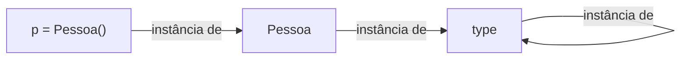
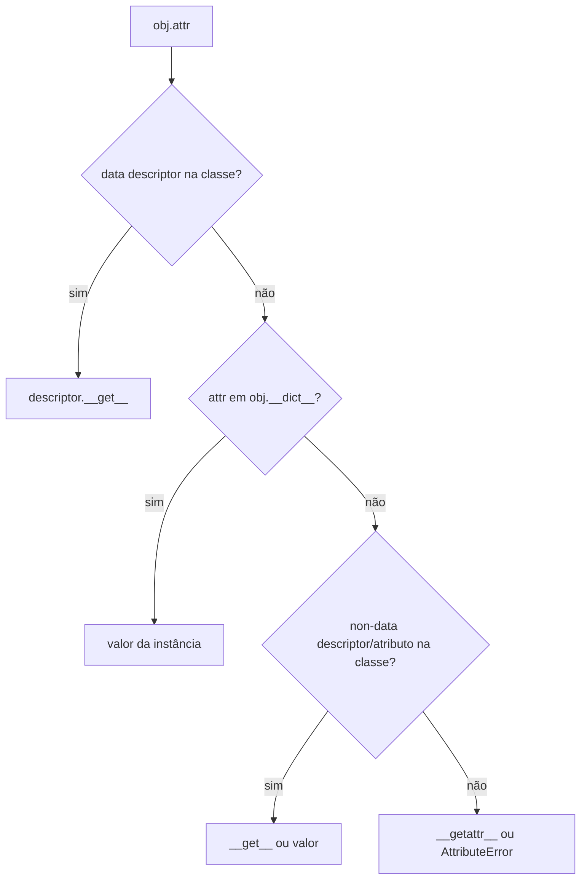
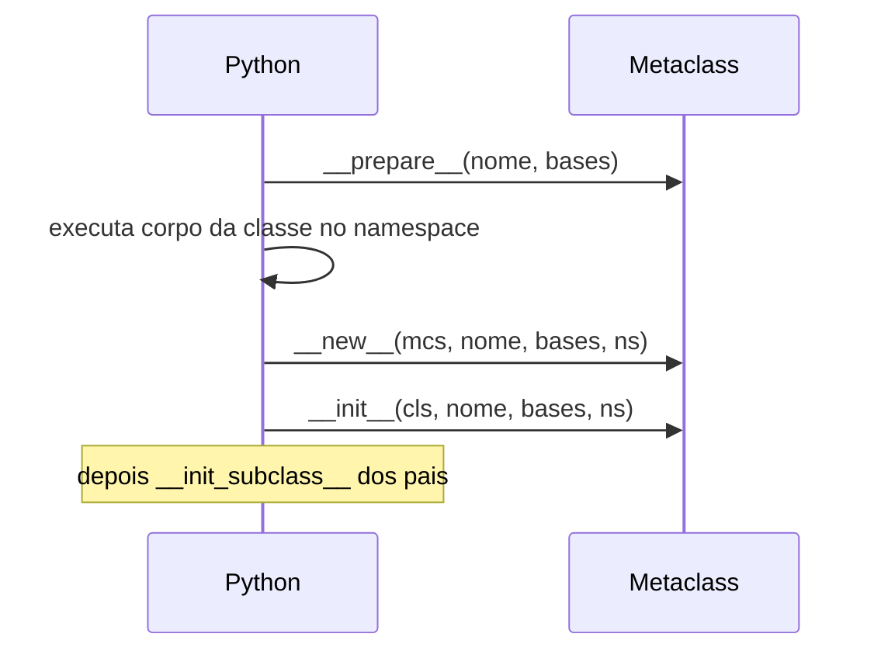

# 🪄 Metaprogramação: Metaclasses e Descriptors

> [!note] O que é
> Metaprogramação é escrever código que **manipula código**: criar classes dinamicamente, interceptar acesso a atributos, validar definições de classe. Em Python, tudo é objeto, inclusive classes, e isso torna o assunto natural.

> [!warning] Use com moderação
> *"Metaclasses são magia profunda; 99% dos usuários nunca precisam delas."* (Tim Peters). Antes de usar uma metaclass, tente: função, decorator de classe, `__init_subclass__` ou descriptor.

## 1. Classes são objetos

```python
class Pessoa: ...

print(type(Pessoa))        # <class 'type'>
print(type(Pessoa()))      # <class '__main__.Pessoa'>
print(type(type))          # <class 'type'>  ← type é instância de si mesmo
```



### Criando classe com `type()`

```python
def saudar(self):
    return f"Oi, {self.nome}"

Pessoa = type("Pessoa", (object,), {"nome": "Ana", "saudar": saudar})
print(Pessoa().saudar())    # Oi, Ana
```

`class X: ...` é açúcar sintático para `type("X", bases, namespace)`.

## 2. Introspecção e reflexão

```python
class A:
    x = 1
    def m(self): ...

a = A()
print(dir(a))                   # nomes disponíveis
print(vars(a), a.__dict__)      # atributos da instância
print(getattr(a, "x"))
setattr(a, "y", 2)
print(hasattr(a, "y"))
print(A.__mro__)                # ordem de resolução de métodos
print(A.__annotations__)
import inspect
print(inspect.signature(A.m))
print(inspect.getsource(A))
```

## 3. Hooks de acesso a atributos

| Método | Quando é chamado |
|---|---|
| `__getattribute__(self, nome)` | **todo** acesso a atributo |
| `__getattr__(self, nome)` | só se o atributo **não foi achado** |
| `__setattr__(self, nome, v)` | toda atribuição |
| `__delattr__(self, nome)` | `del obj.attr` |

```python
class Proxy:
    def __init__(self, alvo):
        object.__setattr__(self, "_alvo", alvo)

    def __getattr__(self, nome):
        print(f"acessando {nome}")
        return getattr(self._alvo, nome)

p = Proxy([3, 1, 2])
p.sort()           # acessando sort
```

> [!warning] ❌ Recursão infinita
> ```python
> class Ruim:
>     def __setattr__(self, k, v):
>         self.__dict__[k] = v   # ok
>         self.k = v             # ❌ chama __setattr__ de novo!
> ```
> ✅ Use `super().__setattr__(k, v)` ou `object.__setattr__`.

## 4. Descriptors

Um **descriptor** é um objeto com `__get__`, `__set__` e/ou `__delete__`, colocado como **atributo de classe**. É o mecanismo por trás de `property`, `classmethod`, `staticmethod` e métodos.

```python
class Positivo:
    """Descriptor de dados que só aceita números positivos."""

    def __set_name__(self, dono, nome):
        self.nome = f"_{nome}"

    def __get__(self, obj, tipo=None):
        if obj is None:
            return self                      # acesso pela classe
        return getattr(obj, self.nome)

    def __set__(self, obj, valor):
        if valor <= 0:
            raise ValueError(f"{self.nome[1:]} deve ser positivo")
        setattr(obj, self.nome, valor)


class Produto:
    preco = Positivo()
    quantidade = Positivo()

    def __init__(self, preco, quantidade):
        self.preco = preco
        self.quantidade = quantidade

p = Produto(10, 2)
p.preco = -5       # ValueError: preco deve ser positivo
```

### Data vs. non-data descriptor

| Tipo | Define | Prioridade |
|---|---|---|
| **Data descriptor** | `__get__` + `__set__` | **vence** o `__dict__` da instância |
| **Non-data descriptor** | só `__get__` | o `__dict__` da instância vence |

Funções são non-data descriptors: por isso `obj.metodo` vira *bound method*.



### `property` por baixo dos panos

```python
class MinhaProperty:
    def __init__(self, fget):
        self.fget = fget
    def __get__(self, obj, tipo=None):
        return self if obj is None else self.fget(obj)
```

Veja [[04 - Programação Orientada a Objetos/04 - Propriedades e Métodos Mágicos|Propriedades]]. E um descriptor *cacheado* (`functools.cached_property` faz isso).

## 5. `__init_subclass__`: o jeito simples

Muitas vezes substitui uma metaclass:

```python
class Plugin:
    registro: dict[str, type] = {}

    def __init_subclass__(cls, /, nome=None, **kw):
        super().__init_subclass__(**kw)
        Plugin.registro[nome or cls.__name__.lower()] = cls

class CSV(Plugin, nome="csv"): ...
class JSON(Plugin): ...

print(Plugin.registro)   # {'csv': <class 'CSV'>, 'json': <class 'JSON'>}
```

## 6. Metaclasses

Uma metaclass é a "classe da classe". Customiza **a criação de classes**.

```python
class MetaSingleton(type):
    _instancias = {}

    def __call__(cls, *args, **kwargs):
        if cls not in cls._instancias:
            cls._instancias[cls] = super().__call__(*args, **kwargs)
        return cls._instancias[cls]

class Config(metaclass=MetaSingleton):
    def __init__(self):
        print("criando Config")

a, b = Config(), Config()     # imprime uma vez
print(a is b)                 # True
```

### `__new__` da metaclass: validar a definição

```python
class MetaObrigaDoc(type):
    def __new__(mcs, nome, bases, ns):
        for attr, valor in ns.items():
            if callable(valor) and not attr.startswith("_") and not valor.__doc__:
                raise TypeError(f"{nome}.{attr} precisa de docstring")
        return super().__new__(mcs, nome, bases, ns)

class Ok(metaclass=MetaObrigaDoc):
    def f(self):
        """doc"""

class Ruim(metaclass=MetaObrigaDoc):
    def g(self): ...        # TypeError
```

### `__prepare__`

Define o *namespace* usado ao executar o corpo da classe (ex: `OrderedDict`, detectar duplicatas).

### Ordem de criação



## 7. Exemplo: mini-ORM com descriptors + metaclass

```python
class Campo:
    def __init__(self, tipo):
        self.tipo = tipo
    def __set_name__(self, dono, nome):
        self.nome = nome
    def __get__(self, obj, t=None):
        return self if obj is None else obj.__dict__[self.nome]
    def __set__(self, obj, v):
        if not isinstance(v, self.tipo):
            raise TypeError(f"{self.nome}: esperado {self.tipo.__name__}")
        obj.__dict__[self.nome] = v

class MetaModelo(type):
    def __new__(mcs, nome, bases, ns):
        cls = super().__new__(mcs, nome, bases, ns)
        cls._campos = [k for k, v in ns.items() if isinstance(v, Campo)]
        return cls

class Modelo(metaclass=MetaModelo):
    def __init__(self, **kw):
        for k, v in kw.items():
            setattr(self, k, v)
    def __repr__(self):
        vals = ", ".join(f"{c}={getattr(self, c)!r}" for c in self._campos)
        return f"{type(self).__name__}({vals})"

class Usuario(Modelo):
    nome = Campo(str)
    idade = Campo(int)

print(Usuario(nome="Ana", idade=30))   # Usuario(nome='Ana', idade=30)
Usuario(nome="Ana", idade="x")         # TypeError
```

## 8. Outras ferramentas

| Ferramenta | Uso |
|---|---|
| `__slots__` | economiza memória, restringe atributos ([[04 - Programação Orientada a Objetos/05 - Dataclasses e Slots\|Slots]]) |
| `exec` / `eval` / `compile` | executar código dinâmico (⚠️ perigoso) |
| `ast` | analisar/modificar árvore sintática |
| `types.new_class`, `types.SimpleNamespace` | criação dinâmica |
| `sys.modules`, `importlib` | import dinâmico, hooks |

> [!warning] ❌ `eval` com entrada do usuário
> `eval(input())` executa **qualquer** código. ✅ Use `ast.literal_eval` para literais.

## 9. Quando usar o quê

| Necessidade | Ferramenta |
|---|---|
| Validar/transformar **um atributo** | `property` ou descriptor |
| Reutilizar a validação em vários atributos | descriptor |
| Registrar subclasses | `__init_subclass__` |
| Alterar classe após criação | decorator de classe ([[07 - Programação Funcional e Intermediário/03 - Decorators\|Decorators]]) |
| Controlar **instanciação** ou **criação da classe** | metaclass |

## 10. Exercícios

> [!question] 1. Crie dinamicamente com `type()` uma classe `Ponto` com `x`, `y` e método `norma`.

> [!success]- Solução
> ```python
> Ponto = type("Ponto", (), {
>     "__init__": lambda self, x, y: (setattr(self, "x", x), setattr(self, "y", y))[0],
>     "norma": lambda self: (self.x**2 + self.y**2) ** 0.5,
> })
> print(Ponto(3, 4).norma())   # 5.0
> ```

> [!question] 2. Descriptor `Limitado(min, max)` que valida faixa.

> [!success]- Solução
> ```python
> class Limitado:
>     def __init__(self, minimo, maximo):
>         self.min, self.max = minimo, maximo
>     def __set_name__(self, dono, nome):
>         self.nome = "_" + nome
>     def __get__(self, obj, t=None):
>         return self if obj is None else getattr(obj, self.nome)
>     def __set__(self, obj, v):
>         if not self.min <= v <= self.max:
>             raise ValueError(f"{self.nome[1:]} fora de [{self.min}, {self.max}]")
>         setattr(obj, self.nome, v)
>
> class Termostato:
>     temp = Limitado(10, 30)
> ```

> [!question] 3. Com `__init_subclass__`, exija que subclasses de `Base` definam o atributo `nome`.

> [!success]- Solução
> ```python
> class Base:
>     def __init_subclass__(cls, **kw):
>         super().__init_subclass__(**kw)
>         if not hasattr(cls, "nome"):
>             raise TypeError(f"{cls.__name__} deve definir 'nome'")
> ```

---

⬅️ [[07 - Programação Funcional e Intermediário/07 - Exercícios de Programação Funcional e Intermediário|Exercícios do Módulo 07]] | ➡️ [[08 - Avançado/02 - Asyncio|Asyncio]]

#python #avancado #metaprogramacao #metaclasses #descriptors
