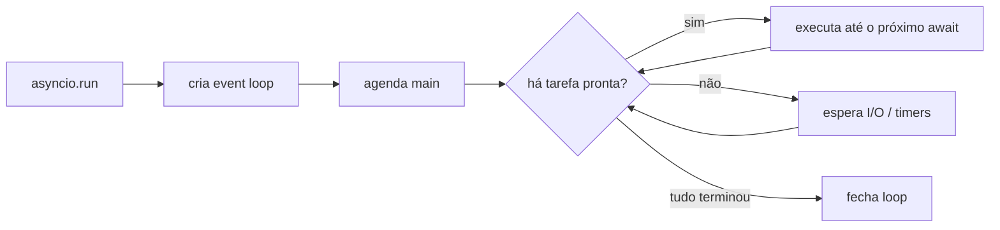

# ⚡ Asyncio e Programação Assíncrona

> [!note] Ideia central
> `asyncio` faz **concorrência cooperativa em uma única thread**: enquanto uma tarefa espera I/O (rede, disco, timer), outra executa. Ideal para **muito I/O** (milhares de conexões). **Não** acelera código que usa CPU: para isso veja [[08 - Avançado/03 - Multiprocessing|Multiprocessing]].

> [!tip] Analogia
> Um garçom (event loop) atende várias mesas (tarefas). Ele não fica parado esperando a cozinha: anota o pedido, vai à próxima mesa e volta quando o prato fica pronto.

## 1. Comparação de modelos

| Modelo | Paralelismo real? | Melhor para | Custo |
|---|---|---|---|
| Sequencial | ❌ | simples | – |
| `threading` | ❌ (GIL) para CPU; ✅ para I/O | I/O com libs bloqueantes | médio |
| `asyncio` | ❌ (1 thread) | I/O massivo | **baixo** |
| `multiprocessing` | ✅ | CPU | alto |

Ver [[06 - Módulos da Biblioteca Padrão Essenciais/06 - concurrent futures e threading|threading e concurrent.futures]].

## 2. `async def` e `await`

```python
import asyncio

async def saudar(nome: str, atraso: float) -> str:
    await asyncio.sleep(atraso)       # cede o controle ao loop
    return f"Oi, {nome}"

async def main():
    print(await saudar("Ana", 1))

asyncio.run(main())                   # ponto de entrada
```

- `async def` cria uma **corrotina** (chamá-la só devolve o objeto, não executa).
- `await` só funciona **dentro** de `async def`.

> [!warning] ❌ Esquecer o `await`
> ```python
> async def main():
>     saudar("Ana", 1)      # ❌ RuntimeWarning: coroutine was never awaited
>     await saudar("Ana", 1)  # ✅
> ```

## 3. Rodando coisas ao mesmo tempo

### ❌ Sequencial (demora 3 s)

```python
async def main():
    await asyncio.sleep(1)
    await asyncio.sleep(1)
    await asyncio.sleep(1)
```

### ✅ `TaskGroup` (3.11+, recomendado)

```python
import asyncio, time

async def tarefa(n):
    await asyncio.sleep(1)
    return n * n

async def main():
    t0 = time.perf_counter()
    async with asyncio.TaskGroup() as tg:
        tarefas = [tg.create_task(tarefa(i)) for i in range(3)]
    print([t.result() for t in tarefas])           # [0, 1, 4]
    print(f"{time.perf_counter() - t0:.1f}s")      # ~1.0s

asyncio.run(main())
```

`TaskGroup` cancela as irmãs se uma falhar e propaga um `ExceptionGroup` (trate com `except*`).

### `gather`

```python
resultados = await asyncio.gather(tarefa(1), tarefa(2), tarefa(3))
# return_exceptions=True devolve exceções como valores
```

| | `TaskGroup` | `gather` |
|---|---|---|
| Cancelamento em falha | ✅ automático | ❌ não cancela as outras |
| Escopo estruturado | ✅ | ❌ |
| Resultados em ordem | via tasks | ✅ lista |

## 4. Timeouts e cancelamento

```python
async def lenta():
    await asyncio.sleep(10)

async def main():
    try:
        async with asyncio.timeout(2):      # 3.11+
            await lenta()
    except TimeoutError:
        print("estourou o tempo")

    t = asyncio.create_task(lenta())
    t.cancel()
    try:
        await t
    except asyncio.CancelledError:
        print("cancelada")
```

> [!warning] Não engula `CancelledError`
> Se capturar, **re-levante** (`raise`). Senão o cancelamento/timeout para de funcionar.

## 5. O grande erro: bloquear o loop

```python
import time

async def ruim():
    time.sleep(3)              # ❌ congela TODAS as tarefas

async def bom():
    await asyncio.sleep(3)     # ✅

async def bom_com_codigo_bloqueante():
    await asyncio.to_thread(time.sleep, 3)     # ✅ roda em thread
```

| Bloqueante ❌ | Assíncrono ✅ |
|---|---|
| `time.sleep` | `asyncio.sleep` |
| `requests.get` | `httpx.AsyncClient`, `aiohttp` |
| `open().read()` grande | `asyncio.to_thread`, `aiofiles` |
| `sqlite3` | `aiosqlite` ou `to_thread` |

> [!tip] Modo debug
> `asyncio.run(main(), debug=True)` ou `PYTHONASYNCIODEBUG=1` avisa sobre chamadas lentas que travam o loop.

## 6. Sincronização e filas

```python
async def produtor(q: asyncio.Queue):
    for i in range(5):
        await q.put(i)
        await asyncio.sleep(0.1)
    await q.put(None)                 # sinal de fim

async def consumidor(q: asyncio.Queue):
    while (item := await q.get()) is not None:
        print("processando", item)

async def main():
    q = asyncio.Queue(maxsize=2)      # backpressure
    async with asyncio.TaskGroup() as tg:
        tg.create_task(produtor(q))
        tg.create_task(consumidor(q))
```

### Limitar concorrência com `Semaphore`

```python
sem = asyncio.Semaphore(5)

async def baixar(url):
    async with sem:                   # no máximo 5 simultâneas
        ...
```

Também: `Lock`, `Event`, `Condition`.

## 7. Iteradores e context managers assíncronos

```python
async def contador(n):
    for i in range(n):
        await asyncio.sleep(0.1)
        yield i                         # async generator

async def main():
    async for x in contador(3):
        print(x)
    print([x async for x in contador(3)])
```

Veja [[07 - Programação Funcional e Intermediário/05 - Context Managers Avançados|`async with`]] e [[07 - Programação Funcional e Intermediário/04 - Generators e Iterators|generators]].

## 8. Exemplo realista: downloads concorrentes

```python
import asyncio
import httpx   # pip install httpx

URLS = ["https://example.com", "https://python.org", "https://pypi.org"]

async def buscar(client: httpx.AsyncClient, url: str) -> tuple[str, int]:
    r = await client.get(url, timeout=10)
    return url, len(r.text)

async def main():
    async with httpx.AsyncClient() as client:
        async with asyncio.TaskGroup() as tg:
            tarefas = [tg.create_task(buscar(client, u)) for u in URLS]
    for t in tarefas:
        print(t.result())

asyncio.run(main())
```

## 9. Ciclo de vida



## 10. Pegadinhas

> [!warning] 1. `asyncio.run()` dentro de um loop rodando
> Em Jupyter, um loop já existe: use `await main()` direto na célula.

> [!warning] 2. Tarefas "esquecidas"
> `asyncio.create_task(x)` sem guardar referência pode ser coletada pelo GC. ✅ Guarde em variável/conjunto ou use `TaskGroup`.

> [!warning] 3. Código CPU-bound
> Um laço pesado trava o loop. ✅ `loop.run_in_executor(ProcessPoolExecutor(), ...)`.

> [!warning] 4. Misturar sync e async ("function coloring")
> Funções `async` só podem ser chamadas com `await`/`asyncio.run`. Planeje a fronteira.

## 11. Exercícios

> [!question] 1. Execute 3 corrotinas `sleep(1)` simultaneamente e confirme que levou ~1 s.

> [!success]- Solução
> ```python
> import asyncio, time
> async def main():
>     t = time.perf_counter()
>     await asyncio.gather(*(asyncio.sleep(1) for _ in range(3)))
>     print(round(time.perf_counter() - t, 1))
> asyncio.run(main())   # 1.0
> ```

> [!question] 2. Escreva `com_timeout(coro, s)` que devolve `None` ao estourar.

> [!success]- Solução
> ```python
> async def com_timeout(coro, s):
>     try:
>         async with asyncio.timeout(s):
>             return await coro
>     except TimeoutError:
>         return None
> ```

> [!question] 3. Processe 20 itens com no máximo 4 simultâneos.

> [!success]- Solução
> ```python
> async def trabalho(i, sem):
>     async with sem:
>         await asyncio.sleep(0.5)
>         return i
>
> async def main():
>     sem = asyncio.Semaphore(4)
>     res = await asyncio.gather(*(trabalho(i, sem) for i in range(20)))
>     print(res)
> asyncio.run(main())
> ```

---

⬅️ [[08 - Avançado/01 - Metaprogramação|Metaprogramação]] | ➡️ [[08 - Avançado/03 - Multiprocessing|Multiprocessing]]

#python #avancado #asyncio #concorrencia #async #await
