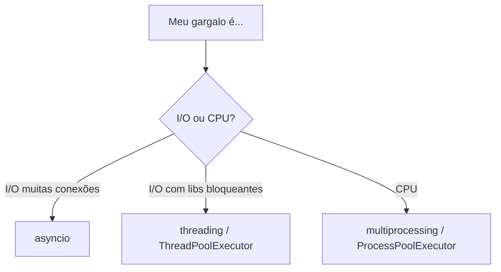

# 🧮 Multiprocessing: paralelismo de verdade

> [!note] Por quê?
> Por causa do [[08 - Avançado/04 - CPython Internals|GIL]], threads não executam bytecode Python em paralelo (no build padrão). Para usar **vários núcleos** em tarefas de **CPU**, use **processos**: cada um tem seu interpretador e sua memória.

## 1. Escolhendo a ferramenta



| | Threads | Processos |
|---|---|---|
| Memória | compartilhada | **isolada** |
| Criação | barata | cara |
| Comunicação | direta (cuidado: locks) | serialização (pickle) |
| Paralelismo CPU | ❌ (GIL) | ✅ |

## 2. `ProcessPoolExecutor` (o jeito moderno)

```python
from concurrent.futures import ProcessPoolExecutor
import time

def pesado(n: int) -> int:
    return sum(i * i for i in range(n))

if __name__ == "__main__":                      # OBRIGATÓRIO (Windows/macOS)
    entradas = [5_000_000] * 8

    t = time.perf_counter()
    seq = [pesado(n) for n in entradas]
    print(f"sequencial: {time.perf_counter() - t:.2f}s")

    t = time.perf_counter()
    with ProcessPoolExecutor() as ex:
        par = list(ex.map(pesado, entradas))
    print(f"paralelo:   {time.perf_counter() - t:.2f}s")
```

> [!warning] ❌ Sem `if __name__ == "__main__":`
> Em Windows/macOS (método *spawn*) cada processo filho **reimporta** o módulo; sem a guarda, você cria processos recursivamente e recebe `RuntimeError`.

## 3. `multiprocessing.Pool`

```python
from multiprocessing import Pool

def quadrado(x): return x * x

if __name__ == "__main__":
    with Pool(processes=4) as pool:
        print(pool.map(quadrado, range(10)))
        print(pool.starmap(pow, [(2, 3), (3, 2)]))
        for r in pool.imap_unordered(quadrado, range(5)):
            print(r)
```

## 4. `Process` e comunicação

```python
from multiprocessing import Process, Queue

def worker(q: Queue, n: int):
    q.put(n * 2)

if __name__ == "__main__":
    q = Queue()
    ps = [Process(target=worker, args=(q, i)) for i in range(4)]
    for p in ps: p.start()
    for p in ps: p.join()
    print(sorted(q.get() for _ in ps))   # [0, 2, 4, 6]
```

| Mecanismo | Uso |
|---|---|
| `Queue` / `Pipe` | trocar mensagens |
| `Value` / `Array` | memória compartilhada simples |
| `shared_memory.SharedMemory` | blocos grandes (NumPy) sem cópia |
| `Manager` | dict/list compartilhados (mais lento) |
| `Lock`, `Event`, `Semaphore` | sincronização |

## 5. Métodos de início

| Método | SO padrão | Característica |
|---|---|---|
| `spawn` | Windows, macOS | novo interpretador, seguro, mais lento |
| `fork` | (Linux ≤ 3.13) | copia o processo, rápido, **inseguro com threads** |
| `forkserver` | Linux 3.14+ | servidor dedicado, seguro |

```python
import multiprocessing as mp
mp.set_start_method("spawn")    # uma vez, no __main__
```

> [!note] Python 3.13/3.14
> Existe build experimental **free-threaded** (sem GIL, PEP 703), que torna threads viáveis para CPU. Verifique `sys._is_gil_enabled()`.

## 6. Pegadinhas

> [!warning] 1. Dados precisam ser "picklable"
> Lambdas, funções locais e conexões abertas **não** vão para outro processo.
> ```python
> ex.map(lambda x: x * 2, dados)   # ❌ PicklingError
> def dobro(x): return x * 2        # ✅ função de nível de módulo
> ```

> [!warning] 2. Overhead
> Para tarefas muito pequenas, criar processos e serializar dados **custa mais** que o ganho. Use `chunksize` em `map` e meça com [[08 - Avançado/05 - Performance e Profiling|timeit]].

> [!warning] 3. Estado global não é compartilhado
> Alterar uma variável global no filho **não** afeta o pai.

> [!warning] 4. Deadlock com `join()` antes de esvaziar a `Queue`
> Consuma os dados da fila antes de dar `join` nos produtores.

> [!warning] 5. Exceções
> Com `Executor`, exceções do filho voltam em `future.result()`. Com `Process` puro, ficam perdidas: prefira executors.

## 7. Receita: combinando asyncio e processos

```python
import asyncio
from concurrent.futures import ProcessPoolExecutor

def cpu(n): return sum(i * i for i in range(n))

async def main():
    loop = asyncio.get_running_loop()
    with ProcessPoolExecutor() as pool:
        r = await asyncio.gather(*(loop.run_in_executor(pool, cpu, 3_000_000) for _ in range(4)))
    print(r)

if __name__ == "__main__":
    asyncio.run(main())
```

## 8. Exercícios

> [!question] 1. Conte primos até 200 000 em 4 pedaços usando `ProcessPoolExecutor`.

> [!success]- Solução
> ```python
> from concurrent.futures import ProcessPoolExecutor
>
> def e_primo(n):
>     return n > 1 and all(n % d for d in range(2, int(n**0.5) + 1))
>
> def contar(faixa):
>     a, b = faixa
>     return sum(e_primo(n) for n in range(a, b))
>
> if __name__ == "__main__":
>     faixas = [(i, i + 50_000) for i in range(0, 200_000, 50_000)]
>     with ProcessPoolExecutor(4) as ex:
>         print(sum(ex.map(contar, faixas)))
> ```

> [!question] 2. Por que `lambda` falha no `Pool.map`?

> [!success]- Resposta
> O argumento é serializado com `pickle`, que referencia funções **por nome**; lambdas não têm nome importável.

---

⬅️ [[08 - Avançado/02 - Asyncio|Asyncio]] | ➡️ [[08 - Avançado/04 - CPython Internals|CPython Internals]]

#python #avancado #multiprocessing #paralelismo #cpu-bound
