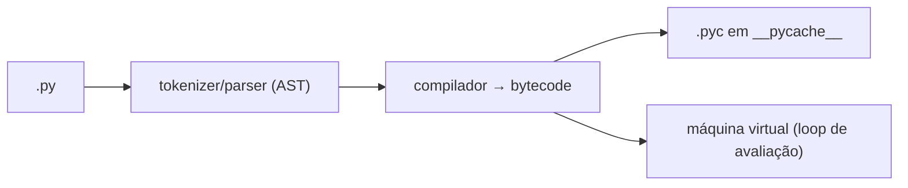
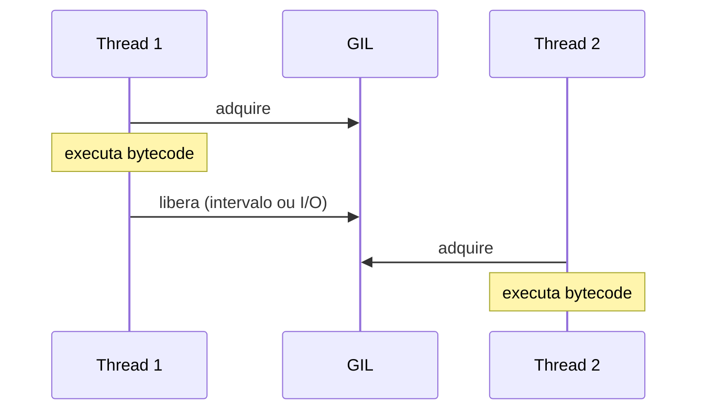

# 🔬 CPython Internals: GIL, memória e bytecode

> [!note] CPython
> "Python" é a linguagem; **CPython** é a implementação oficial, escrita em C. Existem outras: PyPy (JIT), Jython, MicroPython. Aqui falamos de CPython.

## 1. Do código à execução



### Vendo o bytecode

```python
import dis

def soma(a, b):
    return a + b

dis.dis(soma)
```

```text
  RESUME          0
  LOAD_FAST       0 (a)
  LOAD_FAST       1 (b)
  BINARY_OP       0 (+)
  RETURN_VALUE
```

> [!tip] Explore
> `python -m dis script.py`, `ast.dump(ast.parse("x = 1 + 2"), indent=2)`. As instruções mudam entre versões: **não dependa delas**.

Desde o 3.11 o interpretador é **adaptativo/especializado** (instruções como `BINARY_OP_ADD_INT`), e o 3.13 traz um JIT experimental (opt-in).

## 2. Tudo é `PyObject`

Cada objeto tem **contagem de referências** e **tipo**:

```python
import sys

a = []
print(sys.getrefcount(a))   # ≥ 2 (a variável + argumento da chamada)
b = a
print(sys.getrefcount(a))   # +1
```

| Tipo | Tamanho aprox. |
|---|---|
| `int` pequeno | 28 bytes |
| `str` vazia | 49 bytes |
| `list` vazia | 56 bytes |
| `dict` vazio | 64 bytes |

```python
print(sys.getsizeof(0), sys.getsizeof(""), sys.getsizeof([]))
```

> [!warning] `getsizeof` é raso
> Não soma os objetos contidos. Para medir de verdade: `tracemalloc` ou `pympler`.

## 3. Gerenciamento de memória

1. **Contagem de referências**: quando chega a 0, o objeto é liberado imediatamente.
2. **Coletor de lixo cíclico** (`gc`): resolve ciclos, onde refcount nunca chega a zero.
3. **Alocador `pymalloc`**: arenas/pools para objetos pequenos (≤ 512 bytes).

```python
import gc

class No:
    def __init__(self):
        self.outro = None

a, b = No(), No()
a.outro, b.outro = b, a      # ciclo
del a, b                      # refcount não zera!
print(gc.collect())           # coletor encontra e libera
```

```python
gc.get_threshold()   # (700, 10, 10)  — gerações 0, 1, 2
gc.disable()         # raramente recomendado
```

### Referências fracas

```python
import weakref

class Grande: ...
g = Grande()
r = weakref.ref(g)
print(r() is g)    # True
del g
print(r())         # None — não manteve vivo
```

Úteis para caches e observers sem vazamento. Veja [[04 - Programação Orientada a Objetos/06 - Design Patterns Básicos|Observer]].

## 4. Interning e identidade

```python
a = 256; b = 256
print(a is b)       # True (inteiros pequenos -5..256 são cacheados)
a = 1000; b = 1000
# a is b → pode ser True ou False, depende do contexto

import sys
x = sys.intern("texto longo e repetido")
```

> [!warning] ❌ Use `==` para valores, `is` só para `None`/singletons
> ```python
> if x is 1000: ...   # ❌ SyntaxWarning, comportamento indefinido
> if x == 1000: ...   # ✅
> ```

## 5. O GIL (Global Interpreter Lock)

> [!note] Definição
> Um *mutex* que permite que **apenas uma thread** execute bytecode Python por vez, protegendo estruturas internas (como contagem de referências) de corridas.



| Cenário | Efeito do GIL |
|---|---|
| Threads em **I/O** | ✅ GIL é liberado enquanto espera: threads ajudam |
| Threads em **CPU puro** | ❌ sem ganho (pode até piorar) |
| Extensões C (NumPy) | ✅ muitas liberam o GIL |
| Processos | ✅ cada um tem seu GIL |

```python
import threading, time

def contar(n):
    while n: n -= 1

N = 30_000_000
t = time.perf_counter(); contar(N); contar(N)
print("sequencial", time.perf_counter() - t)

t = time.perf_counter()
ts = [threading.Thread(target=contar, args=(N,)) for _ in range(2)]
[x.start() for x in ts]; [x.join() for x in ts]
print("2 threads ", time.perf_counter() - t)    # ≈ igual ou pior
```

> [!note] O futuro
> PEP 703: build **free-threaded** (`python3.13t`) remove o GIL; opcional e experimental, com ecossistema ainda em adaptação. Cheque com `sys._is_gil_enabled()` (3.13+).

### "Operações atômicas" ≠ thread-safe

```python
contador = 0
def inc():
    global contador
    for _ in range(100_000):
        contador += 1      # ❌ LOAD, ADD, STORE: não é atômico
```

✅ Use `threading.Lock` ou `queue.Queue`.

## 6. Mais curiosidades úteis

| Tópico | Explicação |
|---|---|
| `__pycache__` | bytecode cacheado; invalidado por timestamp/hash |
| *Frames* | cada chamada cria um frame; `sys._getframe()`, `inspect.stack()` |
| Recursão | limite padrão ~1000: `sys.getrecursionlimit()` |
| Strings | imutáveis, UTF-8 interno compacto (PEP 393) |
| Dict | ordenado por inserção; tabela hash compacta |
| Lista | array dinâmico de ponteiros, `append` amortizado O(1) |

```python
import sys
l = []
tam = set()
for i in range(50):
    l.append(i)
    tam.add(sys.getsizeof(l))
print(sorted(tam))     # tamanhos crescem em degraus (over-allocation)
```

## 7. `tracemalloc`: achando vazamentos

```python
import tracemalloc

tracemalloc.start()
dados = [str(i) * 10 for i in range(100_000)]
atual, pico = tracemalloc.get_traced_memory()
print(f"{atual/1e6:.1f} MB (pico {pico/1e6:.1f} MB)")
for stat in tracemalloc.take_snapshot().statistics("lineno")[:3]:
    print(stat)
```

## 8. Exercícios

> [!question] 1. Use `dis` para comparar `x = [i for i in range(3)]` e `x = list(range(3))`. Qual gera menos instruções?

> [!success]- Dica
> No 3.12 a comprehension é *inlined* (PEP 709), não cria função extra. Compare e veja `LOAD_FAST_AND_CLEAR`.

> [!question] 2. Crie um ciclo de referências, desligue o `gc`, observe com `weakref` que o objeto sobrevive, depois `gc.collect()`.

> [!success]- Solução
> ```python
> import gc, weakref
> gc.disable()
> class N: pass
> a, b = N(), N(); a.o, b.o = b, a
> r = weakref.ref(a)
> del a, b
> print(r() is not None)   # True: sobreviveu
> gc.collect()
> print(r())               # None
> gc.enable()
> ```

> [!question] 3. Por que `contador += 1` com várias threads pode perder incrementos?

> [!success]- Resposta
> Porque são várias instruções de bytecode (carregar, somar, armazenar); a troca de thread pode ocorrer entre elas, causando *race condition*.

---

⬅️ [[08 - Avançado/03 - Multiprocessing|Multiprocessing]] | ➡️ [[08 - Avançado/05 - Performance e Profiling|Performance e Profiling]]

#python #avancado #cpython #gil #memoria #bytecode #gc
