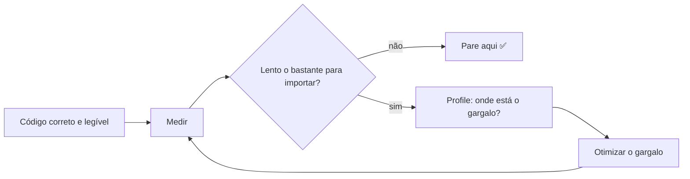

# 🚀 Performance e Profiling

> [!warning] Regra de ouro
> *"Otimização prematura é a raiz de todo mal."* (Knuth). O ciclo correto é:
> **medir → achar o gargalo → otimizar → medir de novo.** Nunca otimize por intuição.



## 1. `timeit`: microbenchmarks

```python
import timeit

print(timeit.timeit("sum(range(1000))", number=10_000))

# Comparando duas abordagens
a = timeit.timeit("[x*2 for x in range(1000)]", number=5_000)
b = timeit.timeit("list(map(lambda x: x*2, range(1000)))", number=5_000)
print(f"comprehension: {a:.3f}s | map+lambda: {b:.3f}s")
```

Na linha de comando (escolhe `number` automaticamente):

```bash
python -m timeit -s "d = dict.fromkeys(range(1000))" "999 in d"
python -m timeit -r 5 "'-'.join(str(i) for i in range(100))"
```

No Jupyter/IPython: `%timeit expr`.

> [!tip] `repeat` e `min`
> Use `min(timeit.repeat(...))`: o menor tempo é o menos afetado por ruído do sistema.

> [!warning] ❌ `time.time()` para medir
> Use `time.perf_counter()` (alta resolução, monotônico).

## 2. `cProfile`: onde o tempo é gasto

```python
import cProfile, pstats

def f():
    return sum(i * i for i in range(200_000))

def g():
    return [str(i) for i in range(200_000)]

def main():
    f(); g()

with cProfile.Profile() as pr:
    main()

pstats.Stats(pr).sort_stats("cumulative").print_stats(8)
```

Ou pela CLI:

```bash
python -m cProfile -o saida.prof meu_script.py
python -m pstats saida.prof
```

| Coluna | Significado |
|---|---|
| `ncalls` | nº de chamadas |
| `tottime` | tempo **dentro** da função (sem sub-chamadas) |
| `cumtime` | tempo **total** (com sub-chamadas) |
| `percall` | média por chamada |

> [!tip] Visualização
> `pip install snakeviz` → `snakeviz saida.prof` abre um gráfico interativo. Outras: `py-spy` (amostragem sem alterar o código), `scalene`, `line_profiler` (linha a linha).

## 3. Memória

```python
import tracemalloc
tracemalloc.start()
...
print(tracemalloc.get_traced_memory())
```

`memory_profiler` (`@profile` + `mprof run`) mostra consumo linha a linha.

## 4. Algoritmo > micro-otimização

| Operação | Lista | Set/Dict |
|---|---|---|
| `x in coll` | O(n) | **O(1)** |
| inserir no fim | O(1) | O(1) |
| inserir no início | O(n) | – |

```python
import timeit
setup = "l = list(range(100_000)); s = set(l)"
print(timeit.timeit("99_999 in l", setup, number=1000))   # lento
print(timeit.timeit("99_999 in s", setup, number=1000))   # ~instantâneo
```

> [!tip] `collections.deque` para filas (inserir/remover nas pontas O(1)); `bisect` para busca em listas ordenadas.

## 5. Idiomas rápidos em Python

### ❌ Concatenar strings em laço → ✅ `join`

```python
# ❌ O(n²) no pior caso
s = ""
for p in partes:
    s += p

# ✅
s = "".join(partes)
```

### ❌ Variável global/atributo repetido → ✅ variável local

```python
# ✅ cache de método em variável local em laços quentes
append = resultado.append
for x in dados:
    append(x * 2)
```

### Comprehension > `append` em laço
### Geradores para economizar memória ([[07 - Programação Funcional e Intermediário/04 - Generators e Iterators|Generators]])
### `functools.cache` / `lru_cache`

```python
from functools import cache

@cache
def fib(n: int) -> int:
    return n if n < 2 else fib(n - 1) + fib(n - 2)

print(fib(200))     # instantâneo; sem cache seria inviável
```

### `__slots__` e `dataclass(slots=True)` para muitos objetos ([[04 - Programação Orientada a Objetos/05 - Dataclasses e Slots|Slots]])

## 6. Quando Python puro não basta

| Estratégia | Ganho típico | Observação |
|---|---|---|
| **NumPy / pandas** (vetorização) | 10–100× | tire laços Python |
| **multiprocessing** | ~N núcleos | [[08 - Avançado/03 - Multiprocessing\|Multiprocessing]] |
| **asyncio** | para I/O | [[08 - Avançado/02 - Asyncio\|Asyncio]] |
| **Numba** (JIT) | 10–100× em laços numéricos | `@njit` |
| **Cython / Rust (PyO3) / C** | 10–1000× | extensões nativas |
| **PyPy** | 2–10× | JIT geral, compat. parcial |

```python
# Vetorização
import numpy as np
a = np.arange(1_000_000)
print((a * 2).sum())     # muito mais rápido que laço
```

## 7. Pegadinhas

> [!warning] 1. Medir só uma vez
> Variações de cache, CPU e SO. Repita e use o mínimo/mediana.

> [!warning] 2. Profiling em modo debug/IDE
> Distorce resultados. Rode no terminal.

> [!warning] 3. Otimizar o que não é gargalo
> Se a função representa 1% do tempo, torná-la 10× mais rápida ganha 0,9%.

> [!warning] 4. `lru_cache` em métodos
> Mantém referência a `self` (vazamento). Prefira cache no nível do módulo ou `cached_property`.

> [!warning] 5. Resultado de cache mutável
> `@cache` devolve o **mesmo objeto**; se for uma lista e você a modificar, o cache é corrompido.

## 8. Exercícios

> [!question] 1. Compare `x in lista` vs `x in set` com 1 milhão de elementos usando `timeit`.

> [!success]- Dica
> Veja a seção 4; construa `set` fora da medição (`setup`) e some o custo de criar o set quando comparar cenários de uma única consulta.

> [!question] 2. Perfile uma função com recursão ingênua de Fibonacci e depois com `@cache`. Compare `ncalls`.

> [!success]- Solução
> ```python
> import cProfile
> from functools import cache
>
> def fib(n): return n if n < 2 else fib(n-1) + fib(n-2)
> @cache
> def fibc(n): return n if n < 2 else fibc(n-1) + fibc(n-2)
>
> cProfile.run("fib(25)")    # ~250 mil chamadas
> cProfile.run("fibc(25)")   # ~51 chamadas
> ```

> [!question] 3. Reescreva `s += x` em laço usando `join` e meça a diferença com 200 000 pedaços.

> [!success]- Solução
> ```python
> import timeit
> partes = ["ab"] * 200_000
> def a():
>     s = ""
>     for p in partes: s += p
>     return s
> def b(): return "".join(partes)
> print(timeit.timeit(a, number=5), timeit.timeit(b, number=5))
> ```

---

⬅️ [[08 - Avançado/04 - CPython Internals|CPython Internals]] | ➡️ [[08 - Avançado/06 - Testes com unittest e pytest|Testes com unittest e pytest]]

#python #avancado #performance #profiling #cprofile #timeit
