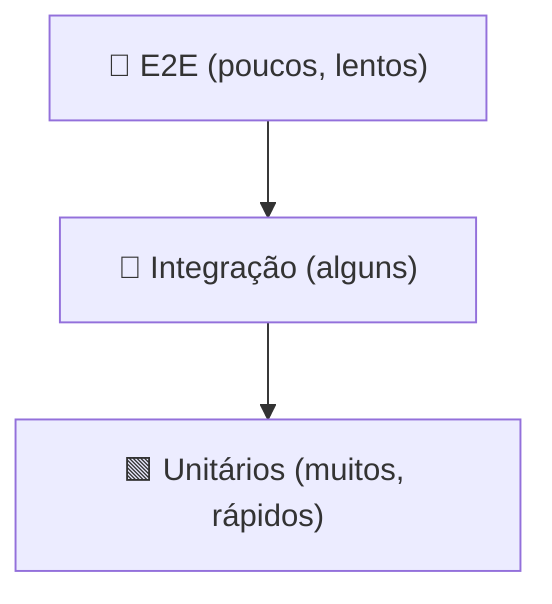
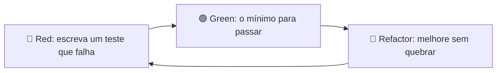

# ✅ Testes: `unittest` e `pytest`

> [!note] Por que testar?
> Testes são a **rede de segurança** que permite refatorar sem medo, documentam o comportamento esperado e pegam regressões cedo.



## 1. Código de exemplo

```python
# calculadora.py
def dividir(a: float, b: float) -> float:
    if b == 0:
        raise ZeroDivisionError("divisor não pode ser zero")
    return a / b

def eh_palindromo(s: str) -> bool:
    t = "".join(c.lower() for c in s if c.isalnum())
    return t == t[::-1]
```

## 2. `unittest` (biblioteca padrão)

```python
# test_calculadora_unittest.py
import unittest
from calculadora import dividir, eh_palindromo

class TestCalculadora(unittest.TestCase):
    def setUp(self):                   # antes de cada teste
        self.valores = (10, 2)

    def test_dividir(self):
        self.assertEqual(dividir(*self.valores), 5)

    def test_dividir_por_zero(self):
        with self.assertRaises(ZeroDivisionError):
            dividir(1, 0)

    def test_palindromo(self):
        self.assertTrue(eh_palindromo("Socorram-me, subi no ônibus em Marrocos"))
        self.assertFalse(eh_palindromo("python"))

    def test_aproximado(self):
        self.assertAlmostEqual(dividir(1, 3), 0.3333, places=4)

if __name__ == "__main__":
    unittest.main()
```

```bash
python -m unittest -v
python -m unittest discover -s tests
```

| Asserção | Verifica |
|---|---|
| `assertEqual(a, b)` | `a == b` |
| `assertTrue/False(x)` | verdade |
| `assertIs / assertIsNone` | identidade |
| `assertIn(a, b)` | `a in b` |
| `assertRaises(Exc)` | levanta exceção |
| `assertAlmostEqual` | floats |
| `subTest(...)` | parametrização simples |

## 3. `pytest` (o padrão da comunidade)

```bash
pip install pytest pytest-cov
```

```python
# test_calculadora.py
import pytest
from calculadora import dividir, eh_palindromo

def test_dividir():
    assert dividir(10, 2) == 5          # assert simples!

def test_dividir_por_zero():
    with pytest.raises(ZeroDivisionError, match="zero"):
        dividir(1, 0)

@pytest.mark.parametrize("texto, esperado", [
    ("arara", True),
    ("A man, a plan, a canal: Panama", True),
    ("python", False),
    ("", True),
])
def test_palindromo(texto, esperado):
    assert eh_palindromo(texto) is esperado

def test_float():
    assert dividir(1, 3) == pytest.approx(0.3333, rel=1e-3)
```

```bash
pytest                 # descobre test_*.py
pytest -v -x           # verboso, para no 1º erro
pytest -k palindromo   # filtra por nome
pytest --cov=. --cov-report=term-missing
pytest --lf            # só os que falharam da última vez
```

> [!tip] Relatórios de falha
> Quando um `assert` falha, o pytest mostra o valor de cada parte da expressão. Sem precisar de `assertEqual`.

### Comparação

| | unittest | pytest |
|---|---|---|
| Instalação | embutido | `pip install` |
| Estilo | classes + `self.assertX` | funções + `assert` |
| Parametrização | `subTest` | `@parametrize` |
| Fixtures | `setUp/tearDown` | `@pytest.fixture` (flexível) |
| Plugins | poucos | centenas |
| Roda testes unittest? | – | ✅ sim |

## 4. Fixtures

```python
import pytest
from pathlib import Path

@pytest.fixture
def arquivo(tmp_path: Path) -> Path:            # tmp_path é nativa
    p = tmp_path / "dados.txt"
    p.write_text("a\nb\nc\n", encoding="utf-8")
    return p

def test_linhas(arquivo):
    assert len(arquivo.read_text().splitlines()) == 3

@pytest.fixture
def conexao():
    c = abrir_conexao()
    yield c                  # entrega ao teste
    c.close()                # teardown, sempre roda
```

Escopos: `function` (padrão), `class`, `module`, `session`. Fixtures compartilhadas ficam em `conftest.py`.

Fixtures nativas úteis: `tmp_path`, `capsys` (captura print), `monkeypatch`, `caplog`.

```python
def test_print(capsys):
    print("oi")
    assert capsys.readouterr().out == "oi\n"

def test_env(monkeypatch):
    monkeypatch.setenv("MODO", "teste")
    ...
```

## 5. Mocks: isolar dependências

```python
from unittest.mock import Mock, patch

# servico.py
import requests
def cotacao(moeda):
    return requests.get(f"https://api.exemplo.com/{moeda}").json()["valor"]

# test_servico.py
@patch("servico.requests.get")
def test_cotacao(mock_get):
    mock_get.return_value.json.return_value = {"valor": 5.2}
    assert cotacao("USD") == 5.2
    mock_get.assert_called_once_with("https://api.exemplo.com/USD")
```

> [!warning] ❌ Patch no lugar errado
> Faça o patch onde o nome é **usado** (`servico.requests`), não onde foi definido.

> [!warning] Cuidado com excesso de mocks
> Testes que só verificam mocks quebram a cada refatoração e não provam nada. Prefira *fakes* simples e testes de comportamento.

## 6. Organização de projeto

```text
meu_projeto/
├── pyproject.toml
├── src/
│   └── meu_pacote/
│       ├── __init__.py
│       └── calculadora.py
└── tests/
    ├── conftest.py
    └── test_calculadora.py
```

```toml
[tool.pytest.ini_options]
testpaths = ["tests"]
addopts = "-ra -q"
```

Ver [[08 - Avançado/07 - Packaging e Distribuição|Packaging]].

## 7. Marcadores e skips

```python
import sys, pytest

@pytest.mark.skipif(sys.platform == "win32", reason="só Unix")
def test_unix(): ...

@pytest.mark.xfail(reason="bug conhecido #123")
def test_bug(): ...

@pytest.mark.slow
def test_lento(): ...        # pytest -m "not slow"
```

## 8. Testando código assíncrono

```bash
pip install pytest-asyncio
```

```python
import pytest, asyncio

@pytest.mark.asyncio
async def test_async():
    await asyncio.sleep(0)
    assert True
```

Veja [[08 - Avançado/02 - Asyncio|Asyncio]].

## 9. TDD em 3 passos



## 10. Cobertura

```bash
pytest --cov=meu_pacote --cov-report=html
```

> [!warning] 100% de cobertura ≠ sem bugs
> Cobertura mostra o que **executou**, não o que foi **verificado**. Foque em casos de borda: vazio, zero, negativos, `None`, tipos errados.

## 11. Pegadinhas

> [!warning] 1. Testes dependentes de ordem/estado global
> Cada teste deve ser independente. Use fixtures.

> [!warning] 2. Testes com tempo/aleatório/rede
> Fixe o tempo, a semente (`random.seed`) ou faça mock.

> [!warning] 3. `assert (cond, "msg")`
> ```python
> assert (x > 0, "x deve ser positivo")   # ❌ tupla é sempre verdadeira
> assert x > 0, "x deve ser positivo"      # ✅
> ```

> [!warning] 4. Nome do arquivo/função
> pytest só coleta `test_*.py`/`*_test.py` e funções `test_*`.

## 12. Exercícios

> [!question] 1. Escreva testes parametrizados para `fatorial(n)` incluindo `0`, `1`, `5` e `-1` (que deve levantar `ValueError`).

> [!success]- Solução
> ```python
> import math, pytest
>
> def fatorial(n):
>     if n < 0:
>         raise ValueError("n deve ser >= 0")
>     return math.prod(range(1, n + 1))
>
> @pytest.mark.parametrize("n, esperado", [(0, 1), (1, 1), (5, 120)])
> def test_fatorial(n, esperado):
>     assert fatorial(n) == esperado
>
> def test_fatorial_negativo():
>     with pytest.raises(ValueError):
>         fatorial(-1)
> ```

> [!question] 2. Crie uma fixture que fornece um `dict` de carrinho de compras e teste a função `total(carrinho)`.

> [!success]- Solução
> ```python
> import pytest
>
> def total(carrinho): return sum(p * q for p, q in carrinho.values())
>
> @pytest.fixture
> def carrinho():
>     return {"cafe": (10.0, 2), "pao": (1.5, 4)}
>
> def test_total(carrinho):
>     assert total(carrinho) == pytest.approx(26.0)
> ```

> [!question] 3. Teste uma função que lê um arquivo usando `tmp_path` e `monkeypatch`/`mock`.

> [!success]- Dica
> Escreva o arquivo em `tmp_path`, passe o caminho à função e verifique o retorno. Nada de tocar no disco real.

---

⬅️ [[08 - Avançado/05 - Performance e Profiling|Performance e Profiling]] | ➡️ [[08 - Avançado/07 - Packaging e Distribuição|Packaging e Distribuição]]

#python #avancado #testes #unittest #pytest #tdd #mock
