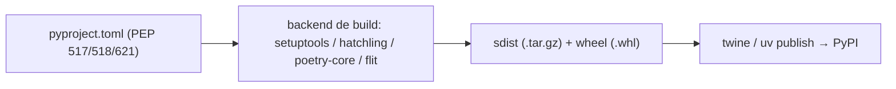

# 📦 Packaging e Distribuição

> [!note] Objetivo
> Transformar seu código em um **pacote instalável** (`pip install meu-pacote`), com versão, dependências e metadados, e publicá-lo no **PyPI** (ou num índice privado).

Pré-requisitos: [[03 - Funções e Modularização/04 - Módulos e Packages|Módulos e Packages]] e [[03 - Funções e Modularização/05 - Virtual Environments e pip|venv e pip]].

## 1. O cenário moderno



> [!warning] ❌ `setup.py` direto e `python setup.py install`
> São legados. ✅ Hoje a **fonte da verdade é o `pyproject.toml`** e você instala com `pip install .` e constrói com `python -m build`.

## 2. Layout recomendado (*src layout*)

```text
meu-pacote/
├── pyproject.toml
├── README.md
├── LICENSE
├── src/
│   └── meu_pacote/
│       ├── __init__.py
│       ├── core.py
│       └── py.typed          # marca o pacote como tipado
└── tests/
    └── test_core.py
```

> [!tip] Por que `src/`?
> Evita importar acidentalmente a pasta local em vez do pacote instalado, o que esconde erros de empacotamento.

## 3. `pyproject.toml` com setuptools

```toml
[build-system]
requires = ["setuptools>=68", "wheel"]
build-backend = "setuptools.build_meta"

[project]
name = "meu-pacote"
version = "0.1.0"
description = "Exemplo de pacote Python"
readme = "README.md"
requires-python = ">=3.12"
license = { text = "MIT" }
authors = [{ name = "Seu Nome", email = "voce@exemplo.com" }]
keywords = ["exemplo", "tutorial"]
classifiers = [
    "Programming Language :: Python :: 3.12",
    "License :: OSI Approved :: MIT License",
]
dependencies = [
    "httpx>=0.27",
    "rich>=13",
]

[project.optional-dependencies]
dev = ["pytest>=8", "mypy", "ruff", "build", "twine"]

[project.scripts]
meu-cli = "meu_pacote.cli:main"      # cria o comando `meu-cli`

[project.urls]
Homepage = "https://github.com/voce/meu-pacote"

[tool.setuptools.packages.find]
where = ["src"]
```

```python
# src/meu_pacote/cli.py
def main() -> None:
    print("Olá do meu-cli!")
```

## 4. Fluxo de trabalho

```bash
python -m venv .venv && source .venv/bin/activate   # Windows: .venv\Scripts\activate
pip install -e ".[dev]"      # instalação editável: mudanças refletem na hora
pytest                       # testes
python -m build              # gera dist/*.whl e dist/*.tar.gz
twine check dist/*           # valida metadados
twine upload --repository testpypi dist/*   # ensaio no TestPyPI
twine upload dist/*          # publicação real
```

> [!warning] Versões são imutáveis no PyPI
> Você **não** pode reenviar a mesma versão. Teste no **TestPyPI** primeiro e incremente a versão a cada publicação.

## 5. Versionamento

**SemVer**: `MAJOR.MINOR.PATCH`

| Mudança | Incrementa |
|---|---|
| quebra compatibilidade | MAJOR |
| nova funcionalidade compatível | MINOR |
| correção de bug | PATCH |

Pré-releases: `1.0.0a1`, `1.0.0rc1` (PEP 440). Para derivar a versão do git: `setuptools-scm`.

## 6. Especificadores de dependência

| Especificador | Significado |
|---|---|
| `requests>=2.31` | no mínimo |
| `requests~=2.31` | compatível: `>=2.31, <3.0` |
| `requests==2.31.0` | exata (evite em bibliotecas) |
| `requests>=2,<3` | faixa |
| `pkg; python_version<"3.12"` | marcador de ambiente |

> [!tip] Bibliotecas vs. aplicações
> **Biblioteca**: faixas amplas (não trave o usuário). **Aplicação**: fixe versões com *lock file* (reprodutibilidade).

## 7. Poetry

Gerenciador completo (dependências + lock + build + publish).

```bash
pipx install poetry
poetry new meu-app --src
cd meu-app
poetry add httpx
poetry add --group dev pytest ruff
poetry install
poetry run pytest
poetry build
poetry publish
```

```toml
[project]
name = "meu-app"
version = "0.1.0"
requires-python = ">=3.12"
dependencies = ["httpx>=0.27"]

[build-system]
requires = ["poetry-core>=2.0"]
build-backend = "poetry.core.masonry.api"
```

> [!note] Poetry 2.x
> Passou a suportar a tabela padrão `[project]` (PEP 621). Versões 1.x usavam `[tool.poetry]`.

## 8. Comparação de ferramentas

| Ferramenta | Pontos fortes | Observação |
|---|---|---|
| **pip + venv** | simples, universal | sem lock nativo |
| **setuptools** | maduro, flexível | só *build*; resto manual |
| **Poetry** | lock, grupos, publish | CLI própria |
| **uv** (Astral) | **muito rápido**, venv+deps+lock+build+publish | cada vez mais adotado |
| **Hatch / Flit / PDM** | alternativas modernas | |

```bash
# exemplo com uv
uv init meu-app
uv add httpx
uv run pytest
uv build
```

## 9. Qualidade e automação

```toml
[tool.ruff]
line-length = 100
target-version = "py312"

[tool.ruff.lint]
select = ["E", "F", "I", "UP", "B"]

[tool.mypy]
strict = true
python_version = "3.12"

[tool.pytest.ini_options]
testpaths = ["tests"]
```

- **ruff**: lint + formatação.
- **mypy/pyright**: tipos ([[07 - Programação Funcional e Intermediário/06 - Type Hints e typing|Type Hints]]).
- **pre-commit**: roda tudo antes de cada commit.
- **GitHub Actions**: CI com matriz de versões e *Trusted Publishing* no PyPI (sem tokens).

## 10. Outras formas de distribuir

| Forma | Quando |
|---|---|
| Wheel no PyPI | bibliotecas e CLIs |
| `pipx install` | aplicações de linha de comando isoladas |
| **PyInstaller / Nuitka** | executável para usuário final |
| **Docker** | aplicações de servidor |
| `zipapp` (`python -m zipapp`) | arquivo `.pyz` executável |

## 11. Pegadinhas

> [!warning] 1. Esquecer `__init__.py` ou `packages.find`
> O pacote constrói "vazio". Confira com `unzip -l dist/*.whl`.

> [!warning] 2. Nome do pacote ≠ nome do import
> `pip install scikit-learn` → `import sklearn`. Em `pyproject`, hífens; no código, underscores.

> [!warning] 3. Dependências com versão fixa em bibliotecas
> Gera conflitos no ambiente de quem instala.

> [!warning] 4. Arquivos de dados não incluídos
> Use `[tool.setuptools.package-data]` ou `include-package-data`.

> [!warning] 5. Commitar tokens do PyPI
> Use *Trusted Publishing* ou segredos do CI.

## 12. Exercícios

> [!question] 1. Empacote um pacote `saudacao` com a função `ola(nome)` e um comando `ola-cli`; instale em modo editável e rode o comando.

> [!success]- Solução
> ```toml
> [build-system]
> requires = ["setuptools>=68"]
> build-backend = "setuptools.build_meta"
>
> [project]
> name = "saudacao"
> version = "0.1.0"
> requires-python = ">=3.12"
>
> [project.scripts]
> ola-cli = "saudacao.cli:main"
>
> [tool.setuptools.packages.find]
> where = ["src"]
> ```
> ```python
> # src/saudacao/cli.py
> import sys
> def main():
>     print(f"Olá, {sys.argv[1] if len(sys.argv) > 1 else 'mundo'}!")
> ```
> ```bash
> pip install -e . && ola-cli Ana
> ```

> [!question] 2. Gere o wheel e liste seu conteúdo para verificar se todos os módulos entraram.

> [!success]- Solução
> ```bash
> python -m build
> python -m zipfile -l dist/*.whl
> ```

---

⬅️ [[08 - Avançado/06 - Testes com unittest e pytest|Testes]] | ➡️ [[08 - Avançado/08 - Design Patterns Avançados e Clean Code|Design Patterns Avançados e Clean Code]]

#python #avancado #packaging #pyproject #setuptools #poetry #pypi
